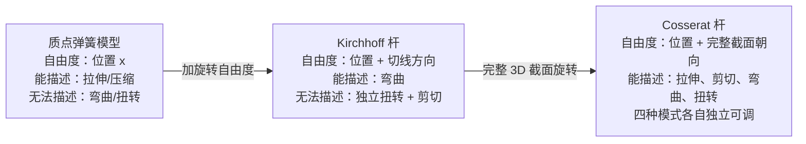
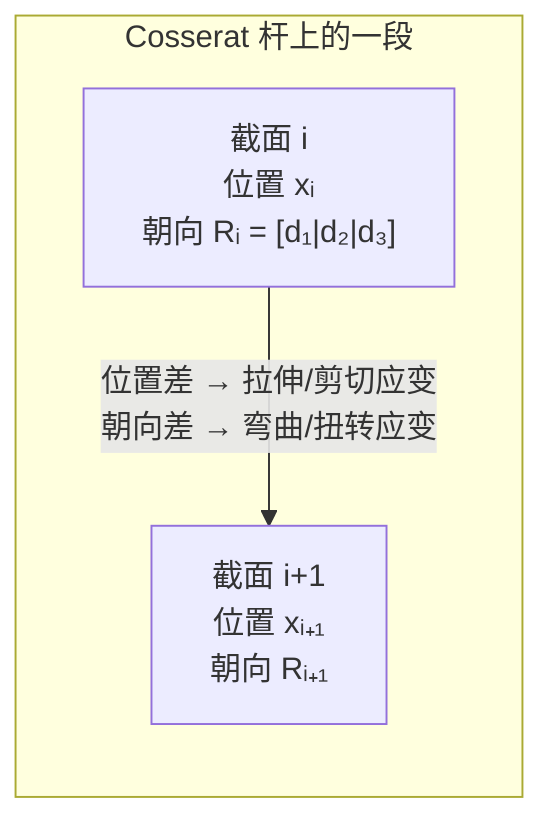

# Cosserat 杆：带截面朝向的弹性杆模型

> **前置知识**：向量与旋转矩阵基础，弹性势能的概念（知道"形变储存弹性能"即可）。
> 本文是
> [Cosserat 杆断裂与 MPM 流固耦合综述](/论文综述/S34_Cosserat_MPM_DEM_断裂流固耦合综述)
> 的前置知识。

---

## 相关阅读

- [质点弹簧模型与绳索仿真基础](/前置知识/006e_前置知识_质点弹簧模型与绳索仿真基础) ——
  本文对比的最简单一维杆模型，只有拉伸没有弯曲扭转。
- [旋转矩阵与 SO(3) 指数映射](/前置知识/008a_前置知识_螺旋理论Twist与SE3指数映射) ——
  director frame 更新的李群运算基础。
- [局部-全局求解框架与 Projective Dynamics](/前置知识/006l_前置知识_局部全局求解框架与Projective_Dynamics) ——
  用 Cosserat 能量构建的快速求解框架。
- [DEM 离散元法基础](/前置知识/013d_前置知识_DEM离散元法) ——
  把 Cosserat 能量接到颗粒键上的材料表示方式。

---

## 普通弹簧描述不了的变形：弯曲和扭转

把一根细杆（金属丝、头发、绳索）压缩、拉伸——弹簧模型够用。但把它折弯或拧转，弹簧模型就失效了：它只记录两端点的距离，完全无法感知截面是否旋转了。

这不是工程细节，而是物理上的根本缺失。弯曲和扭转是**力矩驱动的变形**，要表示力矩就必须知道截面的朝向。Cosserat 杆在经典弹性杆的基础上补上了这一项：给杆上每一个截面附加一个旋转自由度，记录截面此刻朝向哪里。

> 三种模型从左到右能描述的变形模式越来越多。Cosserat 杆是唯一同时覆盖全部四种模式的一维杆模型。

---

## Director Frame：截面的"指南针"

Cosserat 杆用三个单位向量来表示截面朝向，称为 **director frame（导向框架）**：

- $\mathbf{d}_1$：截面法向（杆的轴线方向）
- $\mathbf{d}_2$，$\mathbf{d}_3$：截面内的两个正交方向

这三个向量合在一起就是一个旋转矩阵 $\mathbf{R} = [\mathbf{d}_1 | \mathbf{d}_2 | \mathbf{d}_3]$，记录这一截面在三维空间中的完整朝向。杆上每个截面都有自己的 $\mathbf{R}$，所以整条杆的状态是一条曲线加上沿曲线分布的一串旋转矩阵。

> 应变不从单个截面读出，而从相邻截面的**位置差和朝向差**中计算——这是所有四种变形模式的共同来源。

---

## 四种应变：从相邻截面的差中读出

给定杆上相邻两截面的位置 $\mathbf{x}_i$、$\mathbf{x}_{i+1}$ 和朝向 $\mathbf{R}_i$、$\mathbf{R}_{i+1}$，可以提取四个应变量：

**拉伸应变 $\boldsymbol{\varepsilon}$**：两截面位置差在 $\mathbf{d}_1$ 方向上的分量偏离了静止长度多少。

**剪切应变 $\boldsymbol{\gamma}$**：位置差在 $\mathbf{d}_2$、$\mathbf{d}_3$ 方向上的横向分量——截面没有平移但相互错开了。

**曲率 $\boldsymbol{\kappa}$**：相邻截面朝向差在 $\mathbf{d}_2$、$\mathbf{d}_3$ 方向上的分量——截面绕横轴旋转，即弯曲。

**扭转率 $\tau$**：朝向差在 $\mathbf{d}_1$ 方向上的分量——截面绕自身轴旋转，即扭转。

四个量各自独立：一根杆可以同时被拉长、剪切、弯曲和扭转，彼此不耦合。

---

## 应变能：四项之和

四种应变各自贡献一项弹性势能，叠加得到 Cosserat 杆段 $b$ 的总应变能：

$$
E_b = \frac{L_b}{2} \left( k_s \lVert \boldsymbol{\varepsilon} \rVert^2 + k_{sh} \lVert \boldsymbol{\gamma} \rVert^2 + k_b \lVert \boldsymbol{\kappa} \rVert^2 + k_t \tau^2 \right)
$$

**这个公式在做什么**：把这一段杆承受的全部弹性势能拆成四个独立贡献加在一起，每种变形模式用各自的刚度系数控制，总能量决定这段杆当前"受了多大的苦"。

::: details 📐 公式详解（点击展开）

| 子表达式 | 它是谁 | 它在干嘛 |
|---------|--------|---------|
| $L_b$ | **杆段静止长度** | 对能量做长度归一化，让刚度参数的物理单位和数量级与杆长无关 |
| $k_s$ | **拉伸刚度** | 控制抵抗轴向拉压的强度；金属杆通常远大于弯曲刚度 |
| $k_{sh}$ | **剪切刚度** | 控制抵抗横向错动的强度；各向同性材料中通常比 $k_s$ 小 |
| $k_b$ | **弯曲刚度** | 控制抵抗弯曲（曲率）的强度；细杆弯曲刚度可比拉伸小几个数量级 |
| $k_t$ | **扭转刚度** | 控制抵抗扭转的强度；和 $k_b$ 量级相近，与截面形状有关 |

**为什么四项相加而非耦合**：Cosserat 理论在小变形假设下四种模式是解耦的，独立叠加不损失精度，且每项可以单独调参，大幅简化标定工作。

**边界情形**：若令 $k_{sh} \to \infty$（剪切刚度无穷大），模型退化为 Kirchhoff 杆（剪切不变形）；若再令 $k_t \to \infty$，退化为最简单的欧拉-伯努利梁模型。

:::

---

## 为什么需要四个刚度参数

同一根真实材料的四种刚度差异可以很极端。以直径 1 mm 的钢丝为例：

- 轴向拉伸刚度 $k_s$：$\sim 10^5$ N/m
- 剪切刚度 $k_{sh}$：$\sim 4 \times 10^4$ N/m
- 弯曲刚度 $k_b$：$\sim 0.01$ N·m²/rad/m（比 $k_s$ 小约七个数量级）
- 扭转刚度 $k_t$：$\sim 0.004$ N·m²/rad/m

如果用单一刚度参数，要么杆在拉伸时过硬（时间步被迫极小）、要么弯曲时过软（看起来像面条）。四参数模型允许各自调到物理正确值。

---

## 断裂：能量阈值断键

Cosserat 杆模型天然给出断裂的判据：当杆段的总应变能 $E_b$ 超过材料的断裂能量阈值 $E_{\text{frac}}$ 时，该杆段断裂——对应的约束从系统中移除，两端截面之间不再有任何相互作用。

这比"某种应变超过阈值"的做法更简洁：四种变形模式的贡献自动加权合并，只需一个标量阈值，不需要为弯曲和扭转各设一套判断逻辑。

---

## 数值离散与时间积分

连续 Cosserat 杆离散化后，每个截面是一个节点，保存位置向量 $\mathbf{x}_i \in \mathbb{R}^3$ 和旋转矩阵 $\mathbf{R}_i \in SO(3)$（或等价的四元数）。旋转自由度的更新是非线性的（旋转空间不是线性空间），所以时间积分通常采用**隐式牛顿迭代**：

1. 给定上一步末的 $\mathbf{x}^n$、$\mathbf{R}^n$，计算惯性预测位置和朝向
2. 对总能量（应变能 + 惯性项）求梯度，得到残差方程
3. 对残差线性化（计算 Hessian），解稀疏线性系统得增量
4. 用指数映射（旋转的李群运算）更新旋转，用加法更新位置
5. 重复直到残差收敛

隐式积分的优势是允许大时间步而不发散，代价是每步需要解一个稀疏线性系统（规模等于节点数 × 6）。
