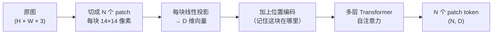

# DINOv2：无需标签训练出来的空间敏感视觉特征提取器

给 DINOv2 输入一张图，它会把图切成小块，对每一块输出一个向量——这些向量不只记录"这是什么物体"，还记录"这一块在图里长什么样、和周围是什么关系"。这种**空间敏感的局部描述能力**，是它被大量三维感知和生成任务采用的根本原因。

## 图像怎么变成 patch token

DINOv2 的骨干是 Vision Transformer（ViT）。ViT 把图像处理成序列的方式和 NLP 里的 Transformer 处理文字完全类似：先把图切成等大的小块（patch），再把每块展平成一个向量，送进 Transformer。



> 每个 patch token 对应图像里的一个固定位置区域。左上角的 patch 出来的 token 描述左上角，右下角的 token 描述右下角——空间布局在整个处理过程中被完整保留。

以 DINOv2 ViT-L/14 为例：patch 大小 14×14 像素，输入 518×518 的图像时，`518 / 14 ≈ 37`，得到约 37×37 = 1369 个 patch，每个 token 是 1024 维向量。输出形状是 `(1369, 1024)`。

## 为什么 patch token 携带空间信息

ViT 的自注意力机制让每个 patch token 在更新时能"看到"整张图里所有其他 patch 的内容——但最终每个 token 的表示仍然对应它原来的那块区域。自注意力的作用是让每块 patch 理解自己在整体场景里的上下文（旁边是什么、自己是物体的哪个部位），而不是把所有信息压缩成一个全局向量。

这和普通 CNN 的全局池化输出或 CLIP 的 `[CLS]` token 根本不同。CLIP 的 `[CLS]` token 是整张图的语义摘要，丢弃了空间位置信息。DINOv2 的 patch token 保留了"哪里有边缘、哪里有纹理、哪个部位在哪个位置"这类结构信息。

## 自监督训练的思路

DINOv2（以及前代 DINO）用**自蒸馏**训练，不需要任何人工标注：

- 对同一张图做两种不同的随机裁剪和增强，得到两个视图
- 一个视图送给**学生网络**，一个视图送给**教师网络**（教师是学生的指数滑动平均，参数更新更慢）
- 训练目标：让学生的输出分布和教师的输出分布尽量一致

同一张图的两个视图应该描述同一个物体，所以"让它们表示相似"本身就是一个有意义的监督信号——模型被迫学习出对视角、光照、裁剪变化鲁棒的结构特征，而不依赖任何类别标签。

DINOv2 在 DINO 基础上改进了数据管线（用 LVD-142M 这个 1.42 亿张精选图的数据集替代了原来的更小数据集），并加入了自监督 + 监督的联合训练，使得特征质量大幅提升。

## 和 CLIP 的核心区别

CLIP 训练目标是：**让图像的整体表示和对应文字描述对齐**。它的特征擅长回答"这张图在说什么"，但不擅长告诉你"物体的左边长什么样"。

DINOv2 的训练目标是：**让同一物体的不同视图在局部结构上一致**。它的特征擅长描述局部结构——边缘在哪、曲面如何弯曲、材质纹理的细节。

| 特性 | CLIP | DINOv2 |
|------|------|--------|
| 训练信号 | 图文对齐（有标注文字） | 视图一致性（无标注） |
| 主要输出 | `[CLS]` token（全局语义） | patch token（局部结构） |
| 擅长任务 | 图文检索、零样本分类 | 密集预测、三维感知、分割 |
| 空间细节 | 弱（压缩到单一向量） | 强（每块保留空间位置） |

三维生成任务关心的是"物体的轮廓在哪、曲面朝哪、材质在哪块区域"，这些都是空间结构问题，DINOv2 的 patch token 天然适合。

## 在 TRELLIS 中的使用方式

TRELLIS 在生成三维资产时，用 DINOv2 ViT-L/14 把输入图像编码成 patch token，作为两个阶段扩散模型的条件：

```python
# 图像缩放到 518×518（DINOv2 的偏好尺寸）
# 前向传播取 pre-norm 特征，再手动做 layer norm
features = dinov2(image, is_training=True)['x_prenorm']
patchtokens = F.layer_norm(features, features.shape[-1:])
# 输出 (B, 1369, 1024)
```

这 1369 个 patch token 通过 cross-attention 注入生成主干的每个 Transformer block。生成体素的每个位置都可以自由关注最相关的图像区域——正面体素关注正面 patch，背面体素关注背面 patch，注意力权重由模型自动学习。

详细的条件注入机制见 [图像条件注入：DINOv2 特征如何驱动生成](/系列/trellis_deep_dive/06_DINOv2图像条件注入)。
