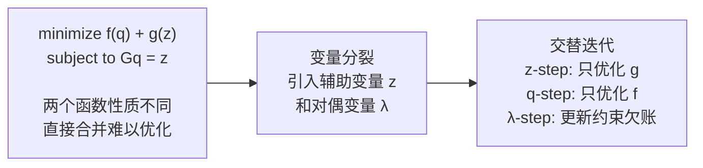

# ADMM：交替方向乘子法

> **前置知识**：拉格朗日乘子法基础（知道约束优化的概念即可）。
> 本文是 [Cosserat 杆断裂与 ADMM 求解综述](/论文综述/S34_Cosserat_MPM_DEM_断裂流固耦合综述) 的前置知识。

---

## 相关阅读

- [局部-全局求解框架与 Projective Dynamics](/前置知识/006l_前置知识_局部全局求解框架与Projective_Dynamics) ——
  ADMM 在 $\boldsymbol{\lambda} \equiv 0$ 时的退化特例，本文的核心对照对象。
- [KKT 条件与鞍点线性系统](/前置知识/013e_前置知识_KKT条件与鞍点线性系统) ——
  ADMM 收敛到的最优性条件。
- [稀疏线性系统与共轭梯度法](/前置知识/006k_前置知识_稀疏线性系统与共轭梯度法) ——
  ADMM 的 q-step 每轮都要解的系统。

---

## 问题：如何处理多个"性格不合"的目标

很多工程问题需要同时最小化两类性质截然不同的函数：一类是光滑的（如惯性项），另一类是不光滑的（如碰撞约束、稀疏正则项）。直接加起来优化，梯度法遇到不可微点就卡死；交替优化各自，两个目标又互相打架，收敛极慢。

ADMM 解决的正是这个矛盾：把两个函数分开处理，每次只优化其中一个，用一个**对偶变量**在迭代间记录约束违反的历史，逐步把两者拉到一致。

> 核心思路：把一个耦合的难问题拆成两个容易的子问题，用对偶变量把"欠账"传递下去，驱动两者收敛到一致解。

---

## 三步迭代

设目标为 $\min_{\mathbf{q},\mathbf{z}} f(\mathbf{q}) + g(\mathbf{z})$，约束为 $\mathcal{G}(\mathbf{q}) = \mathbf{z}$，增广拉格朗日为：

$$
L_\rho(\mathbf{q}, \mathbf{z}, \boldsymbol{\lambda}) = f(\mathbf{q}) + g(\mathbf{z}) + \boldsymbol{\lambda}^\top(\mathcal{G}(\mathbf{q}) - \mathbf{z}) + \frac{\rho}{2}\lVert \mathcal{G}(\mathbf{q}) - \mathbf{z} \rVert^2
$$

**这个公式在做什么**：把原始目标加上一个拉格朗日惩罚项（$\boldsymbol{\lambda}$ 记录历史违反量）和一个二次罚项（$\rho$ 控制当前步的惩罚力度），把约束"软化"进目标函数，使得三个变量可以交替优化。

::: details 📐 公式详解（点击展开）

| 子表达式 | 它是谁 | 它在干嘛 |
|---------|--------|---------|
| $f(\mathbf{q})$ | **主目标** | 光滑部分，如惯性项或数据拟合项 |
| $g(\mathbf{z})$ | **辅助目标** | 不光滑部分，如投影约束或稀疏项 |
| $\boldsymbol{\lambda}^\top(\mathcal{G}(\mathbf{q}) - \mathbf{z})$ | **拉格朗日项** | 记录历史约束违反方向，像一笔"欠账" |
| $\frac{\rho}{2}\lVert \mathcal{G}(\mathbf{q}) - \mathbf{z} \rVert^2$ | **二次罚项** | 当前步对约束违反的即时惩罚，让两个变量靠近 |
| $\rho$ | **罚参数** | 控制当前步惩罚力度；在 Cosserat 杆中通常取为刚度 $k$ |

**为什么需要两个惩罚**：纯二次罚（$\boldsymbol{\lambda}=0$）需要 $\rho\to\infty$ 才能精确满足约束，数值病态；纯拉格朗日法（无二次项）收敛不稳定。两者结合取长补短。
:::

每次迭代依次执行三步：

**步骤 1（z-step，local）**：固定 $\mathbf{q}^{(k)}$ 和 $\boldsymbol{\lambda}^{(k)}$，对 $\mathbf{z}$ 最小化（只涉及 $g$）：

$$
\mathbf{z}^{(k+1)} = \arg\min_{\mathbf{z}}\; g(\mathbf{z}) + \frac{\rho}{2}\lVert \mathcal{G}(\mathbf{q}^{(k)}) - \mathbf{z} + \boldsymbol{\lambda}^{(k)}/\rho \rVert^2
$$

**这个公式在做什么**：找一个满足约束 $g$ 的最近合法目标点，同时把历史欠账 $\boldsymbol{\lambda}/\rho$ 的修正方向考虑进去，让投影方向更准确。

::: details 📐 公式详解（点击展开）

| 子表达式 | 它是谁 | 它在干嘛 |
|---------|--------|---------|
| $g(\mathbf{z})$ | **约束指示函数** | 合法的 $\mathbf{z}$ 代入为 0，否则 $+\infty$，强制结果合法 |
| $\mathcal{G}(\mathbf{q}^{(k)}) + \boldsymbol{\lambda}^{(k)}/\rho$ | **修正后的当前应变** | 当前应变加上历史欠账修正，是投影的"起点" |

当 $g$ 是凸集的指示函数时，这一步退化为**投影**：把修正后的点投影到合法集合上。这是 Projective Dynamics "局部投影步"的几何含义。
:::

**步骤 2（q-step，global）**：固定 $\mathbf{z}^{(k+1)}$ 和 $\boldsymbol{\lambda}^{(k)}$，对 $\mathbf{q}$ 最小化（只涉及 $f$）：

$$
\mathbf{q}^{(k+1)} = \arg\min_{\mathbf{q}}\; f(\mathbf{q}) + \frac{\rho}{2}\lVert \mathcal{G}(\mathbf{q}) - \mathbf{z}^{(k+1)} + \boldsymbol{\lambda}^{(k)}/\rho \rVert^2
$$

**这个公式在做什么**：在"不偏离主目标太远"和"靠近刚投影得到的合法目标"之间折中，当 $\mathcal{G}$ 是线性算子时化简为解一个稀疏线性方程组。

::: details 📐 公式详解（点击展开）

| 子表达式 | 它是谁 | 它在干嘛 |
|---------|--------|---------|
| $f(\mathbf{q})$ | **主目标惯性项** | 让 $\mathbf{q}$ 不偏离预测位置 |
| $\mathcal{G}(\mathbf{q}) - \mathbf{z}^{(k+1)} + \boldsymbol{\lambda}^{(k)}/\rho$ | **约束残差** | 这一步完成后应变和目标之间的差距 |

**为什么是线性系统**：当 $\mathcal{G}$ 是线性算子（如有限元应变算子），整个二次目标的 Hessian 是 $\mathbf{M} + \rho \mathcal{G}^\top \mathcal{G}$，与 $\mathbf{q}$ 无关，可以预分解——Projective Dynamics 快速求解的来源。
:::

**步骤 3（λ-step，dual update）**：

$$
\boldsymbol{\lambda}^{(k+1)} = \boldsymbol{\lambda}^{(k)} + \rho\left(\mathcal{G}(\mathbf{q}^{(k+1)}) - \mathbf{z}^{(k+1)}\right)
$$

**这个公式在做什么**：把这轮约束残差乘以罚参数 $\rho$，累加进对偶变量——下轮 z-step 和 q-step 都会把这笔"欠账"加进修正量，驱动系统朝约束满足方向收敛。

::: details 📐 公式详解（点击展开）

| 子表达式 | 它是谁 | 它在干嘛 |
|---------|--------|---------|
| $\boldsymbol{\lambda}^{(k)}$ | **历史欠账** | 前几轮约束未满足时积累的对偶量 |
| $\rho(\mathcal{G}(\mathbf{q}^{(k+1)}) - \mathbf{z}^{(k+1)})$ | **本轮新增欠账** | 这轮结束后仍剩余的约束违反，按 $\rho$ 缩放后记入账本 |

**Projective Dynamics = ADMM 跳过这步**：PD 相当于永远令 $\boldsymbol{\lambda}^{(k)} = 0$，不积累欠账。高刚度时约束违反很大，但没有对偶变量传递信息，只靠二次罚项慢慢磨平——这是 PD 在高刚度下收敛慢的根本原因。
:::

---

## 为什么 ADMM 对高刚度收敛快

高刚度意味着约束必须被精确满足（允许的违反量极小）。纯罚函数法（PD）没有对偶变量，每轮迭代只能把误差缩小一个比例系数，高刚度时这个比例系数接近 1，需要大量迭代。ADMM 的对偶变量会把残差**全额记账**，下一轮投影时直接把欠账补回来，相当于每轮修正量不受刚度大小的限制，收敛速度可以快 10–100 倍。
