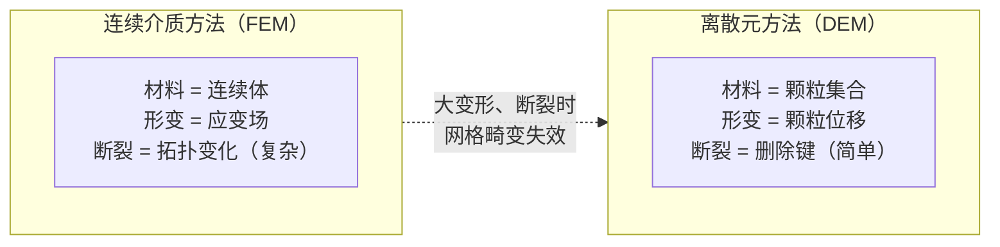

# DEM：离散元法基础

> **前置知识**：牛顿第二定律，弹性力的概念。
> 本文是 [Cosserat 杆断裂与 MPM 流固耦合综述](/论文综述/S34_Cosserat_MPM_DEM_断裂流固耦合综述) 的前置知识。

---

## 什么是离散元法

离散元法（Discrete Element Method，DEM）把材料建模为大量**刚性颗粒**的集合，颗粒之间通过接触力或键来传递力和力矩。和连续介质力学（有限元法）不同，DEM 天然适合模拟**颗粒状材料**（沙、土、砾石）和**断裂过程**（裂缝沿颗粒间界面扩展，直接移除对应的键即可）。

> DEM 的断裂处理极其自然：键的能量超过阈值，删除，两颗粒分开。无需网格重划分。

---

## 颗粒的自由度

每个颗粒有 6 个自由度：位置 $\mathbf{x}_i \in \mathbb{R}^3$ 和朝向 $\mathbf{R}_i \in SO(3)$（旋转矩阵，或用四元数表示）。运动方程是标准的刚体动力学：

$$
m_i \ddot{\mathbf{x}}_i = \sum_j \mathbf{f}_{ij}, \qquad \mathbf{I}_i \dot{\boldsymbol{\omega}}_i = \sum_j \boldsymbol{\tau}_{ij}
$$

**这个公式在做什么**：颗粒 $i$ 的平移加速度由所有邻居对它施加的合力驱动，旋转加速度由合力矩驱动——与普通刚体力学完全一致，只是力和力矩来自颗粒间的接触/键模型。

::: details 📐 公式详解（点击展开）

| 子表达式 | 它是谁 | 它在干嘛 |
|---------|--------|---------|
| $m_i$ | **颗粒质量** | 通常与颗粒体积和密度成正比 |
| $\mathbf{I}_i$ | **转动惯量张量** | 球形颗粒 $\mathbf{I} = \frac{2}{5}m r^2 \mathbf{I}_{3\times3}$ |
| $\mathbf{f}_{ij}$，$\boldsymbol{\tau}_{ij}$ | **颗粒 j 对 i 的力和力矩** | 由接触模型或键模型给出 |
:::

---

## 接触力与键

DEM 的力来自两类来源：

**接触力（无粘结）**：两颗粒表面接触时产生的法向排斥力（赫兹接触）和切向摩擦力。只在接触时有效，颗粒分离后力消失。

**键（bonded contact）**：预先在相邻颗粒之间建立的持久连接，即使颗粒不接触也传递力和力矩。键是模拟固体材料的核心机制——材料的弹性、塑性和断裂行为都靠键来实现。

---

## 标准键的局限：只有拉压，没有弯扭

最常见的 DEM 键是**并行键（parallel bond）**：把两颗粒之间的键建模为一小段弹性圆柱，能传递：

- 轴向拉伸/压缩力
- 横向剪切力
- 弯矩（有限程度）
- 扭矩（有限程度）

但标准实现通常只有前两项，或者弯扭刚度与轴向刚度共用同一个参数，无法独立调节。对细杆（金属丝、植物茎）这个问题很突出：弯曲刚度可以比轴向刚度小三个数量级，共用参数时必然有一个方向失真。

**Rod-Bonded DEM（BDEM）** 的解决方法是把键替换为 Cosserat 杆模型：用完整的四分量应变能（拉伸、剪切、弯曲、扭转）各自独立建模，见 [Cosserat 杆前置知识](/前置知识/013b_前置知识_Cosserat杆弹性杆模型与截面朝向)。

---

## 断裂：删除键

DEM 断裂的实现非常直接：当某条键的应力（或应变能）超过断裂阈值时，把这条键从系统中移除。之后两颗粒只有普通接触力，不再有弹性键约束。

这和有限元方法的断裂形成鲜明对比：有限元需要插入裂缝面、重划分网格、处理裂尖奇异性；DEM 只需一次数组删除操作，断裂面自然由颗粒排列给出。

---

## DEM 的时间积分

颗粒数量通常是万到百万级，常见做法：

- **显式积分（Verlet 或 Leapfrog）**：每步计算量小，但稳定性条件要求时间步 $\Delta t < \sqrt{m/k}$，高刚度时步长极小。
- **隐式积分（Newton 迭代）**：允许大步长，代价是每步解一个稀疏线性系统，BDEM 采用这种方案。

颗粒间的邻接关系用空间哈希或格子数据结构加速查询，避免 $O(N^2)$ 的逐对遍历。
