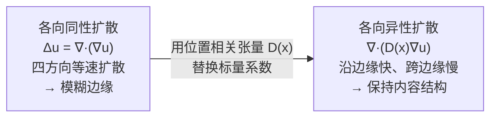
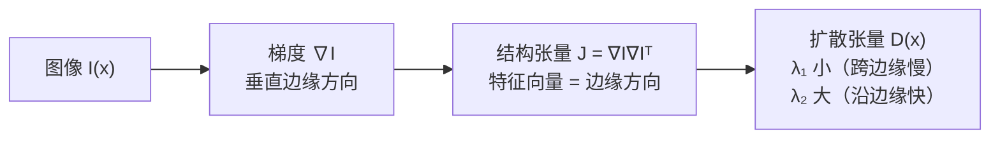

# 各向异性扩散方程

> **前置知识**：偏微分方程基础（知道热传导方程的概念即可），矩阵特征值的基本概念。
> 本文是 [Cosserat 杆断裂与 MPM 流固耦合综述](/论文综述/S34_Cosserat_MPM_DEM_断裂流固耦合综述) 的前置知识，支撑第四篇论文（用户导向风格迁移）的核心 PDE。

---

## 各向同性扩散：四面八方均匀蔓延

最基础的扩散方程（热传导方程）描述某个标量场 $u$（温度、浓度、风格强度）随时间均匀扩散：

$$
\frac{\partial u}{\partial t} = \Delta u = \nabla \cdot (\nabla u)
$$

**这个公式在做什么**：描述一个标量场以相同速率向四面八方扩散的规律——某点的场值随时间的变化率等于该点的拉普拉斯值，即它比邻居低多少就涨多快、比邻居高多少就降多快，最终抹平所有起伏。

::: details 📐 公式详解（点击展开）

| 子表达式 | 它是谁 | 它在干嘛 |
|---------|--------|---------|
| $u(\mathbf{x}, t)$ | **被扩散的标量场** | 温度、浓度，或图像处理中的风格强度 |
| $\frac{\partial u}{\partial t}$ | **时间变化率** | 该点场值随时间增加或减少的速度 |
| $\Delta u$ | **拉普拉斯算子** | 该点场值与邻域平均值的差——正数表示比邻居低 |
| $\nabla \cdot (\nabla u)$ | **散度的梯度** | 拉普拉斯的展开形式：先取梯度，再取散度 |

**为什么这是各向同性的**：算子里没有任何方向信息，$\Delta u$ 对 x 方向和 y 方向一视同仁。这在无结构的均匀介质中没问题，但图像有边缘——边缘两侧的灰度差会被当成普通的"起伏"抹平，于是轮廓变模糊。各向异性扩散要做的就是把这里的标量系数换成能区分方向的张量。
:::

这是**各向同性**的：任意方向的扩散速率完全相同，像向静水中滴墨水，向四周圆形扩散。

对图像处理来说，各向同性扩散有个致命问题：它会模糊边缘。沿边缘方向和垂直边缘方向的传播速率一样，风格或色彩会不加区分地渗透到相邻区域，破坏内容结构。

---

## 各向异性扩散：让方向决定速率

各向异性扩散把标量系数换成**位置相关的扩散张量** $\mathbf{D}(\mathbf{x})$：

$$
\frac{\partial u}{\partial t} = \nabla \cdot \left( \mathbf{D}(\mathbf{x}) \nabla u \right)
$$

**这个公式在做什么**：控制场 $u$ 的传播速率和方向——$\mathbf{D}(\mathbf{x})$ 是一个 2×2 正定矩阵，它的特征向量决定扩散的"快慢轴"，特征值决定各轴的扩散速率，让不同位置的信息沿不同方向以不同速度传播。

::: details 📐 公式详解（点击展开）

| 子表达式 | 它是谁 | 它在干嘛 |
|---------|--------|---------|
| $u(\mathbf{x}, t)$ | **标量场** | 待扩散的量，如温度、风格强度、浓度 |
| $\nabla u$ | **梯度** | 场的空间变化方向，指向 $u$ 增大最快的方向 |
| $\mathbf{D}(\mathbf{x})$ | **扩散张量** | 2×2（二维）或 3×3（三维）正定矩阵，随位置变化，控制每处的扩散方向性 |
| $\mathbf{D}(\mathbf{x})\nabla u$ | **各向异性通量** | 先用 $\mathbf{D}$ 对梯度方向做旋转和缩放，再求散度，实现方向性扩散 |
| $\nabla \cdot (\cdots)$ | **散度** | 对各向异性通量求散度，得到单位时间内 $u$ 在该点的净增量 |

**当 $\mathbf{D} = c\mathbf{I}$ 时的退化**：张量退化为标量 $c$，方程退化为各向同性热传导，四方向等速扩散。各向异性是"可调各向同性"的严格推广。
:::

---

## 扩散张量如何从图像内容构造

在图像处理中，$\mathbf{D}(\mathbf{x})$ 由**结构张量（structure tensor）**的特征向量旋转得到：

1. 在像素 $\mathbf{x}$ 处计算图像梯度 $\nabla I$
2. 构造结构张量 $\mathbf{J} = \nabla I \nabla I^\top$（2×2 半正定矩阵）
3. 对 $\mathbf{J}$ 做特征分解，得到主方向 $\mathbf{e}_1$（梯度方向，垂直于边缘）和次方向 $\mathbf{e}_2$（沿边缘方向）
4. 构造 $\mathbf{D} = \lambda_1 \mathbf{e}_1 \mathbf{e}_1^\top + \lambda_2 \mathbf{e}_2 \mathbf{e}_2^\top$，其中 $\lambda_1 \ll \lambda_2$

> 扩散张量完全由图像内容自动计算，无需人工标注。边缘处自动产生强各向异性（$\lambda_1 \ll \lambda_2$），边缘内部均匀区域产生弱各向异性（$\lambda_1 \approx \lambda_2$）。

---

## 隐式离散化：化成线性方程组

把连续 PDE 在像素网格上离散化，时间上用**隐式（后向）欧拉**：

$$
\frac{u^{n+1} - u^n}{\Delta t} = \mathbf{L}_\mathbf{D}\, u^{n+1}
$$

**这个公式在做什么**：用后向欧拉把扩散方程在时间上离散——用**下一步**的空间算子值来近似时间导数，而不是用当前步的值，从而让任意大的时间步都不发散。

::: details 📐 公式详解（点击展开）

| 子表达式 | 它是谁 | 它在干嘛 |
|---------|--------|---------|
| $u^n$，$u^{n+1}$ | **当前步/下一步的场** | 未知量是 $u^{n+1}$，$u^n$ 已知 |
| $\frac{u^{n+1}-u^n}{\Delta t}$ | **后向差分** | 用下一步减当前步近似时间导数，误差 $O(\Delta t)$ |
| $\mathbf{L}_\mathbf{D}$ | **各向异性空间算子** | 离散化的 $\nabla\cdot(\mathbf{D}\nabla)$，稀疏矩阵 |
| 右侧的 $u^{n+1}$ | **隐式耦合** | 未知量同时出现在等号两边，必须解方程而不是直接算 |

**为什么隐式值得多花一次求解**：显式的右端用 $u^n$，可以逐点直接算出 $u^{n+1}$，但稳定条件 $\Delta t < h^2/(2\lambda_{\max})$ 在高分辨率或强各向异性下把步长压得极小，需要成千上万步。隐式虽要解一次线性系统，但步长不受稳定条件限制，几十步就能到稳态——总计算量反而更小，而且矩阵可预分解，重复调用时几乎只剩回代。
:::

整理后得到：

$$
\left(\mathbf{I} - \Delta t\, \mathbf{L}_\mathbf{D}\right) u^{n+1} = u^n
$$

**这个公式在做什么**：把扩散一步的计算转换为解一个稀疏线性方程组——系数矩阵只依赖 $\mathbf{D}$（与图像内容相关、与 $u$ 无关），因此可以预分解；右端是当前已知的 $u^n$，每次用笔刷涂抹后只需代入新的右端做回代，毫秒级响应。

::: details 📐 公式详解（点击展开）

| 子表达式 | 它是谁 | 它在干嘛 |
|---------|--------|---------|
| $\mathbf{I}$ | **恒等矩阵** | 保留上一步的值，防止场凭空消失 |
| $\mathbf{L}_\mathbf{D}$ | **各向异性离散拉普拉斯** | 离散化的 $\nabla \cdot (\mathbf{D}\nabla)$ 算子，稀疏矩阵（每行只有 5–9 个非零元素） |
| $\Delta t$ | **时间步长** | 隐式格式无条件稳定，可以取大步长快速达到稳态 |
| $u^n$ | **当前已知的场** | 用户已涂抹的种子或上一步的扩散结果，作为右端驱动 |

**显式 vs 隐式的区别**：显式格式（$u^{n+1} = u^n + \Delta t\, \mathbf{L}_\mathbf{D} u^n$）稳定条件要求 $\Delta t < h^2 / (2\lambda_{\max})$，高分辨率下极小；隐式格式无条件稳定，任意大的 $\Delta t$ 都不发散，允许用一步大步长直接扩散到稳态。
:::

---

## 结构张量的物理直觉

一个像素处的结构张量可以想象成一个椭圆：椭圆的长轴沿边缘方向（扩散快，特征值大），短轴垂直于边缘（扩散慢，特征值小）。均匀区域的椭圆接近圆形（各向同性），强边缘处的椭圆极度扁平（高度各向异性）。

扩散张量 $\mathbf{D}$ 在每个像素处把这个椭圆的形状直接编码进 PDE，使扩散自然贴着图像内容结构流动——这是各向异性扩散能用于风格传播、不破坏边缘的根本原因。
