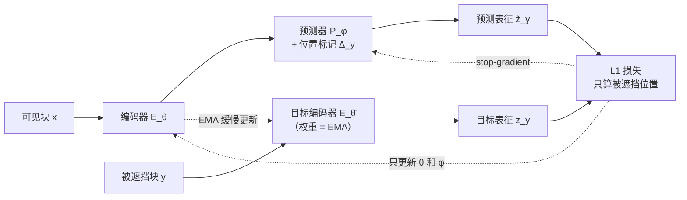
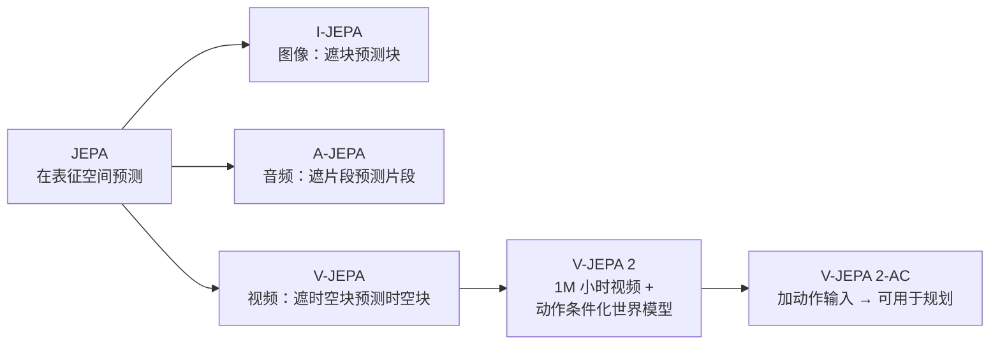

# JEPA：联合嵌入预测架构

> **一句话概括**：不在像素上猜"下一帧长什么样"，而是在**表征空间**里猜"下一帧的语义应该是什么样"——这就是联合嵌入预测架构（Joint-Embedding Predictive Architecture, JEPA）与所有生成式自监督方法的分水岭。

**相关阅读**：
- [世界模型基础（World Model）](/前置知识/000t_前置知识_世界模型基础) — JEPA 是构造世界模型的一种具体方式，先理解世界模型要解决什么问题
- [RoPE 旋转位置编码](/前置知识/002k_前置知识_RoPE旋转位置编码) — V-JEPA 2 用 3D-RoPE 编码视频的时空位置
- [向量量化与离散表示学习](/前置知识/001q_前置知识_向量量化与离散表示学习) — 另一种"学表征"的路线，可与 JEPA 对比理解

---

## 一、JEPA 要解决什么问题

### 1.1 从"预测"这个词说起

自监督学习的核心套路是：给模型一个任务，这个任务的标签从数据本身免费得来，不需要人工标注。在图像和视频领域，最自然的任务是**预测**——遮住一部分，让模型猜被遮住的部分。

问题在于：**猜什么？** 这个选择决定了整个方法的性质。

假设我们有一段视频，把其中一段遮挡住，让模型预测被遮挡的内容。有两种猜法：

**猜法一（生成式）**：预测被遮挡区域的**原始像素**。模型必须输出具体的 RGB 数值。这就是 [MAE](https://arxiv.org/abs/2111.06377)（Masked Autoencoder，掩码自编码器）和视频版的 VideoMAE 走的路线。

**猜法二（JEPA）**：预测被遮挡区域的**表征**。模型不需要说出"这个像素是 RGB(127, 43, 200)"，只需要说出"这块区域在语义上和什么东西相似"。

JEPA 选的是猜法二。这个选择看起来只是换了个预测目标，实际上改变了整个方法的数学性质——后面第四节会讲清楚为什么。

### 1.2 一个贯穿全文的例子

用同一个例子走完全文：**一段 2 秒的视频，画面里一只机械手正在把一个红色杯子放到架子上**。

- 生成式方法要求模型补出被遮挡区域每一帧的每个像素：桌面的木纹走向、杯子上的高光位置、背景里模糊的墙角。这些细节**无法从上下文推断**——桌面木纹具体是向左偏还是向右偏，是数据里的随机事实，不是可以预测的规律。
- JEPA 要求模型补出"这块区域的表征"。表征是语义压缩后的向量，它记录的是"这里有一个红色圆柱形物体，正在被夹爪握住，朝向为某方向"，不记录"木纹的第 37 个像素是 RGB(140, 98, 61)"。

于是生成式模型被迫把容量花在记忆不可预测的细节上，JEPA 则把容量集中在可预测的结构上。这是 JEPA 的出发点。

---

## 二、JEPA 的三件套：编码器、预测器、目标编码器

### 2.1 三个网络的分工

JEPA 的元架构（meta-architecture）由三个部分组成。这里用 $x$ 表示"能看到的上下文"，$y$ 表示"要预测的目标"（在视频里，$x$ 是没被遮挡的帧块，$y$ 是被遮挡的帧块）。

| 组件 | 符号 | 输入 | 输出 | 角色 |
|------|------|------|------|------|
| 上下文编码器 | $E_\theta(\cdot)$ | 可见部分 $x$ | 上下文表征 $E_\theta(x)$ | 把"我看到的"压缩成向量 |
| 预测器 | $P_\phi(\cdot)$ | 上下文表征 + 位置标记 | 预测表征 $\hat{z}_y$ | 从"我看到的"推出"我看不到的应该长什么样" |
| 目标编码器 | $E_{\overline{\theta}}(\cdot)$ | 目标部分 $y$ | 目标表征 $z_y$ | 把"标准答案"也压缩成向量，供比对 |

三者的关系图：

> **看图重点**：注意两条虚线。损失只回传到**编码器和预测器**，不回到目标编码器（stop-gradient）；目标编码器的权重不是学出来的，而是主编码器权重的**指数移动平均**（Exponential Moving Average, EMA）——即把主编码器每次更新后的权重按比例慢慢混进去。这两个设计是防坍塌的关键，第五节展开。

### 2.2 训练目标

把上面的结构写成一个公式：

$$
\min_{\theta,\phi,\Delta_y}\ \big\lVert P_\phi\big(\Delta_y,\ E_\theta(x)\big) - \mathrm{sg}\big(E_{\overline{\theta}}(y)\big) \big\rVert_1
$$

**这个公式在做什么**：让预测器看着"可见部分"和"被遮挡位置在哪"，猜出被遮挡部分的表征，猜得和"标准答案的表征"越接近越好——误差用 L1 距离衡量。

::: details 📐 公式详解（点击展开）

| 子表达式 | 它是谁 | 它在干嘛 |
|---------|--------|---------|
| $E_\theta(x)$ | **看一眼现场** | 主编码器把可见的视频块压成一组向量 |
| $\Delta_y$ | **座位号集合** | 可学习的掩码标记，告诉预测器"你要补的是哪几个位置"，因为它看不到被遮的内容，只能靠位置信息定位 |
| $P_\phi(\Delta_y, E_\theta(x))$ | **填空的人** | 预测器结合"现场信息"和"空在哪"，输出对空位的猜测 |
| $E_{\overline{\theta}}(y)$ | **标准答案** | 目标编码器把真实被遮内容压成向量，作为比对基准 |
| $\mathrm{sg}(\cdot)$ | **禁止通行牌** | stop-gradient：梯度到不了目标编码器，它的权重只靠 EMA 更新 |
| $\lVert\cdot\rVert_1$ | **打分尺** | L1 距离（各分量差的绝对值之和），比 L2 对异常值更稳健 |

**用人话读**："给模型看一段被挖了洞的视频，让它猜那几个洞里是什么，但它不用猜出像素，只要猜出的向量和真实内容的向量足够接近就行。"

**为什么只算被遮挡的位置**：可见位置的答案就摆在眼前，让模型预测它等于白送，起不到自监督的作用。只有遮住的部分才需要真正的"推理"。

**为什么用 L1 而不是 L2**：L2 会对大误差给出平方惩罚，少数难样本会主导梯度；L1 对离群点不那么敏感。实践中两者都能收敛，论文比较后选了 L1。
:::

---

## 三、为什么必须在表征空间预测

### 3.1 像素预测的代价

生成式方法（如 MAE）的目标是重建被遮挡的像素。它们的损失函数大致是：

$$
\mathcal{L}_{\text{MAE}} = \big\lVert \text{Decoder}\big(E(x)\big) - y \big\rVert^2
$$

**这个公式在做什么**：用解码器把编码器的输出还原成像素，再和真实像素逐点对比，误差越小越好。它强迫模型保留重建像素所必需的一切细节。

::: details 📐 公式详解（点击展开）

| 子表达式 | 它是谁 | 它在干嘛 |
|---------|--------|---------|
| $E(x)$ | **编码器** | 把可见输入 $x$ 压成一组向量（不需要像 JEPA 那样区分主/目标编码器，因为这里没有坍塌风险） |
| $\text{Decoder}(\cdot)$ | **解码器** | 把向量还原回像素空间。MAE 通常用一个轻量 Transformer 解码器 |
| $y$ | **真实像素** | 被遮挡区域的实际 RGB 值，直接来自原始图像 |
| $\lVert\cdot\rVert^2$ | **L2 距离** | 逐元素求差后平方再求和。与 JEPA 用 L1 不同，MAE 论文选了 MSE |

**用人话读**："把被遮住的洞补回像素，然后看和原图差多少。"

**为什么这个目标会把容量引向低层细节**：$y$ 是原始像素，它包含木纹走向、高光位置、背景散焦的具体样子——这些在给定上下文后仍然不可预测。模型为了让 $\lVert\text{Decoder}(E(x)) - y\rVert^2$ 足够小，必须在 $E(x)$ 里保留这些细节，否则解码器还原不出来。这正是 JEPA 认为需要改变的地方：标准答案从像素换成表征后，那些不可预测的细节会被目标编码器自然过滤掉。

:::

其中 $y$ 是**真实像素值**。这带来两个后果。

**后果一：容量被用在不可预测的细节上。** 视频里有大量熵很高的内容——树叶的分布、草地每根草的位置、水面波纹的精确相位。这些东西**在给定上下文后仍然是不确定的**，模型无法真正预测，只能记住"这类场景通常长这样"。一个在像素上训练的模型，会把相当一部分参数用来存储这种"统计记忆"，而不是学习"物体如何运动、如何相互作用"这类真正的物理规律。

**后果二：表征偏向低层信息。** 为了重建像素，模型必须保留精确的纹理、颜色、边缘信息，这些是低层视觉特征。而"这个杯子正在被移动"这种高层语义，反而不是重建像素的必需信息。

### 3.2 表征预测的收益

JEPA 的损失在**表征空间**比较，标准答案是另一个编码器的输出。这带来三个连锁效果：

1. **不可预测的细节被自动过滤**：目标编码器本身就是一个压缩器。它会丢掉木纹的具体走向，保留"这里有个杯子"。所以预测器不必去猜那些猜不出来的东西。
2. **容量集中在语义结构上**：表征空间里"红色杯子从左往右移动"是一个可预测的规律，"第 37 个像素是 (140,98,61)"不是。梯度自然引导模型学习前者。
3. **任务迁移性更好**：学到的表征直接可用于分类、检测、规划等多种下游任务，因为它本来就是语义层级的。

一句话总结这个分水岭：**生成式方法问"世界长什么样"，JEPA 问"世界接下来会变成什么样"**。前者需要对细节负责，后者只需要对结构负责。

> **注意一个容易误解的点**：JEPA 不是为了"省算力所以不做像素重建"。它的主张是：像素重建这个目标本身就把模型引向了错误的方向，即使给它无限算力，学到的表征也不如表征预测更适合下游的推理和规划任务。

---

## 四、表示坍塌：JEPA 必须解决的核心难题

### 4.1 坍塌是怎么发生的

JEPA 有一个平凡解（trivial solution）的隐患。假设编码器学成了一个**常数函数**——不管输入什么，都输出同一个向量 $c$。那么：

- 预测器只要也输出 $c$，损失就恒为 0。
- 模型"完美"完成了训练目标，却什么也没学到。

这就是**表示坍塌**（representation collapse）：表征退化到一个点（或一个低维子空间），失去了区分不同输入的能力。

为什么 JEPA 比 MAE 更容易坍塌？因为 MAE 有一条硬约束：输出必须逼近**具体的像素值**。常数输出无法重建出不同的图像，损失会很大。而 JEPA 的目标是"另一张网输出的向量"，两张网**可以合谋**把一切都映射到同一个点——没有像素作为锚点，坍塌的门就开着。

### 4.2 三种常见的防坍塌机制

| 机制 | 做法 | 直觉 |
|------|------|------|
| **EMA 目标编码器** | 目标编码器的权重不是通过梯度学习，而是主编码器权重的滑动平均 | "标准答案"追得慢，主编码器不能通过瞬间改变答案来作弊 |
| **Stop-gradient** | 梯度只回传到主编码器和预测器，不进入目标编码器 | 防止两个网络一起"向坍塌方向跑" |
| **不对称结构** | 预测器只在一条路径上，另一条路径没有预测器 | 两条路径能力不对等，无法对称地退化 |

V-JEPA 2 采用的正是 EMA 目标编码器 + stop-gradient 这套组合（对应论文公式里那个 $\mathrm{sg}(E_{\overline{\theta}}(y))$）。

### 4.3 EMA 权重的更新

EMA 的更新规则很简洁：

$$
\overline{\theta} \leftarrow m\,\overline{\theta} + (1-m)\,\theta
$$

**这个公式在做什么**：每次主编码器更新后，把目标编码器的权重往主编码器的方向挪一小步——挪的幅度由 $m$ 控制，$m$ 越接近 1 挪得越慢。

::: details 📐 公式详解（点击展开）

| 子表达式 | 它是谁 | 它在干嘛 |
|---------|--------|---------|
| $\theta$ | **今天的主编码器** | 刚被梯度更新过的、最新鲜的权重 |
| $\overline{\theta}$ | **记忆中的目标编码器** | 历史上主编码器权重的平滑版本，变化缓慢 |
| $m$ | **惯性系数** | 通常取 0.99 到 0.999。$m=0.99$ 表示新信息只占 1% |
| $1-m$ | **更新步长** | 每次把主编码器的"最新样子"混入的比例 |

**用人话读**："目标编码器不是学出来的，而是主编码器权重的慢速跟随者——主网络走 100 步，它才走 1 步。"

**为什么慢反而好**：如果目标编码器和主编码器完全同步（$m=0$），两者可以同时朝坍塌方向塌缩，损失降到 0 而表征全废。让目标滞后，相当于给主编码器一个"稳定的靶子"——靶子在缓慢移动，主编码器必须持续输出有区分度的表征才能持续命中。这与强化学习里 [DQN 的 target network](/前置知识/000o_前置知识_Q函数与Value函数) 用滞后的网络算 TD 目标，是完全相同的思路。

**$m$ 怎么选**：太小的 $m$（如 0.9）目标变化太快、失去稳定作用；太大的 $m$（如 0.9999）目标几乎不动，学习信号过弱。常见做法是从较小的值开始（如 0.996），随着训练逐步增大到 0.999 以上——训练初期需要快速调整，后期需要稳定。
:::

---

## 五、JEPA 家族与 V-JEPA

JEPA 是一个**架构框架**，不是某一个具体模型。它的思想可以套用到不同模态上：

> **看图重点**：从 JEPA 到 V-JEPA 2-AC 是"抽象框架 → 具体模态 → 具体规模 → 具体应用"的层层落地。I-JEPA 是最早的实例（图像域），V-JEPA 把它搬到视频域，V-JEPA 2 把规模推到 10 亿参数和 100 万小时视频，V-JEPA 2-AC 则加上动作输入，让模型从"看懂视频"变成"能据此规划动作"。

V-JEPA 与 I-JEPA 的关键差异在于**掩码的方式**。图像只有空间维度，I-JEPA 遮的是图片块；视频多了时间维度，V-JEPA 需要决定遮"哪些时间的哪些位置"。

V-JEPA 2 采用的是**多块掩码**（multiblock masking）：不遮单个小块，而是采样若干个大块一次性遮掉。这样做是为了让预测任务有足够难度——如果遮得太碎，模型可以靠相邻像素插值蒙混过关；遮成大块，模型必须真正理解"这段时空里发生了什么"才能补出表征。要预测一个时空块，模型必须知道物体怎么动、动作如何在时间上延续——这正是世界模型需要的能力。

第三个维度是**位置编码**。V-JEPA 2 用 3D-RoPE（三维旋转位置编码）代替了早期 V-JEPA 的绝对位置编码。原因是视频有（时间、高度、宽度）三个轴，绝对编码在输入长度或分辨率变化时无法泛化——而 V-JEPA 2 需要在训练和推理时使用不同的分辨率和帧数。3D-RoPE 把特征维度切成三段，分别对三个轴施加旋转，天然支持任意长度和分辨率。详见 [RoPE 旋转位置编码](/前置知识/002k_前置知识_RoPE旋转位置编码)。

---

## 六、总结

| 维度 | 生成式自监督（如 MAE） | JEPA |
|------|----------------------|------|
| 预测目标 | 原始像素 | 表征向量 |
| 损失比较对象 | 真实图像的像素值 | 目标编码器输出的向量 |
| 对不可预测细节 | 被迫拟合，浪费容量 | 自动过滤，容量集中 |
| 坍塌风险 | 低（像素是硬约束） | 高（两条网络可能合谋） |
| 防坍塌机制 | 不需要 | EMA 目标网络 + stop-gradient |
| 学到的表征层级 | 偏底层（纹理、边缘） | 偏语义（物体、动作） |
| 代表模型 | MAE、VideoMAE | I-JEPA、V-JEPA、V-JEPA 2 |

**核心记忆点**：JEPA = 在表征空间做预测。它用一个不参与梯度更新的 EMA 目标编码器定义"标准答案"，从而避免退化成常数函数；它把预测目标从像素抬高到语义，从而让模型专注学习可预测的世界结构，而不是记忆不可预测的细节。这套设计正是 V-JEPA 2 能够从 100 万小时视频里学到可用于机器人规划的物理直觉的基础。

**延伸阅读**：
- [V-JEPA 2 深度精读：自监督视频世界模型与零样本规划](/论文综述/154_VJEPA2_自监督视频世界模型与规划) — 本架构在 10 亿参数、100 万小时视频规模上的完整实现
- [世界模型基础（World Model）](/前置知识/000t_前置知识_世界模型基础) — JEPA 在世界模型方法谱系中的位置
