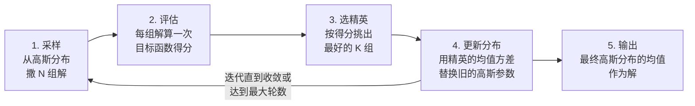
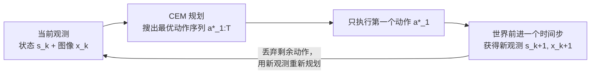

# 交叉熵方法（Cross-Entropy Method, CEM）

> **一句话概括**：不知道往哪个方向走才能让目标变小，就**撒一把随机点、挑出最好的几个、围着它们再撒一把**——反复几轮，撒点范围会收缩到目标的最低处。这就是交叉熵方法：一种不需要梯度的黑箱优化算法。

**相关阅读**：
- [世界模型基础（World Model）](/前置知识/000t_前置知识_世界模型基础) — CEM 常被用来在学到的世界模型里搜索动作序列
- [策略梯度与 PPO](/前置知识/000a_前置知识_策略梯度与PPO) — 基于梯度的策略优化，与 CEM 这类无梯度方法形成对照
- [Q 函数与 Value 函数](/前置知识/000o_前置知识_Q函数与Value函数) — 另一种"评估动作好坏"的思路

---

## 一、CEM 要解决什么问题

### 1.1 什么时候不能用梯度

大多数深度学习优化都依赖梯度：算出损失对参数的导数，然后沿负梯度方向走一步。但有一类问题**算不出梯度，或者梯度不好用**：

1. **目标函数是黑箱**：只能"喂一个输入、看一个输出"，不知道内部形式。比如实际跑一次机器人仿真看结果好不好。
2. **梯度不存在或不可靠**：目标函数是分段的、带离散选择的、或者非常嘈杂。
3. **变量维度不高但目标很怪**：比如在几十维的动作空间里找一个序列，使得某个非凸的目标最小。

CEM 就是为这类问题设计的。它不看梯度，只看**采样点的得分**。

### 1.2 一个贯穿全文的例子

用同一个例子走完全文：**一个机械臂要走到桌面上的目标点**。

- 决策变量是一串动作 $\hat{a}_{1:T}$，比如未来 $T=5$ 步、每步 3 个方向的位移，共 15 个数。
- 目标函数是"按这串动作走完，末端离目标有多远"——一个标量，越小越好。
- 我们**不知道**这个目标函数对动作的显式表达式（真实情况里，它可能是仿真器里的一整套物理计算），所以不能用梯度下降。

CEM 的做法：随机撒 100 组动作序列，每组都算一次"离目标多远"，然后挑最好的 10 组，看它们共同长什么样，下一轮就往那个方向撒。

---

## 二、算法流程

### 2.1 四步循环

CEM 在每一轮迭代里做四件事：

> **看图重点**：CEM 维护的不是"一个解"，而是**一个解的概率分布**。这个分布一开始很宽（到处都可能），随着迭代逐渐收窄到目标函数的低谷附近。输出时取分布的均值作为最终答案。

### 2.2 分布参数的更新公式

设第 $t$ 轮采样的分布是高斯分布 $\mathcal{N}(\mu_t, \sigma_t^2)$，采出 $N$ 组解后，按目标函数值挑出最好的 $K$ 组（称为"精英集"，记作 $\mathcal{E}_t$），然后更新分布参数：

$$
\mu_{t+1} = \frac{1}{K}\sum_{i \in \mathcal{E}_t} x_i, \qquad
\sigma_{t+1}^2 = \frac{1}{K}\sum_{i \in \mathcal{E}_t} (x_i - \mu_{t+1})^2
$$

**这个公式在做什么**：把"下一轮该往哪撒点"完全交给这一轮的精英——新分布的均值就是精英的平均位置，新分布的方差就是精英的离散程度。

::: details 📐 公式详解（点击展开）

| 子表达式 | 它是谁 | 它在干嘛 |
|---------|--------|---------|
| $x_i$ | **一组候选解** | 第 $i$ 组采样出来的完整动作序列（在这里是 15 维向量） |
| $\mathcal{E}_t$ | **精英名单** | 第 $t$ 轮里得分最好的那 $K$ 组解的集合 |
| $\mu_{t+1}$ | **新中心** | 精英解的平均值。下一轮就以它为中心撒点 |
| $\sigma_{t+1}^2$ | **新范围** | 精英解的方差。精英彼此接近 → 方差小 → 下一轮撒得集中 |
| $K$ | **精英数量** | 超参数，常取 $N$ 的 5%~20% |

**用人话读**："撒一批随机解，挑出最好的那一小撮，算出它们的平均位置和分散程度，下一轮就按这个新分布再撒——离得近的、范围小的分布会一代代收窄，最终停在最优点附近。"

**为什么方差也跟着精英走**：如果只用精英的均值、固定方差，撒点范围永远不会收缩，算法就变成随机搜索了。让方差自适应收缩是 CEM 高效的关键——精英越集中，说明已经接近答案，撒点范围就该越小；精英很分散，说明还没找到方向，继续大范围探索。

**为什么用精英的方差而不是全部样本的方差**：全部样本的方差主要由那些差解决定，会把分布撑得很宽。只用精英，相当于让"成功者"定义搜索范围。

**$\mathbb{E}$ 在这里的实际含义**：这是确定性计算，不是期望值——$K$ 个精英解直接求平均，没有蒙特卡洛近似的成分。
:::

### 2.3 一个数值例子

用机械臂走路的例子，把 15 维决策变量简化成一维（只控制"往右走多远"），方便看清机制。假设目标函数是 $f(x) = (x - 3)^2$，最小值在 $x = 3$。

初始分布 $\mathcal{N}(0, 4)$，即均值 0、标准差 2。每轮采 10 个样本，取前 3 个作为精英：

| 轮次 | 分布参数 | 采样（排序后，前 3 为精英） | 精英均值 $\mu$ | 精英标准差 $\sigma$ |
|------|---------|--------------------------|--------------|------------------|
| 1 | $\mathcal{N}(0, 2^2)$ | $-1.2,\ 0.4,\ 1.1,\ 2.3,\ 3.5,\ \ldots$ | $1.27$ | $0.95$ |
| 2 | $\mathcal{N}(1.27, 0.95^2)$ | $0.5,\ 1.4,\ 1.9,\ 2.4,\ 3.1,\ \ldots$ | $2.47$ | $0.87$ |
| 3 | $\mathcal{N}(2.47, 0.87^2)$ | $1.8,\ 2.5,\ 2.8,\ 3.2,\ 3.6,\ \ldots$ | $2.83$ | $0.62$ |
| 4 | $\mathcal{N}(2.83, 0.62^2)$ | $2.4,\ 2.7,\ 2.9,\ 3.0,\ 3.3,\ \ldots$ | $2.87$ | $0.31$ |
| 5 | $\mathcal{N}(2.87, 0.31^2)$ | $2.7,\ 2.8,\ 2.9,\ 3.0,\ 3.1,\ \ldots$ | $2.93$ | $0.15$ |

均值从 0 一路逼近 3，标准差从 2 收缩到 0.15。第五轮之后输出 $2.93$，已经很接近最优解 3。

> **这个例子想说明什么**：CEM 的收敛不是靠"算方向"，而是靠"统计成功者的共同特征"。每一轮都在做同样一件事——看谁得分高，就往谁那边靠。它不需要知道 $f(x)$ 是二次函数，只需要能对 $x$ 求值。

---

## 三、CEM 与模拟退火、遗传算法的关系

CEM 属于**无梯度黑箱优化**家族。它和几个近亲的区别在于"如何利用历史信息"：

| 方法 | 维护什么 | 如何更新 | 特点 |
|------|---------|---------|------|
| **CEM** | 一个高斯分布 $(\mu, \sigma)$ | 用精英样本的均值方差替换 | 简单、并行友好、收敛快 |
| 随机搜索 | 一个当前最优解 | 纯随机撒点，只保留更好的 | 极简单，但无信息积累 |
| 模拟退火 | 一个当前解 + 温度 | 按温度概率接受更差的解 | 有逃离局部最优的机制 |
| 遗传算法 | 一个种群 | 交叉 + 变异 | 组合优化上强，连续优化上不如 CEM |
| 梯度下降 | 一个点 + 梯度 | 沿负梯度走 | 有梯度时最快，但要求可导 |

CEM 的最大优势是**天然并行**：$N$ 组样本的评估互相独立，可以一次性丢到 GPU 或一批仿真实例上跑完。这是它在机器人规划里受欢迎的直接原因——世界模型的前向推理可以批量化。

---

## 四、CEM 在模型预测控制中的角色

CEM 最常见的工程用法是嵌在**模型预测控制**（Model Predictive Control, MPC）循环里。

MPC 的基本思想是：每一步都只往前看有限的一段时间（预测视界 $T$），在视界内规划出最优动作序列，但**只执行第一个动作**，然后观察新状态、重新规划。这种"走一步、看一次、重算一次"的策略叫**滚动时域控制**（receding horizon control）。

> **看图重点**：注意回合上的"丢弃剩余动作"。规划出的 $T$ 个动作只用了第 1 个，剩下 $T-1$ 个直接扔掉。这看起来浪费，但换来的是**闭环纠错**：如果世界没按预期变化（模型有误差、有扰动），下一轮重新规划会自动修正。这正是 MPC 比"一次性规划整条轨迹然后盲执行"更鲁棒的原因。

**为什么用 CEM 而不是梯度法做这个规划**：世界模型往往是"黑箱"——它内部有注意力、有掩码处理、有自回归展开，虽然理论上可微，但实际实现里对动作求梯度既麻烦又容易踩到不连续点。CEM 只需要能"给动作序列、返回一个标量代价"这一个接口，实现代价低得多。代价是采样量大（因为不做梯度利用），但在 GPU 上批量前向很快，可以接受。

**CEM 在 MPC 里的关键超参数**：

| 超参数 | 含义 | 影响 |
|--------|------|------|
| $N$（样本数） | 每轮撒多少组动作序列 | 越大越可能覆盖最优解，但每个规划步的耗时线性增长 |
| $K$（精英数） | 每轮保留最好的几组 | 太小则方差塌缩过快、可能早熟；太大则收敛慢 |
| 迭代轮数 | 分布更新几次 | 越多越精确，但耗时增加；通常 5~10 轮就够 |
| 预测视界 $T$ | 往前规划多少步 | 越长越能处理"先退后进"的非贪心任务，但搜索空间指数增长 |
| 初始方差 | 第一轮撒点的范围 | 太大会浪费在无效区域，太小则可能错过最优解 |

最后一项在机器人应用里尤其微妙：**动作的采样范围需要和物理尺度匹配**。如果机器人一步最多移动几厘米，却在一个几米的范围内撒点，绝大多数样本都是物理上不可达的，白白浪费。V-JEPA 2 的做法是把每个采样动作约束在一个 $\ell_1$ 球内（论文中半径 0.075，对应最大约 13 cm 的末端位移），确保采出来的动作都在模型见过的分布范围内。

---

## 五、总结

| 维度 | 说明 |
|------|------|
| 类型 | 无梯度、基于采样的黑箱优化 |
| 维护的对象 | 一个解的概率分布（通常是高斯），而非单个解 |
| 核心机制 | 采样 → 按目标值排序 → 用精英集重估均值方差 |
| 收敛条件 | 分布方差收缩到足够小，或达到最大迭代轮数 |
| 输出 | 最终分布的均值 |
| 主要优点 | 不需要梯度、实现简单、天然可并行 |
| 主要缺点 | 高维空间样本效率低（维度灾难）、可能陷入局部最优 |
| 典型应用 | 机器人 MPC 规划、组合优化、稀有事件仿真、强化学习中的交叉熵策略搜索 |

**核心记忆点**：CEM 把"优化"变成"统计成功者"。它不追问"往哪个方向走"，只重复问"哪些解更好"，然后让搜索分布朝这些好解收缩。这个特性使它能直接套用在任何"给输入、返回分数"的黑箱上——包括学到的世界模型。V-JEPA 2 正是用它在潜空间里搜索动作序列，把"世界模型"变成"能控制机器人的规划器"。

**延伸阅读**：
- [V-JEPA 2 深度精读：自监督视频世界模型与零样本规划](/论文综述/154_VJEPA2_自监督视频世界模型与规划) — CEM 作为规划器求解潜空间能量最小化的完整实例
- [世界模型基础（World Model）](/前置知识/000t_前置知识_世界模型基础) — 世界模型 + 规划的整体框架
