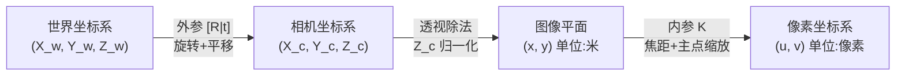

# 相机模型与针孔投影：图像坐标从哪里来

三维空间里的一个点，是如何变成图像上一个像素的？这是 COLMAP、NeRF、3DGS 所有三维视觉方法的底层问题。答案是针孔相机模型——一套把世界坐标映射到图像坐标的几何变换链。

## 四个坐标系与三步变换

一个三维点从"世界空间"到"像素"要经过三步转换，对应四个坐标系：

> 每一步解决一个不同的问题：外参说明相机在世界里的位置朝向；透视除法把三维深度压平；内参把物理单位换算成像素。

## 第一步：外参——相机在世界里的哪里

外参由旋转矩阵 $R$（3×3）和平移向量 $t$（3×1）组成，把世界坐标转换到相机坐标：

$$
\mathbf{X}_c = R \mathbf{X}_w + \mathbf{t}
$$

**直觉**：想象你举着相机站在某处——$t$ 是你站的位置，$R$ 是你脸朝的方向。用这两个量，就能把任意世界坐标系中的点转换到"你眼睛看到的坐标系"里。

$R$ 是正交矩阵（$R^T R = I$，$\det(R)=1$），有 3 个自由度（旋转角）。$t$ 有 3 个自由度（平移）。外参共 6 个自由度，就是相机的六自由度位姿（pose）。

**COLMAP 中的存储**：外参以四元数（用于旋转）+ 三维平移存储，格式为 `QW QX QY QZ TX TY TZ`。

## 第二步：透视除法——把深度压平

相机坐标系中的点 $(X_c, Y_c, Z_c)$ 经过透视投影到焦距为 $f$（单位：米）的图像平面：

$$
x = f \cdot \frac{X_c}{Z_c}, \quad y = f \cdot \frac{Y_c}{Z_c}
$$

**为什么要除以 $Z_c$**：现实中远处的物体看起来更小。除以深度 $Z_c$ 正是模拟这一透视效果——同样大小的物体，距离越远，$Z_c$ 越大，投影坐标 $x, y$ 越小。这一步是不可逆的：深度信息在投影后丢失，这也正是为什么从单张图像无法直接恢复三维结构。

## 第三步：内参——从物理尺寸到像素

图像平面上的物理坐标 $(x, y)$（单位：米）通过内参矩阵 $K$ 转换到像素坐标 $(u, v)$：

$$
K = \begin{bmatrix} f_x & s & c_x \\ 0 & f_y & c_y \\ 0 & 0 & 1 \end{bmatrix}
$$

$$
\begin{bmatrix} u \\ v \\ 1 \end{bmatrix} = K \begin{bmatrix} x \\ y \\ 1 \end{bmatrix}
$$

各参数含义：
- $f_x, f_y$：水平和垂直方向的焦距（单位：像素）。通常 $f_x \approx f_y$，差异来自非方形像素传感器。
- $c_x, c_y$：主点（principal point），即光轴穿过图像平面的像素坐标，通常接近图像中心。
- $s$：斜切系数（skew），现代相机几乎为 0，可忽略。

**数值感知**：一个典型的手机相机，图像分辨率 4000×3000，焦距大约 $f_x \approx 3500$ 像素，主点 $(c_x, c_y) \approx (2000, 1500)$。

## 完整投影公式

把三步合并，世界坐标 $\mathbf{X}_w$ 到像素 $(u, v)$ 的完整映射（齐次坐标形式）：

$$
\lambda \begin{bmatrix} u \\ v \\ 1 \end{bmatrix} = K [R \mid \mathbf{t}] \begin{bmatrix} X_w \\ Y_w \\ Z_w \\ 1 \end{bmatrix}
$$

其中 $\lambda = Z_c$ 是透视深度。矩阵 $P = K[R|\mathbf{t}]$ 称为相机投影矩阵（3×4）。

## 畸变：真实镜头的偏差

真实镜头并非完美针孔，光线在穿过玻璃时会发生弯折（畸变）。COLMAP 中最常用的是径向畸变模型：

$$
x' = x(1 + k_1 r^2 + k_2 r^4 + k_3 r^6), \quad r^2 = x^2 + y^2
$$

$k_1, k_2, k_3$ 是径向畸变系数，$r$ 是归一化图像平面上的半径。正 $k_1$ 对应枕形畸变（图像边缘向外拉伸），负 $k_1$ 对应桶形畸变（向内压缩），广角镜头通常有较大的负 $k_1$。

在使用 COLMAP 时，选择正确的相机模型（`SIMPLE_RADIAL`、`RADIAL`、`OPENCV` 等）会影响重建精度。同焦距同型号的相机可以共享内参（`--ImageReader.single_camera 1`）以减少未知量、提高稳定性。

## 与 COLMAP 的衔接

COLMAP 在 SfM 阶段同时估计所有图像的外参 $(R, t)$ 和每台相机的内参 $K$（相机标定）。理解这一模型是读懂 COLMAP 位姿估计、BA 优化和输出格式的基础。

**知识链接**：
- → [对极几何：两视图如何约束三维空间](/前置知识/014b_前置知识_对极几何两视图几何基础) — 两台相机的几何关系
- → [Bundle Adjustment：同时优化所有相机位姿和三维点](/前置知识/014e_前置知识_BundleAdjustment捆绑调整) — 对内参外参联合优化
