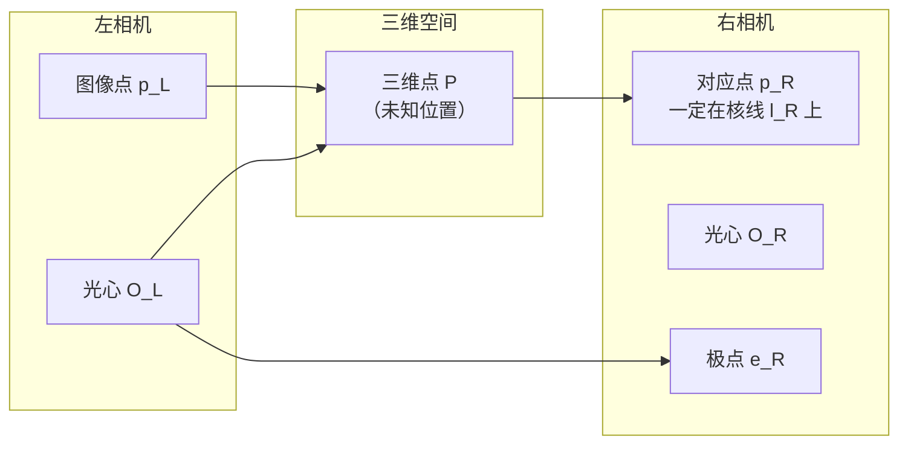

# 对极几何：两视图如何约束三维空间

从单张图像，你无法知道一个点在三维空间里有多远——深度信息被透视投影抹去了。但给定两张图像，且知道两张图像中的点是对应的（同一个三维点），就可以约束并最终恢复三维位置。对极几何就是描述这种约束的数学工具，也是 COLMAP 位姿估计的核心。

## 核线约束：为什么对应点不能随意分布

从左相机光心 $O_L$ 穿过图像点 $p_L$ 的射线，在三维空间中是一条直线。三维点 $P$ 就在这条射线上的某个位置，但具体在哪里未知。这条射线投影到右相机，得到一条直线——称为 **核线（epipolar line）** $l_R$。因此，$p_L$ 的对应点 $p_R$ 一定在核线 $l_R$ 上。

这就是核线约束：**在一张图中找到一个点，在另一张图中搜索对应点时，不需要搜索整个图像，只需要搜索一条线。** 这把匹配的搜索空间从 2D 降到 1D。

## 基础矩阵 F：对应点满足的代数约束

核线约束可以用一个 3×3 矩阵 $F$ 精确地表达。对于图像 1 中的点 $\mathbf{p}$（齐次坐标）和图像 2 中的对应点 $\mathbf{p}'$，它们满足：

$$
\mathbf{p}'^T F \mathbf{p} = 0
$$

**这个公式在说什么**：$F$ 把左图中的点 $\mathbf{p}$ 映射成右图中的一条线（$F\mathbf{p}$ 是核线的系数向量）。$\mathbf{p}'^T (F\mathbf{p}) = 0$ 就是"点 $\mathbf{p}'$ 在直线 $F\mathbf{p}$ 上"的代数表达。

$F$ 有 7 个自由度（3×3 矩阵，齐次且 $\det(F)=0$），因此理论上只需 7 对点就能求解（实践中常用 8 点算法）。$F$ 只依赖两张图像的内参和相对位姿，不需要知道任何三维信息。

## 本质矩阵 E：已知内参时的简化形式

如果两台相机的内参 $K_1, K_2$ 已知，可以把像素坐标归一化到相机坐标系（除去内参影响），得到本质矩阵 $E$：

$$
E = K_2^T F K_1
$$

$$
E = [t]_\times R
$$

其中 $[t]_\times$ 是平移向量 $t$ 的反对称矩阵，$R$ 是两相机间的旋转。$E$ 编码了相机间的纯粹几何关系（旋转 + 平移方向），有 5 个自由度。

**COLMAP 使用 $E$ 还是 $F$**：COLMAP 在已知相机模型时用 $E$（少一半自由度，更稳定）；对内参未知或差异较大的图像对用 $F$。

## 从 E 恢复 R 和 t

已知 $E$，可以通过 SVD 分解恢复旋转矩阵 $R$ 和平移方向 $t$（注意：只能恢复 $t$ 的方向，无法恢复尺度）：

$$
E = U \Sigma V^T \quad \Rightarrow \quad R = U W V^T \text{ 或 } U W^T V^T, \quad t = \pm U[:,2]
$$

其中 $W = \begin{bmatrix}0&-1&0\\1&0&0\\0&0&1\end{bmatrix}$。分解出来有 4 种候选解（$R$ 2 种 × $t$ 2 种符号）。

**通过手性（cheirality）筛选唯一解**：把若干已知对应点用 4 种候选 $(R, t)$ 各自三角测量，检查重建出的三维点是否同时在两台相机前方（$Z_c > 0$）。只有一种解满足这个条件，这就是正确的 $(R, t)$。

## 三角测量：从两条射线恢复三维点

知道了 $(R, t)$，以及两张图像中的对应像素，就可以用三角测量恢复三维坐标。理论上，两条相机射线应该交于一点。实际上由于噪声它们不严格相交，常用线性最小二乘法找最近点（DLT）：

$$
\min_{\mathbf{X}} \| A \mathbf{X} \|^2 \text{ s.t. } \| \mathbf{X} \| = 1
$$

其中 $A$ 由两相机的投影矩阵和像素坐标构造。SVD 的最小奇异值对应的右奇异向量就是三维点的齐次坐标。

**精度与基线的关系**：三角测量的精度与两相机的基线（$\|t\|$）正相关。基线太小（两张图几乎从同一个角度拍），三角化的点会有很大的深度不确定性。COLMAP 用三角测量角（两条射线的夹角）作为质量指标，角度太小的点会被过滤掉。

## 与 COLMAP 的衔接

COLMAP 的两视图几何估计流程：
1. 从特征匹配对出发，用 RANSAC + 5 点算法（或 8 点算法）估计 $E$（或 $F$）
2. 分解 $E$ 为 $(R, t)$
3. 三角测量得到初始三维点
4. 进入增量式 SfM，逐步扩展更多视图

**知识链接**：
- ← [相机模型与针孔投影](/前置知识/014a_前置知识_相机模型与针孔投影) — 投影矩阵的构成
- → [RANSAC：在噪声匹配中找几何一致的子集](/前置知识/014d_前置知识_RANSAC鲁棒估计) — 如何从有大量错误匹配的数据中稳健地估计 $E$
- → [Bundle Adjustment](/前置知识/014e_前置知识_BundleAdjustment捆绑调整) — 三角化后的优化
