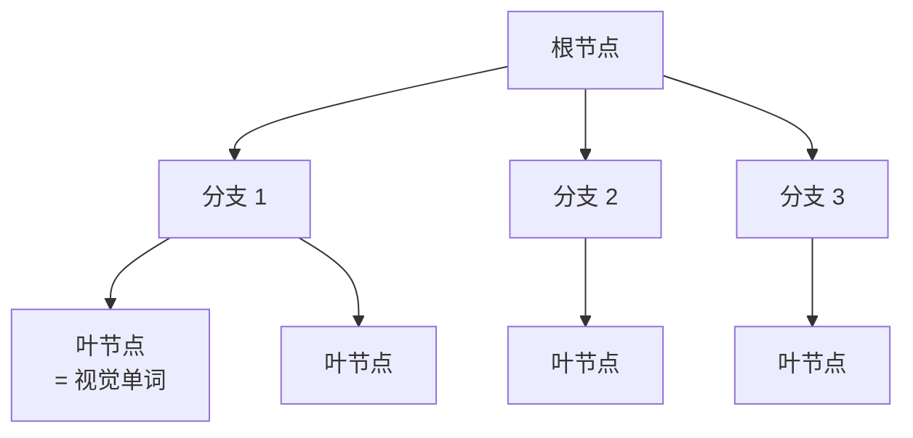
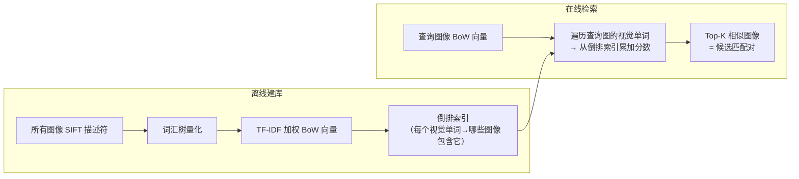

# 词袋模型：从海量图像中快速找相似场景

SIFT 特征匹配需要比较两张图的所有描述符——每对图像的比较成本已经不低。如果有 1000 张图，朴素地两两比对就是近 50 万对，每对还要做向量最近邻搜索：这根本跑不完。

需要解决的问题是**先找到哪些图像值得匹配**，再去做昂贵的 SIFT 比对。词袋模型（Bag of Words，BoW）把这个问题转化成图像检索：用一种粗略但极快的相似度度量，找出场景最可能重叠的候选图像对。

## 视觉词汇表：把连续描述符离散化

SIFT 描述符是 128 维浮点向量，连续空间里两个向量的相似度没法用简单的计数来衡量。BoW 的第一步是**把连续描述符离散化成有限个"视觉单词"**。

做法：从大量图像中收集数百万个 SIFT 描述符，用 k-means 聚类分成 $K$ 个簇（$K$ 通常在 10,000–100,000 之间），每个簇的中心称为一个**视觉单词（visual word）**。这 $K$ 个中心构成**视觉词汇表（visual vocabulary）**。

$$
\text{visual word}(d) = \arg\min_k \| d - c_k \|_2
$$

每个描述符 $d$ 被量化到距离最近的簇中心 $c_k$，原来的 128 维浮点向量变成一个整数索引（1 到 $K$）。

**为什么这行得通**：同一类视觉结构（比如"砖墙角点"、"玻璃边缘"）在不同图像中会产生相似的 SIFT 描述符，它们会落进同一个视觉单词。离散化损失了一些精度，但换来了可以用直方图统计的表示形式。

## BoW 直方图：图像变成词频向量

有了词汇表，每张图像就能表示为一个 $K$ 维直方图：统计图中每个视觉单词出现了多少次。

这个直方图就是图像的 BoW 表示——它完全**忽略了描述符的空间位置**（这也是"袋"字的由来：把所有词扔进一个袋子，不管顺序）。空间信息的丢失意味着 BoW 检索只能找到"词汇组成相似"的图像，不能保证几何对齐，但作为候选筛选已经足够。

## TF-IDF 加权：稀有词更有价值

词频直方图有一个问题：极常见的视觉单词（比如对应天空或白墙的词）在几乎所有图像里都大量出现，但它们对区分图像没有帮助。

TF-IDF（Term Frequency–Inverse Document Frequency）把每个视觉单词的权重与它的**稀有程度**挂钩：

$$
w_{ij} = \underbrace{\frac{n_{ij}}{n_i}}_{\text{TF}} \times \underbrace{\log\frac{N}{N_j}}_{\text{IDF}}
$$

其中 $n_{ij}$ 是单词 $j$ 在图像 $i$ 中的出现次数，$n_i$ 是图像 $i$ 的总描述符数，$N$ 是数据库中的总图像数，$N_j$ 是包含单词 $j$ 的图像数量。

**设计直觉**：$\text{IDF} = \log(N/N_j)$ 在单词 $j$ 出现于所有图像时趋近于 0（公共词无区分力），在单词 $j$ 只出现于少数图像时很大（稀有词有很强区分力）。最终的 TF-IDF 向量归一化到单位长度，两图像之间的相似度用余弦内积衡量。

## 词汇树：层次化加速量化

当 $K$ 很大（如 100,000）时，把每个描述符量化到最近视觉单词需要遍历全部 $K$ 个中心——成本是 $O(K)$，在大规模场景下仍然很慢。

**词汇树（vocabulary tree）**用层次化 k-means 替代平坦 k-means：

每个节点用 $b$ 个子节点分叉，量化时沿树向下：每步只比较 $b$ 个中心，树深 $d$ 层，总叶节点数 $K = b^d$，量化复杂度从 $O(K)$ 降到 $O(b \cdot d) = O(b \log_b K)$。$K=100000$、$b=10$ 时，$d=5$，每次量化只需 50 次比较而非 100,000 次。

COLMAP 附带了一个预训练好的词汇树（可从 COLMAP 官网下载，有 256K/1M 两个规格），不需要用户自己训练。

## 检索流程：从查询到候选对

**倒排索引**让检索极快：不需要和数据库中每张图逐一比较，而是只访问查询图里出现的那些视觉单词，通过倒排表找到包含这些单词的图像，累加相似度分数。检索 Top-50 候选图从 N 张数据库图中只需 $O(|q| \cdot \bar{n})$（$|q|$ 是查询图视觉单词数，$\bar{n}$ 是每个单词平均出现的图像数），通常比全量 $O(N)$ 快很多。

## COLMAP 的实际使用

COLMAP 的词袋检索通过 `vocab_tree_matcher` 命令执行，主要参数：

| 参数 | 默认值 | 含义 |
|------|--------|------|
| `VocabTreeMatching.vocab_tree_path` | — | 词汇树文件路径（必须提供） |
| `VocabTreeMatching.num_nearest_neighbors` | 5 | 每张图检索最相似的前 K 张图 |
| `VocabTreeMatching.num_checks` | 256 | 量化时的最近邻检查次数（越大越准确） |

**词袋检索只负责找候选对**，不替代 SIFT 匹配。后续依然要对每对候选图做完整的 SIFT 描述符比对和几何验证。`num_nearest_neighbors=5` 意味着每张图最多和 5 张相似图匹配，总匹配对数是 $O(N)$ 而非 $O(N^2)$，对几百张图的场景已经够用。

**知识链接**：
- ← [SIFT 特征](/系列/colmap_deep_dive/02_SIFT特征提取与描述) — BoW 量化的原始描述符来源
- → [COLMAP 系列：特征匹配策略](/系列/colmap_deep_dive/03_特征匹配策略) — 词袋检索如何融入完整匹配流程
