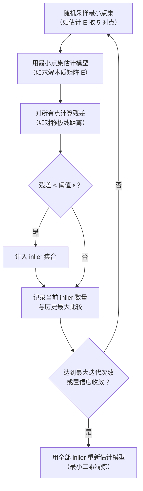

# RANSAC：在充满噪声的匹配中找几何一致的子集

特征匹配（SIFT、SuperPoint 等）找到的"对应点对"里，有相当一部分是错的——同名错配（outliers）。如果直接用所有匹配点估计相机位姿，这些错误匹配会严重污染结果。RANSAC（随机采样一致性）是处理大量 outliers 时的标准工具，也是 COLMAP 特征匹配验证阶段的核心。

## 问题：最小二乘法对 outlier 极其敏感

普通最小二乘法找到所有数据点的整体最优拟合，但只要有几个 outlier（离群点），它们就会把拟合结果拉偏。在特征匹配场景下，100 个匹配里可能有 60 个是错的——此时最小二乘估计出来的 $F$（基础矩阵）或 $H$（单应矩阵）几乎没有意义。

RANSAC 的思路反其道而行之：**不求所有点的最优拟合，而是找一个子集，让这个子集的数据点和拟合结果高度一致，同时内点（inliers）的数量尽量多。**

## RANSAC 的完整流程

> 关键在于"采样最小点集"——估计 $E$ 只需要 5 对点（5点算法），估计单应矩阵 $H$ 只需要 4 对点。采样规模越小，每次迭代越快，在高 outlier 率下仍能收敛。

## 迭代次数的公式推导

迭代多少次才能大概率采到一个全是 inlier 的样本？设 outlier 比例为 $\epsilon$（如 60% 错误匹配则 $\epsilon = 0.6$），每次采样 $s$ 个点，要求置信度至少为 $p$（如 $p = 0.999$）：

$$
N = \frac{\log(1 - p)}{\log(1 - (1 - \epsilon)^s)}
$$

**为什么是这个形式**：$(1-\epsilon)^s$ 是一次采样 $s$ 个点全部是 inlier 的概率。$1 - (1-\epsilon)^s$ 是至少有一个 outlier（本次采样失败）的概率。经过 $N$ 次迭代都失败的概率是 $(1-(1-\epsilon)^s)^N$。令这个概率等于 $1-p$，解出 $N$。

| outlier 比例 $\epsilon$ | 所需迭代数 $N$（$s=5$，$p=0.999$） |
|---|---|
| 20% | 约 6 次 |
| 50% | 约 76 次 |
| 80% | 约 4000 次 |

COLMAP 的 RANSAC 有动态调整：随着找到 inlier 更多的模型，$\epsilon$ 估计不断降低，所需迭代次数自动减少。

## 阈值 ε 的选择：残差用什么衡量

对于估计基础矩阵 $F$，常用的残差是**对称极线距离**：点 $\mathbf{p}$ 到其对应核线 $F\mathbf{p}'$ 的距离，加上 $\mathbf{p}'$ 到 $F^T\mathbf{p}$ 的距离。

阈值选 1-2 像素是常见做法。太大：接受太多 outlier；太小：噪声下把真正的 inlier 也排除了。COLMAP 默认值在绝大多数相机上合适，对鱼眼或畸变较大的镜头可能需要调大。

## LORANSAC：Local Optimization 提升精度

标准 RANSAC 用最小点集估计模型，当 inlier 被正确识别后，只做一次最小二乘精炼。LORANSAC（Lo-RANSAC）在找到新的最佳假设后，立即用当前的 inlier 集合做一次局部优化（拟合 + 更新 inlier + 再拟合），往往能更快找到更好的解。COLMAP 默认使用 LORANSAC。

## 与 COLMAP 的衔接

COLMAP 在两个地方用到 RANSAC：
1. **几何验证（geometric verification）**：验证图像对的匹配，用 RANSAC 估计 $E$/$F$/$H$，过滤 outlier，只保留通过几何验证的图像对进入 SfM。
2. **图像注册（image registration）**：新图像加入 SfM 时，用 PnP + RANSAC 估计其位姿。

**知识链接**：
- ← [对极几何](/前置知识/014b_前置知识_对极几何两视图几何基础) — RANSAC 要估计的模型（$E$/$F$）是什么
- → [Bundle Adjustment](/前置知识/014e_前置知识_BundleAdjustment捆绑调整) — RANSAC 给出粗略估计，BA 做精细优化
