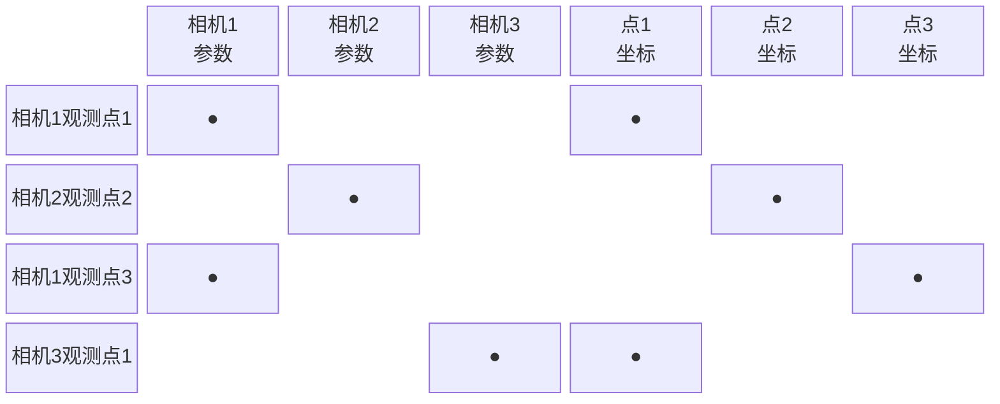

# Bundle Adjustment：同时优化所有相机位姿和三维点

SfM 流程里每一步都有误差积累：特征点定位有亚像素级噪声，RANSAC 位姿估计有残差，三角测量有深度不确定性。随着场景越来越大、相机越来越多，这些误差叠加起来，最终让重建出来的三维点云"漂移"——开头和结尾本应重合的部分在空间里错开了。

Bundle Adjustment（BA，捆绑调整）是解决这个问题的工具：**把所有相机位姿、内参、三维点位置作为变量，以重投影误差最小化为目标，同时联合优化。** BA 是 SfM 精度的最终保证。

## 目标：重投影误差最小化

一个三维点 $\mathbf{X}_j$ 在相机 $i$ 中的观测像素是 $\mathbf{x}_{ij}$，把 $\mathbf{X}_j$ 用相机 $i$ 的参数投影回图像，得到预测像素 $\hat{\mathbf{x}}_{ij}$。**重投影误差**就是实测和预测之间的距离：

$$
e_{ij} = \mathbf{x}_{ij} - \hat{\mathbf{x}}_{ij}(R_i, \mathbf{t}_i, K_i, \mathbf{X}_j)
$$

BA 要找到所有相机参数 $\{R_i, \mathbf{t}_i, K_i\}$ 和所有三维点 $\{\mathbf{X}_j\}$，使所有观测的重投影误差之和最小：

$$
\min_{\{R_i, \mathbf{t}_i, K_i\}, \{\mathbf{X}_j\}} \sum_{(i,j) \in \mathcal{O}} \rho\left( \| e_{ij} \|^2 \right)
$$

**这个公式在说什么**：对每一对"相机 $i$ 观测到三维点 $j$"的记录，计算预测投影和实测像素的距离，累加所有误差。$\rho(\cdot)$ 是鲁棒核（如 Huber 损失），让单个 outlier 不会主导整个优化。

**规模感知**：100 张图、10000 个三维点、平均每点被 5 张图看到，就有 50000 个残差项，待优化变量约 100×6 + 10000×3 = 30600 个——是一个大规模非线性最小二乘问题。

## 雅可比矩阵的稀疏结构

用 Gauss-Newton 或 Levenberg-Marquardt 迭代求解，每步需要计算雅可比矩阵 $J$（残差对变量的偏导）。$J$ 的结构是稀疏的：第 $(i,j)$ 个残差只与相机 $i$ 的参数和三维点 $j$ 的坐标有关，和其他相机或点无关。

> 每行（每个残差）只有少数几列非零。这种稀疏性让 BA 可以高效求解，否则稠密矩阵求逆的计算量是 $O(n^3)$，完全无法扩展。

## Schur 消元：利用稀疏性加速

BA 的正规方程（Hessian 矩阵等于 $J^T J$）有一个特殊的"箭头形"稀疏结构：相机参数之间有耦合（一对相机如果共同观测了同一个点，它们在正规方程中就相互影响），而三维点的参数块是对角块（每个点只影响自己）。

利用这一结构，可以先从方程中消去所有三维点的变量（Schur 消元/边际化），得到一个只含相机参数的缩减系统：

$$
(E - W M^{-1} W^T) \Delta c = b_c - W M^{-1} b_p
$$

$M$ 是三维点的 Hessian 对角块（容易求逆），$W$ 是相机-点耦合项。消元后，先解相机参数 $\Delta c$，再代回求三维点增量 $\Delta p$。

**计算复杂度**：Schur 消元后，相机系统的大小只有 $n_c \times 6$（$n_c$ 是相机数），而不是 $(n_c \times 6 + n_p \times 3)$。对于 100 张图、10000 个点，这把矩阵规模从 30600 压缩到 600，求解速度差距达几十倍。

## 增量式 BA 与全局 BA

**增量式 BA**：在 SfM 每注册几张新图像后，只对最近新加的相机和看到的三维点做局部 BA，速度快，允许实时运行。COLMAP 每隔一定步骤做一次全局 BA。

**全局 BA**：所有相机和点一起优化，精度最高，计算量最大，通常在 SfM 结束时做一次。

**实现**：COLMAP 使用 Google 的 Ceres Solver，它封装了自动微分、稀疏 LM、Schur 消元，开箱即用且高度优化。

## 规范化（gauge freedom）

BA 的绝对坐标系（位置和尺度）是欠定义的——把所有相机和三维点同时平移、旋转、缩放，重投影误差不变。不处理这一不确定性，优化会发散。COLMAP 通过固定第一张图的外参（或用 QR 分解归一化）消除这个自由度。

**知识链接**：
- ← [对极几何](/前置知识/014b_前置知识_对极几何两视图几何基础) — BA 要优化的初始值来自三角测量
- ← [相机模型与针孔投影](/前置知识/014a_前置知识_相机模型与针孔投影) — BA 的待优化变量：$K, R, t$
- → [COLMAP 系列：Bundle Adjustment 章节](/系列/colmap_deep_dive/06_BundleAdjustment) — BA 在 COLMAP 中的具体实现细节
