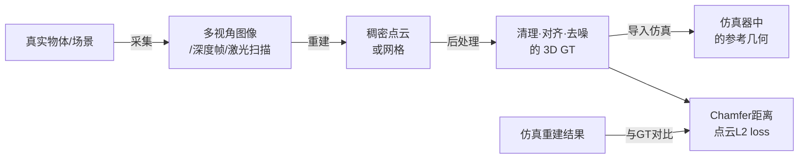
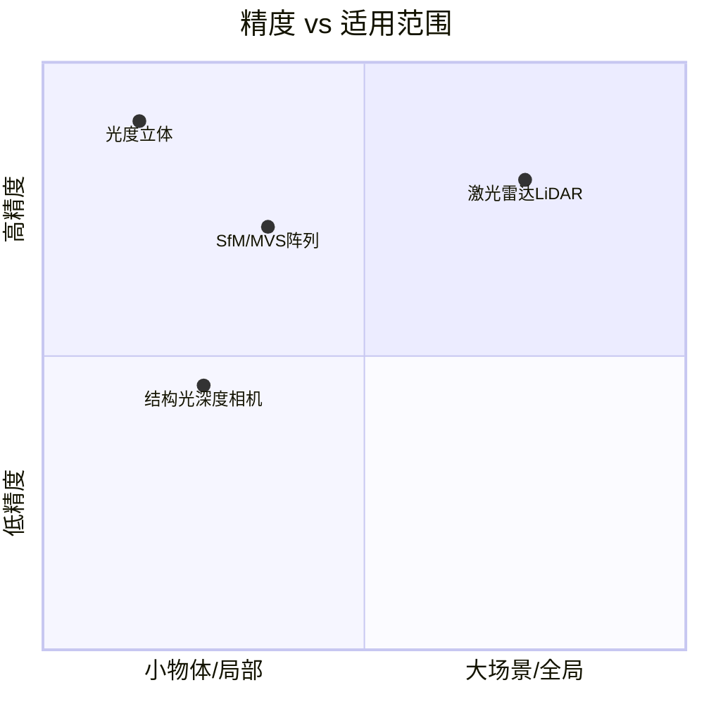

# 三维真值获取：Real2Sim 评估的几何基准

> **一句话**：要量化仿真场景和真实物体之间的几何差距，必须先有一份精确的三维参考几何——这份参考就叫"3D Ground Truth（3D GT）"。没有它，Chamfer 距离、点云 L2 loss 这些评估指标就无从计算。

## 知识链接

- [Chamfer 距离：衡量两个点云的形状有多接近](/前置知识/011b_前置知识_Chamfer距离_点云形状相似性度量) — 3D GT 是 Chamfer 距离计算的基准端
- [图像质量指标：PSNR、SSIM、LPIPS](/前置知识/011c_前置知识_图像质量指标_PSNR_SSIM_LPIPS) — 与 3D GT 互补，从渲染角度度量 real-sim gap
- [相机模型与针孔投影](/前置知识/014a_前置知识_相机模型与针孔投影) — 多视角重建的基础，相机如何将三维点投影到图像
- [Bundle Adjustment 捆绑调整](/前置知识/014e_前置知识_BundleAdjustment捆绑调整) — SfM 管线中同时优化相机位姿和三维点坐标的核心步骤

---

## 为什么 Real2Sim 需要 3D GT

Real2Sim 管线的目标是把真实物体或场景"复刻"进仿真器——准确到让策略在仿真里训练出来，直接搬到真机上也能用。评估这个复刻有多准，有两条路：

- **渲染路**：把仿真场景渲染成图，和真实照片对比——用 PSNR、SSIM、LPIPS
- **几何路**：把仿真场景导出为点云或网格，和真实物体的三维几何直接对比——用 Chamfer 距离、点云 L2 loss

渲染路不需要 3D GT，用照片就够了。几何路必须有一份参考三维几何，这就是 3D GT。

几何路评估比渲染路更严格。渲染图可以通过光照调整、纹理映射来掩盖几何缺陷，看起来"还行"；但点云对比会直接暴露物体侧面缺了一块、薄壳厚度算错了这类问题。对于抓取任务，接触点的几何精度直接影响物理仿真的正确性——渲染图好看但接触面计算错误，策略在真机上依然会失败。

> 3D GT 贯穿整个评估链路：先从真实物体采集获得参考几何，后处理成干净的点云或网格，再与仿真重建结果对比计算指标。

---

## 四种主流获取方式

### 多视角 RGB + SfM/MVS

**结论先说**：把物体放在固定台上，用多台相机（或一台相机绕圈拍摄）从各角度拍照，通过 Structure-from-Motion（SfM）估算相机位姿，再用 Multi-View Stereo（MVS）稠密匹配出三维点云。

原理简述：SfM 在各帧图像中检测特征点（SIFT 等），匹配同一特征在不同视角的像素坐标，通过三角化恢复三维位置，同时用 Bundle Adjustment 联合优化相机位姿和三维点，使重投影误差最小。MVS 在 SfM 位姿基础上，对每对相邻帧做稠密深度估计，融合出稠密点云。

| 指标 | 典型值 |
|------|--------|
| 相机数量 | 30–100 台（阵列）或单机绕圈 |
| 精度 | 1–5 mm（取决于分辨率和基线） |
| 适用对象 | 中等尺寸漫反射物体（杯子、玩具、零件） |
| 主要局限 | 透明、高反光、无纹理表面重建质量差 |

**真实案例**：PhysTwin 使用约 30 个 RGB 摄像头组成的同步阵列，一次性采集布料、毛巾等薄壳物体在抓取过程中的形变序列，作为物理仿真的 3D GT。

### 结构光深度相机

**结论先说**：主动投射已知图案（条纹、点阵）到物体表面，用内置摄像头捕捉图案畸变，三角化得到每个像素的深度值，直接生成深度图再融合成点云。

常见设备：Intel RealSense（近红外结构光）、Microsoft Kinect v2（ToF 时间飞行）、Apple TrueDepth（点阵结构光）。

| 指标 | 典型值 |
|------|--------|
| 单帧时间 | 实时（30fps 以上） |
| 精度 | 1–10 mm（距离越远越差） |
| 最佳工作距离 | 0.3–2 m |
| 主要局限 | 阳光干扰（近红外），黑色/透明表面失效 |

**真实案例**：在机器人操作 Real2Sim 里，RealSense D435 常用来扫描桌面上的单个操作物体，获得粗精度的点云供仿真器导入。精度"凑合差不多"指的就是这种级别——0.5–1 cm 误差在大物体抓取里可以接受，但薄壳接触仿真里会引入明显的接触面计算错误。

### 激光雷达（LiDAR）

**结论先说**：发射激光脉冲，记录光从发射到反射回来的飞行时间，换算出精确距离，旋转扫描覆盖整个场景。

| 指标 | 典型值 |
|------|--------|
| 精度 | 1–5 mm（近距离工业级可达 0.1 mm） |
| 适用范围 | 场景级（房间、车间、室外） |
| 主要局限 | 价格高，对高反光金属和透明材质有盲区 |

**真实案例**：COLMAP 系列的场景级重建里，LiDAR 点云常用作 SfM 结果的精度验证基准；RoboTwin 等仿真环境的桌面场景有时用 LiDAR 扫描真实工作台来初始化几何。

### 光度立体（Photometric Stereo）

**结论先说**：固定相机不动，用从不同方向打来的光源逐张照亮物体，利用各角度光照下的亮度差计算表面每个像素的法线方向，积分还原出高精度表面形状。

这个方法不擅长恢复整体三维形状，但对**平面物体的表面细节**（细纹、刻印、布料纹路）精度极高，可以达到亚毫米。

| 指标 | 典型值 |
|------|--------|
| 适用对象 | 平坦或低曲率表面 |
| 精度 | 0.1 mm 级表面法线 |
| 主要局限 | 无法处理高曲率物体背面，不能独立恢复完整几何 |

---

## 四种方式的对比

> 没有一种方法全面胜出：高精度的光度立体只能覆盖局部表面，覆盖全场景的 LiDAR 对透明材质失效，最常用的 SfM/MVS 阵列在薄壳侧边等复杂几何处重建质量下降。

---

## 薄壳物体为什么特别难

薄壳（布料、毛巾、纸张、薄金属片）是 Real2Sim 里公认最难处理的类别，原因可以从三维重建角度理解：

**深度相机的盲区**：薄壳侧面在深度图里只有几个像素宽，深度精度（1–5 mm）比壳厚（0.1–1 mm）低一个数量级，侧边几何完全重建不出来。

**多视角重建的法线模糊**：布料表面漫反射，正面容易匹配；但薄壳侧边的特征点密度极低，三角化误差大，MVS 在侧边经常"塌陷"——重建出的侧边厚度可能是真实的 5–10 倍。

**实际后果**：如果用这份不精确的 3D GT 计算 Chamfer 距离，侧边误差会被平均进全局指标，掩盖真实的 real-sim gap。PhysTwin 的解法是在有限元仿真里对 SDF（有符号距离场）单元做接触插值，绕过了直接依赖侧边精确几何的问题，在"GT 不完美"的条件下仍能正确评估接触行为。

---

## "凑合差不多"的 GT 带来什么问题

当 3D GT 本身存在误差（例如用单台 RealSense 扫描、精度 5–10 mm），用它计算出的 Chamfer 距离和点云 L2 loss 有两个系统性偏差：

**误差下限抬高**：即使仿真几何完全准确，用不精确的 GT 算出来的 Chamfer 距离也不会是零，而是被 GT 误差本身限制了下限。这意味着你无法分辨"仿真本身不够好"还是"GT 太粗糙"。

**相对改进被压缩**：方法 A 把 Chamfer 距离从 8 mm 降到 6 mm，方法 B 降到 4 mm——但如果 GT 误差本身就有 5 mm，这个对比就失去了意义。两个方法的真实差异被 GT 噪声淹没。

这解释了为什么 Real2Sim 论文里常见"开源数据集的 30 相机阵列"设置：足够多的视角和同步采集大幅降低了 GT 误差，使得 Chamfer 距离的数值比较才有意义。

---

## 获取方式选型速查

| 场景 | 推荐方案 | 理由 |
|------|----------|------|
| 论文评估，需要精确 GT | 多视角阵列（≥30 台同步相机）+ MVS | 精度高，社区标准 |
| 快速工程验证 | RealSense/Kinect 深度相机 | 实时，部署方便，精度够用 |
| 大型工作场景/桌面 | LiDAR 扫描 | 毫米级精度，覆盖范围广 |
| 布料/薄壳细节研究 | 多视角阵列 + 物理参数化仿真辅助 | 侧边几何靠仿真模型补充，不依赖 GT 完美 |
| 无预算/快速原型 | 开源数据集（如 YCB、ShapeNet 扫描） | 质量可控，但换到自定义物体需重新采集 |
