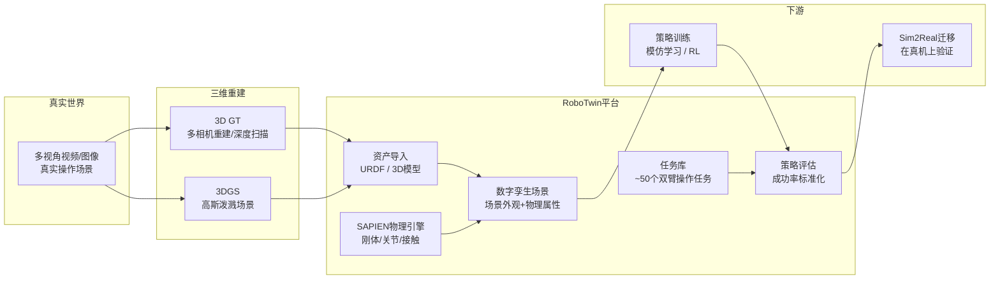

# RoboTwin：双臂机器人操作的数字孪生仿真平台

> **一句话**：RoboTwin 是一个专门为双臂协作操作设计的仿真基准平台——它不只是一个物理引擎，而是在 SAPIEN 之上搭建了"任务库 + 数字孪生场景生成 + 标准评估协议"的完整工具链，让不同策略能在同一套任务上公平对比。

**知识链接**：
- [三维真值获取与多视角重建](/前置知识/015a_前置知识_三维真值获取与多视角重建)（占位）——Real2Sim 的上游，提供场景的 3D 几何
- [SAPIEN 仿真平台](/前置知识/015c_前置知识_SAPIEN仿真平台)（占位）——RoboTwin 的底层物理引擎
- [数字表亲与 Real2Sim 数据增广](/前置知识/010b_前置知识_数字表亲与Real2Sim数据增广)——为什么要从真实场景构建一族仿真变体

---

## 双臂操作为什么需要一个专门的仿真平台

单臂机器人抓一个杯子，任务里只有一个主角。双臂机器人（bimanual robot）要同时控制两条手臂，这两条手臂的动作必须在时间上精确协调——一只手按住盒子，另一只手才能把盖子拧开；一只手举着托盘，另一只手才能往上放物品。

这给仿真平台带来两个额外挑战：

1. **任务定义更复杂**：需要描述"哪只手做什么、什么时候交接"，而不是单臂那样简单的"抓哪里、放哪里"。
2. **评估指标更难统一**：不同研究组自定义任务和成功标准，结果根本无法横向比较。

RoboTwin 的出发点就是解决这两个问题：用 LLM 辅助的程序化方法自动生成双臂任务描述，并提供统一的评估协议，让不同策略在同一套任务上直接比较成功率。

## RoboTwin 在 Real2Sim 管线中的位置

> 图中，真实场景经过三维重建（得到 3D GT 或 3DGS）之后，资产被导入 RoboTwin。RoboTwin 把物理引擎（SAPIEN）、任务定义和场景外观整合在一起，策略在这里训练并接受标准化评估，最终验证能否迁移到真机。

三维重建负责"把真实场景的几何搬进仿真"，RoboTwin 负责"在这个几何上定义任务、运行物理、评估策略"。两者分工明确，RoboTwin 是 Real2Sim 管线的第二段。

## 核心组件

### 物理引擎：SAPIEN

RoboTwin 的物理仿真由 SAPIEN（Simulation And Physical Environment for Interactive Networks）提供。SAPIEN 是清华大学开发的开源物理仿真器，支持刚体、关节体和接触动力学，并原生支持 GPU 并行，可以同时跑多个环境实例（对强化学习训练很关键）。

RoboTwin 本身不处理物理计算，它是在 SAPIEN 之上的一层上层框架，负责场景组织、任务逻辑和评估协议。可以把 SAPIEN 理解为"引擎"，RoboTwin 是"车身"。

### 任务库

RoboTwin 内置约 50 个双臂操作任务，覆盖常见的操作类型：

- **抓取类**：双手协作拾取大型物体（如箱子、托盘）
- **装配类**：一手固定、一手插入或拧紧（螺栓、瓶盖）
- **搬运类**：双手端持易倾翻容器（装水的碗、玻璃杯）
- **翻转类**：把物体从一种朝向转成另一种朝向

任务定义由 LLM 和程序化脚本联合生成：LLM 负责自然语言描述和任务逻辑草案，程序化脚本把草案转换成可在 SAPIEN 内执行的状态机和成功判断条件。这样既有语言层面的多样性，又有精确的可执行定义。

### 数字孪生场景生成

当真实场景的 3D 重建结果（点云、网格、或 3DGS 表示）准备好之后，需要把它转成 SAPIEN 能加载的格式（通常是 URDF 或 `.obj` 网格加物理属性标注）。RoboTwin 提供了这条转换管线：

1. 从三维重建结果中提取物体的几何形状
2. 手动或自动标注物理属性（质量、摩擦系数、碰撞包围盒）
3. 把场景的视觉外观（纹理、光照）和物理属性一起打包，生成可复现的仿真场景

这个场景就是"数字孪生"——在外观上尽量接近真实场景，在物理行为上尽量还原真实物体的特性。

### 策略评估协议

标准化是 RoboTwin 相比自搭仿真环境最大的价值。评估协议规定：

- 每个任务在固定的初始状态分布下随机采样若干次（如 100 次）
- 以任务成功率（success rate）为主要指标，成功/失败的判定条件在任务定义时锁死
- 支持多种策略接口（模仿学习策略、RL 策略、基于语言指令的策略）

这样，在 RoboTwin 上报告"任务 X 的成功率 Y%"就有了可比性，不同论文的数字可以直接对比。

## 与其他仿真平台的定位差异

| 平台 | 定位 | 物理引擎 | 任务库 | 双臂支持 | 评估标准化 | 典型用途 |
|------|------|----------|--------|----------|------------|----------|
| **RoboTwin** | 双臂操作基准 + 数字孪生 | SAPIEN | ✅ 内置~50个 | ✅ 专门设计 | ✅ 有 | 策略横向对比、Real2Sim 验证 |
| **Isaac Sim** | 通用机器人仿真器 | PhysX | ❌ 需自己定义 | ✅ 支持 | ❌ 无统一协议 | 传感器仿真、工业场景、强化学习 |
| **MuJoCo** | 轻量高效物理引擎 | 自研 | 部分（via dm_control） | ✅ 支持 | 部分（Gym 接口） | 研究原型、连续控制算法验证 |
| **SAPIEN** | 底层物理仿真器 | 自研 | ❌ 需自己定义 | ✅ 支持 | ❌ 无 | 作为其他框架的底层（如RoboTwin） |

RoboTwin 的独特之处是"任务库 + 评估协议"的组合，而不是物理性能。Isaac Sim 物理更精确（PhysX 引擎），MuJoCo 更轻量，但两者都没有提供"双臂操作专用、可直接用于横向对比"的标准任务集。RoboTwin 填的正是这个空缺。

## 局限与常见坑

**资产导入的 sim-real gap**

这是 RoboTwin 使用中最大的工程挑战。把真实场景的 3D 重建导入仿真时，物理属性（质量、摩擦、弹性）无法从几何形状自动推断，必须手动标注或用经验值近似。一个杯子在真实世界里的摩擦系数和在仿真里的默认值可能差很多，导致策略在仿真里学会的技能到真机上失效。

解决方向：用系统辨识（system identification）方法，通过真机上的一系列探索动作，反推仿真里该用什么物理参数。

**视觉外观的 sim-real gap**

即使几何形状一致，仿真里的光照和渲染也和真实相机图像有差距。这会让依赖视觉输入的策略出现泛化问题。常见缓解方法是域随机化（对光照、纹理、颜色随机扰动）或直接用深度图代替 RGB。

**LLM 生成任务的质量问题**

RoboTwin 用 LLM 辅助生成任务脚本，但 LLM 生成的状态机逻辑可能有 bug，导致成功判定条件不准确。使用 RoboTwin 内置任务时问题不大；如果要自定义新任务，需要仔细验证生成的判定逻辑是否符合预期。
