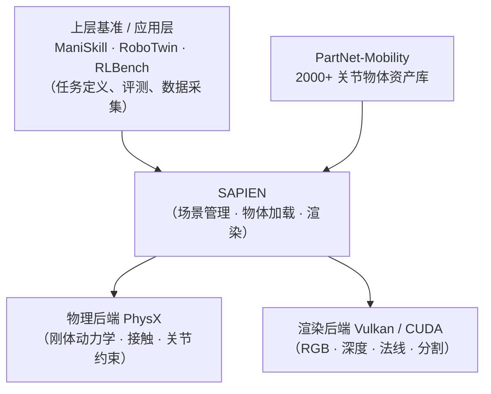

# SAPIEN：关节物体操作仿真的交互式物理引擎

> **一句话**：SAPIEN 是机器人操作研究最常用的物理仿真平台，专门为"带关节的物体"（抽屉、门、箱盖）和灵巧手操作任务设计，提供精确的接触力学和一个配套的 Python API，上层的 ManiSkill、RoboTwin 等主流基准都以它为物理后端。

## 知识链接

- [RoboTwin 仿真基准](/前置知识/015b_前置知识_RoboTwin仿真基准) — RoboTwin 以 SAPIEN 为底层物理引擎
- [3D Gaussian Splatting：用一堆椭球把真实场景搬进电脑](/前置知识/007a_前置知识_3D_Gaussian_Splatting三维场景重建) — Real2Sim 流程中重建的场景资产最终要导入 SAPIEN 等仿真器中运行

---

## SAPIEN 在技术栈中的位置

机器人操作研究通常在三层结构上运作：研究者写的任务代码在最上层，物理引擎在最下层，中间是一个"胶水层"把任务定义翻译成物理引擎能理解的指令。SAPIEN 同时扮演了胶水层和物理引擎这两个角色，并向上暴露了一套简洁的 Python API。



> 上层应用只和 SAPIEN 的 Python API 打交道；物理求解和渲染分别由 PhysX 和 Vulkan 承接，对用户透明。PartNet-Mobility 是最常用的关节物体数据集，SAPIEN 对它有原生的加载支持。

---

## 核心能力

### 关节物体模拟

普通仿真器（如 MuJoCo 早期版本）处理关节时要求用户手写 URDF（统一机器人描述格式）中的铰链参数。SAPIEN 的重点设计目标之一是让**来自扫描/重建的真实物体**也能参与物理交互。它支持以下关节类型：

- **转动关节**（revolute）：门、旋钮、瓶盖
- **棱柱关节**（prismatic）：抽屉、推拉窗
- **自由关节**（free）：可以在空间任意运动的刚体

每个关节都有可配置的摩擦、阻尼、限位和驱动力矩，足以覆盖桌面操作任务里的绝大多数物体类型。

### PartNet-Mobility 数据集

**PartNet-Mobility** 是 SAPIEN 团队随论文一同发布的配套资产库（不是单独的外部数据集），包含 2000+ 类日常物体（椅子、冰箱、储物柜……）的三维网格，并带有**语义分割好的关节标注**——每个可动部件的轴向、运动范围、父子关系都已标记好，导入 SAPIEN 之后直接可以驱动，不需要手工标注。

这是 SAPIEN 区别于 MuJoCo 和 PyBullet 的最大差异：它不只是一个求解器，还附带了一整套可以立刻用于研究的带关节资产。

### 传感器与渲染

SAPIEN 通过 Vulkan 后端支持以下渲染输出，可以直接作为机器人的观测输入：

| 传感器类型 | 用途 |
|-----------|------|
| RGB 图像 | 视觉策略训练 |
| 深度图 | 点云生成、距离估计 |
| 实例/语义分割掩码 | 物体定位 |
| 法线图 | 接触法向估计 |

---

## 和其他仿真器的比较

三个最常见的对比对象是 MuJoCo、Isaac Sim 和 PyBullet，它们的定位差异明显：

**MuJoCo** 是轻量级、高性能的接触力学求解器，主要用于连续控制（locomotion、dexterous hand），资产生态以 URDF/MJCF 手工建模为主，没有现成的大规模关节物体库。

**Isaac Sim**（NVIDIA）基于 Omniverse USD 格式，GPU 并行度极高，适合需要数千个并行环境的大规模 RL 训练。代价是安装和配置远比 SAPIEN 重，与 Python 深度学习工作流的集成需要更多胶水代码。

**SAPIEN** 的定位是：关节物体种类最丰富、和 Python/PyTorch 工作流最易集成、上层有 ManiSkill 等标准化基准直接可用，适合操作任务的算法研究。

---

## 在 Real2Sim 中的角色

Real2Sim 流程的目标是把真实场景中拍到的物体"移植"进仿真器，让策略能在仿真中和真实物体的几何/动力学交互。SAPIEN 在这个流程里扮演**目标仿真环境**的角色：


> 重建管线生成几何后，要手工或半自动地给物体添加关节标注和碰撞体，然后导入 SAPIEN。这个对接步骤（几何 → 可仿真资产）是 Real2Sim 流程中最容易出现误差累积的环节。

---

## 快速上手：最小可运行示例

SAPIEN 的核心工作流是：创建引擎和场景 → 加载资产 → 步进物理 → 读取渲染结果。以下示例展示了从零启动一个场景、加载一个带关节的物体、并运行几步物理的最小代码路径。

在此之前先安装：

```bash
pip install sapien          # SAPIEN 2.x，依赖 Python ≥ 3.8
```

下面的代码创建一个空场景，添加地面和重力，加载一把带关节的椅子（PartNet-Mobility 格式），然后模拟 10 步并打印第一个关节的当前角度：

```python
import sapien.core as sapien

engine = sapien.Engine()
renderer = sapien.VulkanRenderer()
engine.set_renderer(renderer)

scene = engine.create_scene()
scene.set_timestep(1 / 100.0)          # 100Hz 仿真
scene.add_ground(altitude=0)
scene.set_ambient_light([0.5, 0.5, 0.5])

# 从 PartNet-Mobility 格式加载一个带关节物体（如 chair）
loader = scene.create_urdf_loader()
loader.fix_root_link = True            # 固定根节点，不让物体整体飞走
asset = loader.load("path/to/chair/mobility.urdf")
asset.set_root_pose(sapien.Pose(p=[0, 0, 0.5]))

for _ in range(10):
    scene.step()                       # 步进一帧物理

joints = asset.get_joints()
print(f"关节 0 当前角度: {joints[0].get_drive_target():.4f} rad")
```

`loader.fix_root_link = True` 的作用是告诉引擎把物体的根连杆固定在世界坐标系里——抽屉这类物体本身不会自由飞，只有它的子连杆（抽屉板）能沿关节轴滑动。去掉这一行，整个物体就变成自由体，会在重力下掉落。

---

## 小结

SAPIEN 的核心价值是**关节物体 + Python 友好 + 标准基准生态**三件事同时做好。它不追求最快的并行度（那是 Isaac 的优势），也不追求最通用的接触力学（那是 MuJoCo 的优势），而是把"把扫描来的真实物体变成可以操作的仿真道具"这件事做到开箱即用。对做桌面操作、Real2Sim、灵巧手任务的研究者来说，SAPIEN + ManiSkill 是目前阻力最小的起点。
