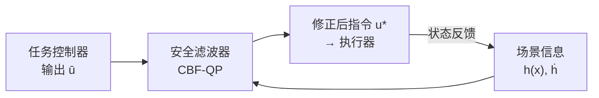

# 控制屏障函数：给机器人控制器装一层安全滤波器

控制屏障函数（Control Barrier Function，CBF）解决的问题是：你有一个能完成任务的控制器，但它不知道障碍物在哪，如果直接运行会碰撞。CBF 的做法不是重新设计控制器，而是在它输出指令之前加一层过滤——每个时间步都问"这条指令走下去还安全吗？"，如果不安全就用一次二次规划把指令微调到刚好安全的最近值，然后把调整后的指令发给机器人。任务性能损失最小，安全性由数学保证。

## 安全集合与屏障函数

CBF 的核心是把"安全"翻译成一个函数的符号。选一个函数 $h(\mathbf{x})$，满足：

- $h(\mathbf{x}) \geq 0$：机器人在安全区域内
- $h(\mathbf{x}) < 0$：机器人在危险区域内

安全集合定义为 $\mathcal{S} = \{ \mathbf{x} \mid h(\mathbf{x}) \geq 0 \}$。对于"距离障碍物至少保持 $r$ 米"的要求，可以取 $h(\mathbf{x}) = \|\mathbf{p} - \mathbf{p}_\text{obs}\|^2 - r^2$，机器人在 $r$ 米外时 $h > 0$，进入 $r$ 内时 $h < 0$。

让 $\mathcal{S}$ 保持不变的充分条件是：只要系统当前在 $\mathcal{S}$ 边界（$h = 0$），状态的时间导数方向要指向 $\mathcal{S}$ 内部（$\dot{h} \geq 0$）。CBF 把这个条件放宽成：

$$
\dot{h}(\mathbf{x}, \mathbf{u}) \geq -\alpha \, h(\mathbf{x})
$$

**这个公式在做什么**：当 $h$ 还很大（离边界远）时，允许 $\dot{h}$ 稍微为负（可以靠近障碍物）；当 $h$ 接近零（快到边界了）时，强制 $\dot{h} \geq 0$（必须停止靠近）。$\alpha > 0$ 是可调参数，控制这个"减速缓冲"有多急。

::: details 📐 公式详解（点击展开）

| 子表达式 | 它是谁 | 它在干嘛 |
|---------|--------|---------|
| $\dot{h}(\mathbf{x}, \mathbf{u})$ | $h$ 对时间的导数，取决于当前状态和控制输入 | 衡量"当前指令会让 $h$ 上升还是下降" |
| $\alpha \, h(\mathbf{x})$ | $h$ 的当前值乘以增益 $\alpha$ | 离边界越近，允许的 $\dot{h}$ 下降空间越小 |
| $\alpha > 0$ | 用户可调的增益参数 | $\alpha$ 越大，减速越激进，保守性越高 |

**用人话读**：离障碍物越近，控制器越不允许继续靠近。

**为什么是这个形式**：直接要求 $\dot{h} \geq 0$ 过于保守（靠近前就要停）；这个放宽允许缓慢接近，只在边界附近才强制撤离，同时在理论上能证明 $h \geq 0$ 永远成立。
:::

## 安全滤波器：一次 QP 解决问题

给定名义控制器输出 $\bar{\mathbf{u}}$（不考虑障碍物的原始指令），安全滤波器求解：

$$
\mathbf{u}^* = \arg\min_{\mathbf{u}} \|\mathbf{u} - \bar{\mathbf{u}}\|^2 \quad \text{s.t.} \quad \dot{h}(\mathbf{x}, \mathbf{u}) \geq -\alpha \, h(\mathbf{x})
$$

**这个公式在做什么**：在所有满足安全约束的指令里，找一个和原始指令偏差最小的——最小代价修正。

::: details 📐 公式详解（点击展开）

| 子表达式 | 它是谁 | 它在干嘛 |
|---------|--------|---------|
| $\|\mathbf{u} - \bar{\mathbf{u}}\|^2$ | 修正量的平方范数 | 衡量对名义控制器的"破坏程度" |
| 约束 $\dot{h} \geq -\alpha h$ | 安全不等式 | 强制满足上一节推导的 CBF 条件 |
| $\mathbf{u}^*$ | QP 的最优解 | 既安全又尽量保留任务意图的最终指令 |

**用人话读**：给原始指令做最小幅度的修正，恰好让机器人不会越过安全边界。

**为什么是这个形式**：QP 有解析结构，单个约束时闭式可解，多个约束时也可在毫秒内求解。这使得 CBF 能在每个控制周期（10–100 Hz）实时运行。
:::

> 名义控制器只管完成任务，不知道障碍物。CBF 滤波器在输出端把危险指令挡住，两个模块完全解耦。

## 高阶 CBF：控制量进入导数更深

上面的推导假设控制量 $\mathbf{u}$ 直接决定 $\dot{\mathbf{x}}$（一阶系统，比如速度控制的移动机器人）。对于加速度控制的机械臂，$\mathbf{u}$ 影响 $\ddot{\mathbf{p}}$，$h$ 对时间的一阶导数 $\dot{h}$ 里不含 $\mathbf{u}$，需要看二阶导数 $\ddot{h}$ 才能把约束和控制量挂钩——这叫**相对度为 2**的情形。

处理方式是引入二阶 CBF（HOCBF）：定义 $\psi_0 = h$，$\psi_1 = \dot{\psi}_0 + \alpha \psi_0$，要求 $\dot{\psi}_1 + \beta \psi_1 \geq 0$。展开后得到一个关于 $\mathbf{u}$ 的线性约束，形式和一阶情形相同，仍然可以放进 QP 里求解。SAFER-Splat（见综述文章 S36）用的就是这个方案：障碍物是三维高斯椭球，机器人末端执行器是质点，控制量是加速度。

## 与高斯泼溅的结合点

SAFER-Splat 把每个三维高斯定义了一个 $h_i(\mathbf{p})$：在椭球外部 $h_i > 0$，在内部 $h_i < 0$，以此代替传统的点云或网格障碍物。原始 3DGS 场景有数十万个高斯，但大多数距离末端执行器很远，对当前运动完全无关。每个控制步只需要把当前位置附近的高斯加入约束集，99.9% 的约束在加入 QP 前就可以直接剪枝，只剩少数几个活跃约束需要求解。这使得整套流程可以在 15 Hz 运行。

## 和相关概念的关系

CBF 解决"当前这一步安不安全"，是**局部、逐步**的保证。它不规划路径，也不知道目标在哪里——任务规划和目标导向行为由名义控制器负责。两者分工：名义控制器负责有效，CBF 滤波器负责安全。

和传统路径规划的区别在于：路径规划在执行前一次性找到无碰路径，对动态变化的场景响应慢；CBF 在每个控制步在线求解，天然支持障碍物移动或新增的情形，代价是只能保证局部安全，不保证全局可达性。

**知识链接**：[[neus-article]]、[[colmap-series-status]]、3DGS 基础见前置知识 007a，碰撞近似类型见前置知识 011a，具体应用见综述 S36（具身高斯）。
