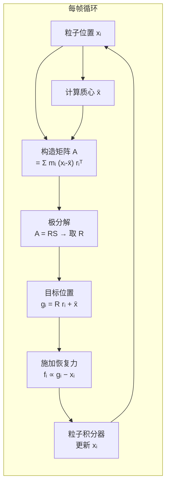

# 形状匹配：让仿真刚体在力的作用下保持形状

粒子仿真（PBD、SPH、MPM 等）把物体离散成一堆粒子，然后对每个粒子单独积分运动方程。这很方便，但有一个问题：刚体的定义是"不管受什么力，内部点的相对位置不变"。如果只让粒子各自受力运动，刚体会慢慢"融化"——粒子间距拉伸、旋转错开，刚性消失。

**形状匹配（Shape Matching）** 解决这个问题的思路不是给粒子之间加弹簧（会引入振荡），而是每一帧直接找一个最合适的刚体变换（旋转 + 平移），让变换后的参考构型尽量贴合当前粒子位置，然后把粒子拉向这个目标——像给每个粒子一个"回家"的力。

## 核心思路

给定一个刚体，在参考构型（未变形时）里各粒子的位置记为 $\mathbf{r}_i$（相对于质心，称为**参考偏移**）。当前构型中粒子实际位置为 $\mathbf{x}_i$，当前质心为 $\bar{\mathbf{x}}$。

形状匹配要找一个旋转矩阵 $\mathbf{R}$ 使得 $\mathbf{R} \mathbf{r}_i + \bar{\mathbf{x}}$ 尽量接近 $\mathbf{x}_i$。换言之，把参考构型旋转到当前帧最合适的朝向。找到 $\mathbf{R}$ 后，每个粒子的目标位置就定了：

$$
\mathbf{g}_i = \mathbf{R} \, \mathbf{r}_i + \bar{\mathbf{x}}
$$

**这个公式在做什么**：用当前帧拟合出的最优旋转，把参考构型里的第 $i$ 个粒子"投影"到它在刚体上应该在的位置。$\mathbf{g}_i$ 就是这帧粒子 $i$ 的"理想落点"。

::: details 📐 公式详解（点击展开）

| 子表达式 | 它是谁 | 它在干嘛 |
|---------|--------|---------|
| $\mathbf{r}_i$ | 参考偏移（输入，初始化时固定） | 描述粒子 $i$ 在刚体中的"出生位置"（相对质心） |
| $\mathbf{R}$ | 当前帧求解出的旋转矩阵（状态，每帧更新） | 描述刚体当前朝向与参考朝向的差 |
| $\bar{\mathbf{x}}$ | 当前所有粒子的质心（每帧计算） | 描述刚体整体在哪 |
| $\mathbf{g}_i$ | 粒子 $i$ 的目标位置（输出，每帧计算） | 刚体约束下这帧粒子应该在的地方 |

**用人话读**：先算出刚体现在转了多少、到哪里了，再把每个粒子的"应在位置"算出来，然后把粒子推过去。

**为什么是这个形式**：刚体变换 = 旋转 + 平移。把参考偏移旋转之后加上质心，正好是"旋转的刚体上第 $i$ 个点"的全局坐标。
:::

## 求最优旋转

问题归结为：给定 $\mathbf{x}_i - \bar{\mathbf{x}}$（当前偏移）和 $\mathbf{r}_i$（参考偏移），求最优旋转 $\mathbf{R}$。

构造矩阵 $\mathbf{A} = \sum_i m_i (\mathbf{x}_i - \bar{\mathbf{x}}) \mathbf{r}_i^\top$，对 $\mathbf{A}$ 做极分解（Polar Decomposition）：$\mathbf{A} = \mathbf{R S}$，其中 $\mathbf{R}$ 是正交矩阵（旋转）、$\mathbf{S}$ 是正定对称矩阵（拉伸）。提取 $\mathbf{R}$ 即为所求。

极分解可以通过 SVD 计算：$\mathbf{A} = \mathbf{U} \mathbf{\Sigma} \mathbf{V}^\top$，则 $\mathbf{R} = \mathbf{U} \mathbf{V}^\top$（如果行列式为负则翻转最小奇异值对应列，避免反射）。

> 每帧走一遍这个循环：拟合旋转 → 算目标 → 施力 → 积分。形状约束以力的形式加入，和外力（重力、碰撞力、视觉力）共存，不需要单独求解约束方程组。

## 施加恢复力

最简单的做法是直接把每帧粒子推向目标：

$$
\mathbf{f}_i^\text{shape} = \frac{\alpha}{\Delta t^2} (\mathbf{g}_i - \mathbf{x}_i)
$$

**这个公式在做什么**：对每个粒子加一个正比于"与目标位置偏差"的弹性力，把它往应在的地方推。系数里除以 $\Delta t^2$ 是为了让力的强度和时间步长无关——否则步长越小，每步推得越轻，刚性越差。

::: details 📐 公式详解（点击展开）

| 子表达式 | 它是谁 | 它在干嘛 |
|---------|--------|---------|
| $\mathbf{g}_i - \mathbf{x}_i$ | 恢复向量（输出） | 粒子偏离理想位置的方向和大小 |
| $\alpha$ | 刚度系数（用户可调，0–1） | 控制恢复力有多强；1 = 完全刚体 |
| $1/\Delta t^2$ | 时间步长归一化因子（由仿真器提供） | 保证刚度和步长选择无关 |

**用人话读**：粒子偏了多少就推多少，$\alpha$ 决定推得有多猛。

**为什么要除以 $\Delta t^2$**：速度更新是 $\Delta v = f \cdot \Delta t / m$，位置更新是 $\Delta x = \Delta v \cdot \Delta t$，所以 $\Delta x \propto f \Delta t^2$。要让每帧位移固定（刚度稳定），力必须以 $1/\Delta t^2$ 缩放。
:::

## 仅针对刚体，不负责弹性变形

形状匹配的"参考构型"是固定的初始状态，恢复力始终指向那个固定形状。这只对刚体有意义——对于橡皮泥、布料、流体，形状本身就该改变，不能用形状匹配。

需要弹性变形时要用其他方案：Position-Based Dynamics（PBD）加距离约束可以模拟弹性软体，MPM 通过弹塑性本构模型（弹性模量、泊松比）来描述变形程度，两者都不以"回到初始形状"为目标，而是以"满足材料本构"为目标。

在具身高斯（Embodied Gaussians）的参考实现里，形状匹配专门服务于刚体（杯子、箱子）；柔性物体如果需要仿真则要换用 PBD 或 MPM。

## 和 PBD 的关系

PBD（Position-Based Dynamics）的刚度约束也可以实现近似的刚体效果，但需要对所有粒子对加距离约束，约束数量是 $O(n^2)$，而且调参困难（每次迭代次数影响等效刚度）。形状匹配只需要对整个刚体做一次极分解，参数（$\alpha$）有清晰的物理含义，实现更简洁。

**知识链接**：具身高斯中形状匹配的实际应用见综述 S36，粒子动力学基础见前置知识 006f（PBD），MPM 仿真见前置知识 006n，控制屏障函数见前置知识 015d。
