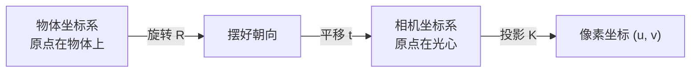

# 6DoF 位姿估计与 ADD-S 评测指标

> **一句话**：位姿估计回答"这个物体在相机的坐标系里的哪个位置、朝向哪里"，ADD 系列指标回答"估出来的位姿到底错了多少"——而绕对称轴的朝向本来就没有唯一答案，所以必须用只比较最近点的 ADD-S，而不是逐点对应的 ADD。

**知识链接**：
- [三维旋转表示：旋转矩阵、四元数与角速度](/前置知识/006a_前置知识_三维旋转表示_旋转矩阵四元数与角速度) — 位姿的旋转部分有 6D、四元数、9D 等多种参数化，是本文一切位姿预测的基础
- [相机模型与针孔投影](/前置知识/014a_前置知识_相机模型与针孔投影) — 深度图如何反投影成相机坐标系下的三维点（pointmap），是位姿估计的直接输入
- [螺旋理论与 SE(3) 指数映射](/前置知识/008a_前置知识_螺旋理论Twist与SE3指数映射) — 刚体位姿的数学本体就是 SE(3) 上的一个元素
- [Chamfer 距离：点云形状相似性度量](/前置知识/011b_前置知识_Chamfer距离_点云形状相似性度量) — 形状重建的评测指标，和 ADD-S 是同一类"最近点"思想

---

## 一、位姿是什么：把一个物体"放回"相机坐标系

一台相机拍下一张桌子上的水杯。照片里只有二维像素，但水杯在现实里有六个数千真万确地决定了它的状态：它相对相机往右偏了多少、往上抬了多少、离镜头多远（3 个平移自由度），以及它绕竖直轴转了多少、绕着水平轴点了多少次头、像钟表指针一样翻滚了多少（3 个旋转自由度）。这六个自由度合起来就是 **6DoF 位姿（6 Degrees of Freedom pose）**。

用数学写，位姿是一个刚体变换 $T \in \mathrm{SE}(3)$，作用是把物体自身坐标系里的点搬到相机坐标系：

$$
\mathbf{p}_{\text{cam}} = \mathbf{R}\,\mathbf{p}_{\text{obj}} + \mathbf{t}
$$

**这个公式在做什么**：说明"位姿"到底运算是怎么发生的——一个物体自带的坐标点，先被旋转 $\mathbf{R}$ 摆好朝向，再被平移 $\mathbf{t}$ 挪到正确位置，就落到它在相机眼里的位置。

::: details 📐 公式详解（点击展开）

| 子表达式 | 它是谁 | 它在干嘛 |
|---------|--------|---------|
| $\mathbf{p}_{\text{obj}}$ | **物体自己的坐标** | 在"物体局部坐标系"里描述的一个点，比如杯子把手的根在原点附近 |
| $\mathbf{R} \in \mathrm{SO}(3)$ | **朝向** | 一个 $3\times 3$ 旋转矩阵，决定物体的三个轴对准相机坐标系的哪几个方向 |
| $\mathbf{t} \in \mathbb{R}^3$ | **位置** | 物体原点相对相机原点的偏移，单位是米 |
| $\mathbf{p}_{\text{cam}}$ | **相机看到的坐标** | 同一个点在相机坐标系中的位置，可以直接投影成像素 |
| $T = (\mathbf{R}, \mathbf{t})$ | **6DoF 位姿** | 这一对量合起来就是我们要估计的目标，旋转 3 个自由度 + 平移 3 个自由度 |

**用人话读**："先把物体在脑子里摆成正确朝向，再平移到正确的地方，它就到了相机看到的位置。"

**为什么是这个形式**：刚体不能拉伸、不能扭曲，只允许旋转和平移，所以位姿只能落在 SE(3) 这个群里。任何"缩放"都要单独当作一个参数处理（RecGen 用的是相似变换 Sim(3)，即在 SE(3) 之外再加一个各向同性尺度 $s$）。
:::

> 从物体到像素要经过旋转、平移、投影三步；位姿估计做的事，就是从像素（加上深度）反推回旋转和平移。

位置上还有一层约定：**相机坐标系**是指原点在相机光心、$z$ 轴指向拍摄方向的坐标系；**世界坐标系**是场景固定的一个参考系。位姿估计通常直接输出"物体相对相机"的位姿，因为它不需要额外的世界坐标定义，也正是机器人抓取时最直接需要的量。

---

## 二、位姿估计的三条路线，差别在"有没有已知模型"

同样是估计位姿，任务的难度高度依赖于**我们事先知不知道这个物体长什么样**。由此分出一组关键区分：

| 情形 | 事先知道什么 | 典型任务名 | 难点 |
|------|--------------|------------|------|
| 已知物体的 CAD 模型 | 物体的精确网格 | 实例级 6DoF 位姿 | 只需把已知网格和图像对齐 |
| 知道类别但没见过这个实例 | 类别先验（"水瓶大概长这样"） | 类别级位姿与尺寸估计 | 实例的具体形状也要估 |
| 完全没见过 | 什么都不知道 | 模型无关位姿估计 / 新物体位姿 | 形状、尺度、位姿全要猜 |

"模型无关位姿估计"（model-free pose estimation）看起来最难，但实际做法通常是：**先生成一个网格，再把它对齐到图像或深度上**。这就把问题拆成了"生成"和"配准"两步。早期方法（如 Any6D）正是这么做的：用 InstantMesh 或 TRELLIS 生成网格，再用图像/深度匹配反推位姿。

拆成两步会带来一个隐蔽的麻烦：**生成和对齐是分别优化的，误差会累积**。生成网络给出的网格尺度、朝向未必和输入照片一致，配准阶段就必须在"网格形状本身可能就不对"的前提下寻找最优对齐，在杂乱场景、弱纹理或对称物体上非常容易翻车。

于是第三条路线出现了：**把形状和位姿当成一个联合分布，一次生成出来**。这就是 RecGen 的选择，也是本系列精读的核心。要理解它到底赢在哪里，先得理解评测这件事——因为对称性让"位姿错了多少"这个问题本身都变得不平凡。

---

## 三、怎么衡量位姿错多少：ADD 家族

最朴素的度量是 **ADD（Average Distance of model points）**：把预测位姿和真实位姿分别作用在同一组物体表面点上，逐点求距离再平均。

$$
\text{ADD} = \frac{1}{N}\sum_{i=1}^{N} \left\lVert \mathbf{R}_{\text{pred}}\,\mathbf{x}_i + \mathbf{t}_{\text{pred}} \;-\; \mathbf{R}_{\text{gt}}\,\mathbf{x}_i - \mathbf{t}_{\text{gt}} \right\rVert
$$

**这个公式在做什么**：给同一堆物体表面点两个不同的"落点"——一个按预测位姿落，一个按真值位姿落——然后量两套点之间的距离，距离越小说明位姿估得越准。

::: details 📐 公式详解（点击展开）

| 子表达式 | 它是谁 | 它在干嘛 |
|---------|--------|---------|
| $\mathbf{x}_i$ | **物体上的采样点** | 从物体自身坐标系里取的 $N$ 个表面点，第 $i$ 个记为 $\mathbf{x}_i$ |
| $\mathbf{R}_{\text{pred}}\mathbf{x}_i+\mathbf{t}_{\text{pred}}$ | **预测摆位** | 点 $i$ 在预测位姿下落到相机坐标系的位置 |
| $\mathbf{R}_{\text{gt}}\mathbf{x}_i+\mathbf{t}_{\text{gt}}$ | **真值摆位** | 同一个点在真值位姿下应有的位置 |
| $\lVert\cdot\rVert$ | **逐点距离** | 两个位置的欧氏距离，单位是米（或物体直径的比例） |
| $\frac{1}{N}\sum_i$ | **全局平均** | 把 $N$ 个点的误差平均成一个标量 |

**用人话读**："把物体的每个点分别按我猜的位姿和正确位姿摆一遍，看两套点平均差多远。"

**为什么这么定义**：它直接度量"如果把物体按预测位姿放进场景，它会偏离正确位置多远"，这正是抓取和仿真关心的量。实践里常把它归一化成"占物体直径的百分比"，并报告误差小于 10% 直径（ADD@0.1）或 5%（ADD@0.05）的样本比例——这就是常写的 **ADD@0.1d**、**ADD@0.05d**，数值越高越好。
:::

ADD 有一个致命弱点：**它假设每个点都有唯一正确的对应点**。可现实里大量物体是**旋转对称**的——一个方盒绕中心竖轴转 90° 后，外形和原来一模一样；一个圆柱形瓶子绕自身轴转任意角度，看起来都没区别。这时候"把标签转到背面"和"把标签转到正面"在几何上根本分不出对错，但 ADD 会判前者错得离谱。

### 3.1 ADD-S：只问"最近点"多远

解决办法是把"逐点对应"换成"最近点匹配"：**预测的每个点，只要在真值点云里能找到某个很接近的点，就算对**。这就是 **ADD-S（Average Distance of model points for Symmetric objects）**。

$$
\text{ADD-S} = \frac{1}{N}\sum_{i=1}^{N} \min_{\mathbf{x}_j \in \mathcal{M}} \left\lVert \mathbf{R}_{\text{pred}}\,\mathbf{x}_i + \mathbf{t}_{\text{pred}} \;-\; \big(\mathbf{R}_{\text{gt}}\,\mathbf{x}_j + \mathbf{t}_{\text{gt}}\big) \right\rVert
$$

**这个公式在做什么**：和 ADD 唯一的区别，是把"第 $i$ 个点必须对第 $i$ 个点"放宽成"第 $i$ 个点只要对上真值里的任意一个点就行"，于是对称旋转不再被当成错误。

::: details 📐 公式详解（点击展开）

| 子表达式 | 它是谁 | 它在干嘛 |
|---------|--------|---------|
| $\mathbf{R}_{\text{pred}}\mathbf{x}_i+\mathbf{t}_{\text{pred}}$ | **预测点 $i$ 的位置** | 和第 $i$ 个物体点被我摆到了哪里 |
| $\min_{\mathbf{x}_j \in \mathcal{M}}$ | **最近的替身** | 在真值点云 $\mathcal{M}$ 里找离它最近的那个点，不要求编号一致 |
| 其余符号 | **同 ADD** | 采样点、真值摆位、平均方式都不变 |

**用人话读**："我摆出来的每个点，只要正确的那套点里有一个点就贴在我旁边，就当我摆对了——不追究是哪一个点。"

**为什么这样才公平**：对称物体的真值位姿本身就不唯一，逐点惩罚等于强迫模型猜中一个无法从图像推断出来的具体编号。用最近点匹配，度量的是"我摆出来的形状和正确的形状是否重合"，而不是"我猜中的是哪种对称等效解"。
:::

> 横轴是绕对称轴的旋转误差，红色是逐点对应的 ADD，蓝色是最近点匹配的 ADD-S。方盒转 30° 时 ADD 早已越过 0.1 直径的成功阈值，ADD-S 却几乎纹丝不动——这说明评测一个"外形近对称"的物体时，用 ADD 会把一个几何上正确的解判成失败。

### 3.2 ADD-SB：当"真值网格"也是生成的

标准 ADD 需要真值网格 $\mathcal{M}$。但在很多新数据集（尤其是合成仿真数据）里，"真值"本身就是一份生成的网格，可能和渲染用的真实几何略有出入。RecGen 采用的 **ADD-SB（Bidirectional ADD-S，双向 ADD-S）** 在预测网格和真值网格之间**双向**计算最近点距离：既看预测的每个点到真值最近多远，也看真值的每个点到预测最近多远，两边都算了再合并。这样，无论哪一方多出一块或少了一块几何，都会被计入误差，不会出现"我少做了一半几何却因为点对得上而侥幸得分"。

### 3.3 尺度也要单算：DRE

位姿里的平移和尺度很容易混淆：一个物体如果既离相机远、又比较大，它的投影可能和一个离得近、比较小的物体一模一样。当物体被严重遮挡、只剩一小块可见时，"它到底有多大"会变得极难判断，而尺度猜错会连带把位置和直径一起带偏。

为此 RecGen 引入 **DRE（Diameter Relative Error，直径相对误差）**：

$$
e_d = \frac{\lvert d_{\text{pred}} - d_{\text{gt}} \rvert}{d_{\text{gt}}}
$$

**这个公式在做什么**：把"预测出来的物体直径"和"真实直径"相比，看差了多少个百分比——专门监控遮挡下最容易被搞错的尺度。

::: details 📐 公式详解（点击展开）

| 子表达式 | 它是谁 | 它在干嘛 |
|---------|--------|---------|
| $d_{\text{pred}}$ | **预测直径** | 模型认为这个物体有多大 |
| $d_{\text{gt}}$ | **真值直径** | 物体实际直径 |
| $\lvert\cdot\rvert$ | **取绝对值** | 把偏大和偏小都记为正的误差 |
| 除以 $d_{\text{gt}}$ | **归一化** | 让一个大物体和小物体的尺度误差可以公平对比 |

**用人话读**："算出来的物体尺寸和真实尺寸，差了百分之几。"

**为什么单列这个指标**：ADD-S 已经包含了尺度误差，但它和形状误差混在一起。把尺度单独拿出来看，才能确认"模型是不是在被遮挡的情况下也能正确估计物体的绝对大小"——这正是把重建资产放进物理引擎前必须过关的一步，尺寸错了，重力下的行为就全错了。
:::

---

## 四、位姿指标之外的形状与外观指标

位姿对了不代表几何对。一个物体的形状质量通常用 **Chamfer 距离（CD）** 衡量（见 [Chamfer 距离前置知识](/前置知识/011b_前置知识_Chamfer距离_点云形状相似性度量)）：预测网格到真值网格的单向最近点平均距离，再加反方向，两项之和。为了消除尺度影响、让大小不同的物体可比，报告时常把 CD 除以真值直径，得到 **CD_norm**。

外观质量则沿用图像领域的标准指标——**PSNR**、**SSIM**、**LPIPS**（见 [图像质量指标：PSNR / SSIM / LPIPS](/前置知识/011c_前置知识_图像质量指标_PSNR_SSIM_LPIPS)），做法是把预测资产按预测位姿渲染出来，和真实物体按真值位姿渲染出来的图比较。

这些指标里，"位姿指标"和"形状指标"必须**分开看**，因为一个模型完全可能在几何上得分很高（把形状做得像），却在位姿上惨败（放错了位置和朝向）——而这恰恰是模块化管线（先建网格、后配准）最容易出现的问题。

---

## 五、为什么这些指标对 Real2Sim 是硬指标

把真实场景重建进仿真器（Real2Sim）时，物体要被物理引擎当成刚体来处理。这会暴露出三个在渲染视角下看不出来、但在物理视角下致命的问题：

- **位姿错了几个毫米**：物体和桌面之间就会出现穿模或悬空，仿真第一帧就会让物体弹飞或陷进去。ADD-S 直接量化这个风险。
- **尺度错了几个百分点**：重力、摩擦、接触力全都按错误的尺寸计算，策略在仿真里学到的行为无法迁移。DRE 专门盯这件事。
- **对称物体朝向错了**：视觉上几乎看不出差别，但如果物体表面有标签、把手或功能区分，抓取点就会落在错误的一侧；纹理就会和朝向对不上。这正是"对称物体必须用 ADD-S + 朝向一致性检查"的原因。

一句话：**在 Real2Sim 里，位姿和尺度不是"锦上添花的美观指标"，而是资产能不能被物理引擎正确加载的前提。**

---

## 六、小结

| 指标 | 衡量什么 | 越高越好还是越低越好 | 关键设计 |
|------|----------|----------------------|----------|
| ADD | 预测位姿与真值位姿的逐点平均距离 | 越低越好 | 需要逐点对应，对称物体上偏严 |
| ADD-S | 最近点匹配下的位姿误差 | 越低越好 | 放宽对应关系，对对称旋转不惩罚 |
| ADD-SB | 双向最近点误差 | 越低越好 | 真值网格也是生成的情况下更公平 |
| DRE | 预测直径的相对误差 | 越低越好 | 单独监控遮挡下的尺度错误 |
| CD_norm | 归一化 Chamfer 形状距离 | 越低越好 | 只看几何形状，与位姿解耦 |
| PSNR / SSIM / LPIPS | 渲染后的外观保真度 | PSNR/SSIM 越高越好，LPIPS 越低越好 | 需要先按位姿摆放再渲染 |

**记忆锚点**：ADD 问"每个点有没有摆到它自己该在的地方"；ADD-S 问"我摆出来的这团几何，有没有和正确的几何重合"。前者关心编号，后者关心形状——对称物体上，后者才是能真正从图像推断出来的那一半。

## 延伸阅读

- [RecGen 精读](/论文综述/162_RecGen_生成式联合形状位姿重建)：把本文的指标用在"联合生成形状与位姿"的生成式重建框架上
- [OVOW：从单目视频重建可仿真的 4D 场景](/论文综述/161_OVOW_单目视频重建可仿真4D场景)：同样关心位姿与尺度，用于把视频重建成可仿真资产
- [多视角物体重建与融合综述](/论文综述/S35_多视角物体重建与融合综述)：从多视角重建到 6DoF 位姿的更广视野
