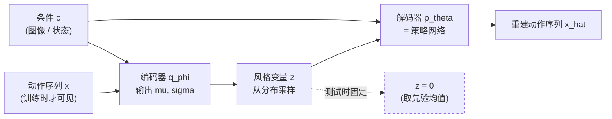

# 前置知识：条件变分自编码器 CVAE——给生成模型加上"条件"

> **一句话**：条件变分自编码器（Conditional Variational Autoencoder, CVAE）是一种"输入一个条件 $c$，输出一个服从该条件的分布"的生成模型——它不是给每个条件单独训练一个网络，而是让同一个网络学会"给定 $c$ 时哪些输出是合理的"。

## 一 从一个机器人抓取问题说起

假设你有一个机械臂，同一张桌子上同一个杯子，人用手演示了 50 次把它抓起来。这 50 次里，手腕的角度、接近的路径、闭合的时机都不一样。现在你想训练一个策略网络，输入是相机图像，输出是机械臂的下一组关节角。

普通的监督学习会怎么做？对每一帧图像，让网络去回归那一帧对应的"标准答案"关节角。问题是：**同一个图像对应 50 个不同的、都正确的关节角**。如果你强行让网络回归到它们的平均值，得到的往往是一个既不左也不右、抓不到杯子的"平均动作"。这就是多模态（multi-modal）问题：数据在同一条件下有多个合理的输出，简单回归会把它平均掉。

CVAE 的核心动机就是解决这个问题：**面对"一个输入对应多个合理输出"的数据，不要预测单点，而是预测一个分布。**

## 二 普通自编码器与 VAE

先把"条件"放一放，理解条件之前的东西。

**自编码器（Autoencoder, AE）** 由两部分组成：编码器 $f_\phi$ 把输入 $x$ 压成一个低维向量，解码器 $g_\theta$ 再从低维向量重建 $x$。训练目标是重建误差最小。它的问题在于：编码出来的低维向量是"离散地"对应训练样本的，你随手在低维空间里取一个点丢给解码器，解码器往往产出一堆噪声——它没有被训练过处理"凭空出现"的点。

**变分自编码器（Variational Autoencoder, VAE）** 的关键改动：编码器不再输出一个确定的向量，而是输出一个分布的**参数**——均值 $\mu$ 和标准差 $\sigma$。也就是说，对于输入 $x$，编码器说"这个 $x$ 在潜空间里大致住在以 $\mu$ 为中心、宽度为 $\sigma$ 的高斯分布里"。

为什么这个改动有意义？因为它强迫整个潜空间被组织成一个光滑的结构：训练时还有一个正则项把每个编码分布往标准高斯 $\mathcal{N}(0, I)$ 拉。结果是潜空间里任意一个点附近都有训练样本的"痕迹"，你可以在潜空间里平滑地插值、采样，解码器都能产出合理的东西。VAE 的完整推导（ELBO 的来历）见 [对数似然与变分下界](/前置知识/000e_前置知识_对数似然与变分下界)。

## 三 加上"条件"：CVAE

现在回到抓杯子的问题。我们希望网络输出的分布**依赖于当前看到的图像**。这就在 VAE 的每个部件上加了一个"条件输入" $c$：

- **编码器**：$q_\phi(z \mid x, c)$——看到"图片 $c$ 和与之配对的动作 $x$"，推断动作 $x$ 在这张图片下应该对应潜变量 $z$ 的什么分布。
- **解码器**：$p_\theta(x \mid z, c)$——给定潜变量 $z$ 和图片 $c$，生成动作 $x$。

这里的 $z$ 被称为**风格变量（style variable）**。它被设计成承载"这一次演示和别次的差异"——比如这次手腕偏左一点、这次多等了半秒。图像 $c$ 提供"必须做到什么"的硬约束，$z$ 提供"以哪种方式做"的自由度。

> 读图重点：编码器只在训练时存在，它的唯一作用是"教会解码器如何利用 $z$"。部署时整条左支路被砍掉，$z$ 直接固定成先验均值（对角高斯通常取 0），解码器退化成"给定图像 $c$，输出一个确定的动作序列"。

## 四 训练目标

CVAE 的训练目标是最大化数据在给定条件下的对数似然。由于真实后验不可解，实际优化的是它的下界（ELBO），课本里通常拆成两项：

$$
\mathcal{L}_{\text{CVAE}} = \underbrace{-\mathbb{E}_{z \sim q_\phi(z \mid x, c)}\big[\log p_\theta(x \mid z, c)\big]}_{\text{重建项：让 } x \text{ 能被还原}} + \underbrace{\beta\, D_{\mathrm{KL}}\big(q_\phi(z \mid x, c) \,\|\, \mathcal{N}(0, I)\big)}_{\text{正则项：让 } z \text{ 接近先验}}
$$

**这个公式在做什么**：第一项要求"用图像和潜变量把动作重建出来"，逼解码器学会利用 $z$ 和 $c$；第二项要求"事后看出来的 $z$ 分布不要偏离标准高斯太远"，逼潜空间保持光滑，这样测试时随手取 $z = 0$ 也能解码出合理动作。

::: details 📐 公式详解（点击展开）

| 子表达式 | 它是谁 | 它在干嘛 |
|---------|--------|---------|
| $\log p_\theta(x \mid z, c)$ | **重建打分** | 解码器拿着 $z$ 和图像 $c$ 生成动作 $x$，对"真实动作"打出的对数概率。概率越高说明重建越准 |
| $-\mathbb{E}_{z \sim q_\phi}[\cdot]$ | **重建项** | 对 $z$ 的分布取期望再取负，等价于"让重建误差越小越好" |
| $q_\phi(z \mid x, c)$ | **事后推断器** | 训练时偷偷看答案 $x$，推断"这次演示用了什么样的 $z$" |
| $D_{\mathrm{KL}}(q_\phi \| \mathcal{N})$ | **正则项** | 衡量推断出的 $z$ 分布和标准高斯差多远，差得远就罚 |
| $\beta$ | **信息闸门** | 缩放正则项强度。$\beta$ 越大，$z$ 被压得越"规矩"、承载的信息越少 |

**用人话读**："一边要求网络能靠图像加潜变量把真实动作重建出来，一边要求潜变量别太放飞、贴近标准高斯；两项用 $\beta$ 调配。"

**为什么用 $\beta$ 而不是固定为 1**：标准 VAE 取 $\beta = 1$。但在很多实际任务（尤其机器人）里，重建精度比"潜空间绝对光滑"更重要，于是把 $\beta$ 调小（如 0.1），让模型把更多容量花在重建上。$\beta$ 太大时 $z$ 几乎不含信息，解码器退化成"无视 $z$ 的确定性回归"，多模态问题又会回来。
:::

## 五 为什么 CVAE 能解决多模态问题

关键在于**训练时 $z$ 携带了"这次是哪种做法"的信息**。具体到抓杯子：编码器看到某次演示的手腕偏左，就会在潜空间里给这次演示一个偏左的 $z$；解码器学到"看到偏左的 $z$ 就往左抓"。50 次演示因此被映射到潜空间里 50 个不同的位置，网络不再被迫求平均——它把"哪一次"这个变量交给了 $z$。

测试时没有答案可看，$z$ 固定成 0。此时解码器输出的是"以 $z = 0$ 为中心的那种典型做法"，但因为训练时它见过各种 $z$，它在 $z = 0$ 附近的行为是平滑一致的，不会崩。

这也解释了一个常见困惑：**测试时只用 $z = 0$，那分支里的随机性去哪了？** 答案是：CVAE 训练时通过让解码器依赖 $z$，把数据里的多模态"吸收"进了网络参数；测试时用一个确定的 $z$ 也能输出一个合理的动作，只是每次跑同一个 $z$ 结果都一样。若想在测试时保留随机性，可以从先验 $\mathcal{N}(0, I)$ 里采样 $z$，得到同一图像下不同的合理动作。

## 六 在行为克隆中的位置

在模仿学习里，CVAE 常常被用作**动作分块策略**的生成模型：条件 $c$ 是当前观测（图像 + 关节角），输出 $x$ 是未来若干步的动作序列，$z$ 承载"人类演示的随机风格"。把它训练成 CVAE 而不是普通回归网络，是 [ACT](/系列/act_aloha_deep_dive/) 这类工作提升精细任务成功率的关键之一。更一般的模仿学习背景见 [机器人模仿学习综述](/论文综述/S02_机器人模仿学习综述)。

## 相关阅读

- [对数似然与变分下界](/前置知识/000e_前置知识_对数似然与变分下界)——ELBO 的完整推导，CVAE 目标的数学根
- [重参数化技巧](/前置知识/002e_前置知识_重参数化技巧)——让"从分布采样 $z$"这一步可反向传播
- [KL 散度与策略约束](/前置知识/000j_前置知识_KL散度与策略约束)——正则项里那个 $D_{\mathrm{KL}}$ 到底是什么
- [编码器解码器架构](/前置知识/009a_前置知识_编码器解码器架构)——$f_\phi$ 和 $g_\theta$ 的通用结构
