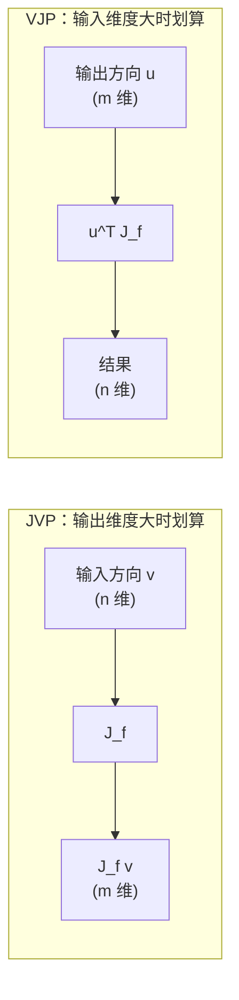

# 前置知识：雅可比向量积 JVP——自动微分如何一次算出一整列方向导数

> **一句话**：雅可比向量积（Jacobian-Vector Product, JVP）是指"拿一个方向向量 $v$，乘以函数在某点的雅可比矩阵 $J$ 得到 $Jv$"这件事；它的价值在于自动微分框架能在**一次前向传播**里算出这个乘积，而不需要真的把雅可比矩阵写出来。

## 一 雅可比矩阵回顾

考虑一个函数 $f: \mathbb{R}^n \to \mathbb{R}^m$，输入 $x \in \mathbb{R}^n$，输出 $f(x) \in \mathbb{R}^m$。当输入发生一个微小变化 $\Delta x$ 时，输出的变化近似是线性的：

$$
f(x + \Delta x) \approx f(x) + J_f(x)\,\Delta x
$$

其中 $J_f(x)$ 就是**雅可比矩阵**：第 $i$ 行第 $j$ 列的元素是 $\partial f_i / \partial x_j$。它把"输入的每个方向的微小扰动"映射成"输出的变化"。维度是 $m \times n$。

**这个公式在做什么**：它是一阶泰勒展开，用矩阵乘法近似"小扰动经过函数后放大/缩小/旋转成什么样"。

::: details 📐 公式详解（点击展开）

| 子表达式 | 它是谁 | 它在干嘛 |
|---------|--------|---------|
| $f(x)$ | **基准点输出** | 不加扰动时函数的值 |
| $J_f(x)$ | **局部罗盘** | 在 $x$ 附近，函数对每个输入方向的敏感度排成一张表 |
| $\Delta x$ | **扰动方向** | 你想试探的输入变化方向 |
| $J_f(x)\Delta x$ | **一阶响应** | 沿 $\Delta x$ 方向走，输出大约变化多少 |

**用人话读**："在 $x$ 附近，函数近似是线性的，输出的变化 = 敏感度矩阵乘上输入变化。"

**为什么用矩阵而不是直接算导数**：$f$ 是多输入多输出时导数不是一个数，而是一张张量（矩阵），必须用矩阵乘法才能表达"方向和响应"的关系。
:::

## 二 JVP 和 VJP 的两个方向

朴素的算法思维是"先把 $J_f$ 整个算出来，再乘向量"。但 $J_f$ 可能有百万行百万列，存不下。自动微分（autodiff）的技巧是：**不构造 $J_f$，直接算它和一个向量的乘积。** 按向量乘在哪一侧，分两种：

**雅可比向量积（JVP）**：给定一个输入方向的向量 $v \in \mathbb{R}^n$，算 $\mathrm{JVP}(f, x, v) = J_f(x)\, v \in \mathbb{R}^m$。直觉是"把输入沿 $v$ 方向推一下，看输出往哪儿动"。它对应**前向模式（forward-mode）**自动微分，规模代价约等于一次前向传播。

**向量雅可比积（VJP）**：给定一个输出方向的向量 $u \in \mathbb{R}^m$，算 $\mathrm{VJP}(f, x, u) = u^\top J_f(x) \in \mathbb{R}^n$。直觉是"反向传播"，也叫**反向模式（reverse-mode）**。深度学习里大家天天用的 `.backward()` 算的就是这个——损失是标量（$m=1$），所以 $u$ 退化成 1，结果就是梯度。

## 三 两种模式的代价对比

为什么需要知道这个区别？看一张表：

| 模式 | 一句记忆 | 单位代价 | 一次调用产出 | 适合 |
|------|---------|---------|-------------|------|
| JVP（前向） | "推输入看输出" | 约 1 次前向 | $J_f$ 的一**列** | 输入维度 $n$ 小、输出维度 $m$ 大 |
| VJP（反向） | "推输出看输入" | 约 1 次前向 | $J_f$ 的一**行** | 输出维度 $m$ 小、输入维度 $n$ 大（深度学习常态） |

一张图把方向讲清楚：



> 读图重点：JVP 从输入侧出发、一次吃完整个 $J_f$ 的一列；VJP 从输出侧出发、一次吃完一行。深度学习因为输出往往是标量损失，VJP（反向传播）最划算。

## 四 JVP 在连续系统里的用途

JVP 不只在"想省内存地算完整雅可比"时有价值，它在**连续时间模型**里是刚需。假设有一个编码器 $f_{\text{dyn}}(s_t; s_0)$ 把状态 $s_t$ 映射到潜表示 $z_t$，我们想求潜表示随时间的导数 $\dot{z}_t = \frac{d z_t}{dt}$。根据链式法则：

$$
\dot{z}_t = \frac{\partial f_{\text{dyn}}(s_t; s_0)}{\partial s_t} \cdot \dot{s}_t = \mathrm{JVP}\big(f_{\text{dyn}}(s_t; s_0),\, \dot{s}_t\big)
$$

即：**只要知道状态速度 $\dot{s}_t$（可从相邻帧差分估计），一次 JVP 就能把"潜空间里对应的速度"算出来**，而完全不必显式构造那个庞大的雅可比。这正是 [ODEWorld](/系列/odeworld_deep_dive/) 里"直接一阶监督"能落地的前提。

**这个公式在做什么**：把"状态的速度"通过雅可比这座桥，翻译成"潜表示的速度"。

::: details 📐 公式详解（点击展开）

| 子表达式 | 它是谁 | 它在干嘛 |
|---------|--------|---------|
| $\partial f_{\text{dyn}} / \partial s_t$ | **翻译矩阵** | 编码器对当前状态的局部敏感度 |
| $\dot{s}_t$ | **状态速度** | 状态在物理时间里的变化率，由相邻帧 $(s_{t+1}-s_t)/\Delta t$ 估计 |
| $\dot{z}_t$ | **潜速度（目标）** | 我们希望潜表示应有的变化率 |
| $\mathrm{JVP}$ | **一次前向算完** | 不显式构造雅可比，直接得到乘积 |

**用人话读**："知道真实状态变化得多快，就用编码器局部的敏感度把它换算成潜表示该变化得多快。"

**为什么不用数值差分**：先算 $z_{t+1}$ 再减 $z_t$ 会把两次编码的数值误差相减放大，且无法对 $f_{\text{dyn}}$ 直接求导；JVP 走的是解析链式法则，数值上干净得多。
:::

## 五 在框架里怎么写

主流框架的写法高度一致：构造一个"方向"，用前向模式自动微分求一次即可。

```python
import torch

def jvp_velocity(f_dyn, s_t, s_0, dt):
    # s_t: 当前状态, s_0: 初始状态, 目标是求 d f_dyn(s_t; s_0) / dt
    # 用一个显式方向向量 (s_t - s_prev)/dt 近似状态速度
    s_dot = (s_t - s_prev) / dt
    # 把 s_t 和 s_0 拼在一个元组里作为函数输入的"棱镜"
    _, dz = torch.autograd.functional.jvp(
        lambda st: f_dyn(st, s_0),  # 只对 s_t 求导，s_0 视为常数
        (s_t,),                     # 求导位置
        (s_dot,),                   # 推动方向 = 状态速度
    )
    return dz  # 这就是潜空间里的速度 z_dot
```

上面这段代码只是把第四节那个公式翻译成调用：`jvp` 的第一个参数是函数，第二个是求导位置 $s_t$，第三个是方向向量 $\dot{s}_t$，返回的就是 $J_f \dot{s}_t$。注意 `s_0` 被闭包固定成常数，因此它对应的雅可比那一项不会被计算——这正好对应"初始状态不随时间变化"这一物理事实。

## 相关阅读

- [常微分方程 ODE——直觉与数值求解](/前置知识/001b_前置知识_常微分方程ODE直觉与数值求解)——JVP 服务的连续性建模基础
- [雅可比矩阵与微分运动学](/前置知识/003b_前置知识_雅可比矩阵与微分运动学)——机器人力学里同一个雅可比概念
- [矩阵的秩与低秩近似](/前置知识/000z_前置知识_矩阵的秩与低秩近似)——为什么"不显式构造大矩阵"是一种通用智慧
- [ODEWorld 系列](/系列/odeworld_deep_dive/)——JVP 在"直接一阶监督"里的具体用法
