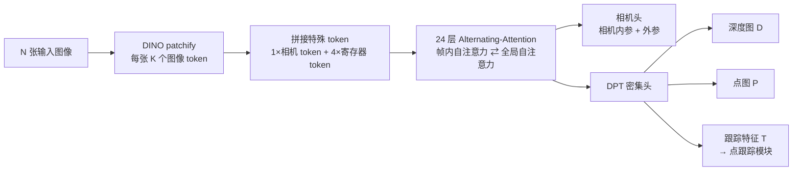

# VGGT：一次前向就重建出相机、深度与点云的前馈式几何基础模型

> **一句话**：VGGT 是一个标准的 Transformer，喂进 1～几百张同一场景的照片，**一次前向传播**、不到一秒就同时吐出每张图的相机参数、深度图、点云（pointmap）和点轨迹——精度还超过了需要跑十几秒迭代优化（SfM + 光束法平差）的传统管线。

**知识链接**：
- [相机模型与针孔投影](/前置知识/014a_前置知识_相机模型与针孔投影) — 相机内参、外参、深度反投影成三维点，是 VGGT 三个预测头的共同语言
- [对极几何：两视图几何基础](/前置知识/014b_前置知识_对极几何两视图几何基础) — 传统方法靠它找对应点，理解 VGGT 替代了什么要先懂它
- [Bundle Adjustment 捆绑调整](/前置知识/014e_前置知识_BundleAdjustment捆绑调整) — VGGT 要"绕开"的经典后优化步骤
- [DINOv2 视觉特征提取器](/前置知识/013b_前置知识_DINOv2视觉特征提取器) — VGGT 的图像 token 由 DINO 产生
- [三维旋转表示：旋转矩阵、四元数与角速度](/前置知识/006a_前置知识_三维旋转表示_旋转矩阵四元数与角速度) — 相机外参里的旋转用四元数表示
- [Chamfer 距离：点云形状相似性度量](/前置知识/011b_前置知识_Chamfer距离_点云形状相似性度量) — 点图质量的评测指标

---

## 一、传统三维重建贵在哪

从一组照片恢复场景的三维结构和拍摄相机的位置，经典做法是**运动恢复结构（Structure-from-Motion, SfM）加多视图立体（Multi-View Stereo, MVS）**。这条管线可以概括成三个环节：

1. **特征匹配**：在每两张照片之间找出对应同一个物理点的像素。
2. **三角化**：用两视图的几何关系（[对极几何](/前置知识/014b_前置知识_对极几何两视图几何基础)）把这些对应点还原成三维点。
3. **[光束法平差](/前置知识/014e_前置知识_BundleAdjustment捆绑调整)（Bundle Adjustment, BA）**：把相机参数和所有三维点放在一起，反复迭代最小化重投影误差——这是一个非凸优化，往往要跑十几秒甚至更久。

三个环节里，只有"特征匹配"能被神经网络加速，后面的三角化和 BA **仍然是迭代优化**。即便把匹配换成深度网络，整个系统依旧是"网络 + 优化器"的混合体，复杂、慢，且对初始值敏感。

一个自然的想法是：**能不能干脆不要优化器，让一个网络直接一次性吐出所有几何量？** DUSt3R 证明了这件事对"两张图"可行，但它只能处理一对，更多图片要靠把一对对结果做全局对齐拼起来，又没有真正摆脱后处理。VGGT 把这步彻底推到了多视图。

---

## 二、VGGT 的一句话结论

先给结论，再看细节：

- **输入**：一序列图像 $(I_i)_{i=1}^{N}$，$N$ 可以是 1、几张，也可以是几百张。
- **输出**：对每一张图，同时给出它的**相机参数** $\mathbf{g}_i$、**深度图** $D_i$、**点图（pointmap）** $P_i$，以及用于点跟踪的**特征图** $T_i$。
- **代价**：一次前向传播，约 0.2 秒（而非迭代优化的十几秒）。

一句话：**VGGT 把"三维重建"从"一个需要反复优化的几何问题"改写成了"一个训练好的大模型的单次推理"。** 这一节把它的架构、三个头、训练目标和它为什么能work讲清楚。

---

## 三、架构：一个没有三维先验的 Transformer

VGGT 的设计哲学是"**尽量少的几何归纳偏置，靠数据学**"——这一点和 DINO、CLIP、GPT 一脉相承。

### 3.1 输入怎么变成 token

每张图像先经 **DINO** 切成 patch token $\mathrm{t}^I_i \in \mathbb{R}^{K\times C}$（$K$ 是每张图的 patch 数，$C$ 是特征维度）。然后给每张图**额外拼上**两类特殊 token：

- **1 个相机 token** $\mathrm{t}^{\mathbf{g}}_i$：专门用来"存放"这张图的相机信息；
- **4 个寄存器 token**（register token）$\mathrm{t}^R_i$：不承担具体输出，只给网络一个"暂存中间量"的地方。

第一张图的相机 token 和寄存器 token 用**一组独立的可学习向量**，其余图用另一组——这样网络能区分"谁是参考帧"。

### 3.2 Alternating-Attention：帧内 + 全局交替

标准 Transformer 的所有 token 互相注意，计算量随图像数量平方增长。VGGT 用一个简单改动控制成本，同时兼顾"帧内一致"和"跨帧一致"：

- **帧内自注意力（frame-wise self-attention）**：第 $i$ 张图内部的 token 互相注意，负责把这张图自己的信息整理好（归一化激活、匹配同一张图里的相机 token 和图像 token）；
- **全局自注意力（global self-attention）**：所有图的 token 一起注意，负责跨视角整合信息。

两者**逐层交替**，共 24 层。注意：VGGT 全程只用自注意力，**没有任何 cross-attention**。

> 从图像到四类输出：图像先 patchify，再拼上相机/寄存器 token，经过帧内与全局注意力交替的 24 层主干，最后由一个相机头和一个 DPT 密集头分别输出相机参数与逐像素几何。图中所有输出都定义在**第一台相机的坐标系**里。

### 3.3 三个预测头

- **相机头**：把输出相机 token $\hat{\mathrm{t}}^{\mathbf{g}}_i$ 再经过 4 层自注意力和一个线性层，回归出 9 维相机参数 $\mathbf{g}=[\mathbf{q},\mathbf{t},\mathbf{f}]$——四元数旋转 $\mathbf{q}\in\mathbb{R}^4$、平移 $\mathbf{t}\in\mathbb{R}^3$、视场角 $\mathbf{f}\in\mathbb{R}^2$（主点固定在图像中心）。
- **深度头 / 点图头**：图像 token $\hat{\mathrm{t}}^I_i$ 先经一层 DPT 变成密集特征图 $\mathbf{F}_i$，再用一个 $3\times3$ 卷积分别映射成深度图 $D_i$ 和点图 $P_i$。同时预测每个像素的**偶然不确定性**（aleatoric uncertainty），用作损失里的置信度权重。
- **跟踪头**：DPT 头还输出一张密集跟踪特征 $T_i$。给定查询点，把它和所有帧的特征做相关，再用自注意力得到各帧中的对应点——这部分直接借用了 CoTracker2 的结构。

### 3.4 为什么输出"互相冗余"的量反而更好

这里有一个反直觉但很重要的设计（论文叫 **over-complete predictions**）：相机参数其实可以从点图里用 PnP 解出来，深度图也能从点图和相机推出来——也就是说这三者**不是独立的**。那为什么还要让网络全都预测？

答案是：**让网络在训练时同时监督这些互相冗余的量，会实质提升每一项的精度**，即便它们之间存在闭式关系。但是——

> **推理时有个反转**：直接用深度图和相机参数反投影得到的点云，比直接用点图头输出的点图**更准**。

这看似矛盾，其实是"**把一个难问题拆成几个简单子问题**"的经典收益：训练时多任务互相提供监督信号，让共享主干学到更丰富的几何表示；推理时用更可靠的分解路径（深度 + 相机）组装点云。VGGT 因此在推理流程里默认用"深度图 × 相机参数"重建三维点。

---

## 四、训练：多任务损失

VGGT 端到端地优化一个多任务损失：

$$
\mathcal{L} = \mathcal{L}_{\text{camera}} + \mathcal{L}_{\text{depth}} + \mathcal{L}_{\text{pmap}} + \lambda\,\mathcal{L}_{\text{track}}
$$

**这个公式在做什么**：用一个共享 backbone，同时监督四件事——相机参数、深度、点图和点轨迹，再把它们按权重加成一个总目标。

::: details 📐 公式详解（点击展开）

| 子表达式 | 它是谁 | 它在干嘛 |
|---------|--------|---------|
| $\mathcal{L}_{\text{camera}}$ | **相机损失** | 预测相机 $\hat{\mathbf{g}}_i$ 与真值的 Huber 损失，管旋转、平移、视场角 |
| $\mathcal{L}_{\text{depth}}$ | **深度损失** | 预测深度与真值深度之差，乘上预测的**不确定性图**做加权，另加一项深度梯度的差异（让边缘锐利） |
| $\mathcal{L}_{\text{pmap}}$ | **点图损失** | 与深度损失同构，但作用在逐像素三维点上 |
| $\lambda\,\mathcal{L}_{\text{track}}$ | **跟踪损失** | 查询点在各帧中的对应点误差，用一个很小的 $\lambda=0.05$ 降权 |
| $\lambda=0.05$ | **跟踪权重** | 跟踪是辅助任务，避免它喧宾夺主 |

**用人话读**："让同一个网络一次学四样本事：相机在哪、每个像素多深、每个像素对应的三维点在哪、一个点在其它图里落到哪。相机/深度/点图三项量级相近不加权，跟踪项给小权重。"

**为什么深度和点图要带"不确定性"和"梯度"两项**：纯像素差在大片均匀区域（比如白墙）几乎没有梯度信号，网络会学到"糊墙也不亏"；加上**梯度差**这一项，等于额外惩罚"深度在物体边缘处不该平滑却平滑了"，逼网络保住几何边界。同时让网络自己预测每个像素的不确定度，是让它学会"哪里没把握就别硬猜"。
:::

### 4.1 坐标归一化：三视图重建的尺度歧义

一组照片的绝对尺度和全局坐标是无法确定的——把整个场景缩放、平移、旋转，得到的照片完全一样。所以 VGGT 学的是**规范选择**：以第一台相机的坐标系为世界系，并把所有三维点相对原点的平均欧氏距离当作尺度，用它归一化相机平移、点图和深度。

和 DUSt3R 不同，VGGT **不在推理时对输出做这个归一化**，而是**强制网络从训练数据里学会这个归一化约定**。这是个重要区别：归一化变成了模型内化的能力，而不是外挂的预处理。

### 4.2 训练配置

主干 24 层、约 **12 亿参数**；AdamW 训练 160K 步；每批从场景里随机抽 **2～24 帧**；图像最长边 518 像素；64 张 A100 训练 9 天。数据来自十几个室内外、合成与真实数据集（Co3Dv2、BlendMVS、DL3DV、MegaDepth、ScanNet、HyperSim、Replica 等），规模与 MASt3R 相当。

---

## 五、结果与它的历史意义

### 5.1 又快又准

VGGT 最震撼的一点是：**纯前馈**就已经超过了需要后优化的方法，而叠加 BA 还能再涨一截。

> 横轴是单次重建耗时（对数），纵轴是 RealEstate10K 相机位姿 AUC@30。灰色是需要迭代优化（SfM/BA）的方法，蓝色是前馈方法，红色星号是 VGGT。VGGT 前馈版用约 0.2 秒拿到 85.3 的 AUC，同时碾压要花 7～25 秒的优化式方法；再叠加 BA（约 1.8 秒）可达 93.5。

关键数字（10 帧，未在 RealEstate10K 上训练过）：

| 方法 | 类型 | AUC@30 ↑ | 时间 |
|------|------|----------|------|
| COLMAP+SPSG | 传统 + 优化 | 45.2 | ~15s |
| DUSt3R | 前馈 + 全局对齐 | 67.7 | ~7s |
| MASt3R | 前馈 + 全局对齐 | 76.4 | ~9s |
| VGGSfM v2 | 可微 SfM | 78.9 | ~10s |
| Fast3R | 前馈 | 72.7 | ~0.2s |
| **VGGT（前馈）** | 前馈 | **85.3** | **~0.2s** |
| **VGGT + BA** | 前馈 + BA | **93.5** | ~1.8s |

### 5.2 为什么它是"几何基础模型"

VGGT 的价值不止于重建本身。论文证明：**把 VGGT 当特征骨干**（而不是从零训练），可以显著提升下游任务，比如动态点跟踪和前馈新视角合成。这和 DINOv2 之于视觉、CLIP 之于多模态是同一个模式——**一个可复用的几何表征底座**。

同时，VGGT 的"点图"是**相机不变**的：无论哪个视角，同一个物理点会落到同一组三维坐标上（都在第一台相机的坐标系里）。这个性质正是 RecGen3D 选定它作为"规范空间点云"来源的原因，见下一节。

---

## 六、它在 RecGen3D 里的角色

RecGen3D 用 VGGT 作为 **Stage 1 的重建骨干**，但要把它**从相机坐标系改造到物体规范坐标系**（论文叫 branch repurposing，分支改造）：

- VGGT 原始的相机头、深度头**保持在参考帧**，只把**点图头**改造为在**规范物体空间**里预测；
- 然后把更准的"深度派生的三维点"通过**相似变换**对齐到规范点图，得到一份高质量**规范点云**；
- 这份规范点云再作为条件，去引导第二阶段的 3D 扩散生成。

也就是说，RecGen3D 完整继承了 VGGT 的两个核心优点——**无需相机位姿**、**一次前向给全局一致的几何**——只是把它"orient 到物体自己身上"。想读这条链路，见 [RecGen3D 精读](/论文综述/163_RecGen3D_重建引导规范空间三维生成)。

---

## 七、小结

| 问题 | 传统 SfM+MVS | VGGT |
|------|--------------|------|
| 相机位姿 | 三角化 + BA 迭代求解 | 相机头一次回归 |
| 深度/点云 | 多视图立体优化 | DPT 头一次输出 |
| 是否需要相机已知 | 匹配需要、BA 处理 | 完全不需要 |
| 多视图扩展 | 成对拼接 + 全局对齐 | 原生支持任意帧数 |
| 速度 | 十几秒 | ~0.2 秒 |
| 与优化结合 | 就是优化 | 可选叠加 BA 再涨 |

**记忆锚点**：VGGT 证明了"三维重建可以是一个大 Transformer 的一次前向"；它用**交替注意力**在帧内与全局之间切换，用**多任务监督冗余量**换来更强的几何表示，用**点图的相机不变性**给下游任务提供了一个即插即用的几何底座。

## 延伸阅读

- [RecGen3D 精读](/论文综述/163_RecGen3D_重建引导规范空间三维生成) — 把 VGGT 的规范点云接到 3D 扩散生成上
- [6DoF 位姿估计与 ADD-S 评测指标](/前置知识/015f_前置知识_6DoF位姿估计与ADD-S评测指标) — 重建结果如何量化位姿误差
- [多视角物体重建与融合综述](/论文综述/S35_多视角物体重建与融合综述) — VGGT 在多视角重建谱系中的位置
- [Depth Anything 3 深度解析](/系列/da3_deep_dive/01_深度估计的困境与DA3的答案) — 另一条"几何基础模型"路线
