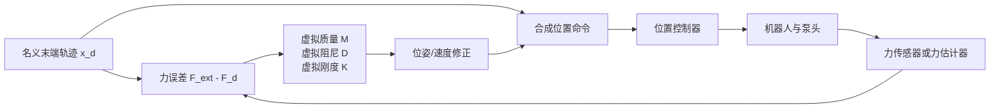
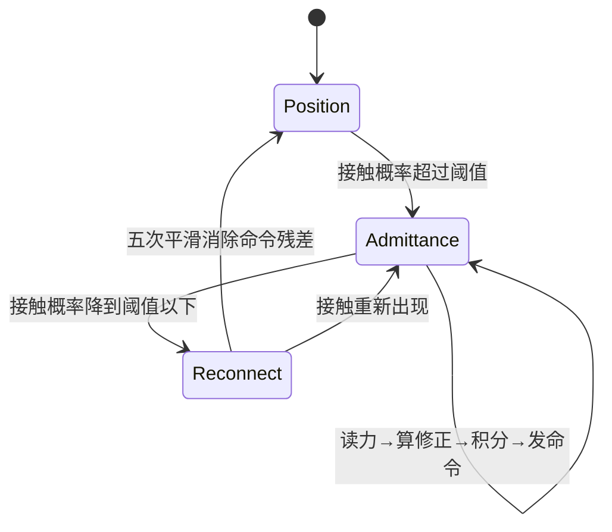

# 前置知识：导纳控制与接触柔顺

> **一句话**：导纳控制把“力的误差”翻译成“应该怎样移动”，让一个只能稳定执行位置命令的机器人在接触环境时表现得像有虚拟质量、阻尼和弹簧。

**知识链接**：

- [雅可比矩阵与微分运动学](/前置知识/003b_前置知识_雅可比矩阵与微分运动学)——末端速度和关节速度如何互相转换
- [机器人静力学、虚功与雅可比转置](/前置知识/008f_前置知识_机器人静力学虚功与雅可比转置)——末端力如何映射为关节力矩
- [机械臂动力学方程](/前置知识/008d_前置知识_机械臂动力学方程M_C_g与关节力矩)——质量、阻尼、重力和外力如何共同决定运动
- [惩罚法接触模型](/前置知识/006d_前置知识_惩罚法接触模型_弹簧阻尼与摩擦锥)——仿真器如何产生接触力

## 贯穿例子：机械臂按压一个泵头

设一台位置控制机械臂要按下洗手液泵头。视觉策略给出一条末端位姿轨迹，但真实泵头的高度、弹簧刚度和接触时刻都可能变化。如果控制器只追踪位置，泵头高一点会造成撞击，低一点又可能按不出液体。

导纳控制放在“外力传感器/力估计器”和“位置控制器”之间：它读取末端外力与目标力的差，计算一个位姿或速度修正，再把修正后的轨迹交给原有位置环。因此它不必替换底层伺服器，只改变底层伺服器收到的目标。

> 这张图的关键是反馈位置：导纳控制不是让策略凭空输出一个“正确力矩”，而是把测得的物理交互转换为位置命令修正，再复用成熟的位置伺服器。

## 一 导纳和阻抗到底差在哪里

两者都描述“机器人与环境接触时应该有多柔软”，但输入输出方向相反。

| 控制形式 | 读取的量 | 输出的量 | 更适合的硬件接口 |
|---|---|---|---|
| 阻抗控制 | 位姿误差和速度误差 | 力或力矩命令 | 能直接控制力矩的机器人 |
| 导纳控制 | 外力与目标力的误差 | 位姿、速度或加速度修正 | 只能可靠执行位置命令的机器人 |

把机械臂想成一个虚拟的质量—弹簧—阻尼系统：阻抗控制告诉机器人“你偏离目标后要产生多大的力”，导纳控制告诉机器人“受到这股力后应该移动多少”。TAO-Force 采用导纳接口，原因正是它的 AgiBot G1 使用位置命令执行，策略需要在不改动底层位置伺服器的情况下快速调节接触力。

## 二 连续时间模型

要把力误差变成可控的运动，最小模型需要同时表示惯性、阻尼和弹性。令 $mathbf{x}$ 是末端位姿，$mathbf{x}_d$ 是名义位姿，$mathbf{F}^{\mathrm{ext}}$ 是环境施加的外力，$mathbf{F}^{d}$ 是目标力；导纳模型写成：

$$
\mathbf{M}(\ddot{\mathbf{x}}-\ddot{\mathbf{x}}_d)+\mathbf{D}(\dot{\mathbf{x}}-\dot{\mathbf{x}}_d)+\mathbf{K}(\mathbf{x}-\mathbf{x}_d)=\mathbf{F}^{\mathrm{ext}}-\mathbf{F}^{d}.
$$

**这个公式在做什么**：把力误差分配给三条物理通道——加速度、速度和位置误差；机器人受到的力越大，就越倾向于改变运动，但阻尼和刚度会阻止它无限漂移。

::: details 📐 公式详解（点击展开）

| 子表达式 | 它是谁 | 它在干嘛 |
|---|---|---|
| $\mathbf{F}^{\mathrm{ext}}-\mathbf{F}^{d}$ | **交互欠账** | 实际受到的力和期望受到的力相差多少，正负号决定修正方向 |
| $\mathbf{M}(\ddot{\mathbf{x}}-\ddot{\mathbf{x}}_d)$ | **虚拟惯性** | 不让末端因一帧噪声突然改变速度，$\mathbf{M}$ 越大，响应越慢 |
| $\mathbf{D}(\dot{\mathbf{x}}-\dot{\mathbf{x}}_d)$ | **虚拟刹车** | 抑制振荡和冲击，阻尼越大，力误差转成运动的过程越平稳 |
| $\mathbf{K}(\mathbf{x}-\mathbf{x}_d)$ | **虚拟弹簧** | 把末端拉回名义轨迹，刚度越大，允许的位姿偏离越小 |

**用人话读**：机器人把“多出来的力”变成运动修正，但同时用虚拟质量限制突然变化、用阻尼消除振荡、用弹簧把自己拉回轨迹。

**为什么是这个形式**：只用力到位置的比例关系会缺少动态缓冲，接触刚度一变就容易振荡；加入速度和加速度项后，控制器可以分别调节响应速度、稳定性和轨迹保持能力。
:::

### 二维按压算例

只看按压方向 $z$。如果泵头要求 $F^d_z=8$ N，而传感器读到 $F^{\mathrm{ext}}_z=12$ N，那么力误差为 $4$ N。若临时忽略加速度和速度项，$K_z=200$ N/m 时，允许的稳态位移修正为 $4/200=0.02$ m，也就是末端后退 2 cm。

这个结果解释了刚度的结构位置：刚度在分母意义上决定“同样的力误差换来多少位移”。若把 $K_z$ 增大到 1000 N/m，修正只有 4 mm，机器人更像硬位置控制；若把它减小到 50 N/m，修正达到 8 cm，虽然柔顺，却可能脱离任务工作空间。

## 三 从连续模型到离散控制循环

机器人控制器每个周期只能读一次力、算一次命令、发一次位置目标。因此必须明确旧状态、增量和更新值，不能只写一个连续方程就跳到代码。

令时间步长为 $\Delta t$，在每个周期执行：

1. 读取上一周期的位姿误差 $\mathbf{e}_{t-1}=\mathbf{x}_{t-1}-\mathbf{x}_{d,t-1}$ 和速度误差。
2. 读取当前外力，计算当前力误差 $\mathbf{r}_t=\mathbf{F}^{\mathrm{ext}}_t-\mathbf{F}^{d}_t$。
3. 用虚拟模型计算当前的末端修正速度或加速度。
4. 对修正量积分并更新位置命令。
5. 把本次命令、上一命令和接触状态写入下一周期的历史。

一种直接的速度型离散实现是：

$$
\begin{aligned}
\dot{\mathbf{x}}^{\mathrm{adm}}_t &= \dot{\mathbf{x}}_{d,t}+\mathbf{D}^{-1}\left(\mathbf{r}_t-\mathbf{K}\mathbf{e}_{t-1}\right),\\
\mathbf{x}^{\mathrm{cmd}}_{t+1} &= \mathbf{x}^{\mathrm{cmd}}_t+\Delta t\,\dot{\mathbf{x}}^{\mathrm{adm}}_t.
\end{aligned}
$$

**这个公式在做什么**：用当前力误差抵消上一时刻的位姿偏离，得到一个有阻尼的修正速度，再按控制周期积分为下一条位置命令。

::: details 📐 公式详解（点击展开）

| 子表达式 | 它是谁 | 它在干嘛 |
|---|---|---|
| $\mathbf{r}_t$ | **当前力误差** | 当前周期实际测得的外力减去期望力，是新的反馈输入 |
| $\mathbf{K}\mathbf{e}_{t-1}$ | **轨迹回拉项** | 纠正上一周期已经积累的位置偏差，避免导纳修正无限漂移 |
| $\mathbf{D}^{-1}(\cdot)$ | **柔顺增益** | 把净力误差转换为速度；阻尼越大，同一误差产生的速度越小 |
| $\Delta t\,\dot{\mathbf{x}}^{\mathrm{adm}}_t$ | **本周期位移增量** | 只允许控制器在一个采样周期内移动有限距离，保证更新与执行频率一致 |

**用人话读**：先从力误差中扣掉已经偏离轨迹的部分，再用阻尼把剩余误差变成速度，最后乘一个时间步得到新的位置。

**为什么是这个形式**：如果只累加力误差而不扣除位置误差，持续接触会造成命令不断漂移；如果不乘 $\Delta t$，换一个控制频率会改变物理响应速度，模型就不再是同一个导纳系统。
:::

## 四 参数如何影响真实行为

### 4.1 刚度不是“越小越柔软就越好”

- **刚度过大**：末端几乎不让位，位置误差小但接触冲击大；适合需要精确保持轨迹、接触力变化慢的阶段。
- **刚度过小**：接触力容易被压低，但末端会漂移，刀具、擦布或插头可能离开任务表面。
- **各向异性刚度**：按压方向可设低刚度，切向方向保留较高刚度，使机器人沿表面柔顺而不横向跑偏。

### 4.2 阻尼决定是否会振荡

接触表面相当于另一个刚性系统。如果虚拟阻尼太小，机器人、工具和环境会形成“反复撞—退—再撞”的振荡；阻尼太大则响应慢，泵头按下后迟迟不能达到目标力。工程调参应先固定刚度，再逐步增加阻尼直到释放动作不产生明显过冲。

### 4.3 力坐标系比参数更容易出错

力传感器常在腕部坐标系输出，策略可能在基座坐标系定义目标力。若不做坐标变换，向下按压可能被解释成侧向推力。处理顺序必须固定：去除工具重力和偏置、把力变换到控制器坐标系、统一环境对机器人或机器人对环境的符号约定，再进入导纳方程。

## 五 导纳控制接入 VLA 的完整状态机

在接触任务中，导纳控制通常不是全程开启。非接触阶段保持名义轨迹，接触阶段才根据力误差修正；退出接触时还要把导纳造成的命令残差平滑地接回名义轨迹。

状态转换必须保存三类状态：上一条已发送命令、上一周期接触门控值、平滑重连进度。只保存当前策略输出而不保存这些历史，会在“接触→脱离”瞬间产生位置跳变。

## 六 与接触感知策略的关系

导纳控制只解决“已知外力后如何运动”，不负责判断何时接触、应该施加多大目标力，也不负责从图像或电流中估计外力。这些职责可以由力传感器、[触觉仿真与传感器模型](/系列/tactile_simulation_deep_dive/index)、或 NeuralActuator 的力估计头提供。

因此，一个完整的接触闭环至少有四层：

| 层 | 输入 | 输出 | 典型频率 |
|---|---|---|---|
| 语义/任务层 | 用户指令、场景图像 | 原子技能或目标 | 低频 |
| 策略层 | 图像、语言、本体、力 | 动作块和目标力 | 中频 |
| 接触层 | 当前力、接触概率、名义轨迹 | 修正速度/位置 | 高频 |
| 伺服层 | 位置命令 | 电机电流与实际运动 | 更高频 |

TAO-Force 的核心价值正是把策略层的力预测和接触层的导纳执行连接起来；如果只有力作为输入而没有高频导纳环，策略即使“知道正在接触”，也可能来不及在下一次低频推理前减小冲击。

## 总结

导纳控制的设计可以归结为三点：

1. 用力误差驱动位姿、速度或加速度修正，而不是直接假设一个固定力矩。
2. 用虚拟质量、阻尼和刚度分别控制响应速度、振荡和轨迹保持。
3. 用明确的接触门控、历史状态和重连过程，把高频柔顺控制安全地接入低频策略。

理解这三点后，读者可以把 [TAO-Force 力感知 VLA 与快慢控制](/系列/robot_closed_loop_intelligence_deep_dive/03_TAO_Force_力感知VLA与快慢控制) 中的导纳分支看成一个清晰的工程模块，而不必把它当成策略网络内部的黑盒。

## 延伸阅读

- [机器人系统辨识深度解析](/系列/system_identification_deep_dive/index)——执行器、动力学和接触参数如何从真机数据获得
- [触觉仿真深度解析](/系列/tactile_simulation_deep_dive/index)——接触真值如何变成策略可读的力/触觉观测
