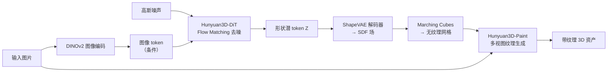

# 混元 3D：从 ShapeVAE 到 Omni，原生三维生成的统一范式

> **一句话**：腾讯混元 3D 系列（Hunyuan3D）用"**3D VAE 压缩 + 潜空间扩散生成 + 多视图纹理回投影**"这套统一的原生三维范式，把单张图片变成带材质的网格；其中 Hunyuan3D-Omni 又把点云、体素、包围盒、骨架四种控制信号塞进同一个控制编码器，让生成可以被精细约束。

**知识链接**：
- [Flow Matching 与连续归一化流](/前置知识/000g_前置知识_Flow_Matching与连续归一化流) — 形状生成的训练目标就是流匹配
- [DiT：Diffusion Transformer 架构](/前置知识/002x_前置知识_DiT_Diffusion_Transformer架构) — 形状生成骨干是扩散 Transformer
- [DINOv2 视觉特征提取器](/前置知识/013b_前置知识_DINOv2视觉特征提取器) — 图像条件由 DINOv2 编码
- [编码器解码器架构](/前置知识/009a_前置知识_编码器解码器架构) — ShapeVAE 是典型的编码器-解码器
- [DINOv2 视觉特征提取器](/前置知识/013b_前置知识_DINOv2视觉特征提取器) — 条件注入依赖其 patch token
- [NeuS：符号距离场隐式表面重建](/前置知识/013a_前置知识_NeuS_符号距离场隐式表面重建) — SDF 与等值面提取的关系
- [图像质量指标 PSNR / SSIM / LPIPS](/前置知识/011c_前置知识_图像质量指标_PSNR_SSIM_LPIPS) — 纹理质量评测
- [VGGT 前馈式多视图三维重建](/前置知识/016a_前置知识_VGGT前馈式多视图三维重建) — RecGen3D 用 VGGT 产出、用混元消费

---

## 一、混元 3D 是什么

混元 3D（Hunyuan3D）是腾讯开源的一条**原生三维生成（native 3D generation）**路线。它的核心主张是：**不要在二维上生成再"抬升"到三维，而是在三维本身上生成**。整条产品线可以看成一个不断加能力的过程：

| 版本 | 时间 | 新增能力 |
|------|------|----------|
| Hunyuan3D 1.0 | 2024.11 | 首个统一文/图生 3D 框架 |
| **Hunyuan3D 2.0** | 2025.01 | 开源大模型：ShapeVAE + DiT 生成网格，Paint 生成纹理 |
| Hunyuan3D 2.1 | 2025.06 | 生产级 PBR 材质 |
| Hunyuan3D 2.5 | 2025.06 | 更精细的几何与细节 |
| **Hunyuan3D-Omni** | 2025.09 | **统一可控生成**：点云 / 体素 / 包围盒 / 骨架 |

其中 2.0 确立了整条链路的骨架，Omni 把"可控性"补上——而这两个正是 RecGen3D 使用的那一块。

---

## 二、原生三维生成的两件套

原生三维生成几乎都遵循同一个套路，混元 3D 也不例外：

1. **一个 3D 变分自编码器（3D VAE）**：把三维形状压成一小段连续的**潜 token**（叫 VecSet，向量集），并能解码回去；
2. **一个潜空间扩散模型**：在 VAE 的潜空间里做生成，条件是一张图片。

这么做的好处和 2D 的潜扩散（如 Stable Diffusion）完全一样：**不直接在高维三维数据上建模，而是在一个紧凑、平滑的潜空间里建模**，训练和推理都便宜得多。

> 混元 3D 的两段式：先生成几何（VAE 潜空间里的 DiT），再为几何生成纹理（多视图扩散 + 烘焙）。形状和纹理解耦，使得纹理模型可以给任意手工网格上色。

---

## 三、Hunyuan3D-ShapeVAE：把网格压成向量集

### 3.1 输入输出

- **输入**：从网格表面采样的点云 $P\in\mathbb{R}^{N\times(3+C)}$，每个点带三维坐标和表面法向；
- **中间**：一组潜向量 $\bm{Z}\in\mathbb{R}^{L\times d}$（$L$ 个 token，每个 $d$ 维），也就是 VecSet；
- **输出**：一个**符号距离场（Signed Distance Function, SDF）** $F_{\mathrm{sdf}}$，再用 Marching Cubes 提取成三角网格。

用公式写就是一个编码器 $\mathcal{E}$ 和一个解码器 $\mathcal{D}$：

$$
\bm{Z}=\mathcal{E}(P),\qquad F_{\mathrm{sdf}}=\mathcal{D}(\bm{Z})
$$

**这个公式在做什么**：定义 ShapeVAE 的压缩与解压——把点云形状压成一组潜向量，再从潜向量重建出可提取网格的隐式场。

::: details 📐 公式详解（点击展开）

| 子表达式 | 它是谁 | 它在干嘛 |
|---------|--------|---------|
| $P$ | **表面采样点云** | 从网格表面采的点，带坐标和法向，是"形状的原始数据" |
| $\mathcal{E}$ | **编码器** | 用交叉注意力把点云压缩成一组固定的潜 token |
| $\bm{Z}$ | **VecSet 潜表示** | $L\times d$ 的 token 序列，体积远小于原始点云，是生成模型工作的空间 |
| $\mathcal{D}$ | **解码器** | 以三维网格点为查询，从 $\bm{Z}$ 预测每个查询点的 SDF 值 |
| $F_{\mathrm{sdf}}$ | **隐式几何场** | 空间中任意点到表面的有符号距离；其零等值面就是物体表面 |

**用人话读**："把点云压成一串潜向量，再用这串向量重建出一个'每个空间点离表面多远'的函数，函数取零的地方就是表面。"

**为什么输出 SDF 而不是直接输出网格**：网格的顶点连接关系难以用神经网络稳定生成，而 SDF 是空间上的连续函数，可以用任意点采样来监督，训练稳定、分辨率可调，最后再用 Marching Cubes 一次性提取网格。
:::

### 3.2 关键设计一：重要性采样

只用均匀采样的点，弧面（比如一面墙）会占满预算，而真正决定形状的**棱角和边缘**反而点太少，导致重建细节糊。ShapeVAE 因此**同时采两套点**：

- 均匀采样 $P_u$：保证整体覆盖；
- **重要性采样** $P_i$：在网格的边和角上多采点，强化高频细节。

两套点各自做**最远点采样（Farthest Point Sampling, FPS）**得到查询点 $Q_u, Q_i$，然后把点云和查询点都拼起来，送进交叉注意力 + 自注意力，得到形状隐表示，再投影出潜分布的**均值与方差**（VAE 的变分性质）。

### 3.3 关键设计二：变长潜 token

训练时潜序列长度在多档之间**随机采样**：短序列省算力、促收敛，长序列保细节。发布版最长 **3072** 个 token，支撑高分辨率、锐利的细节。

### 3.4 训练损失

$$
\mathcal{L}_r=\mathbb{E}_{x\in\mathbb{R}^3}\big[\mathrm{MSE}(\mathcal{D}(x\,|\,\bm{Z}),\ \mathrm{SDF}(x))\big]+\gamma\,\mathcal{L}_{KL}
$$

**这个公式在做什么**：让解码器预测的 SDF 尽量贴近真值 SDF（重建项），同时用 KL 项把潜空间约束成"紧凑、连续、好采样"的形状。

::: details 📐 公式详解（点击展开）

| 子表达式 | 它是谁 | 它在干嘛 |
|---------|--------|---------|
| $\mathcal{D}(x\|\bm{Z})$ | **预测的 SDF** | 给定潜表示，解码器对空间点 $x$ 预测的距离值 |
| $\mathrm{SDF}(x)$ | **真值 SDF** | 该点到真实表面的有符号距离 |
| $\mathbb{E}_{x\in\mathbb{R}^3}$ | **空间随机采样** | 不需要遍历整个空间，随机抽点求期望即可，等价于蒙特卡洛近似 |
| $\mathcal{L}_{KL}$ | **KL 散度项** | 把编码分布拉向标准高斯，让潜空间平滑、便于扩散模型学习 |
| $\gamma$ | **KL 权重** | 平衡"重建得准"和"潜空间规整" |

**用人话读**："随机在空间里抽点，让解码器猜它离表面多远，猜错就罚；再加一项把潜空间捏成规整的高斯形状，方便后面做生成。"

**为什么要有 KL 项**：如果潜空间是任意形状，扩散模型很难学；把它压向标准高斯后，潜空间各处都"有定义"，扩散模型才能稳定地从噪声一路走到真实形状。
:::

---

## 四、Hunyuan3D-DiT：潜空间里的形状生成

### 4.1 网络结构

形状生成骨干是一个**流匹配（Flow Matching）扩散 Transformer**，结构借鉴 FLUX，采用**双流 + 单流**混合：

- **双流块**：潜 token 和条件 token 各自有独立的 QKV、MLP，只在注意力里交互；
- **单流块**：潜 token 和条件 token 拼接在一起，用并行的空间注意力与通道注意力处理。

一个有意思的细节：**它不加潜序列的位置编码**。因为 VecSet 里的每个 token 不对应固定的三维格子坐标——**位置信息由 token 内容自己携带**。这与图像/视频生成里"token 负责预测某个固定像素"截然不同。

**条件注入**：图像用 **DINOv2-Giant** 在 **518×518** 分辨率下编码成 patch token，再通过交叉注意力注入。预处理还会抠背景、把物体居中缩放到统一大小、背景补白——纯粹为了不让背景浪费分辨率。

### 4.2 训练目标

$$
\mathcal{L}=\mathbb{E}_{t,x_0,x_1}\big[\ \lVert u_\theta(x_t,c,t)-u_t\rVert_2^2\ \big],\quad x_t=(1-t)x_0+t\,x_1,\ u_t=x_1-x_0
$$

**这个公式在做什么**：让网络在"噪声 → 真实潜向量"的直线路径上，学会预测每一步的前进方向。

::: details 📐 公式详解（点击展开）

| 子表达式 | 它是谁 | 它在干嘛 |
|---------|--------|---------|
| $x_0\sim\mathcal{N}(0,I)$ | **起点噪声** | 从标准高斯采样的初始潜向量 |
| $x_1$ | **终点真实潜向量** | 形状的 VecSet 潜表示 |
| $x_t=(1-t)x_0+t x_1$ | **路径上的中间点** | 在噪声和形状之间做线性插值，$t\in[0,1]$ |
| $u_t=x_1-x_0$ | **正确的前进方向** | 从噪声指向真实形状的直线方向（速度） |
| $u_\theta(x_t,c,t)$ | **网络的猜测** | 给定当前点、条件图像 $c$ 和时间 $t$，网络猜的方向 |
| $\lVert\cdot\rVert_2^2$ | **方向误差** | 猜的方向和正确方向差多少 |

**用人话读**："在噪声和真实形状之间连一条直线，随机停在路上某点，让网络猜'该往哪个方向走'，猜得越准越好。"

**为什么用直线路径（flow matching）而不是传统扩散**：直线是最短路径，积分时可以用很少的步数从噪声走到形状（一阶欧拉求解器即可），既快又稳。推理时就是从高斯采样、用 Euler ODE 求解器迭代解出 $x_1$。
:::

---

## 五、Hunyuan3D-Paint：给几何上色

几何生成只给出"无纹理网格"，Paint 负责长出纹理。它的目标是三件事同时满足：**贴合输入图像、遵循几何、多视图一致**。

1. **图像去光照（delighting）**：把输入图（往往带强烈光照和阴影）先转成"无光照"状态，避免光照被**烘进**纹理。训练数据用同一物体在随机 HDRI 和均匀白光的配对图来监督。
2. **双流图像条件参考网**：把参考图的**无噪** VAE 特征直接送进一条冻结权重的参考分支（时间步设为 0），再通过参考注意力注入生成分支。冻结权重起到"软正则"，防止分布漂移到渲染图域，从而更好地适配真实照片。
3. **多任务注意力**：在原有自注意力旁边**并行**加两路注意力——参考注意力（贴合参考图）和多视图注意力（视图间一致）：

$$
Z_{MVA}=Z_{SA}+\lambda_{ref}\cdot\mathrm{Softmax}\!\Big(\frac{Q_{ref}K_{ref}^T}{\sqrt{d}}\Big)V_{ref}+\lambda_{mv}\cdot\mathrm{Softmax}\!\Big(\frac{Q_{mv}K_{mv}^T}{\sqrt{d}}\Big)V_{mv}
$$

**这个公式在做什么**：把"原自注意力的结果"加上"参考图注意力"和"多视图注意力"两项，让生成既贴图又跨视角一致。

::: details 📐 公式详解（点击展开）

| 子表达式 | 它是谁 | 它在干嘛 |
|---------|--------|---------|
| $Z_{SA}$ | **原自注意力输出** | 生成分支自己的注意力结果（冻结权重） |
| $Q_{ref},K_{ref},V_{ref}$ | **参考注意力** | 让当前视图去查询参考图的图像特征，保证"像参考图" |
| $Q_{mv},K_{mv},V_{mv}$ | **多视图注意力** | 让不同视角之间互相查询，保证"多视角一致" |
| $\lambda_{ref},\lambda_{mv}$ | **两项权重** | 调节"像参考图"和"多视图一致"的相对强度 |

**用人话读**："在原本的注意力结果上，再叠一路'参考图注意力'保证贴图，叠一路'多视图注意力'保证各视角不打架。"

**为什么两路并行而不是串行**：并行结构让两个目标各自独立地与主特征交互，避免串行叠放时前一路的输出污染后一路的查询，减少功能冲突。
:::

除几何外，还把**规范法向图**和**规范坐标图**（CCM）作为与视图无关的几何条件，拼进去噪输入；并给每个预定义视角一个**可学习的视角嵌入**。训练时用**视角 dropout**（从 44 个预设视角随机抽 6 个）让模型见过所有视角，于是推理时能做**密集视角生成**，减少自遮挡造成的空洞。最后经超分、UV 展开与纹理修补，得到无缝高分辨率纹理图。

---

## 六、Hunyuan3D-Omni：一个编码器统一四种控制

单图生 3D 本质上是病态问题，光靠一张图无法确定被遮挡的几何。Omni 的思路是**额外给几何线索**，并把多种线索统一进一个模型。

### 6.1 四种控制信号

| 控制 | 表示 | 管什么 |
|------|------|--------|
| **点云** | $P_c\in\mathbb{R}^{N_c\times3}$，含随机丢弃与噪声扰动 | 提供空间结构，缓解单视角歧义、对齐尺度 |
| **体素** | 归一化到 $[0,16]^3$ 后量化去重的体素中心 | 提供稀疏几何线索、恢复细节与比例 |
| **包围盒** | 8 个顶点 $P_{box}\in\mathbb{R}^{8\times3}$ | 控制长宽高比例，防止生成"纸片"几何，可做几何编辑 |
| **骨架** | 每根骨骼起点坐标 $P_{pose}\in\mathbb{R}^{M\times6}$ | 控制角色姿态（身体骨 + 手骨） |

### 6.2 统一控制编码器

既然点云、体素、包围盒、骨架都能表示成"一堆带特征的点"，就可以共用一个点编码器。为了区分不同控制目标，再加一个**条件类型嵌入**：

$$
\beta_i=\big[\ \mathrm{Linear}(\mathrm{PosEmb}(P_i^c)),\ \mathcal{R}(\mathcal{M}(E(i)),r)\ \big]
$$

**这个公式在做什么**：把任意一种控制信号编码成条件特征 $\beta_i$，并在末尾附上"这是哪种控制"的类型标记，防止四种控制混为一谈。

::: details 📐 公式详解（点击展开）

| 子表达式 | 它是谁 | 它在干嘛 |
|---------|--------|---------|
| $P_i^c$ | **第 $i$ 种控制的点集** | 点云/体素/包围盒/骨架统一成 $N\times6$ 的点 |
| $\mathrm{PosEmb}(P_i^c)$ | **位置编码** | 把三维坐标变成高维特征 |
| $\mathrm{Linear}(\cdot)$ | **共享点编码器** | 把位置特征投影成条件特征 |
| $E(i)$ | **条件类型嵌入** | 一个 learnable 向量，表示"这是第 $i$ 种控制" |
| $\mathcal{M},\mathcal{R}(\cdot,r)$ | **线性投影 + 重复** | 把类型嵌入投影并重复 $r$ 次，让它在序列里有足够强的信号 |
| $[\cdot,\cdot]$ | **拼接** | 把点特征和类型标记拼成一个 token |

**用人话读**："把任意一种控制点集编码成特征，再贴上'我是点云 / 体素 / 包围盒 / 骨架中的哪一种'的标签，避免模型把四种控制搞混。"

**为什么必须显式区分类型**：点云控制和骨架控制都表现为"一串点"，但它们的目的相反——点云是**在不动几何的前提下补深度信息**，骨架却是**改变几何**（换姿态）。没有类型标记，模型无法知道该服从哪一个，就会出现控制混乱。
:::

最后把图像特征 $c_i$ 和控制特征拼成联合条件，喂进 2.1 的 DiT：

$$
\mathrm{cond}'=[\,c,\ \beta_i\,]
$$

**这个公式在做什么**：把"图像条件"和"控制条件"拼成一个联合条件，交给 DiT，从而在一次去噪里同时受图像和几何控制。

::: details 📐 公式详解（点击展开）

| 子表达式 | 它是谁 | 它在干嘛 |
|---------|--------|---------|
| $c$ | **图像特征** | DINOv2 编码的输入图 token，保证"像这张图" |
| $\beta_i$ | **控制特征** | 上式的输出，保证"符合这个几何约束" |
| $[\,c,\beta_i\,]$ | **联合条件** | 沿序列维度拼接，DiT 通过注意力同时看到两者 |

**用人话读**："把图片条件和几何控制条件拼在一起喂给生成模型，让它同时听两边的。"

**为什么用拼接而不是相加**：图像特征和控制特征数量不同、来源不同，拼接后走注意力能让模型自行决定"哪一步听图、哪一步听几何"，比直接相加更灵活。
:::

### 6.3 训练策略

Omni 只新增了一个**轻量控制编码器**，主干照旧，因此训练步数很少。它用**逐样本单一控制 + 难度感知采样**：每个样本只抽一种控制，但对更难学的条件（如骨架）给更高的采样概率，对较容易的（如点云）降权。这样既训练了多模态融合，又能优雅处理"某些控制缺失"的情况。

---

## 七、它在 RecGen3D 里的角色

RecGen3D 的 Stage 2 直接**站在 Hunyuan3D-Omni 上**：

- Omni 天然支持**点云条件**，于是 RecGen3D 把 VGGT 产出的**规范点云**直接当作几何约束喂进去；
- 但原始 Omni 只支持**单视图**图像条件，且没见过"带噪声的 VGGT 点云"；RecGen3D 因此**微调**它，把条件扩展成**多视图图像 + 点云**（详见 RecGen3D 精读里 latent-augmented conditioning 那一节）。

换句话说：**VGGT 负责"从照片到规范点云"，混元 Omni 负责"从点云到完整网格"，RecGen3D 负责把两者的坐标系和条件对齐。** 完整链路见 [RecGen3D 精读](/论文综述/163_RecGen3D_重建引导规范空间三维生成)。

---

## 八、小结

| 组件 | 作用 | 关键设计 |
|------|------|----------|
| **ShapeVAE** | 网格 ↔ 潜 VecSet | 重要性采样（补棱角）+ 变长 token + SDF 解码 |
| **Hunyuan3D-DiT** | 潜空间形状生成 | 双流/单流 Transformer + Flow Matching + 无位置编码 |
| **Hunyuan3D-Paint** | 多视图纹理合成 | 去光照 + 冻结参考网 + 并行多任务注意力 + 纹理烘焙 |
| **Hunyuan3D-Omni** | 统一可控生成 | 统一控制编码器（点/体素/盒/骨架）+ 难度感知采样 |

**记忆锚点**：混元 3D 就是"**3D 版的 Stable Diffusion**"——一个 3D VAE 把形状压进潜空间，一个流匹配 DiT 在里面按图片生成形状，再把多视图扩散的纹理烘回网格；Omni 则给这套生成加上了"可以精确指挥"的遥控器。

## 延伸阅读

- [RecGen3D 精读](/论文综述/163_RecGen3D_重建引导规范空间三维生成) — 把混元 Omni 接到 VGGT 的重建上
- [VGGT 前置知识](/前置知识/016a_前置知识_VGGT前馈式多视图三维重建) — 另一块底座
- [TRELLIS 深度解析系列](/系列/trellis_deep_dive/index) — 稀疏体素路线的另一个原生三维生成代表，与 VecSet 路线对照阅读
- [SPAR3D 精读](/论文综述/154_SPAR3D_单图重建两阶段概率点云网格生成) — 单图重建中"点云 + 生成"的另一种组合
