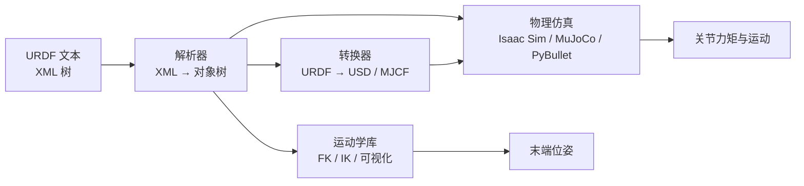
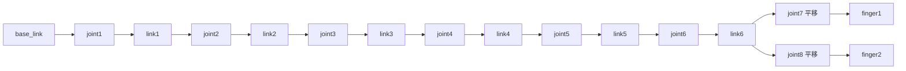
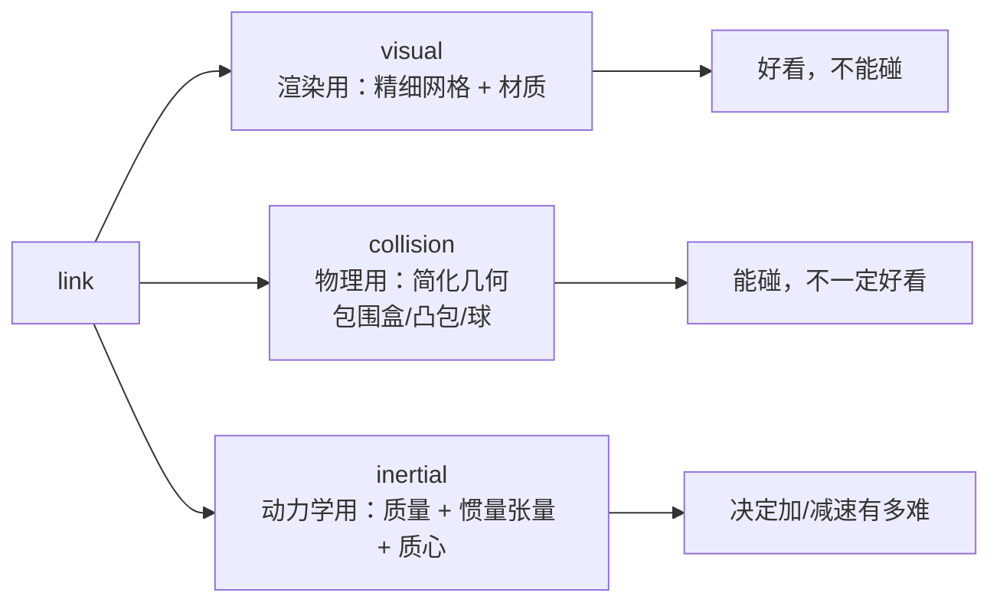

# URDF：机器人模型的通用描述格式

> **一句话**：URDF（Unified Robot Description Format，统一机器人描述格式）就是一个 XML 文件，用「连杆（link）+ 关节（joint）」把一台机器人写成**一棵树**——每个关节记住它连的是哪两个连杆、自己的轴在哪、能转到什么角度范围。仿真器、可视化工具、运动学库读的都是这个文件，所以它是"把真机搬进电脑"的第一份输入。

**知识链接**：
- [正运动学与 DH 参数](/前置知识/003a_前置知识_正运动学与DH参数) — URDF 是 FK 的输入；这篇讲怎么把关节角算成末端位姿
- [三维旋转表示：旋转矩阵、四元数与角速度](/前置知识/006a_前置知识_三维旋转表示_旋转矩阵四元数与角速度) — URDF 的 `rpy` 和 `axis` 都建立在旋转表示之上
- [刚体动力学：牛顿-欧拉方程与惯性张量](/前置知识/006b_前置知识_刚体动力学_牛顿欧拉方程与惯性张量) — URDF 里 `inertial` 标签填的就是这套量
- 下游：[URDF 转 USD 完整工程流程详解](/工程实践/URDF转USD完整工程流程详解) — 拿到 URDF 之后如何变成仿真能加载的 USD
- 下游：[机器人系统辨识深度解析](/系列/system_identification_deep_dive/index) — 辨识出的几何和动力学参数最终写回 URDF

---

## 1. 为什么需要一份"机器人说明书"

假设你有一台进口机械臂，厂商给了你一张 CAD 装配图。仿真器要跑它，需要知道三件事：**有哪些刚体、它们之间怎么连、每个连接能怎么动**。如果每家仿真器各自定义一套格式，换一个引擎就要重新录一遍参数，而且很容易抄错。

URDF 就是用来终结这种重复劳动的标准：它用一段纯文本，把机器人的**运动学骨架**完整写下来。任何工具只要能解析 URDF，就能重建这棵树。它描述的不是"零件长什么样"，而是"关节怎么连、怎么动"——外观网格和碰撞网格只是挂在连杆上的附件。

图里要看的重点：**同一份 URDF 喂给不同下游工具**。正因为如此，URDF 里任何一处笔误（轴方向写反、限位写错）都会在每一个下游工具里同时放大。

---

## 2. 一棵树：link 与 joint

URDF 的顶层结构就两类元素：

- **link（连杆）**：一个刚体。它自己不"动"，只是被关节带着走。link 可以挂三类附件：`visual`（长什么样）、`collision`（碰撞用什么形状）、`inertial`（质量与惯量）。
- **joint（关节）**：连接父 link 和子 link 的连接体。它定义了"能怎么动"和"动多少"。

整台机器人必须是一棵**树**：任意两个 link 之间只有一条通路，不允许出现闭环。这是 URDF 最硬的结构性限制，后面第 8 节会讲它带来的麻烦。

图里要看的重点：**关节是父子 link 之间的边，不是节点**。所以"关节角度"这个概念天然依附在边上，而"连杆位姿"属于节点。正运动学就是沿着这条链从 base 一路连乘到 link6。

---

## 3. joint 标签的完整规格

一个关节要回答五个问题：它连谁、怎么连、能怎么动、动量范围、以及内部动力学。下表把它们一一对应到 URDF 字段。

| URDF 字段 | 回答的问题 | 取值示例 |
| --- | --- | --- |
| `type` | 能怎么动 | `revolute` / `continuous` / `prismatic` / `fixed` |
| `parent` / `child` | 连的是哪两个 link | `parent link="link1"` |
| `origin` `xyz` | 关节在父 link 上的位置 [m] | `0.28503 0 0` |
| `origin` `rpy` | 关节在父 link 上的朝向 [rad] | `0 0 -1.7939` |
| `axis` `xyz` | 绕/沿哪根轴运动（子 link 坐标系） | `0 0 1` |
| `limit` `lower`/`upper` | 允许的运动范围 | `-2.618` / `2.618` |
| `limit` `effort`/`velocity` | 最大力矩 / 最大速度 | `100` / `5` |
| `dynamics` | 摩擦、阻尼 | `damping="0.1"` |

`origin` 和 `axis` 是**最容易抄错、后果最大**的两个字段，下一节专门拆解。

---

## 4. origin 与 axis：关节的位姿从哪来

`origin` 把子连杆"挂"到父连杆上：`xyz` 是平移，`rpy` 是绕固定轴的旋转（分别绕 X、Y、Z 转，按此顺序复合）。`axis` 则是关节运动的旋转轴或平移方向，它定义在**关节坐标系的当前位置**。

从这个字段结构可以直接写出从父 link 到子 link 的变换。当关节值为 $q$ 时：

$$
T^{\text{parent}}_{\text{child}}(q) = \mathrm{Trans}(\text{origin.xyz}) \cdot \mathrm{Rot}(\text{origin.rpy}) \cdot \mathrm{Rot}(\text{axis},\, q)
$$

**这个公式在做什么**：先按 `origin` 把关节坐标系摆到父连杆上，再按关节值 $q$ 绕轴旋转——一步平移、两步旋转，串成父到子的完整位姿。

::: details 📐 公式详解（点击展开）

| 子表达式 | 它是谁 | 它在干嘛 |
|---------|--------|---------|
| $\mathrm{Trans}(\text{origin.xyz})$ | **挂点位置** | 把关节坐标系从父 link 原点平移到安装处 |
| $\mathrm{Rot}(\text{origin.rpy})$ | **挂点朝向** | 把关节坐标系的三个轴转到安装方向 |
| $\mathrm{Rot}(\text{axis},\,q)$ | **关节自己的动作** | 绕 `axis` 转 $q$ 弧度（平移关节则换成沿轴平移 $q$） |
| $T^{\text{parent}}_{\text{child}}(q)$ | **父子相对位姿** | 一个 4×4 齐次变换，把子 link 的坐标映射到父 link |

**用人话读**："关节的安装位置和朝向由 origin 固定，关节值 q 只负责在安装好的坐标系里再动一下。"

**为什么是这个顺序**：关节运动必须发生在**安装完成之后**的局部坐标系里。如果先旋转再平移，相当于关节轴的安装位置也会跟着动，那就不符合"轴固定在父连杆上"的物理事实。
:::

把每个关节的这个矩阵按树结构连乘，就得到末端位姿——这正是[正运动学](/前置知识/003a_前置知识_正运动学与DH参数)做的事：

$$
T^{\text{base}}_{\text{link6}} = \prod_{j=1}^{6} T^{(j-1)}_{j}(q_j)
$$

**这个公式在做什么**：从基座出发，经过 6 个关节各乘一次父子变换，累乘到第六个连杆，得到末端在基座坐标系里的位姿。

::: details 📐 公式详解（点击展开）

| 子表达式 | 它是谁 | 它在干嘛 |
|---------|--------|---------|
| $\prod_{j=1}^{6}$ | **接力链** | 按关节顺序把 6 个矩阵依次相乘，前一个的结果喂给后一个 |
| $T^{(j-1)}_{j}(q_j)$ | **单节贡献** | 第 $j$ 个关节在角度 $q_j$ 下带来的父子变换 |
| $T^{\text{base}}_{\text{link6}}$ | **末端位姿** | 4×4 矩阵，前三列是朝向，最后一列是位置 |

**用人话读**："每个关节负责一小段变换，六段接起来就是末端相对基座的位姿。"

**为什么用矩阵连乘**：变换的复合天然对应矩阵乘法，连乘顺序就是运动链从根到叶的顺序，物理上不会错位。
:::

---

## 5. 五种关节类型

URDF 用 `type` 区分关节的运动方式，这决定了 `axis`、`limit` 的含义和仿真器的处理方式。

| 类型 | 运动 | 单位 | 典型用途 |
| --- | --- | --- | --- |
| `revolute` | 绕轴转动，有角度限位 | rad | 机械臂主关节 |
| `continuous` | 绕轴转动，无限位 | rad | 轮子 |
| `prismatic` | 沿轴平移，有位移限位 | m | 夹爪开合、升降柱 |
| `fixed` | 完全不动 | — | 把传感器/工具刚性固定在连杆上 |
| `planar` / `floating` | 平面/自由六自由度 | — | 移动底盘、被操作的物体 |

注意 `revolute` 和 `prismatic` 虽然运动形式不同，**数值单位一个是弧度一个是米**。仿真器里必须按类型分别处理，否则会拿"0.03 rad"当"0.03 m"用。

---

## 6. 限位、effort 与 velocity

`limit` 标签里四个数各有分工：

- `lower` / `upper`：关节允许到达的最小/最大位置。这是**机械限位**——真实机器人在装配上撞到的硬边界。
- `effort`：关节能输出的最大力矩（转动关节单位 N·m）或最大推力（平移关节单位 N），是仿真器施加力矩时的上限。
- `velocity`：关节的最大速度。

它们的重要性在于：仿真回放真机数据时，真机录下的目标值**可能超出 URDF 的限位**。此时正确的做法是如实截断并报告数量，而不是偷偷放宽限位让误差变好看——宽限位会让仿真"作弊"通过，掩盖模型和真机的真实差距。限位之外的残差本身就是重要证据，说明真机硬件版本、零位或记录链路与这份 URDF 存在差异。

---

## 7. visual / collision / inertial 三者不能混用

每个 link 可以同时挂三种描述，它们服务的目的完全不同：

图里要看的重点：**三套几何可以不一致，而且经常故意不一致**。渲染网格追求精细，几万个三角形；碰撞网格追求快，用几十个面的凸包近似就够。真机回放只做运动学检查时，甚至可以完全不要碰撞体——但那样就没法验证抓取和接触。

`inertial` 里的质量、惯量张量和质心决定了动力学。仿真里关节"加个速要多少力矩""松手后会不会甩"，全由它决定。URDF 声明的惯量通常来自 CAD，未必等于真机实测值。

---

## 8. URDF 描述不了什么

URDF 只负责"单台机器人的运动学骨架"，以下内容它都不管：

- **闭环机构**：并连杆、平行四边形机构无法直接表达（有人用 `mimic` 标签近似）。
- **执行器模型**：电机、减速比、PD 增益、电流限制都不在 URDF 里，是仿真器的配置。
- **传感器**：相机、IMU、力传感器要在仿真场景里单独添加。
- **场景与物体**：URDF 描述的是一台机器人，不包含桌面、餐具、其他物体。
- **外观材质与光照**：`visual` 只给网格路径，材质、光照属于渲染场景。

正因为 URDF 覆盖面有限，把它导入仿真器时通常要"转换 + 补充"：mesh 路径修复、惯量补全、执行器配置、碰撞过滤、传感器注入。这套流程就是把 URDF 变成场景描述格式（如 USD）的过程，属于下游工程实践的范畴。

---

## 9. 一个真实例子：Piper 关节表

一台 AgileX Piper 机械臂的 URDF 声明值（每臂 6 个转动关节 + 2 个平移手指关节）：

| 关节 | 类型 | 下限 | 上限 | effort 上限 | velocity 上限 |
| --- | --- | ---: | ---: | ---: | ---: |
| joint1 | 转动 | -2.618 rad | 2.618 rad | 100 N·m | 5 rad/s |
| joint2 | 转动 | 0 rad | 3.14 rad | 100 N·m | 5 rad/s |
| joint3 | 转动 | -2.967 rad | 0 rad | 100 N·m | 5 rad/s |
| joint4 | 转动 | -1.745 rad | 1.745 rad | 100 N·m | 5 rad/s |
| joint5 | 转动 | -1.22 rad | 1.22 rad | 100 N·m | 5 rad/s |
| joint6 | 转动 | -2.0944 rad | 2.0944 rad | 100 N·m | 3 rad/s |
| joint7 | 平移 | 0 m | 0.035 m | 10 N | 1 m/s |
| joint8 | 平移 | -0.035 m | 0 m | 10 N | 1 m/s |

再看它们的 `origin`，就能理解为什么"关节轴方向"必须从文件读、不能靠猜：

| 关节 | origin xyz [m] | origin rpy [rad] | 局部 axis |
| --- | --- | --- | --- |
| joint2 | (0, 0, 0) | (1.5708, -0.1359, -3.1416) | (0, 0, 1) |
| joint4 | (-0.021984, -0.25075, 0) | (1.5708, 0, 0) | (0, 0, 1) |
| joint8 | (0, 0, 0.1358) | (1.5708, 0, -3.1416) | (0, 0, -1) |

注意 joint8 的 axis 是 `(0, 0, -1)`，和 joint7 的 `(0, 0, 1)` **符号相反**。这正是一根夹爪的两片手指：一个向正方向推、一个向负方向推，开口才能对称张合。如果把两个都写成 `+1`，两片手指会同向移动，夹爪永远夹不住东西。

另外，joint2 的 `origin` 全是 0，但它有 180° 的 rpy 旋转——说明"关节装在原点"和"关节朝向被翻转过"是两回事。表中 xyz 都相对各自父连杆，**绝不能当世界坐标用**。

---

## 10. 常见的四类错误

| 错误 | 后果 | 排查方式 |
| --- | --- | --- |
| axis 方向写反 | 关节反向运动，末段姿势完全错 | 单关节小角度移动，看末端往哪走 |
| 限位单位混用（度 vs 弧度） | 关节被过早截断或超出太多 | 检查数值量级，弧度一般 < 7 |
| origin 当世界坐标 | 各连杆位置整体错位 | 确认 xyz 都相对父 link |
| 忽略了 float32 精度 | 时间戳/角度出现微小抖动 | 不要用 `==` 比较浮点，用容差 |

---

## 11. 总结

- URDF 用 **link + joint 的树** 描述一台机器人的运动学骨架，是所有下游工具的公共输入。
- 关节的 `origin` 决定它挂在哪、朝向如何；`axis` 决定绕/沿哪根轴动；两者共同定义了父子变换。
- 正运动学就是沿运动链把父子变换连乘起来。
- `visual` / `collision` / `inertial` 服务渲染、物理、动力学三个不同目的，可以且经常故意不一致。
- URDF 不包含执行器、传感器、场景、材质；导入仿真时需要转换和补充。

**一句话**：URDF 是机器人的"骨架说明书"，读懂它的字段，就能知道仿真里每一个关节为什么会那样动。

---

## 延伸阅读

- [URDF 转 USD 完整工程流程详解](/工程实践/URDF转USD完整工程流程详解) — 把 URDF 变成 Isaac Sim 能加载的场景
- [正运动学与 DH 参数](/前置知识/003a_前置知识_正运动学与DH参数) — 沿 URDF 树做 FK 的完整推导
- [机器人系统辨识深度解析](/系列/system_identification_deep_dive/index) — 用真机实验修正 URDF 里不准确的几何与动力学参数
