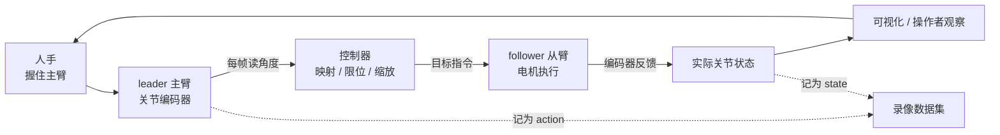
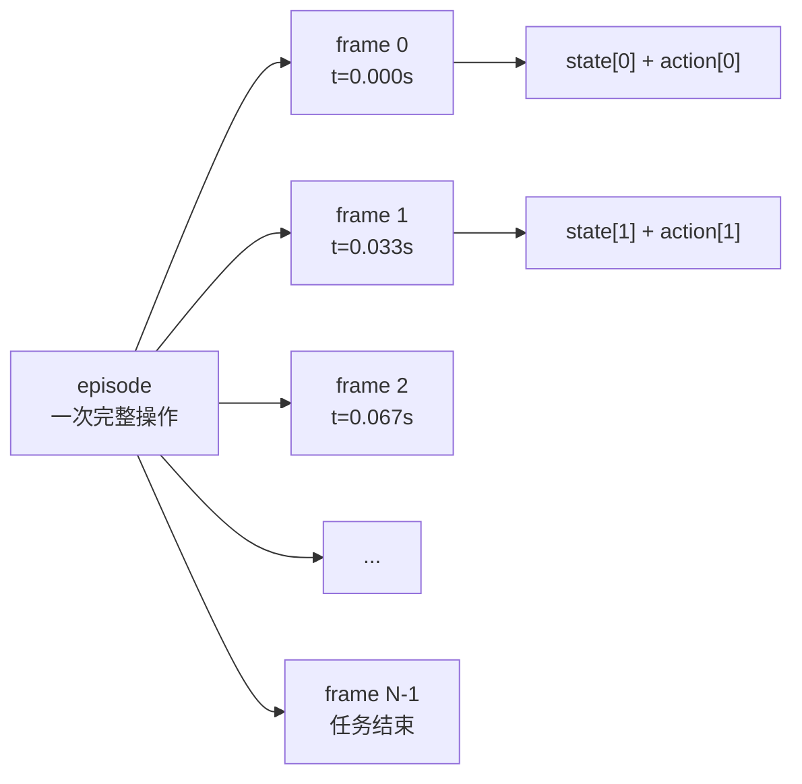
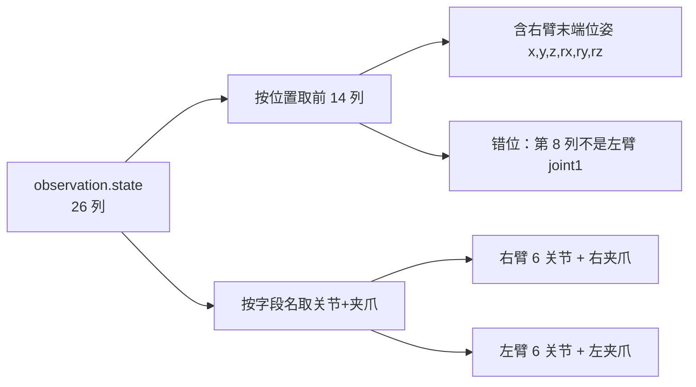
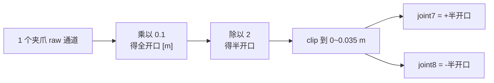

# Leader-Follower 遥操作与机器人示教数据格式

> **一句话**：遥操作就是"人握着一只机械臂动，另一只机械臂照着动"，握的那只叫 leader（主臂）、跟着动的那只叫 follower（从臂）。录像系统每秒记下几十次"leader 的指令"和"follower 的实际状态"，把这一串时刻排成一张表，就是机器人模仿学习的原始素材。

**知识链接**：
- [行为克隆与 RL 微调范式](/前置知识/000d_前置知识_行为克隆与RL微调范式) — 这些示教数据最终喂给的方法
- [Diffusion Policy](/前置知识/000c_前置知识_Diffusion_Policy) — 直接从遥操作数据学策略的经典方法
- [正运动学与 DH 参数](/前置知识/003a_前置知识_正运动学与DH参数) — 用关节角验证记录里的末端位姿
- [URDF：机器人模型的通用描述格式](/前置知识/017a_前置知识_URDF机器人模型描述格式) — 解码后的关节角要对照的模型
- 下游：[LeRobot：开源端到端机器人学习库](/论文综述/020_LeRobot_开源端到端机器人学习库) — 这套数据格式的工程实现

---

## 1. 为什么要"人手教"而不是"手写程序"

传统工业机器人靠工程师手写轨迹：把每个点的位置和姿态一个个编进程序。这在零件位置固定、动作重复的产线上很好用，但一旦面对"把不同的食物摆到不同盘子里"这类任务，穷举所有情况根本不可能。

遥操作换了一条路：**让一个人直接演示怎么做**，系统把演示过程完整录下来。于是问题从"怎么写规则"变成了"怎么从一堆演示里学出规则"——这正是模仿学习（imitation learning）要解决的，而遥操作是它最主流的数据来源。

---

## 2. Leader-Follower：把人的动作"缩放"映射到机器人

leader-follower 结构解决的是"人怎么指挥机器人"的问题。人握住 leader，leader 的每个关节角度被实时读出来，再作为目标发给 follower；follower 用自己的电机去追这个目标。



图里要看的重点：**同一时刻产生了两种数据**——leader 的角度是"人想让它去哪"（记作 `action`），follower 的角度是"它实际到了哪"（记作 `state`）。这两条线之间的差值，就是后面做系统辨识时要研究的"跟随误差与延迟"。

### 2.1 ALOHA：一台便宜的双臂遥操作台

ALOHA（A Low-cost Open-source Hardware system for bimanual teleoperation）是一套开源的低成本双臂遥操作方案。它的关键设计是**用两组同样的机械臂**：后面一对由人操作（leader），前面一对执行任务（follower）。因为硬件同构，关节空间可以直接对应，不需要复杂的逆运动学换算，遥操作手感顺滑。

真实的数据采集台上，两台 leader 和两台 follower 装在同一张桌子上，正对摄像机。遥操作者的手腕运动被缩放到 follower 上——比如手腕转 30° 可能对应 follower 关节转某个成比例的角度。这个"缩放关系"和"零位关系"如果没有明确记录，就会成为数据解读的隐患。

---

## 3. 一次遥操作被切成什么：episode 与 frame

录像的时间轴被切成两层：

- **episode（回合）**：一次完整操作，从初始姿态开始到任务结束（或操作者停手）。它是一段独立的任务样本。
- **frame（帧）**：某个采样时刻的一整条记录。所有通道在这一个时刻的值组成"一行"。

采样频率决定帧的密度。30 Hz（每秒 30 帧）意味着相邻帧间隔约 33 毫秒。一条几十秒的 episode 就是上千帧。



图里要看的重点：**每一帧都同时携带 state 和 action**。所以"某时刻的指令"和"该时刻的状态"天然配对，这也是学习"观测→动作"映射的样本单元。

---

## 4. state 与 action：两种数据，两种用途

| 通道 | 含义 | 从哪来 | 下游用途 |
| --- | --- | --- | --- |
| `state` | follower 的实际关节角/位姿 | follower 编码器 | 作为策略的观测、作为回放基准 |
| `action` | leader 的关节角 | leader 编码器 | 作为策略要预测的目标、作为仿真输入 |

一个容易混淆的点：**在真机上，`action` 是 leader 读数；在仿真回放里，`action` 被当成"要发给 follower 的目标"**。这两者并不严格相等——leader 读数还要经过控制器映射、限位、滤波才变成真正下发的指令。所以用 `action` 驱动仿真，测到的是"整条链路（含映射和延迟）的有效响应"，而不是电机本身的响应。

---

## 5. 数据集长什么样：目录与元数据

现代机器人数据集（如 LeRobot 格式）把一条数据组织成"元数据 + 数据分块 + 视频"三部分：

```text
dataset_root/
├── meta/
│   ├── info.json          # 全局元数据：fps、特征名、维度
│   └── common_record.json # 任务信息：task_id、task_name、machine_id
├── data/
│   └── chunk-000/
│       └── episode_000000.parquet   # 关节与动作的时间序列
└── videos/
    └── chunk-000/
        └── observation.images.image_{top,left,right}/
            └── episode_000000.mp4   # 三路相机视频
```

几个关键点：

- **`meta/info.json` 里的 `features` 描述每一列叫什么、单位是什么。** 这是解码数据的唯一权威来源。
- **`data/chunk-*` 分块存储**，是为了避免单个文件过大；一条 episode 的关节数据就是一张表。
- **视频与关节数据分开存**，各自有自己的时间轴，需要通过时间戳对齐。

---

## 6. 按名字解码，不按位置猜

这是数据格式里最容易踩、后果最隐蔽的坑。

假设 `observation.state` 有 26 列。一个想当然的做法是"取前 14 列当双臂关节"。但如果这张表实际上是**右臂 6 关节 + 右夹爪 + 6 维末端位姿 = 13 列，再乘两台臂 = 26 列**，那么前 14 列里就混进了右臂的末端位姿，第 8~13 列根本不是关节角。

正确做法是：从 `info.json` 读出每列的**名字**，再按名字去取：

| 通道类别 | 字段名模式 | 数量 |
| --- | --- | --- |
| follower 手臂关节 | `follower_joint{1..6}_{right,left}.pos` | 12 |
| follower 夹爪 | `follower_gripper_{right,left}.pos` | 2 |
| follower 末端位姿 | `follower_pose_{right,left}_{x,y,z,rx,ry,rz}.pos` | 12 |
| leader 手臂关节 | `leader_joint{1..6}_{right,left}.pos` | 12 |
| leader 夹爪 | `leader_gripper_{right,left}.pos` | 2 |

于是 `observation.state` 的 26 列 = 12（follower 关节）+ 2（follower 夹爪）+ 12（末端位姿）；而 `action` 的 14 列 = 12（leader 关节）+ 2（leader 夹爪）。**把末端位姿误当成关节，会让整条解码在无声中错位。**

下面这张索引映射图说明"同一份数据按位置取和按名字取会得到不同结果"：



图里要看的重点：**"14"这个数字在 state 和 action 里含义不同**。state 的 14 在位置上一半是错的，只有按名字取才正确。

---

## 7. 通道顺序与单位

即使按名字取对了列，还要确定**排列顺序**和**单位**，否则维度对得上、数值全错。

**顺序**：约定的记录次序是"右臂六关节 → 右夹爪 → 左臂六关节 → 左夹爪"。仿真侧的关节顺序也要和它一致，否则右臂的数值会被喂给左臂。

**单位**：手臂关节直接是**绝对弧度**（不是度、不是相对增量、不归一化）。夹爪通道则往往是设备自己的**原始计数**（raw unit），不是米——全开对应多少米，需要额外标定。如果直接把 raw 当米用，夹爪的开口会差一个数量级。

| 通道 | 单位 | 是否直接可用 |
| --- | --- | --- |
| 手臂关节 | 弧度 rad | 是（绝对角度） |
| 夹爪 | 原始计数 raw | 否（需标定比例） |
| 末端位置 | 米 m | 是（基座局部系） |
| 末端姿态 | 弧度 rad（欧拉角） | 是（需确认顺序） |

---

## 8. 时间戳：数据的隐藏坐标

每一帧都带一个时间戳。它有两个用途：一是确认采样是否等间隔，二是把关节数据与视频对齐。

- **等间隔检查**：如果相邻时间戳差不是几乎恒定的 1/fps，说明采集链路发生过头采样或丢帧，直接按固定步长回放就会错位。
- **数值精度**：时间戳常以 float32 存储，相邻差值会在末几位抖动（例如 0.0333328 与 0.0333347）。这是编码精度，不是真实的时间抖动。
- **与视频对齐**：视频和关节是两条独立的时间轴，要真正对齐需要共同时钟或明确的时钟映射，靠"都是 30 Hz"并不够。

---

## 9. 这批数据的三个"未确认"

理解遥操作数据格式时，必须区分"文件里写了什么"和"它是否可靠"：

1. **夹爪单位未标定**：raw 到米的换算比例是暂定假设，需要尺量验证。
2. **零位未标定**：编码器的"0"和 URDF 的"0"可能差一个常数，未确认前不能当几何零偏写进模型。
3. **末端位姿的来源未确认**：记录里的末端位姿可能是控制器用自身 FK 算出来的，不是独立的外部测量——用 URDF 去对比它，验证的是"两套 FK 是否一致"，不是"真实末端精度"。

---

## 10. 一条真实 episode 的数值画像

把一帧数据完整"翻译"一遍，能看清所有通道如何落到仿真维度上。假设某帧的 14 个 `action` 通道（leader 侧，按"右臂 6 关节 → 右夹爪 → 左臂 6 关节 → 左夹爪"排列）是：

| 下标 | 0–5 | 6 | 7–12 | 13 |
| --- | --- | --- | --- | --- |
| 含义 | 右臂 joint1–6 | 右夹爪 | 左臂 joint1–6 | 左夹爪 |
| 单位 | rad | raw | rad | raw |

解码后送进仿真的顺序变成 16 维：右臂 `joint1…joint8`、左臂 `joint1…joint8`。夹爪那一个 raw 值被拆成两片手指：

```text
half_opening = clip(raw_gripper × 0.1 / 2, 0, 0.035)   # 单位 m
joint7 = +half_opening
joint8 = -half_opening
```

例如 raw = 0.6，则每片手指位移 0.03 m、总开口 0.06 m；raw = 2 被截断到每片 0.035 m；raw 为负表示完全闭合。这张映射图说明了"一个物理夹爪通道 → 两个平移关节"的关系：



图里要看的重点：**raw 和米之间隔着一个暂定比例**，而且"两片手指反号"是 URDF 的定义，不是物理必然。整条 episode 的规模参考值是：936 帧、30 Hz、首末时间差 31.17 s、相邻时间戳约 0.03333 s。真机数据里还有一批目标值超出了 URDF 的机械限位（例如右 joint6 有 155 个标量越界），这些越界在回放时会被如实截断，不会被静默放宽。

---

## 11. 总结

- 遥操作让机器人通过"人手演示"获取任务数据；leader 记录人的意图（`action`），follower 记录实际状态（`state`）。
- ALOHA 用同构双臂实现顺滑的遥操作，是常见的开源数据采集方案。
- 数据被切成 episode 和 frame，每帧同时携带 state 和 action。
- 数据集的权威来源是 `meta/info.json`：**按字段名解码**，不要按列位置猜。
- 顺序、单位、时间戳、零位都是解码正确性的一部分；夹爪的 raw 单位和末端位姿来源在未标定前不能当作已知事实。

**一句话**：遥操作数据不是"一堆数字"，而是一份带字段名、单位、时间戳和未确认项的契约——解码正确，后面的仿真和学习才有意义。

---

## 延伸阅读

- [LeRobot：开源端到端机器人学习库](/论文综述/020_LeRobot_开源端到端机器人学习库) — 这套数据格式的工程实现
- [Diffusion Policy](/前置知识/000c_前置知识_Diffusion_Policy) — 直接消费遥操作数据的策略
- [URDF：机器人模型的通用描述格式](/前置知识/017a_前置知识_URDF机器人模型描述格式) — 解码出的关节角要对照的模型
