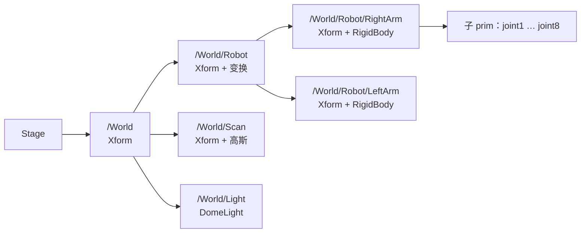
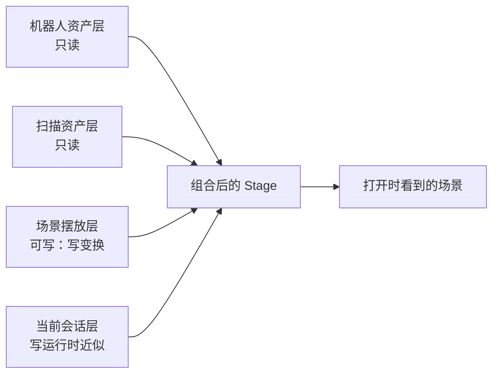
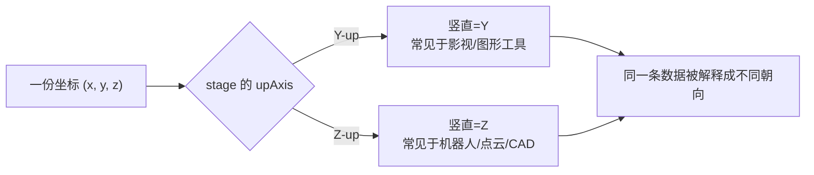

# USD：场景描述、坐标轴与单位约定

> **一句话**：USD（Universal Scene Description，通用场景描述）是 NVIDIA Isaac Sim 用来装整个虚拟世界的文件格式——它不是"一个模型"，而是**一棵可以层层拼装的场景树**：每个节点（prim）有自己的变换、属性和物理标签，一棵树从上到下把所有物体和它们的父子关系描述清楚。它同时规定了"哪根轴朝上""一个单位等于多少米"这两条最容易出错、后果最大的全局约定。

**知识链接**：
- [URDF：机器人模型的通用描述格式](/前置知识/017a_前置知识_URDF机器人模型描述格式) — 机器人模型进入 USD 之前的格式
- [三维旋转表示：旋转矩阵、四元数与角速度](/前置知识/006a_前置知识_三维旋转表示_旋转矩阵四元数与角速度) — prim 的朝向用四元数表示
- [3D Gaussian Splatting 三维场景重建](/前置知识/007a_前置知识_3D_Gaussian_Splatting三维场景重建) — 扫描场景最终也以 USD prim 的形式加载
- 下游：[URDF 转 USD 完整工程流程详解](/工程实践/URDF转USD完整工程流程详解) — 转换器实际写了哪些 USD 属性
- 下游：[Isaac Sim 6.0 物理系统深度解析](/系列/isaacsim_physics_deep_dive/index) — USD 物理数据如何被 PhysX/Newton 后端读取

---

## 1. 为什么不直接用一个模型文件

一个仿真场景里通常同时有：机器人、桌面、餐具、相机、光源，甚至一整片扫描出来的背景。它们来自不同来源、用不同工具制作，却要在同一个世界里对齐。如果把它们全部"打平"成一个文件，任何一处修改都要重新导出整份资产，无法协作、无法复用。

USD 的核心设计是**组合（composition）**：一个场景不是一份文件，而是**多条数据层（layer）叠加**的结果。机器人资产是一层、扫描背景是一层、当前摆放位置又是一层，最终看到的场景是它们叠加后的结果。这种"引用而不复制"的机制，是 Isaac Sim 里"同一份机器人资产实例化两次（左右臂）""同一份扫描换一个世界变换"的基础。

---

## 2. 三层结构：stage / prim / attribute

USD 的世界观只有三样东西：

- **stage（舞台）**：一个打开的场景，是整棵树的容器。
- **prim（图元）**：树上的一个节点，可以是物体、变换、相机、光源或分组。prim 有层级路径（如 `/World/Robot/LeftArm`），子 prim 继承父 prim 的变换。
- **attribute（属性）**：挂在 prim 上的键值，例如位置、朝向、颜色、物理材质。



图里要看的重点：**变换是沿树累乘的**。`/World/Robot` 平移一次，左右臂会一起平移；左右臂各自再叠加自己的基座位置，就得到两条臂在世界里的最终位姿。把机器人整体挪到扫描工位的正确位置，只需要改 `Robot` 这一个节点的变换。

---

## 3. 组合：一个场景由多层拼出来

"引用而不复制"具体靠四种机制实现，它们的分工是：

| 机制 | 作用 | 典型用途 |
| --- | --- | --- |
| References | 把另一个文件（或子图）挂到当前 prim 下 | 把机器人 USD 挂到 `/World/Robot` |
| Payloads | 延迟加载的重资产 | 打开场景时先不加载大网格，需要时才载入 |
| Variants | 同一资产的多套可选配置 | "带物理 / 不带物理"两套变体 |
| Layers | 只存差异的叠加层 | 场景层只记录摆放位置，资产层保持只读 |



图里要看的重点：**摆放层只写"物体放在哪"，不改动资产本身**。所以同一份机器人资产可以被引用两次、放在两个不同位置，而资产文件保持一份。当同一份资产被放两处时，若把每个实例的位姿写到资产层，两个实例会互相覆盖——这就是"实例化与变换该写在哪一层"的规则来源。

---

## 4. 坐标轴约定与单位：全局的二选一

USD 有两个必须显式声明的全局设置，它们决定所有坐标怎么被理解：

- **`upAxis`（上方向）**：可以是 **Y-up** 或 **Z-up**。它规定"哪根轴是竖直向上的"。
- **`metersPerUnit`（每单位多少米）**：规定一个 USD 单位等于多少米。



图里要看的重点：**同一组数值在不同 upAxis 下代表完全不同的空间方向**。如果点云是按 Z-up 采出来的，而消费它的 USD 被标成 Y-up，整个场景会"躺倒"——原本朝上的地面会变成一面侧墙。

### 4.1 两种约定的换算

把一个在 Y-up 坐标系下表达的点 $p_Y = (x, y, z)$ 换成等价的 Z-up 表示 $p_Z$，需要一次绕 X 轴 90° 的旋转：

$$
p_Z = R_{Z \leftarrow Y}\, p_Y, \qquad
R_{Z \leftarrow Y} =
\begin{pmatrix}
1 & 0 & 0 \\
0 & 0 & -1 \\
0 & 1 & 0
\end{pmatrix}
$$

**这个公式在做什么**：把"竖直轴是 Y"的坐标重新解读成"竖直轴是 Z"，保持"哪个物理方向朝上"不变——原来的 Y 变成新的 Z，原来的 Z 变成新的负 Y。

::: details 📐 公式详解（点击展开）

| 子表达式 | 它是谁 | 它在干嘛 |
|---------|--------|---------|
| $p_Y$ | **旧坐标** | 用 Y-up 约定表达的点的位置 |
| $R_{Z \leftarrow Y}$ | **换算矩阵** | 一个纯旋转，把 Y-up 的轴重新映射到 Z-up 的轴 |
| 第 1 行 $(1,0,0)$ | **X 不变** | 两个约定都把 X 当作水平的一个方向 |
| 第 2 行 $(0,0,-1)$ | **新 Y 来自旧 -Z** | 新的水平方向由旧的深度方向取反而来 |
| 第 3 行 $(0,1,0)$ | **新 Z 来自旧 Y** | 竖直方向从旧 Y 搬到新 Z |
| $p_Z$ | **新坐标** | 同一物理点在 Z-up 约定下的表示 |

**用人话读**："竖直方向从 Y 搬到 Z，同时把水平方向重新分配，点本身没动，只是换了一套坐标轴来读它。"

**为什么用旋转而不是直接换字段**：如果只是把 (x, y, z) 里的 y 和 z 对调，会得到一个左手系，旋转关系被破坏。真正的约定切换必须是一个正交旋转（行列式为 +1），才能保持朝向、法线、旋向都不出错。这也解释了为什么"看起来只是换个 upAxis"会让一个扫描场景整体翻转。
:::

`metersPerUnit` 则是纯缩放：如果资产以厘米为单位而场景声明 `metersPerUnit = 1`，物体就会放大 100 倍——这就是"导入后机器人变巨人"最常见的原因。

---

## 5. 变换怎么写：translate / orient / scale

prim 的变换通常是几个独立的操作按固定顺序复合：

$$
T = T_{\text{translate}} \cdot R_{\text{orient}} \cdot S_{\text{scale}}
$$

**这个公式在做什么**：先把物体缩放、再旋转、最后平移，得到它在父坐标系里的完整位姿。

::: details 📐 公式详解（点击展开）

| 子表达式 | 它是谁 | 它在干嘛 |
|---------|--------|---------|
| $S_{\text{scale}}$ | **塑形** | 先改变物体自身大小（单位换算常在这里发生） |
| $R_{\text{orient}}$ | **定向** | 在缩放后的形状上旋转朝向 |
| $T_{\text{translate}}$ | **落位** | 把旋转好的物体平移到世界里的最终位置 |
| 乘法顺序 | **执行顺序** | 最右边的操作最先作用在物体上 |

**用人话读**："先把自己调整好大小，再转个方向，最后搬到指定位置。"

**为什么顺序不能反**：如果先平移再旋转，物体会绕世界原点公转而不是原地转身——摆放两臂基座时就会把整条臂甩到错误的位置。USD 的 `XformOpOrder` 显式记录这个顺序，就是为了避免歧义。
:::

---

## 6. 物理属性也挂在 prim 上

USD 不只描述"看起来是什么"，还描述"物理上是什么"。物理能力通过 **API schema（能力标签）** 附加到 prim 上：

| API schema | 作用 |
| --- | --- |
| `PhysicsRigidBodyAPI` | 把 prim 声明为刚体 |
| `PhysicsCollisionAPI` / `PhysicsMeshCollisionAPI` | 声明碰撞形状 |
| `PhysicsJoint` | 声明关节（另一种 prim 类型） |
| `PhysicsScene` | 声明重力、求解器设置 |

这套"标签式"设计让同一个几何 prim 可以选择性地参与物理：加载一个机器人 USD 时，可以选"带物理"的变体让它能动，也可以选"不带物理"的变体只做静态摆放。**外观和物理职责分离**，正是"扫描场景只有外观、没有碰撞体"这种状态的实现方式。

---

## 7. USDA 与 USDC、以及"直接写 USD"的坑

USD 文件有两种常见载体：

- **`.usda`**：ASCII 文本，可读可 diff，适合检查和小场景。
- **`.usdc`**：二进制，紧凑、加载快，适合大资产。

一个工程上的坑是：仿真运行时，关节状态可能被写在**高性能数据层（Fabric）**里，而不是直接落回 USD 图层。如果只在运行中直接给刚体写 USD transform，可能因为 tensor handle 失效而失败，或者导出的 USD 里根本没有运行时姿态。稳妥做法是运行中读取实际刚体位姿，导出后再写入一个独立的检查 stage——这也是"导出的场景要单独验证姿态"的原因。

---

## 8. 一个典型场景的 prim 树

把机器人、扫描、光源、相机装进一个世界，结构大致是：

```text
/World
├── /World/Robot
│   ├── /World/Robot/RightArm      (RigidBody + 关节)
│   └── /World/Robot/LeftArm       (RigidBody + 关节)
├── /World/Scan                    (仅外观的高斯场景)
├── /World/Light                   (DomeLight)
└── /World/Camera                  (相机)
```

- `/World/Robot` 的变换决定两条臂整体的位置。
- 每条臂的基座位置写在自己的初始位姿里。
- `/World/Scan` 的变换把源点云坐标系搬到世界坐标系。
- 只有挂了 RigidBodyAPI 的 prim 才会被物理引擎驱动。

---

## 9. 一次 upAxis 换算的数值例子

取一个 Y-up 约定下的点 $p_Y = (1, 2, 3)$（三个分量单位都是米）。按第 4.1 节的换算矩阵：

```text
p_Z = R_{Z←Y} · p_Y
    = ( 1·1 + 0·2 + 0·3,
        0·1 + 0·2 + (-1)·3,
        0·1 + 1·2 + 0·3 )
    = (1, -3, 2)
```

同一个物理点，在 Z-up 约定下的坐标是 $(1, -3, 2)$。原来的"竖直高度 2"变成了新坐标的第三个分量 2，而原来的"深度 3"变成了新的水平分量 $-3$。如果只把 y 和 z 对调写成 $(1, 3, 2)$，竖直分量虽然也是 2，但水平方向的符号错了，整个场景会镜像翻转——这正是"用旋转而不是换字段"的原因。

再看单位：如果一份以厘米建模的机器人 mesh 被导入 `metersPerUnit = 1` 的场景，一个 30 个单位长的连杆会被当成 30 米——比真实长度放大 100 倍，肉眼上就是"机器臂伸出了整栋房子"。修正是把 `metersPerUnit` 设为 0.01，或在导入时对 mesh 应用 0.01 的缩放，两种做法只能选一种，同时做会变成 1 厘米。

---

## 10. 总结

- USD 是 **stage / prim / attribute** 的树，用**组合**把多层资产拼成一个场景。
- 变换沿树累乘；摆放位置写在外层 prim 上，资产本身保持只读，才能安全地实例化多份。
- **`upAxis` 和 `metersPerUnit` 是两条全局约定**：搞错 upAxis 场景会整体躺倒，搞错单位会造成数量级的尺度错误。
- 物理能力通过 API schema 附加到 prim 上，外观与物理可以分离。
- 运行时状态可能在 Fabric 层，导出 USD 后需要单独验证姿态是否真的写进去了。

**一句话**：读一个 USD 场景，先看它的 upAxis 和 metersPerUnit，再看 prim 树的父子变换——这两条约定和这棵树，决定了场景里的一切空间关系。

---

## 延伸阅读

- [URDF 转 USD 完整工程流程详解](/工程实践/URDF转USD完整工程流程详解) — 转换器实际写入的 USD 结构和物理参数
- [Isaac Sim 6.0 物理系统深度解析](/系列/isaacsim_physics_deep_dive/index) — USD 物理数据如何被后端读取
- [3D Gaussian Splatting 三维场景重建](/前置知识/007a_前置知识_3D_Gaussian_Splatting三维场景重建) — 高斯场景作为 USD prim 的加载方式
