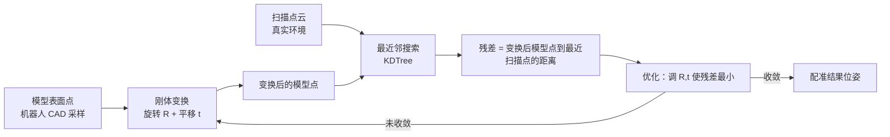
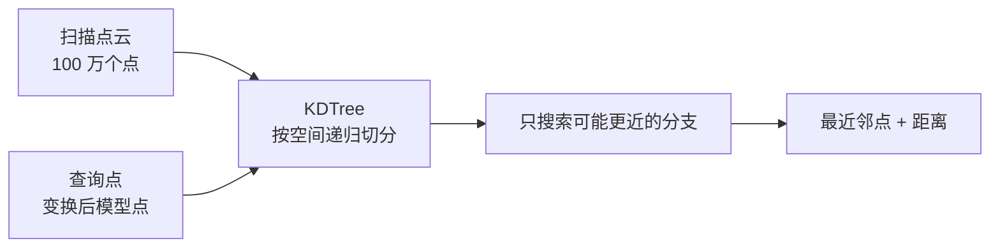
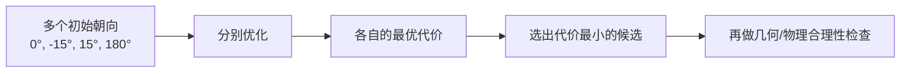

# 点云配准与稳健最近邻拟合

> **一句话**：配准就是"把两块分开得来的三维几何摆到同一个坐标系里对上"。做法通常是：给模型上的每个点，在扫描点云里找离它最近的点当作"应该对上"的伴，然后调一个刚体变换，让所有点对的距离平方和最小。因为真实扫描总有噪声、遮挡和离群点，还要把"平方和"换成对离群点不敏感的稳健损失。

**知识链接**：
- [三维旋转表示：旋转矩阵、四元数与角速度](/前置知识/006a_前置知识_三维旋转表示_旋转矩阵四元数与角速度) — 配准的未知量里三个是旋转
- [Chamfer 距离：衡量两个点云的形状有多接近](/前置知识/011b_前置知识_Chamfer距离_点云形状相似性度量) — 最近邻距离之和的一种对称形式
- [RANSAC 鲁棒估计](/前置知识/014d_前置知识_RANSAC鲁棒估计) — 另一条对抗离群点的路线
- [相机内外参标定](/前置知识/012a_前置知识_相机内外参标定) — 配准得到的相对位姿就是外参的一种
- 下游：[real2sim-eval 深度解析](/系列/real2sim_eval_deep_dive/index) — 位置对齐与颜色对齐的完整工程实现

---

## 1. 配准要解决什么问题

想象你手里有两份几何：

- 一份是**模型**：机器人的 CAD/URDF 表面，坐标原点在机器人自己身上，单位是米。
- 一份是**扫描**：用深度相机或激光扫出来的环境点云，坐标原点在扫描设备里，可能还是 Z-up。

它们描述的是同一个真实世界，但用的是两套坐标系。配准要找的，就是那个能把模型搬到扫描坐标系（或反过来）的**刚体变换**。

图里要看的重点：**优化变量只有刚体变换**（6 个自由度），模型和扫描本身的形状都不改。每一步都"先变换、再找最近邻、再算残差、再更新变换"，循环到收敛。

---

## 2. 未知量：6 个自由度的刚体变换

三维空间里的刚体变换由两部分组成：

- **平移** $t \in \mathbb{R}^3$：沿三个轴各移动多少米。
- **旋转** $R \in SO(3)$：朝哪个方向转。$SO(3)$（三维旋转群）指所有保持长度和旋向不变的旋转；具体可以用旋转矩阵、四元数或欧拉角表示。

合起来是 6 个自由度（3 平移 + 3 旋转）。之所以叫"刚体"，是因为它保持点之间距离不变——只允许整体搬家，不允许拉伸或压缩。

如果已知**一些额外的物理约束**，自由度数可以降下来。最典型的是**地面约束**：如果模型原本就站在地面上，可以先从扫描里拟合出地面平面，然后规定"模型的底面必须贴在平面上、竖直轴沿平面法线"。这样就只剩下平面内的 2 个平移和 1 个绕法线的旋转，也就是 3 个自由度。

图里要看的重点：**约束把搜索空间从 6 维压到 3 维**，更不容易陷入奇怪解，但代价是"必须假设模型确实站在地面上"。一旦这个假设不成立，约束反而会强行把正确的解排除掉。

---

## 3. 最近邻：残差怎么定义

配准不知道"模型上的点 A 应该和扫描里的哪个点对应"，于是用最近邻来**猜测对应关系**：对变换后的模型点 $p_i$，在扫描点云里找欧氏距离最近的那个点 $\mathrm{NN}(p_i)$，把它们的距离当作残差。

$$
r_i(\theta) = \big\lVert R(\theta)\,p_i + t(\theta) - \mathrm{NN}\!\left(R(\theta)\,p_i + t(\theta)\right) \big\rVert_2
$$

**这个公式在做什么**：先把模型点按下标 $\theta$ 指定的刚体变换搬过去，再找扫描里离它最近的点，两者之间的欧氏距离就是这一个点的残差。

::: details 📐 公式详解（点击展开）

| 子表达式 | 它是谁 | 它在干嘛 |
|---------|--------|---------|
| $p_i$ | **模型上的第 i 个采样点** | 从 CAD 表面均匀采样得到的点 |
| $R(\theta)p_i + t(\theta)$ | **搬家后的模型点** | 用当前猜测的旋转和平移把它放到扫描坐标系 |
| $\mathrm{NN}(\cdot)$ | **找对手** | 在扫描点云里找离它最近的扫描点 |
| $\lVert\cdot\rVert_2$ | **量距离** | 两个三维点之间的欧氏距离 |
| $r_i(\theta)$ | **第 i 个残差** | 一个非负标量，越小说明这个点对得越准 |

**用人话读**："把模型点搬过去，看它在扫描里最近的邻居有多远，这个距离就是它当前的错位量。"

**为什么用最近邻而不是找真对应**：两份几何没有共同点编号，无法知道谁和谁对应；最近邻是"在没有对应时唯一能算的近似对应"，虽然不完美，但配合迭代优化通常能收敛到合理结果。
:::

---

## 4. KDTree：为什么最近邻要找得快

暴力做法是"每个模型点都和扫描里所有点比一遍"，如果模型有几千个采样点、扫描有上百万个点，就是几十亿次距离计算。

KDTree（k-dimensional tree，k 维树）把点云按空间位置切成一棵二叉树：每个内部节点沿某个轴一刀切开空间。查询一个点的最近邻时，从根往下选分支，只在可能更近的子树里继续找，把复杂度从线性降到对数级。

图里要看的重点：**KDTree 不改变最近邻的定义，只是让查询变快**。它是配准能跑到实用的前提——同一个扫描点云只建一次树，之后每个模型点都复用它。

---

## 5. 目标函数：把残差汇总成一个数

优化需要一个标量指标。最直接的是把所有残差的平方加起来：

$$
\min_{\theta}\ \sum_{i=1}^{N} \big\lVert r_i(\theta)\big\rVert_2^{2}
$$

**这个公式在做什么**：调刚体变换 $\theta$，让所有模型点到最近扫描点的距离平方和最小。

::: details 📐 公式详解（点击展开）

| 子表达式 | 它是谁 | 它在干嘛 |
|---------|--------|---------|
| $\theta$ | **优化变量** | 6 个（或约束后 3 个）描述刚体变换的参数 |
| $r_i(\theta)$ | **单个点的残差** | 上一节定义的距离 |
| $\lVert r_i\rVert_2^2$ | **放大惩罚** | 把距离平方，让大残差受更重的惩罚 |
| $\sum_{i=1}^{N}$ | **全体汇总** | 把所有采样点的残差合成一个数 |
| $\min_\theta$ | **寻优** | 找让这个数最小的变换 |

**用人话读**："把每个点的错位量平方后全加起来，找到让这个总和最小的摆法。"

**为什么平方而不是直接相加**：平方让"有一个点错得特别离谱"比"很多点各错一点"更划算被修正，这符合"大错必须消除"的直觉；但代价是它对离群点极其敏感——下一节就是来解决这个代价的。
:::

---

## 6. 稳健损失：不让离群点带偏整盘

真实扫描里总有离群点：被遮挡产生的空洞边缘、反光造成的飞点、其他物体或线缆的残留。平方损失会让这些点拿到极大的权重，把整个配准拉偏。

解决办法是把平方换成**增长更慢的稳健损失**。常用的 `soft_l1` 是：

$$
\rho(z) = 2\left(\sqrt{1+z^{2}} - 1\right), \qquad z = \frac{r}{f}
$$

**这个公式在做什么**：对小的残差，损失接近平方增长；对大的残差，损失退化成近似线性增长，从而压制离群点的影响。

::: details 📐 公式详解（点击展开）

| 子表达式 | 它是谁 | 它在干嘛 |
|---------|--------|---------|
| $r$ | **残差** | 当前点到最近邻的距离 |
| $f$ | **尺度 $f\_scale$** | 规定"多大残差才算离群"的分界 |
| $z = r/f$ | **归一化残差** | 把距离换算成"离群程度" |
| $\sqrt{1+z^2}$ | **软化开关** | 小 $z$ 时接近 1，大 $z$ 时接近 $z$ |
| $\rho(z)$ | **稳健损失** | 小残差近似 $z^2$，大残差近似 $2z-2$ |

**用人话读**："残差小的时候照常按平方惩罚，残差大到超过尺度 f 之后，惩罚只按线性增长，不再疯狂放大。"

**为什么是这种形式**：它处处可导、在 0 附近和平方一致（保证正常点被精确拟合），又在大残差处线性增长（保证离群点不主导目标），还不用像 RANSAC 那样显式划分内点外点。$f\_scale$ 是唯一要选的旋钮：选小了把好点当离群，选大了退化成平方损失。
:::

> 左图看损失形状：二次损失 $0.5r^2$ 一路陡增，soft-L1 在大残差处只缓慢上升。右图是关键：二次损失对每个点权重恒为 1，而 soft-L1 的权重 $1/\sqrt{1+(r/f)^2}$ 随残差增大而衰减——一个错得离谱的点，权重自动被压到很小。

---

## 7. 有界最小二乘与多初值

配准的目标函数是**非凸**的：最近邻对应会随变换改变，存在多个局部最优。两个工程手段来应对：

- **有界最小二乘**：给平移和旋转量限定一个合理范围（比如初值 ±0.1 m），防止优化跑到荒谬的解上去。
- **多初值**：从几个不同的初始朝向出发各优化一次，保留代价最低的结果。因为目标函数可能有对称的局部解，单一初值容易停在错误的一侧。

图里要看的重点：**"代价最小"不等于"物理正确"**。如果某些部件没有参与拟合，或者不同朝向恰好都能压低代价，单看数值会选错；最后一步的合理性检查（比如是否悬空、是否反向）不可省略。

---

## 8. 残差该用什么口径报告

优化内部用平方和方便求导，但**向人报告时要换成不易被离群点扭曲的口径**：

| 口径 | 含义 | 什么时候看 |
| --- | --- | --- |
| 中位数 | 一半的点比它近、一半比它远 | 看"典型点"对得如何 |
| 90 分位（P90） | 90% 的点不超过它 | 看尾部的糟糕程度 |
| RMSE | 平方根均值 | 看整体，但被离群点拉高 |
| 20 mm 内占比 | 有多少点已经很准 | 看"大部分是否对齐" |

同一份配准，中位数可能只有 30 mm，P90 却有 60 mm——这说明"典型情况不错，但有一批点错得明显"。只报 RMSE 会同时掩盖这两件事。

---

## 9. 最容易自欺的三个坑

1. **同一变换抵消误差**。如果记录末端和仿真末端都用基座那一个变换映射到世界，那么配准本身的误差在相减时互相抵消了——于是毫米级的末端误差**完全不能**证明"机器人和点云对得准"。要验证配准，必须用不参与变换的独立测量。
2. **单侧最近邻有偏**。计算的是"模型点到扫描点的距离"，反向的"扫描点到模型点"没算。如果模型只覆盖了扫描的一部分，缺失区域不会贡献残差，配准可能漂移而指标依旧好看。
3. **裁剪引入偏差**。为了排除遮挡和重影，往往人工框选保留区域。拟合用的点集和最终交付的场景点集如果不是同一批，就不能把最终产物当成拟合的输入。

---

## 10. 总结

- 配准是求一个**刚体变换**（6 自由度），把模型和扫描对上；加约束可以降维。
- 对应关系用**最近邻**近似，用 **KDTree** 加速查询。
- 目标函数是残差平方和；面对离群点要换成 **soft_l1 之类的稳健损失**，用 $f\_scale$ 控制"多大算离群"。
- 非凸问题靠**有界优化 + 多初值**缓解，但"代价最小"仍需物理合理性检查兜底。
- 报告要用**中位数/P90 等多口径**，并警惕变换抵消、单侧偏差、裁剪偏差这三个自欺陷阱。

**一句话**：配准 = 最近邻给对应、稳健损失抗离群、有界多初值防跑偏，最后用独立证据而不是"数字变小了"来判断它对不对。

---

## 延伸阅读

- [Chamfer 距离：衡量两个点云的形状有多接近](/前置知识/011b_前置知识_Chamfer距离_点云形状相似性度量) — 最近邻距离的对称度量
- [RANSAC 鲁棒估计](/前置知识/014d_前置知识_RANSAC鲁棒估计) — 显式区分内点外点的另一条抗离群路线
- [real2sim-eval 深度解析](/系列/real2sim_eval_deep_dive/index) — 位置对齐与颜色对齐的工程实现
- [相机内外参标定](/前置知识/012a_前置知识_相机内外参标定) — 配准得到的相对位姿与相机外参的关系
