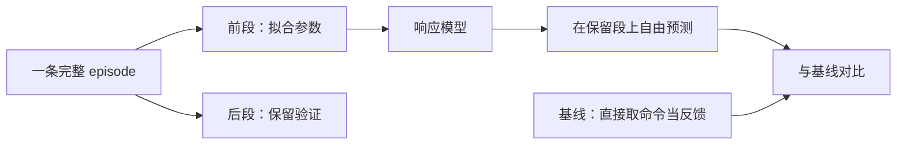

# 一阶响应模型与命令-反馈系统辨识

> **一句话**：给机器人发一个"转到这里"的命令，关节不会瞬间到位，而是像被水拖住一样慢慢逼近。这种"命令变了、反馈慢慢跟上"的行为，可以用一个最简单的模型描述：**它只有一个参数——时间常数 $\tau$，越大越慢**。用真机录下的"命令—反馈"数据把这个 $\tau$（以及延迟、偏置、饱和）估出来，就叫系统辨识。

**知识链接**：
- [Leader-Follower 遥操作与机器人示教数据格式](/前置知识/017b_前置知识_Leader_Follower遥操作与机器人示教数据格式) — 辨识的输入就是这里的 action 与 state
- [常微分方程 ODE：直觉与数值求解](/前置知识/001b_前置知识_常微分方程ODE直觉与数值求解) — 一阶响应就是一阶常微分方程的解
- [物理仿真数值积分：辛积分与能量稳定性](/前置知识/006c_前置知识_物理仿真数值积分_辛积分与能量稳定性) — 离散化与数值积分的关系
- [RANSAC 鲁棒估计](/前置知识/014d_前置知识_RANSAC鲁棒估计) — 抗离群点的另一条估计路线
- 下游：[机器人系统辨识深度解析](/系列/system_identification_deep_dive/index) — 完整的运动学/动力学/执行器辨识流水线
- 下游：[隐式 PD 与极点匹配](/前置知识/017f_前置知识_隐式PD与极点匹配) — 把本文辨识出的 $\tau$ 翻译成仿真增益

---

## 1. 命令和反馈不是一回事

在位置控制的机器人上，控制器接收"目标角度"，输出电流，电机带着关节去追这个目标。整个过程里有一连串会造成滞后的环节：控制器内部的滤波、通信周期、电机电流环的响应、减速器和连杆的惯性。

所有这些环节叠加起来，从外部看就是一句话：**你让它到某个角度，它要花一点时间才到，而且到了一定程度就不再是瞬变**。

如果只关心"命令到关节角度"这一层的有效行为，把这堆环节等效成一个一阶系统就够了——不需要知道里面到底有几个环、每个环多快，只要一个 $\tau$ 能预测"下一步它会到哪"。

---

## 2. 一阶系统：为什么只用一个参数

一阶系统对阶跃命令的响应是一条指数曲线：从当前值出发，指数逼近目标值。


> 图里看的重点：四条曲线都是同一种形状，只是"快慢"不同。较小的 $\tau$（红色 20 ms）几乎瞬间到位；较大的 $\tau$（橙色 250 ms）要走很久才追上。所有曲线在 $t=\tau$ 时都恰好走完总距离的 **63.2%**——这个恒定比例就是一阶系统的指纹。

从这张图可以读出三件事：

1. **只有快慢一个自由度**。给定了 $\tau$，整条曲线就确定了。
2. **$t=\tau$ 对应 63.2%**，$t=3\tau$ 约 95%，$t=5\tau$ 约 99%。
3. **初始斜率决定 $\tau$**：一开始上升越陡，$\tau$ 越小。

### 2.1 用微分方程写出来

一阶响应满足

$$
\tau\,\frac{dq(t)}{dt} = \text{target} - q(t)
$$

**这个公式在做什么**：它说"关节逼近目标的速度，正比于它离目标还有多远"——离得越远走得越快，快到了就走得越慢。

::: details 📐 公式详解（点击展开）

| 子表达式 | 它是谁 | 它在干嘛 |
|---------|--------|---------|
| $q(t)$ | **关节当前角度** | 随时间变化的反馈量 |
| $\text{target}$ | **目标角度** | 命令（leader 角度或控制器输出） |
| $\text{target}-q(t)$ | **还差多远** | 当前误差 |
| $\tau$ | **时间常数** | 决定追上的快慢，单位是秒 |
| $\tau\,dq/dt$ | **滞后项** | 把"想立刻跳到目标"的冲动压成一阶滞后 |

**用人话读**："关节靠近目标的速度和它还差多少成正比，比例系数由时间常数决定。"

**为什么左边要乘 $\tau$**：如果不乘，方程会退化成"瞬间等于目标"（无滞后）。$\tau$ 的存在，正是把"电机追不上理想指令"这件事参数化。
:::

这个方程的解就是图中那条指数曲线：$q(t)$ 以 $\tau$ 为特征时间逼近 target。

---

## 3. 离散化：从连续时间到 30 Hz 采样

真实数据是按固定频率采样的。设采样间隔为 $\Delta t$（30 Hz 时约 0.0333 s），把连续方程离散成一个递推式：

$$
q[k+1] = \alpha\, q[k] + (1-\alpha)\left(\text{clip}\!\left(\text{gain}\cdot u[k-d],\ \text{lower},\ \text{upper}\right) + \text{bias}\right)
$$

**这个公式在做什么**：用上一帧的反馈 $q[k]$ 和若干帧之前的命令 $u[k-d]$，预测下一帧的反馈 $q[k+1]$——旧值和目标按比例 $\alpha$ 与 $1-\alpha$ 混合，命令先经过增益、偏置和饱和处理。

::: details 📐 公式详解（点击展开）

| 子表达式 | 它是谁 | 它在干嘛 |
|---------|--------|---------|
| $q[k]$ | **上一帧反馈** | 关节当前在哪 |
| $\alpha$ | **记忆系数** | 越接近 1 越"拖沓"，旧值权重越大 |
| $u[k-d]$ | **延迟后的命令** | $d$ 帧之前的命令，模拟链路延迟 |
| $\text{gain},\, \text{bias}$ | **缩放与零点** | 命令到反馈的比例和固定偏移 |
| $\text{clip}(\cdot,\text{lower},\text{upper})$ | **饱和** | 命令超范围时截断，模拟能到的上下限 |
| $q[k+1]$ | **预测的下一帧反馈** | 模型输出 |

**用人话读**："下一帧的位置 = 一部分旧位置 + 一部分（延迟后的命令经缩放和截断后的目标），两者按 α 加权。"

**为什么用 α 而不是直接用 τ**：离散模型每步只做一次加权平均，和采样率绑定，实现最省事；$\tau$ 和 $\alpha$ 是一一对应的，需要时随时换算。
:::

$\tau$ 与 $\alpha$ 的换算关系是：

$$
\alpha = e^{-\Delta t/\tau}, \qquad \tau = -\frac{\Delta t}{\ln \alpha}
$$

**这个公式在做什么**：在有界区间内把"物理上的时间常数"和"离散递推里的记忆系数"来回换算。

::: details 📐 公式详解（点击展开）

| 子表达式 | 它是谁 | 它在干嘛 |
|---------|--------|---------|
| $\Delta t$ | **采样间隔** | 30 Hz 时约 0.0333 s |
| $\tau$ | **时间常数** | 物理意义上的快慢 |
| $\alpha$ | **离散记忆系数** | 递推式里的权重，取值 $(0,1)$ |
| $e^{-\Delta t/\tau}$ | **换算桥梁** | 把连续指数衰减采样成离散权重 |

**用人话读**："采样越密或响应越快，α 就越小；采样越疏或响应越慢，α 就越接近 1。"

**为什么 τ 变大 α 也变大**：τ 大代表系统慢，慢系统在一步之内变化小，所以"保留旧值"的权重 α 就大。
:::

---

## 4. 模型里另外三个要估的量

$\alpha$ 只描述"跟随快慢"，真实数据还需要三个量才能对上：

| 参数 | 含义 | 典型来源 |
| --- | --- | --- |
| **delay（延迟帧数 $d$）** | 命令发出后过几帧才生效 | 通信、控制周期、打包 |
| **gain（增益）** | 命令换算到反馈的比例 | 夹爪的原始单位到实际行为 |
| **bias（偏置）** | 命令与反馈之间的固定差 | 零点不一致、稳态误差 |
| **饱和（lower/upper）** | 命令能到达的上下限 | 机械限位、驱动器限幅 |

需要注意：**在 30 Hz 采样下，延迟和响应快慢很难分开**。如果数据里"命令延迟 1 帧"和"响应慢一点"能产生几乎一样的曲线，那么估出来的 $d$ 就不能解释成"硬件延迟"，只能解释成"整条链路合起来看，等效于延迟了这么多帧"。报告时必须这么说。

---

## 5. 因果性：模型不能用未来

一个合法的响应模型必须满足：**预测第 $k+1$ 帧时，只能用到第 $k$ 帧及更早的信息**。递推式里命令用 $u[k-d]$（$d \ge 0$），反馈只用 $q[k]$，就是这条约束的体现。

如果允许用 $u[k+1]$，模型就"偷看答案"了——它在离线数据上会非常准，一旦用于在线控制就会失效，因为控制时未来命令还不存在。检查方式是构造一对只在未来时刻不同的输入，看过去输出是否完全相同。

---

## 6. 怎么用数据把参数估出来

拟合的目标是让模型**自由推进**后在训练段上接近真实反馈，而不是每帧都用真实值替换预测值：

$$
\hat{\theta} = \arg\min_{\theta}\ \sum_{k=1}^{N-1}\big(q[k+1] - \hat{q}[k+1]\big)^2
$$

**这个公式在做什么**：调参数 $\theta=(\alpha, d, \text{gain}, \text{bias}, \text{上下限})$，让模型从初始状态一路自由预测出来的轨迹，尽量贴近真实反馈。

::: details 📐 公式详解（点击展开）

| 子表达式 | 它是谁 | 它在干嘛 |
|---------|--------|---------|
| $q[k+1]$ | **真实反馈** | 数据里下一帧的实际值 |
| $\hat{q}[k+1]$ | **模型预测** | 由递推式算出，只用过去信息 |
| $\theta$ | **待估参数** | α、延迟、增益、偏置、上下限 |
| $\sum$ | **全段汇总** | 把整段训练数据的平方误差加起来 |

**用人话读**："让模型自己一步步往前推，看它推出来的轨迹和真实轨迹差多少，差越小参数越好。"

**为什么必须自由推进**：如果每一步都用真实值重置，误差会被反复清零，模型就算参数错了也不会累积暴露——自由推进才是真实使用时模型要面对的情形。
:::

工程上还会给参数加**上下界**（例如 $\alpha \in [0, 0.995)$、$|\text{bias}| \le 0.05$），避免优化跑出物理上不可能的解。

---

## 7. 训练/验证分割与基线

估参数的数据必须和检验的数据分开，否则等于"用考试题训练再用同一套题判分"：



图里要看的重点：**保留段在拟合时完全不能碰**。此外还需要一个"简单到不容易错"的**基线**——比如"下一帧就等于当前命令"——只有当模型在保留段上明显优于基线，才说明辨识确实抓到了响应，而不是把噪声也学进去了。

验证时还要单独看**运动段**：把关节速度很小的静止帧单独统计一次，确认误差改善不是靠大量"本来就没动、随便预测都对"的帧凑出来的。

---

## 8. 模型的能力边界

一阶响应模型只能回答"命令到关节角度"这一层，它**不能**回答：

- 机器人的质量、惯量、摩擦、电机增益是多少（这些需要力矩/电流等独立约束）。
- 真实硬件延迟是多少（30 Hz 采样分不开各环节）。
- 有物体接触、有负载时的行为（空载数据里根本没有接触信息）。

因此它的适用声明应该是："**在采集条件下、空载、这条链路上、这个采样率下，能预测命令到关节的响应**"，而不是"辨识出了这台机器人的动力学参数"。

---

## 9. 一个数值算例：α 和 τ 怎么互相换算

采集频率 30 Hz，采样间隔 $\Delta t = 1/30 \approx 0.03333$ s。假设在某条空载轨迹上拟合出一个通道的离散记忆系数 $\alpha = 0.594$，求它的时间常数：

```text
ln α      = ln(0.594) = -0.52099
τ         = -Δt / ln α = -0.03333 / (-0.52099) ≈ 0.0640 s = 64.0 ms
3τ        ≈ 192 ms     ≈ 5.8 个采样帧
```

结论是：这一步命令发出后，关节在一帧内走完约 40% 的差距，三帧多一点之后基本到位。反过来，如果从机器人手册知道某关节的响应大约是 64 ms，也可以直接算出该用多大的 $\alpha$：

```text
α = exp(-Δt / τ) = exp(-0.03333 / 0.064) = exp(-0.5208) ≈ 0.594
```

这个例子也解释了为什么 $\alpha$ 和 $\tau$ 只能"二选一当自由参数"：它们是同一个物理量的两种写法。辨识时对 $\alpha$ 加边界（如 $[0, 0.995)$），就等价于对 $\tau$ 加了下界，防止模型退化成"永远追不上"。

---

## 10. 总结

- 从"命令—反馈"看，位置控制关节的有效行为可以等效成一个**一阶系统**，特征量是时间常数 $\tau$。
- 一阶阶跃响应在 $t=\tau$ 时到达 63.2%，形状只由 $\tau$ 决定。
- 离散化后递推式只有一个记忆系数 $\alpha=e^{-\Delta t/\tau}$，再叠加延迟、增益、偏置、饱和四个量。
- 拟合要求模型**自由推进**、只使用过去信息（因果），并在**独立保留段**上和简单基线对比。
- 一阶模型只描述"有效响应"，不提供质量、惯量、摩擦和真实硬件延迟。

**一句话**：一阶响应模型用最少的参数抓住"关节追命令有多慢"，但它是一条**有效链路模型**，不是机器人物理本身。

---

## 延伸阅读

- [机器人系统辨识深度解析](/系列/system_identification_deep_dive/index) — 从真机实验到仿真对齐的完整流水线
- [隐式 PD 与极点匹配](/前置知识/017f_前置知识_隐式PD与极点匹配) — 把 $\tau$ 翻译成仿真里的阻尼
- [常微分方程 ODE：直觉与数值求解](/前置知识/001b_前置知识_常微分方程ODE直觉与数值求解) — 一阶响应的数学基础
