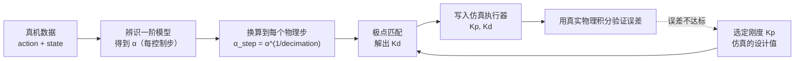

# 隐式 PD 与极点匹配：把辨识出的响应搬进仿真

> **一句话**：仿真里的关节靠 PD 控制器驱动——一个虚拟弹簧（刚度）加一个虚拟阻尼。我们已经用真机数据估计出了一个"跟随有多慢"的时间常数，现在要回答的问题是：**给这对弹簧阻尼设什么值，仿真关节才会以和真机一样的速度逼近目标？** 极点匹配就是给出这个换算公式：用"忽略质量时的隐式 Euler 递推"把辨识出的慢系数直接翻译成阻尼。

**知识链接**：
- [一阶响应模型与命令-反馈系统辨识](/前置知识/017e_前置知识_一阶响应模型与命令反馈系统辨识) — 本文的输入是那里辨识出的 $\alpha$
- [物理仿真数值积分：辛积分与能量稳定性](/前置知识/006c_前置知识_物理仿真数值积分_辛积分与能量稳定性) — 隐式 Euler 的稳定性来源
- [刚体动力学：牛顿-欧拉方程与惯性张量](/前置知识/006b_前置知识_刚体动力学_牛顿欧拉方程与惯性张量) — 为什么"忽略质量"只是一个近似
- 下游：[Isaac Lab 仿真对齐与参数调优](/工程实践/IsaacLab仿真对齐与参数调优) — 相机内参到关节 PD 增益的完整调参流程

---

## 1. 仿真怎么驱动一个关节

在 Isaac Lab 这类仿真器里，关节通常不是"直接设成某个角度"，而是被一个 **PD 控制器**驱动：控制器比较目标角度和当前角度，算出一个"弹簧力"，再叠加一个与速度成正比的"阻尼力"。

- **刚度 $K_p$**（stiffness）：弹簧的硬软。$K_p$ 越大，追得越急。
- **阻尼 $K_d$**（damping）：阻尼大小。$K_d$ 越大，越抑制震荡、越"迟钝"。

写成二阶系统（$I$ 是关节的有效惯量）：

$$
I\,\ddot{q} + K_d\,\dot{q} + K_p\,(q - \text{target}) = 0
$$

**这个公式在做什么**：它说关节的运动由三股力平衡——惯性拒绝变化、弹簧把它往目标拉、阻尼把它往"停下来"拉。

::: details 📐 公式详解（点击展开）

| 子表达式 | 它是谁 | 它在干嘛 |
|---------|--------|---------|
| $I\ddot{q}$ | **惯性项** | 关节加速需要克服的惯量 |
| $K_p(q-\text{target})$ | **弹簧项** | 离目标越远，拉力越大，把关节拉回目标 |
| $K_d\dot{q}$ | **阻尼项** | 速度越快，阻力越大，抑制震荡 |
| $q-\text{target}$ | **位置误差** | 当前角度与目标的差 |

**用人话读**："关节被一根弹簧拉向目标，同时被阻尼拖住不许乱冲，惯性决定它有多难被推动。"

**为什么需要阻尼**：只有弹簧会一直震荡（欠阻尼振铃）；阻尼把它压向临界阻尼或过阻尼，响应才平稳地收敛。$K_p$ 和 $K_d$ 的组合决定了响应是"振铃""刚好"还是"迟钝"。
:::


> 图里看的重点：同样刚度 $K_p=2000$，阻尼太小（红）会来回振铃，阻尼刚好（蓝）一次到位不超调，阻尼太大（绿）则慢得迟钝。**刚度决定"要多快"，阻尼决定"要不要震荡"**——而"要多快"正是我们从真机数据里估出来的东西。

---

## 2. 隐式驱动器：为什么仿真里"隐式"更好

显式 PD 是一步算出力、再积分速度；刚度很大时，一个步长内关节可能被推得很远，导致数值不稳定（数值爆炸）。**隐式驱动器**把阻尼项用**下一个时刻的速度**来算，相当于让阻尼"预知"下一步的变化，从而在大刚度下依然稳定。

这正是仿真器的默认选择：它不追求精确还原某个电机的电流环，而是用一个稳定、可调的虚拟执行器，让关节"手感"可配置。

---

## 3. 矛盾：辨识的是一阶，仿真给的是二阶

问题来了：

- 从真机数据辨识出来的，是**一阶**有效响应，参数是一个离散记忆系数 $\alpha$（等价于时间常数 $\tau$）。
- 仿真里能调的，是**二阶** PD 的 $K_p$ 与 $K_d$。

两者形式不同，不能直接"把 $\tau$ 塞进仿真"。要做的是**极点匹配**：调整 $K_d$，让仿真的关节在"忽略质量、用隐式 Euler 积分"的近似下，每一步的离散响应正好等于辨识出的 $\alpha$。也就是让两个系统的**极点**（决定衰减快慢的特征根）一致。



图里要看的重点：**$K_p$ 是人为选定的设计值，$K_d$ 才是被 $\alpha$ 决定的对象**。极点匹配只保证"在忽略质量的简化模型里响应一致"，真实仿真还有惯量、重力、限幅，所以匹配完必须再用实际推进误差回检。

---

## 4. 极点匹配的推导

在忽略质量（$I \approx 0$）的近似下，对阻尼项用隐式 Euler（步长 $h$）：

$$
\frac{K_d}{h}\left(q[k+1] - q[k]\right) + K_p\left(q[k+1] - \text{target}\right) = 0
$$

**这个公式在做什么**：把弹簧阻尼方程去掉惯性项，并让阻尼项和弹簧项都作用在**下一个时刻**的角度 $q[k+1]$ 上——这就是隐式处理。

::: details 📐 公式详解（点击展开）

| 子表达式 | 它是谁 | 它在干嘛 |
|---------|--------|---------|
| $q[k]$ / $q[k+1]$ | **本步与下一步角度** | 待求的离散状态 |
| $(q[k+1]-q[k])/h$ | **隐式速度** | 用下一步算速度，而不是用当前步 |
| $K_d/h \cdot (\cdot)$ | **隐式阻尼力** | 阻尼作用在下一步 |
| $K_p(q[k+1]-\text{target})$ | **弹簧力** | 把下一步角度往目标拉 |
| $I \approx 0$ | **忽略惯性** | 把二阶问题降成一阶，便于和辨识结果对齐 |

**用人话读**："在只考虑弹簧和阻尼、不管惯性的情况下，让下一步的角度同时满足弹簧和阻尼的平衡，解出它。"

**为什么可以忽略质量**：这里的目标不是还原真实动力学，而是**对齐响应速度**。在慢响应、阻尼主导的情形下，惯性的影响较小，忽略它换来的是一阶模型和 PD 之间一个干净的换算关系；代价是必须事后验证。
:::

把上式整理成"下一步角度 = α 乘旧值 + (1−α) 乘目标"的形式，让它的记忆系数正好等于辨识结果换算到**单个物理步**的值，就能解出阻尼：

$$
K_d = \frac{K_p\, h}{\alpha_{\text{step}}^{-1} - 1}, \qquad
\alpha_{\text{step}} = \alpha_{\text{ctrl}}^{1/\text{decimation}}
$$

**这个公式在做什么**：给定选定的刚度 $K_p$、物理步长 $h$，以及辨识出的每控制步记忆系数 $\alpha_{\text{ctrl}}$，算出能匹配这个响应快慢的阻尼 $K_d$。

::: details 📐 公式详解（点击展开）

| 子表达式 | 它是谁 | 它在干嘛 |
|---------|--------|---------|
| $K_p$ | **选定的刚度** | 人为设定的仿真设计值，决定整体硬度 |
| $h$ | **物理步长** | 仿真每小步的时间（例如 1/120 s） |
| $\alpha_{\text{ctrl}}$ | **辨识结果** | 每控制步的记忆系数，来自真机数据 |
| $\text{decimation}$ | **每控制步的物理步数** | 控制 30 Hz、物理 120 Hz 时等于 4 |
| $\alpha_{\text{step}}$ | **每个物理步的记忆** | 把控制步的 α 开 decimation 次方根得到 |
| $K_d$ | **求出的阻尼** | 写进仿真执行器的阻尼值 |

**用人话读**："把辨识出的慢系数换算到一个物理步上，再按刚度和步长算出对应的阻尼。"

**为什么 α 要开 decimation 次方根**：辨识出的 α 描述的是"过一个控制周期"的衰减；但 PD 阻尼作用在**每个物理步**上。控制周期包含 decimation 个物理步，所以单个物理步的记忆系数是 $\alpha_{\text{ctrl}}$ 的 decimation 次方根——$\alpha$ 越小，开根后越接近 1，说明单步变化很小，这与"每个小步只走一点点"一致。

**为什么 $K_d$ 随 $K_p$ 增大而增大**：刚度越大，弹簧拉得越急，要维持同样的响应慢度就需要更大的阻尼去抵消，否则关节会变快、甚至振铃。
:::

---

## 5. 两个必须解释清楚的近似

1. **忽略质量**：真实仿真保留了官方质量、惯量、重力、机械限位和力矩/速度上限。因此极点匹配给出的 $K_d$ 只是"起点"，真正的响应还取决于这些被忽略的因素。**匹配完必须跑真实物理积分，用实际推进误差检查**，而不是假设匹配一定成功。
2. **不再叠加一阶滤波**：如果仿真里已经用极点匹配产生了和真机一样的滞后，就**不能**再对目标额外做一次一阶平滑滤波——那等于把同一个滞后叠两次，关节会比真机慢很多。响应模型里的饱和、增益、偏置、离散延迟仍然用于生成目标，但"慢"这一部分已经由 $K_d$ 承担。

---

## 6. 怎么验证匹配成功

匹配后的验收标准不是"公式算对了"，而是"**仿真的实际推进误差和离线预测一致**"：

- 在训练段上跑连续物理积分，看末端/关节误差是否落在预期范围。
- 在**独立验证轨迹**上，用同一组 $K_p, K_d$ 复现，误差也应相近。
- 单独统计静止侧和运动侧，避免"静止臂本来就不动、误差自然小"制造假象。

一个参数匹配得好的信号是：默认 PD 下误差很大，替换成匹配出来的阻尼后误差明显下降，且这个下降在没参与调参的轨迹上依然成立。

---

## 7. 数值算例：一次完整的换算

沿用一阶辨识的结果：控制周期 30 Hz、物理步长 $h = 1/120$ s、$\text{decimation}=4$、某关节辨识出的每控制步记忆系数 $\alpha_{\text{ctrl}} = 0.594$（对应时间常数约 64 ms）。选定刚度 $K_p = 1000$ N·m/rad，求阻尼：

```text
第一步：把控制步的 α 换算到一个物理步
α_step = α_ctrl^(1/decimation) = 0.594^(1/4) = exp(-0.52099/4) = exp(-0.13025) ≈ 0.8779

第二步：由极点匹配求阻尼
Kd = Kp · h / (α_step^(-1) - 1)
   = 1000 × (1/120) / (1/0.8779 - 1)
   = 8.333 / 0.13905
   ≈ 59.9 N·m·s/rad
```

得到 $K_d \approx 60$ N·m·s/rad。

**如果漏掉 decimation 换算会怎样**：直接用 $\alpha_{\text{ctrl}} = 0.594$ 代入，会得到

```text
Kd = 8.333 / (1/0.594 - 1) = 8.333 / 0.6835 ≈ 12.2 N·m·s/rad
```

阻尼只有正确值的约五分之一，仿真关节会比真机明显更快、更容易过冲——虽然阶跃响应曲线看起来"更接近临界阻尼"，但代价是**响应速度与真机不匹配**，辨识出的慢动态没有被还原。这就是为什么 $\alpha$ 必须按物理步、而不是按控制步参与匹配。

再看 $K_p$ 的角色：如果把 $K_p$ 提高到 2000 N·m/rad 而 $\alpha$ 不变，$K_d$ 会随之翻倍到约 120 N·m·s/rad，刚度提高带来的"更急"被阻尼抵消，响应慢度保持不变。**$K_p$ 决定手感有多硬，$K_d$ 负责把速度钉在辨识值上。**

---

## 8. 总结

- 仿真关节由**二阶 PD**（刚度 + 阻尼）驱动；刚度决定快慢，阻尼决定震荡。
- 隐式驱动器在大刚度下更稳定，是仿真器的默认选择。
- 辨识出来的是**一阶**响应（记忆系数 $\alpha$），和二阶 PD 形式不同，需要**极点匹配**换算。
- 匹配公式：先把 $\alpha$ 换算到单个物理步（开 decimation 次方根），再由 $K_d = K_p h/(\alpha_{\text{step}}^{-1}-1)$ 求阻尼。
- 极点匹配建立在"忽略质量"近似上，**必须用真实物理积分验证**；匹配后不要再叠加一层一阶滤波。
- $K_p$ 是人为设计值，$K_d$ 才是被 $\alpha$ 决定的对象。

**一句话**：极点匹配让仿真关节"慢得和真机一样"，但它只是把辨识出的响应速度移植进仿真，仍然要在真实物理里回检——匹配的是极点，不是整个机器人。

---

## 延伸阅读

- [一阶响应模型与命令-反馈系统辨识](/前置知识/017e_前置知识_一阶响应模型与命令反馈系统辨识) — $\alpha$ 是怎么来的
- [物理仿真数值积分：辛积分与能量稳定性](/前置知识/006c_前置知识_物理仿真数值积分_辛积分与能量稳定性) — 隐式 Euler 为什么稳定
- [Isaac Lab 仿真对齐与参数调优](/工程实践/IsaacLab仿真对齐与参数调优) — 从相机内参到关节 PD 增益的完整对齐流程
- [Isaac Lab real2sim 回放的四种驱动模式](/工程实践/IsaacLab回放四种驱动模式_state_action_response_servo) — 极点匹配所在的 servo 模式与其他三种回放模式的关系
