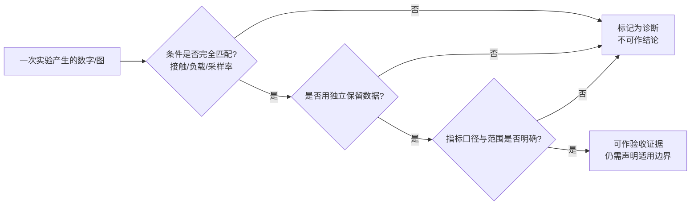
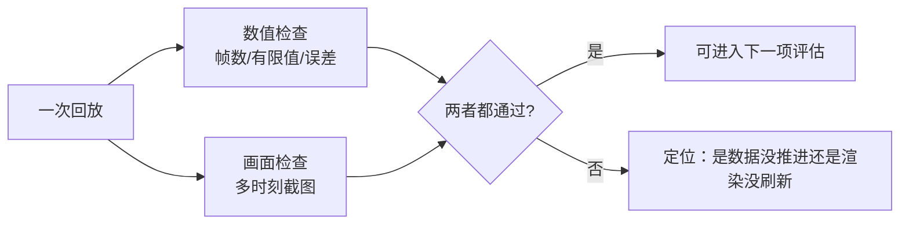

# Real2Sim 评估的证据边界：验收、诊断与不能声称的结论

> **一句话**：在 real2sim 里，"误差从 25 mm 降到 5 mm"这句话本身**证明不了任何结论**——它可能是控制对齐真的变好了，也可能是测量变换把误差抵消掉了，还可能是任务里根本没有物体接触、条件根本没对上。评估的核心能力不是把数字做得漂亮，而是**分清哪些数字能当证据（验收），哪些只能算参考（诊断），以及每个数字明确不能说明什么**。

**知识链接**：
- [点云配准与稳健最近邻拟合](/前置知识/017d_前置知识_点云配准与稳健最近邻拟合) — 配准误差如何被"同一变换"抵消
- [一阶响应模型与命令-反馈系统辨识](/前置知识/017e_前置知识_一阶响应模型与命令反馈系统辨识) — 训练/验证分割与基线
- [数字表亲与 Real2Sim 数据增广](/前置知识/010b_前置知识_数字表亲与Real2Sim数据增广) — real2sim 的目标与范围
- 下游：[real2sim-eval 深度解析](/系列/real2sim_eval_deep_dive/index) — 仿真成功率与真机成功率的相关性评估
- 下游：[机器人系统辨识深度解析](/系列/system_identification_deep_dive/index) — 辨识结果的独立验证闭环

---

## 1. 为什么"数字变好"不是证据

假设你在仿真里回放一条真机轨迹，把控制器参数改了改，末端误差从 25 mm 降到 5 mm。这个改善可能来自至少五种原因：

1. **真的对齐了**：仿真控制确实更接近真机。
2. **误差被抵消**：真值和仿真值经过了同一个变换，配准误差在相减时消掉了。
3. **指标口径变了**：原来报最大误差，现在报均方根。
4. **混淆变量**：任务里有物体接触，仿真却当空载跑，误差下降其实来自"没模拟接触反而更接近"。
5. **数据用错**：用拟合段自己的数据报误差，而不是独立保留段。

把这五种原因分开，就是评估要做的全部事情。**一个负责的评估报告，每一项结论旁边都必须写清"这个数不能证明什么"。**

---

## 2. 验收与诊断：两条不能混的通道

评估结果只有两种身份：

- **诊断（diagnostic）**：用来观察和排查，**不作为结论依据**。典型特征是条件没对齐、范围不确定或含外推。
- **验收（acceptance）**：条件明确、用独立数据、能支撑某个具体结论。

图里要看的重点：**任何一条不满足，结果就退回诊断**。诊断不是"没用的实验"——它很有价值，只是价值在于"提示下一步查什么"，而不在于"证明某事成立"。把诊断当验收，是 real2sim 里最常见、也最致命的错误。

一个具体的划界方式是给每个实验打上元数据标签：用途（诊断/验收）、负载条件（空载/接触）、验收状态（是否排除在标定验证之外）。报告里保留这些标签，后来的人就不会误用。

---

## 3. 证据的四个性质

一条能被称为"验收证据"的结果，应该同时满足：

| 性质 | 含义 | 反例 |
| --- | --- | --- |
| **可追溯** | 输入、版本、参数都有据可查 | 报告没记 URDF 提交号和数据哈希 |
| **可复现** | 同一输入重复跑能得到一致结果 | 随机种子没固定，每次都不同 |
| **独立** | 验证数据未参与拟合 | 用训练段报"预测误差" |
| **范围明确** | 结论限定在特定条件内 | 一条轨迹的结果外推到整个工作空间 |

可追溯性靠给每个输入算哈希、把来源和参数写进 manifest（清单文件）；可复现性靠固定随机种子、固定环境和版本快照。这两条看似琐碎，却是"这次结果"和"下次结果"能否相提并论的唯一保证。

---

## 4. 陷阱一：同一变换抵消误差

这是最隐蔽、最容易被当成"高精度"的错误。

假设真机末端位置 $p_{\text{rec}}$ 要映射到世界坐标，用的是基座变换 $T_b$；仿真末端 $p_{\text{sim}}$ 也用同一个 $T_b$ 映射。如果 $T_b$ 本身有误差 $\Delta$，两者都变成 $T_b(\cdot)+\Delta$。相减时：

$$
\big(T_b(p_{\text{sim}}) + \Delta\big) - \big(T_b(p_{\text{rec}}) + \Delta\big) = T_b(p_{\text{sim}}) - T_b(p_{\text{rec}})
$$

**这个公式在做什么**：说明当两端用同一个变换时，这个变换里的公共误差在相减时被抵消，剩下的差异只反映"两端本身的不同"。

::: details 📐 公式详解（点击展开）

| 子表达式 | 它是谁 | 它在干嘛 |
|---------|--------|---------|
| $T_b$ | **公共基座变换** | 把基座坐标系映射到世界 |
| $\Delta$ | **变换自身的误差** | 配准不准带来的偏移 |
| $p_{\text{sim}} - p_{\text{rec}}$ | **两端真实差异** | 仿真与记录的末端差距 |
| 抵消 | **关键结论** | $\Delta$ 同时出现在两端，被减掉 |

**用人话读**："两边都加上同一个错误偏移，减一下就抵消了，所以剩下的差看不出这个偏移有多大。"

**为什么这很重要**：毫米级的末端误差看起来说明"配准很准"，其实它只说明"仿真和记录用了同一套映射"，恰恰**不能**证明机器人和点云对得准。要验证配准，必须引入不参与这个变换的独立测量。
:::

给一组具体数字：假设真机末端在基座坐标系里位于 $x = 100$ mm，仿真末端位于 $x = 103$ mm，两者本来就差 3 mm。如果公共基座变换在 $x$ 方向有 5 mm 的误差，映射到世界后两者分别变成 105 mm 和 108 mm——差仍然是 3 mm，那 5 mm 的配准误差**完全没出现在报告里**。于是"末端误差 3 mm"这个数字，既可能来自"仿真和真机只差 3 mm"，也可能来自"仿真和真机差得更多，但配准误差恰好抵消了一部分"，从这一条数据里分不出来。

推论：**用同一个变换算出来的相对误差，永远不能用来验收那个变换本身。**

---

## 5. 陷阱二：指标口径与范围

同一个实验，换一种统计口径就能得到完全不同的印象：

| 口径 | 会掩盖什么 |
| --- | --- |
| 均方根（RMSE） | 掩盖尾部糟糕的少数帧 |
| 最大误差 | 被单个离群帧主导 |
| 只报改善的通道 | 掩盖变差的通道 |
| 只报拟合段 | 掩盖过拟合 |
| 不报帧数 | 掩盖"其实只跑了一小段" |

因此报告要**同时给出多个口径**（均值、最大、分位），并且**完整报告所有通道**，包括没有改善甚至变差的那些。"只留改善项"是评估造假的常见形式，即便不是有意为之。

同样重要的还有**完成量**：报告里写了"576 帧"还是"全部 936 帧"，含义完全不同。一段只跑了三分之一的回放，不能算"整段完成"。

---

## 6. 陷阱三：混淆变量

当多个因素同时变化时，误差的下降无法归因到某一个因素。

最典型的是**接触与负载**：一条"把食物盛到盘子里"的任务轨迹里，真机抓着一个物体，关节会受到额外负载和接触力。如果仿真里根本没有可交互的物体、也没有接触模型，那么"仿真误差小"可能是**因为仿真忽略了负载**，而不是因为控制参数对。把这条轨迹上的误差下降当成"控制标定有效"，是典型的归因错误。

正确的做法是**把带接触的轨迹排除在空载标定验证之外**，单独标记为诊断；空载响应只用空载数据验证。

---

## 7. 陷阱四：数值变了但画面没动

可视化也是证据的一部分，而且会独立出错。一个真实出现过的现象是：**码值在变，但视口里的机器人一直冻结在初始姿态**——因为只更新了数据、没有真正推进渲染。此时"数值报告正常"和"画面没动"同时成立。

应对方式是把可视化和数值当成**两条独立的检查线**：

- 数值线：报告帧数、有限值检查、各口径误差。
- 画面线：在若干时刻截图，确认机器人姿态确实随时间变化，而不是停在零位。

图里要看的重点：**单看数值或单看一张截图都不够**。一张截图只代表一个时刻；一个正常的数值报告也可能对应一个冻结的画面。

---

## 8. 陷阱五：外推

"在这条轨迹上验证通过"和"在整个工作空间都成立"是两件事。

一条验证轨迹只覆盖了工作空间里的一小片区域。它在统计上无法代表从未到过的关节组合、末端姿态和接触情况。因此结论必须写成"**在本条数据/本侧臂上**"成立，而不是"该方法可靠"。

判断是否需要谨慎外推的简单标准：**验证集和训练集是否来自不同的采集条件（不同轨迹、不同方向、不同幅度）**。如果只是把训练集切一刀，验证的意义有限。

---

## 9. 一份合格结论的写法

把上面的原则浓缩成模板，每一项结论都应按这个结构写：

| 结论 | 支撑证据 | 适用边界（不能声称什么） |
| --- | --- | --- |
| 运动学模型与记录一致 | URDF FK 与末端位姿的 RMSE | 末端位姿可能来自控制器自身 FK，非独立测量 |
| 响应模型改善预测 | 独立保留段上优于基线 | 只覆盖空载、本采样率、本链路 |
| 回放完成整体轨迹 | 报告帧数 + 多时刻截图 | 数值完成不等于任务成功 |
| 基座摆放大致合理 | 局部表面残差 | 不是外参精度证明 |

每一行右边那一列，才是 real2sim 评估真正的难点。**能说清"这个数不能证明什么"，才算真正理解了这个数。**

---

## 10. 总结

- "误差变小"不等于"结论成立"；必须先排除抵消、口径、混淆变量、数据误用。
- 评估结果只有两种身份：**诊断**（参考）和**验收**（可作结论）；条件不匹配就退回诊断。
- 可追溯、可复现、独立、范围明确是验收证据的四个必要条件。
- 最隐蔽的错误是**同一变换抵消误差**：用它算出的相对误差不能验收这个变换。
- 指标要**多口径、全通道、报完成量**；可视化和数值要当两条独立检查线。
- 结论必须写明**适用边界**——不能声称的部分和能声称的部分同等重要。

**一句话**：real2sim 评估的水平，不体现在误差有多小，而体现在"是否清楚每一个数字能证明什么、不能证明什么"。

---

## 延伸阅读

- [点云配准与稳健最近邻拟合](/前置知识/017d_前置知识_点云配准与稳健最近邻拟合) — 误差抵消陷阱的几何来源
- [一阶响应模型与命令-反馈系统辨识](/前置知识/017e_前置知识_一阶响应模型与命令反馈系统辨识) — 训练/验证分割与基线
- [real2sim-eval 深度解析](/系列/real2sim_eval_deep_dive/index) — 仿真与真机成功率相关性的评估方法
- [机器人系统辨识深度解析](/系列/system_identification_deep_dive/index) — 独立验证闭环
