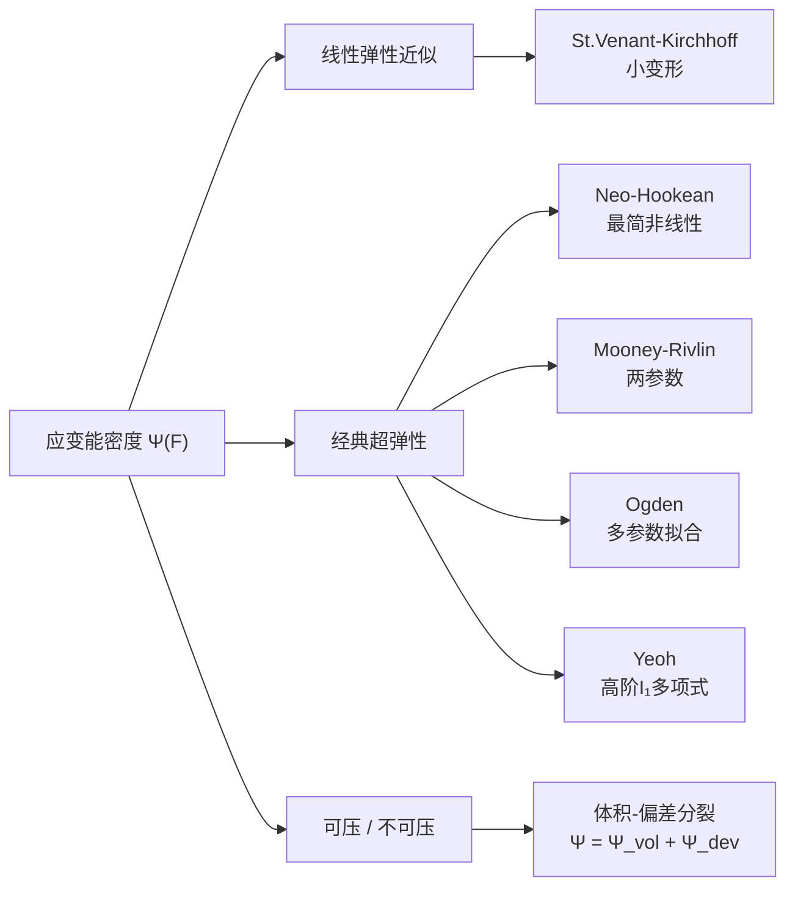

# 应变能密度与超弹性本构模型全景

> **一句话**：超弹性本构关系把弹性体"存了多少能量"写成变形状态的函数，从而用一个标量场完整描述该材料在任意大变形下的力学响应。

**知识链接**：
- [Neo-Hookean 本构关系精读](/前置知识/006i_前置知识_超弹性材料模型Neo-Hookean与本构关系)（本文补充它的全景视角，Neo-Hookean 深度推导在那里）
- [质点弹簧模型](/前置知识/006e_前置知识_质点弹簧模型与绳索仿真基础)（离散弹性能量的简化版本）
- [系统辨识与逆问题基础](/前置知识/018b_前置知识_系统辨识与逆问题基础)（如何从视频观测中反推本构参数）
- [PAC-NeRF 精读](/论文综述/164_PAC-NeRF_物理感知连续场的材料参数辨识)（应用本文所述模型做视频参数辨识）
- [PhysGaussian 精读](/论文综述/165_PhysGaussian_物理集成三维高斯动态仿真)（前向仿真中对本构模型的实现）

---

## 贯穿全文的例子

把一个硅胶圆柱从高处丢到桌面：它压扁、反弹、恢复原形。整个过程中没有能量损耗（理想超弹性），但形状变化极大——这正是超弹性本构模型要捕捉的场景。关键问题是：给定变形，材料内部存储了多少弹性势能？这个势能对变形求导就得到应力，应力驱动运动方程，运动方程给出可观测的加速度和位移。反过来，从摄像机拍到的运动反推弹性势能的参数，就是基于视频的材料辨识。

---

## 一、变形梯度：描述变形的唯一状态

超弹性模型的输入只有一个量：**变形梯度** $\mathbf{F}$。

$$\mathbf{F} = \frac{\partial \mathbf{x}}{\partial \mathbf{X}}$$

::: details 📐 公式详解（点击展开）
| 符号 | 是什么 | 在干嘛 |
|------|--------|--------|
| $\mathbf{x}$ | 当前构型坐标（3维向量） | 变形后的位置 |
| $\mathbf{X}$ | 参考构型坐标（3维向量） | 未变形时的位置 |
| $\mathbf{F}$ | $3\times3$ 矩阵 | 把参考构型的微元映射到当前构型 |

**用人话读**：$\mathbf{F}_{ij}$ 告诉你，参考构型里沿 $j$ 方向拉一个单位长度的小段，在当前构型里会出现在 $i$ 方向多少。

**为什么是这个形式**：变形的局部线性化就是雅可比矩阵，$\mathbf{F}$ 恰好是位置映射的雅可比。极分解 $\mathbf{F} = \mathbf{R}\mathbf{U}$ 把旋转（$\mathbf{R}$）和纯拉伸（$\mathbf{U}$）分离开，弹性能量只应该和拉伸有关，和旋转无关，这被称为"物质客观性"。
:::

$\mathbf{F}$ 完整地编码了一个材料点的局部变形状态。超弹性的核心假设是：**弹性势能只取决于 $\mathbf{F}$，不取决于加载历史**。这一假设使得整个本构关系可以用一个标量函数 $\Psi(\mathbf{F})$ 完整表达。

---

## 二、应变能密度：从变形到能量

应变能密度 $\Psi(\mathbf{F})$（Strain Energy Density，单位 $\mathrm{J/m^3}$）把参考构型每单位体积在当前变形状态 $\mathbf{F}$ 下储存的弹性能量量化为一个标量。弹性体总势能：

$$E = \int_{\Omega_0} \Psi(\mathbf{F}(\mathbf{X})) \, \mathrm{d}\mathbf{X}$$

对 $\mathbf{F}$ 求导立即给出第一类 Piola-Kirchhoff 应力：

$$\mathbf{P} = \frac{\partial \Psi}{\partial \mathbf{F}}$$

::: details 📐 公式详解（点击展开）
| 符号 | 是什么 | 在干嘛 |
|------|--------|--------|
| $\Psi(\mathbf{F})$ | 应变能密度（标量） | 当前变形状态下单位体积存储的弹性能 |
| $\Omega_0$ | 参考构型的体积域 | 积分域，覆盖整个弹性体 |
| $\mathbf{P}$ | 第一类 Piola-Kirchhoff 应力（$3\times3$） | 参考面积上的力密度 |

**用人话读**：$\Psi$ 就像弹簧的 $\frac{1}{2}k x^2$，只不过这里"弹簧"是三维连续体，"伸长量"是矩阵 $\mathbf{F}$。对 $\mathbf{F}$ 求导得到"恢复力"。

**为什么是这个形式**：把弹性力学纳入最小势能原理后，应力就是能量对变形的梯度。这意味着只要写出 $\Psi$，运动方程 $\rho \ddot{\mathbf{x}} = \nabla \cdot \mathbf{P} + \mathbf{f}_\text{ext}$ 中的内力全部确定。不同的 $\Psi$ 就是不同的本构模型。
:::

---

## 三、常用应变不变量

为满足各向同性的物质客观性（即 $\Psi$ 与刚体旋转无关），$\Psi$ 应写成右 Cauchy-Green 张量 $\mathbf{C} = \mathbf{F}^T\mathbf{F}$ 的不变量的函数：

| 不变量 | 定义 | 物理含义 |
|--------|------|----------|
| $I_1$ | $\mathrm{tr}(\mathbf{C})$ | 三个主拉伸平方之和——整体拉伸程度 |
| $I_2$ | $\frac{1}{2}[(\mathrm{tr}\,\mathbf{C})^2 - \mathrm{tr}(\mathbf{C}^2)]$ | 面积变化程度 |
| $I_3$ | $\det(\mathbf{C}) = J^2$ | 体积变化平方（$J = \det\mathbf{F}$） |

不变量的好处：无论坐标系怎么转，$I_1, I_2, I_3$ 不变，因此 $\Psi(I_1, I_2, I_3)$ 自动满足材料客观性。

---

## 四、超弹性本构模型全景图

> **看什么**：从左到右复杂度递增。仿真论文中最常用的是 Neo-Hookean 和 Fixed Corotated。

### 4.1 St. Venant-Kirchhoff（StVK）

$$\Psi_\text{StVK} = \mu \,\mathrm{tr}(\mathbf{E}^2) + \frac{\lambda}{2}\left(\mathrm{tr}\,\mathbf{E}\right)^2, \quad \mathbf{E} = \frac{1}{2}(\mathbf{C} - \mathbf{I})$$

- $\mu$ 和 $\lambda$ 是拉梅常数，与工程常用的杨氏模量 $E$ 和泊松比 $\nu$ 的换算：$\mu = \frac{E}{2(1+\nu)}$，$\lambda = \frac{E\nu}{(1+\nu)(1-2\nu)}$。
- 优点：形式最简，退化到小变形与线弹性等价。
- 缺点：**压缩到 $J < 0$ 时能量反而下降**——弹性体会被压穿自己。这在大变形仿真中是致命的。

### 4.2 Neo-Hookean（详细推导见 [006i](/前置知识/006i_前置知识_超弹性材料模型Neo-Hookean与本构关系)）

$$\Psi_\text{NH} = \frac{\mu}{2}(I_1 - 3) - \mu \ln J + \frac{\lambda}{2}(\ln J)^2$$

- $\ln J$ 项在 $J \to 0$ 时趋于 $-\infty$，使能量"爆炸"——形成无穷大的阻力阻止体积压缩到零。
- 只有两个参数（$\mu$, $\lambda$），适合参数辨识场景（待估参数越少越好）。
- PAC-NeRF、PhysGaussian、GIC 等视频物理重建论文默认使用 Neo-Hookean。

### 4.3 Fixed Corotated

$$\Psi_\text{FCR} = \mu \sum_{i=1}^{3}(\sigma_i - 1)^2 + \frac{\lambda}{2}(J - 1)^2$$

其中 $\sigma_i$ 是 $\mathbf{F}$ 的奇异值（即主拉伸）。

- 优点：$\sigma_i = 1$ 时能量为零，几何直觉清晰——偏离"不变形"越远，能量越大。
- 在 MPM（物质点法）中非常流行，因为求导和 SVD 计算都高效。
- PAC-NeRF 在 MPM 时间步进中使用的即 Fixed Corotated。

### 4.4 Mooney-Rivlin 与 Ogden

| 模型 | $\Psi$ 形式 | 参数数 | 典型应用 |
|------|-------------|--------|----------|
| Mooney-Rivlin | $C_1(I_1-3) + C_2(I_2-3)$ | 2 | 硅胶、天然橡胶中等变形 |
| Ogden（$N$阶） | $\sum_{k=1}^N \frac{\mu_k}{\alpha_k}(\sigma_1^{\alpha_k}+\sigma_2^{\alpha_k}+\sigma_3^{\alpha_k}-3)$ | $2N$ | 生物软组织、高精度拟合 |
| Yeoh | $\sum_{k=1}^3 C_k(I_1-3)^k$ | 3 | 碳黑填充橡胶大变形 |

参数越多拟合能力越强，但辨识难度成指数上升。视频逆问题中几乎不用超过 Neo-Hookean 的模型，因为有限的观测数据无法区分 Mooney-Rivlin 的 $C_1$ 和 $C_2$。

---

## 五、体积-偏差分裂：可压与不可压

很多材料（橡胶、生物组织）几乎不可压缩（$J \approx 1$）。强迫 $J = 1$ 的不可压约束在数值上很昂贵，实践中用"近似不可压"处理——把 $\Psi$ 拆成体积项和偏差项：

$$\Psi = \underbrace{\Psi_\text{vol}(J)}_{\text{阻止体积变化}} + \underbrace{\Psi_\text{dev}(\bar{\mathbf{F}})}_{\text{只管形状变化}}$$

其中 $\bar{\mathbf{F}} = J^{-1/3}\mathbf{F}$ 是去掉体积变化后的变形梯度。

- $\Psi_\text{vol}(J)$ 常取 $\frac{\kappa}{2}(J-1)^2$，$\kappa$ 是体积模量。$\kappa$ 越大，材料越难压缩。
- PhysGaussian 的 MPM 实现在弱可压缩流体（非牛顿流体）模式下正是用这种分裂。

### 5.1 各模型在单轴压缩下的行为差异

把同一个材料在不同本构模型下做单轴压缩，可以直观看出为什么 StVK 在大变形下不能用。设材料沿一个方向被压缩，压缩比 $j$ 从 1 减小到 0.3，比较各模型给出的应变能。

> **看什么**：横轴是单轴压缩比 $j$（1 表示未变形，向左表示越压越扁），纵轴是归一化应变能密度。**Neo-Hookean**（蓝色）在 $j \to 0$ 时急速发散，提供无限大的能量壁垒。**Fixed Corotated**（绿色）趋于有限平台 3.5，但其应力仍单调增长，仍能抵抗压缩。**StVK**（红色）也趋于有限平台 1.875——不是"下降趋零"，而是"上升后停住"。StVK 的根本失效要到应力图才能看出来。

把 $\mathbf{F} = \text{diag}(j, j, j)$ 代入 $\mathbf{E} = \frac{1}{2}(\mathbf{F}^\top\mathbf{F} - \mathbf{I})$ 后，得到 $\mathrm{tr}\,\mathbf{E} = \frac{3}{2}(j^2-1)$，StVK 能量 $\Psi_\text{StVK} \propto (j^2-1)^2$。当 $j \to 0$ 时，$(j^2-1)^2 \to 1$，能量趋近有限平台 1.875（系数由材料参数决定）——既不发散，也不"下降趋零"。StVK 的真正失效不在能量，而在应力：$P \propto j(1-j^2)$ 在 $j = 1/\sqrt{3} \approx 0.577$ 处达峰后随压缩加深而塌陷，让仿真器可以"穿透"材料而不受任何恢复力。

换成应力视角看得更清楚。单轴压缩下沿压缩方向的恢复应力：

> **看什么**：纵轴是材料抵抗压缩的应力，横轴仍是压缩比。Neo-Hookean 的应力随压缩加深单调上升、最终发散；**StVK 的应力在 $j \approx 0.58$ 处达到峰值后掉头向下，$j \to 0$ 时趋于零**。这意味着把 StVK 材料压得越扁，它反抗得越弱——数值求解器会一路把它压穿自己。这是 StVK 在小变形下完全正常、在大压缩下彻底失效的根本原因。

而 Neo-Hookean 里的 $-\mu\ln J$ 项在 $J \to 0^+$ 时趋于 $+\infty$，$\frac{\lambda}{2}(\ln J)^2$ 同样发散，两者共同保证了压缩到零体积需要无穷大的能量。这就是"大变形安全"的数学来源：**不是参数调出来的，是函数形式自带的对数壁垒**。

| 模型 | $J \to 0$ 时的能量 | $J \to 0$ 时的应力 | 压缩安全 |
|------|------------------|------------------|---------|
| StVK | 趋有限平台 1.875 | 在 $j\approx0.58$ 达峰后**塌陷趋零** | ❌ 应力反向，求解器可"压穿" |
| Neo-Hookean | $-\mu\ln J \to +\infty$ | 单调增长至**发散** | ✅ 无限大壁垒 |
| Fixed Corotated | 趋有限平台 3.5 | 单调增长至**有限上界** 6 | ⚠️ 有界但始终抵抗，无病理行为 |
| Mooney-Rivlin | 含 $I_1$ 项，$I_1\to+\infty$ | 同 Neo-Hookean 机制 | ✅ 依赖 $I_1$ 与体积项 |

**这张表的判据是应力列而不是能量列**，这一点容易被误读。StVK 的危险不在于能量有界——Fixed Corotated 的能量同样有界（3.5），有界本身无害。危险在于**能量的导数会变号**：压缩越深，恢复力越小，直到趋零。一个趋零的恢复力意味着求解器每多压一点都更省力，最终可以无限压下去而不遇到阻力。Fixed Corotated 的应力虽然也是有界的，但它**单调**——压得越深、抵抗越强，只是强度不再无限增长。所以"上界有限"与"导数变号"是两件完全不同的事，前者只是抵抗力度不够猛，后者是抵抗方向反了。

---

## 六、怎么从 $\Psi$ 得到仿真中可用的力

> **看什么**：一条链——变形→能量→应力→力→加速度。反过来（观测加速度→推 $\Psi$ 的参数）就是逆问题/系统辨识。

在 MPM 或 FEM 中，数值流程是：
1. 读取每个材料点的 $\mathbf{F}$
2. 用选定的本构模型计算 $\mathbf{P} = \partial\Psi/\partial\mathbf{F}$
3. 散度算子把 $\mathbf{P}$ 转成节点力
4. 牛顿第二定律更新速度和位置
5. 更新 $\mathbf{F}$ → 回到第 1 步

---

## 七、本构模型选择对视频物理重建的影响

| 维度 | Neo-Hookean | Fixed Corotated | StVK | Mooney-Rivlin |
|------|-------------|-----------------|------|---------------|
| 可辨识参数数 | 2 | 2 | 2 | 2+ |
| 大压缩安全 | ✅ | ✅ | ❌ 会穿透 | ✅ |
| 求导复杂度 | 低 | 中（需 SVD） | 低 | 低 |
| 论文使用情况 | PAC-NeRF, GIC, PhysGaussian | PAC-NeRF (MPM), NeuSpring | PIE-NeRF | — |

选 Neo-Hookean 的原因很务实：只有 $\mu$ 和 $\lambda$ 两个自由度，和视频观测能提供的信息量匹配。更复杂的模型在辨识问题中反而不可辨识——参数组合不唯一，优化器会陷入等效解的流形上无法收敛。

---

## 八、总结

| 关键点 | 内容 |
|--------|------|
| 核心输入 | 变形梯度 $\mathbf{F}$，是位置映射的雅可比矩阵 |
| 核心输出 | 应变能密度 $\Psi(\mathbf{F})$，标量函数 |
| 应力获取 | $\mathbf{P} = \partial\Psi / \partial\mathbf{F}$ |
| 各向同性保证 | 用不变量 $I_1, I_2, J$ 表达 $\Psi$ |
| 仿真/辨识中的主流选择 | Neo-Hookean（两参数、大变形安全、求导简单） |
| 与本项目其他文章的关系 | 006i 讲 Neo-Hookean 推导细节，本文给出模型全景；018b 讲如何从视频反推这些参数 |

---

## 延伸阅读

- Bonet & Wood, *Nonlinear Continuum Mechanics for Finite Element Analysis*, 第 5-6 章——本构关系的数学严格推导
- [超弹性材料模型 Neo-Hookean 与本构关系](/前置知识/006i_前置知识_超弹性材料模型Neo-Hookean与本构关系)——Neo-Hookean 推导细节与数值例子
- [系统辨识与逆问题基础](/前置知识/018b_前置知识_系统辨识与逆问题基础)——从观测反推本构参数的方法论
- [PAC-NeRF 精读](/论文综述/164_PAC-NeRF_物理感知连续场的材料参数辨识)——把 $\Psi$ 作为可辨识模块接进 MPM 的完整系统
- [PhysGaussian 精读](/论文综述/165_PhysGaussian_物理集成三维高斯动态仿真)——换 $\Psi$ 即可切换材料的工程实践
