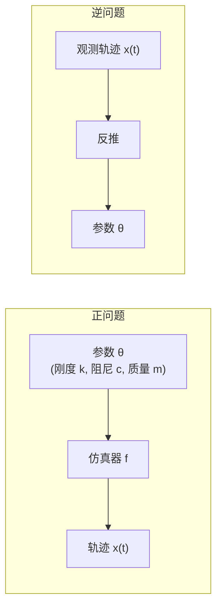
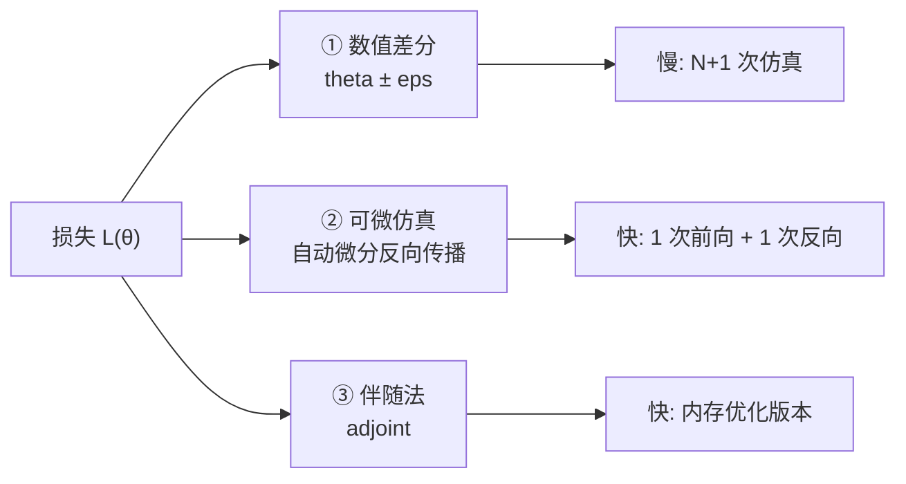
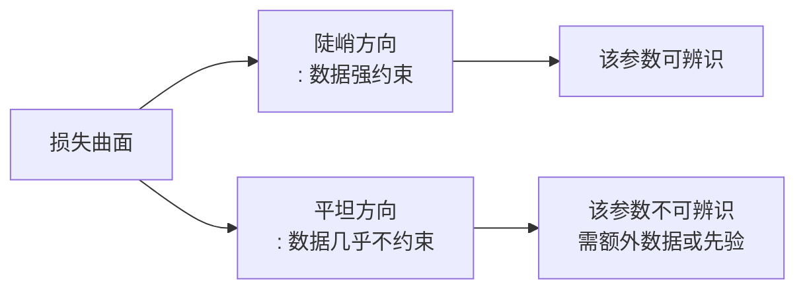
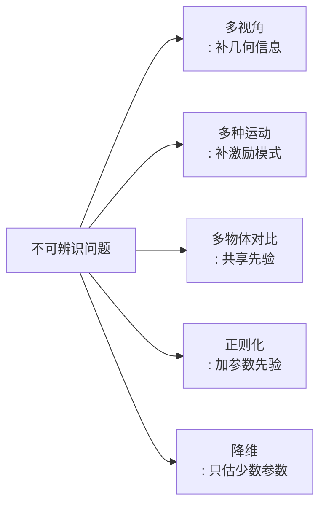

# 系统辨识与逆问题基础

> **一句话**：系统辨识是"看着系统怎么动，反推它内部参数是多少"的问题；它之所以困难，不是因为算不出来，而是因为观测信息常常不足以唯一确定答案。

**知识链接**：
- [应变能密度与超弹性本构模型全景](/前置知识/018a_前置知识_应变能密度与超弹性本构模型全景)（待辨识的参数来自哪里）
- [薄壳布料仿真基础](/前置知识/018c_前置知识_薄壳布料仿真基础)（最难的辨识对象）
- [估计器与可辨识性](/系列/system_identification_deep_dive/06_估计器与可辨识性)（机器人系统辨识中的同类问题）
- [可微仿真：梯度怎么传回控制输入](/系列/newton_engine_deep_dive/08_可微仿真_梯度怎么传回控制输入)（为辨识提供梯度的技术基础）
- [PAC-NeRF 精读](/论文综述/164_PAC-NeRF_物理感知连续场的材料参数辨识)
- [GIC 精读](/论文综述/166_GIC_高斯告知连续体的材料属性辨识)

---

## 贯穿全文的例子

一根橡皮筋，一端固定，另一端被拉伸后松手。它会振荡着回到原长。如果只看到"它最终回到了原长"，你无法判断它是硬而重，还是软而轻——两者可以产生完全相同的静态结果。但如果看到**振荡的周期**，你就能反推出刚度与质量的比值。系统辨识的核心问题就是：**观测里到底含有多少关于参数的信息**。

---

## 一、正问题与逆问题

同一个物理系统有两个方向的问法：

> **看什么**：正问题是"给定参数算结果"，是良定义的、唯一解的。逆问题是"给定结果算参数"，可能无解、多解、或对噪声极端敏感。

视频物理重建（从一段视频估计材料弹性模量、密度、阻尼）全部是逆问题。认清这一点很重要，因为它决定了方法论的形状：

| | 正问题 | 逆问题 |
|---|---|---|
| 输入 | 参数 + 初始/边界条件 | 部分观测 |
| 输出 | 完整时空轨迹 | 参数估计值 |
| 解的性质 | 唯一、稳定 | 可能不唯一、可能不稳 |
| 数值方法 | 时间积分 | 优化、滤波、贝叶斯推断 |
| 主要困难 | 计算成本、稳定性 | **可辨识性** |

---

## 二、逆问题的标准解法：把残差最小化

最直接的思路是把逆问题写成一个优化问题——找一组参数，使仿真出来的轨迹和观测轨迹最接近。

$$\hat{\theta} = \arg\min_{\theta} \; \mathcal{L}(\theta), \qquad \mathcal{L}(\theta) = \sum_{t=1}^{T}\left\| \mathcal{R}\big(\mathbf{x}_\theta^t\big) - \mathbf{y}^t \right\|^2$$

::: details 📐 公式详解（点击展开）
| 子表达式 | 它是谁 | 它在干嘛 |
|---------|--------|---------|
| $\theta$ | 待辨识参数向量 | 优化变量，例如 $[\mu, \lambda, \rho]$ |
| $\mathbf{x}_\theta^t$ | 参数取 $\theta$ 时仿真器在第 $t$ 帧产生的状态 | 正问题的输出 |
| $\mathcal{R}(\cdot)$ | 观测算子 | 把仿真状态映射到可观测量（渲染图像、点云位置、掩码），因为仿真状态本身通常不可直接观测 |
| $\mathbf{y}^t$ | 第 $t$ 帧的真实观测 | 来自视频 |
| $\mathcal{L}$ | 残差平方和 | 衡量"仿真与观测差多远" |
| $\hat{\theta}$ | 估计出的参数 | 使残差最小的那组参数 |

**用人话读**：不断试参数，让仿真尽量复现视频里看到的东西，谁复现得最好谁就是答案。

**为什么是这个形式**：在观测噪声为独立高斯分布的假设下，最小二乘就是最大似然估计。这个形式是"数据驱动反推"的默认起点。
:::

---

## 三、梯度从哪来：三种获取方式

优化要迭代，迭代要梯度 $\partial \mathcal{L}/\partial \theta$。有三种拿梯度的方式，成本与精度完全不同：

> **看什么**：数值差分要跑 $N+1$ 次仿真（$N$ 是参数个数），可微仿真只要一次前向加一次反向。

### 3.1 数值差分（有限差分）

$$\frac{\partial \mathcal{L}}{\partial \theta_i} \approx \frac{\mathcal{L}(\theta + \epsilon \mathbf{e}_i) - \mathcal{L}(\theta)}{\epsilon}$$

- 优点：不需要仿真器可微，黑箱也能用。
- 缺点：**$N$ 个参数就要 $N+1$ 次完整仿真**；步长 $\epsilon$ 难调——太小被浮点误差淹没，太大引入截断误差。

### 3.2 可微仿真（反向模式自动微分）

把整个时间积分过程记成计算图，反向传播一次就能拿到对**所有**参数的梯度。这就是 PAC-NeRF、GIC、PhysGaussian 类方法的技术基石。

$$\frac{\partial \mathcal{L}}{\partial \theta} = \frac{\partial \mathcal{L}}{\partial \mathbf{x}^T}\frac{\partial \mathbf{x}^T}{\partial \mathbf{x}^{T-1}}\cdots\frac{\partial \mathbf{x}^1}{\partial \theta}$$

- 代价与参数个数**无关**（只与前向计算量成正比）。
- 代价：需要保存整个前向轨迹，内存随帧数线性增长；长序列需要检查点（checkpointing）技术。

### 3.3 伴随法（连续时间）

求解一个反向传播的微分方程，时间和内存都优于直接反向模式。MPM 类仿真中常用。参见 [可微仿真](/系列/newton_engine_deep_dive/08_可微仿真_梯度怎么传回控制输入)。

---

## 四、可辨识性：逆问题真正的地雷

即使优化能跑、梯度能算，逆问题依然可能失败。失败的方式有三种：

### 4.1 结构不可辨识（Structural Non-identifiability）

存在**多组不同参数产生完全相同的观测**。最经典的例子是弹性体的 $\mu$ 和 $\lambda$：如果观测中完全没有体积变化的信息（例如只做旋转、不做压缩），$\lambda$ 的任何取值都不影响结果。

数学表述：如果存在 $\theta_1 \neq \theta_2$ 使得对所有观测 $\mathcal{R}(\mathbf{x}_{\theta_1}) = \mathcal{R}(\mathbf{x}_{\theta_2})$，则这两个参数等价，无法区分。

### 4.2 实践不可辨识（Practical Non-identifiability）

理论上唯一，但参数空间中损失函数是**平坦峡谷**——沿某个方向损失几乎不变。表现是优化结果对初始值极度敏感，微小的观测噪声导致估计值剧烈跳动。

### 4.3 激励不足（Insufficient Excitation）

这是视频物理重建中最常踩的坑。**一段运动只激发有限的变形模式**，而被激发的模式只对参数的某些组合敏感。

用本文开头的橡皮筋例子说明：

| 观测到的现象 | 能确定什么 |
|-------------|-----------|
| 最终静止长度 | 什么都确定不了（和信息无关） |
| 振荡周期 $T$ | 刚度质量比 $k/m$ |
| 振荡衰减率 | 阻尼质量比 $c/m$ |
| 振荡周期 + 衰减率 | $k/m$ 与 $c/m$，但 $k$ 和 $m$ 各自仍不可分 |

要同时辨识 $k$ 和 $m$，需要引入**不同的激励**（例如挂不同质量再试），或者引入外部先验（例如已知形状算体积得质量）。

---

## 五、可辨识性的改善手段

> **看什么**：五条路线的共同点都是"增加约束"——要么增加数据，要么减少未知数。

| 手段 | 做法 | 举例 |
|------|------|------|
| 多视角 | 同时观测不同角度 | PAC-NeRF 用多视角视频 |
| 多种运动 | 收集多种变形模式 | 一次只抖一下不够，需要拉伸+压缩+扭转 |
| 生成先验 | 用视频生成模型判断"物理上合理" | PhysDreamer |
| 正则化 | 惩罚参数的极端取值 | 加 $\|\theta\|^2$ 或参数上界 |
| 降低参数维度 | 假设各向同性、均质 | 从 $\Psi$ 的 5 个参数降到 2 个 |

---

## 六、各向异性与异构：参数场而非参数

现代重建方法越来越多地把"一对参数"推广成"空间变化的参数场"：$\mu(\mathbf{X}), \lambda(\mathbf{X})$。

| 假设 | 参数个数 | 是否可辨识 | 代表工作 |
|------|---------|-----------|---------|
| 均质各向同性 | 2 | ✅ 通常可辨识 | PAC-NeRF, GIC |
| 空间异构 | 每点 2 个（无穷维） | ⚠️ 需要强正则 | GIC（coarse-to-fine 网格） |
| 分区域均质 | 每区域 2 个 | ✅ 折中方案 | NeuSpring（分段拓扑） |
| 神经网络参数场 | 网络权重 | ✅ 隐式正则 | NeuSpring, EgoPhys |

用神经网络表示 $\mu(\mathbf{X})$ 有一个隐含优势：**网络结构本身就是正则化**——它只能表达光滑、低复杂度的参数场，从而压缩了搜索空间。

---

## 七、辨识 vs 估计 vs 学习：术语边界

| 术语 | 未知量 | 数据 | 典型方法 |
|------|--------|------|---------|
| 参数辨识 (identification) | 物理参数（少量） | 输入输出轨迹 | 最小二乘、可微仿真 |
| 状态估计 (estimation) | 系统状态（每时刻） | 观测序列 | 卡尔曼滤波 |
| 系统学习 (learning) | 网络权重 | 大量轨迹 | 神经网络 |
| 神经仿真 (neural simulation) | 转移函数本身 | 轨迹对 | GNN、Neural ODE |

实践中这些边界很模糊。PAC-NeRF 同时做参数辨识和几何学习；PhysGaussian 中神经网络的输出被约束成物理量。分清主线对读懂论文很有帮助。

---

## 八、总结

| 关键点 | 内容 |
|--------|------|
| 逆问题的本质 | 从观测反推参数，可能无解、多解、不稳 |
| 标准形式 | 最小化仿真轨迹与观测轨迹的残差 |
| 梯度的三种来源 | 数值差分（慢）、可微仿真（主流）、伴随法（省内存） |
| 最大的坑 | 可辨识性——观测信息量不足，而非优化器不行 |
| 激励不足 | 一段运动只能激发有限模式，对应有限的参数信息 |
| 改善手段 | 多视角、多运动、先验、正则化、降维 |
| 趋势 | 从"一对参数"走向"空间变化的参数场" |

---

## 延伸阅读

- [估计器与可辨识性](/系列/system_identification_deep_dive/06_估计器与可辨识性)——机器人系统辨识中同一问题的工程视角
- [可微仿真：梯度怎么传回控制输入](/系列/newton_engine_deep_dive/08_可微仿真_梯度怎么传回控制输入)——伴随法与反向传播的实现细节
- Ljung, *System Identification: Theory for the User*——经典教材，第 4 章讲可辨识性条件
- [应变能密度与超弹性本构模型全景](/前置知识/018a_前置知识_应变能密度与超弹性本构模型全景)——待辨识参数 $\mu, \lambda$ 的物理含义
- [PAC-NeRF 精读](/论文综述/164_PAC-NeRF_物理感知连续场的材料参数辨识)——几何与参数联合辨识，阶段敏感性导致的退化解实例
- [GIC 精读](/论文综述/166_GIC_高斯告知连续体的材料属性辨识)——用运动分解改善实践可辨识性的具体手段
- [PhysDreamer 精读](/论文综述/168_PhysDreamer_视频生成先验驱动的物体物理交互)——观测不足时用生成先验填补损失曲面零空间