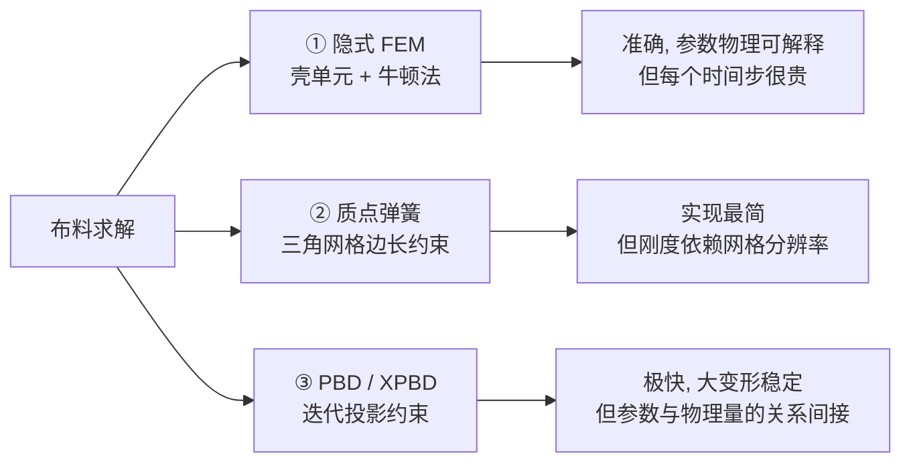
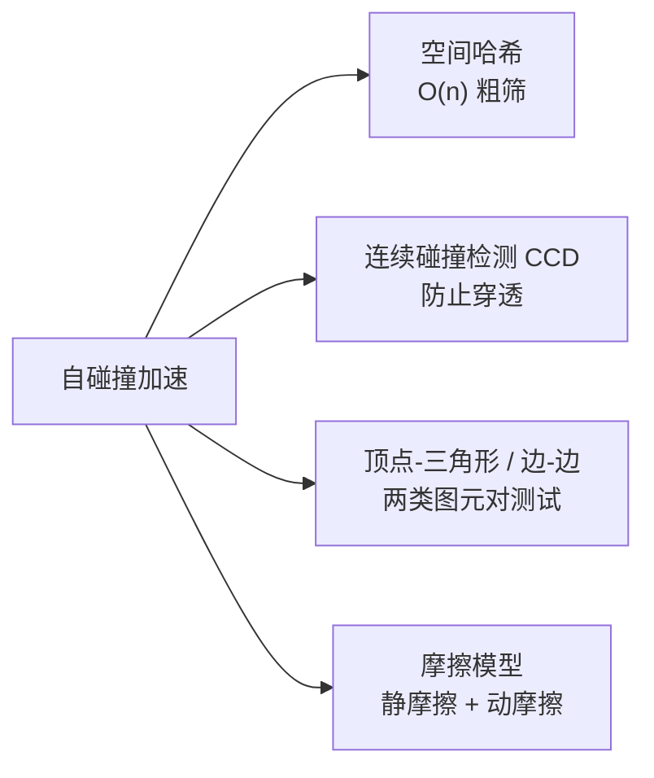
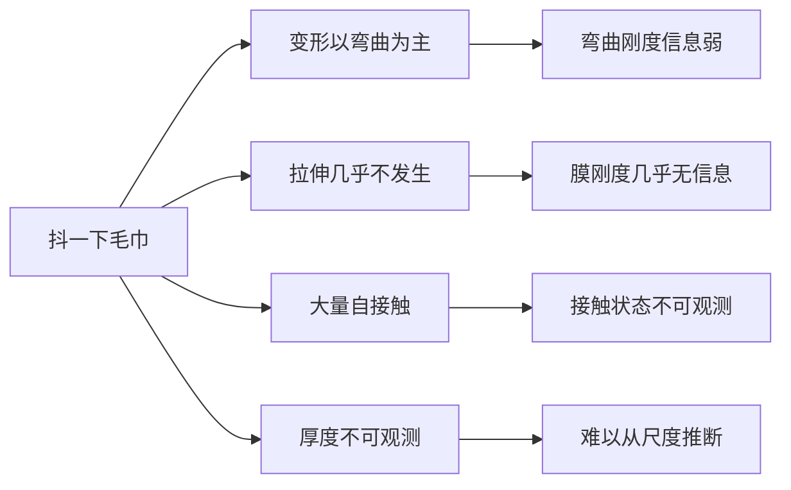

# 薄壳布料仿真基础

> **一句话**：布料是一张几乎没有厚度、能弯不能伸的曲面，它的难点不在变形本身，而在于"极薄"这个几何特性把拉伸和弯曲的能量尺度拉到了完全不同的量级上。

**知识链接**：
- [应变能密度与超弹性本构模型全景](/前置知识/018a_前置知识_应变能密度与超弹性本构模型全景)（体材料本构，与本文的壳理论对照）
- [质点弹簧模型与绳索仿真基础](/前置知识/006e_前置知识_质点弹簧模型与绳索仿真基础)（布料的一维退化情形，先读它）
- [系统辨识与逆问题基础](/前置知识/018b_前置知识_系统辨识与逆问题基础)（为什么布料参数特别难估）
- [PhysGaussian 精读](/论文综述/165_PhysGaussian_物理集成三维高斯动态仿真)（把布料当连续体处理的替代路线）

---

## 贯穿全文的例子

抖一下毛巾。你会看到三种同时在发生的变形：毛巾整体被甩动（刚体运动）、表面出现波浪起伏（弯曲，几乎不耗能）、少数地方被明显拉长（拉伸，很费力）。如果要写一个仿真器复现这个动作，就必须同时处理这三种在数值上尺度悬殊的效应。这一段抖动视频也是本文讨论的参数辨识场景——为什么它比"捏一块橡皮"难得多。

---

## 一、从三维体到二维壳：降维的代价

一块厚度为 $h$ 的布料，如果按三维连续体仿真，需要沿厚度方向至少离散 3-5 层，意味着网格量是二维离散的数十倍。更糟的是布料厚度通常只有 0.1-1 mm，和面内尺寸（几十厘米）相差 $10^3$ 量级，导致有限元的刚度矩阵条件数极差。

薄壳理论的做法是把厚度方向**解析积分掉**，只保留中面（mid-surface）作为自由度：

> **看什么**：降维把未知量从三维网格降到二维曲面，同时也把"厚度"从一个几何尺寸变成一个出现在能量公式里的参数 $h$。

降维后，材料参数不再是三维的 $\mu, \lambda$，而是被积分成两个二维量：

| 二维量 | 表达式 | 单位 | 含义 |
|--------|--------|------|------|
| 膜刚度 | $K_\text{mem} \propto \mu h$ | $\mathrm{N/m}$ | 面内拉伸刚度，正比于厚度 |
| 弯曲刚度 | $K_\text{bend} \propto \frac{\mu h^3}{12(1-\nu^2)}$ | $\mathrm{N\cdot m}$ | 抗弯刚度，正比于**厚度立方** |

**这是布料仿真最重要的一个事实**：弯曲刚度里 $h$ 是三次方。厚度从 1 mm 减到 0.5 mm，膜刚度减半，但弯曲刚度变成 1/8。布料之所以"能弯不能伸"，就是因为 $h$ 极小让弯曲项相对拉伸项被压到极低。

---

## 二、布料的能量分解

布料的弹性势能写成膜能量与弯曲能量之和：

$$E = \underbrace{\int_{\Omega} \frac{K_\text{mem}}{2}\left(\|\nabla \mathbf{x}\|^2 - 1\right)^2 \mathrm{d}A}_{\text{膜（拉伸）能量}} + \underbrace{\int_{\Omega} \frac{K_\text{bend}}{2}\left(\Delta \mathbf{x}\right)^2 \mathrm{d}A}_{\text{弯曲能量}}$$

::: details 📐 公式详解（点击展开）
| 子表达式 | 它是谁 | 它在干嘛 |
|---------|--------|---------|
| $\mathbf{x}(\mathbf{u})$ | 中面上材料坐标 $\mathbf{u}$ 处当前三维位置 | 壳的未知函数（二维到三维的映射） |
| $\|\nabla \mathbf{x}\|^2 - 1$ | 面内度规偏离单位值的量 | 拉伸应变，等于 0 表示局部没有伸长或缩短 |
| $\Delta \mathbf{x}$ | 位置的拉普拉斯（二阶空间导数） | 曲率近似，越大表示弯得越厉害 |
| $K_\text{mem}$ | 膜刚度 | 惩罚拉伸的系数 |
| $K_\text{bend}$ | 弯曲刚度 | 惩罚弯曲的系数 |

**用人话读**：第一项说"每个小块的面积不许变"，第二项说"曲面尽量少弯"。前者是硬约束，后者是软偏好。

**为什么拉伸项是平方、弯曲项是二阶导**：$\|\nabla\mathbf{x}\|^2-1$ 是度规张量偏离单位阵的度量，取平方是能量正定性的最低阶选择。弯曲能量的自然形式是曲率平方 $(\kappa)^2$，而曲率用位置场的二阶导近似。这两个形式的能量量纲通过 $K_\text{mem}$ 和 $K_\text{bend}$ 的取值统一起来。
:::

### 2.1 为什么拉伸项远大于弯曲项

把典型的布料参数代入量级比较：设 $h = 0.5\,\mathrm{mm}$，$K_\text{mem} \sim 10^3\,\mathrm{N/m}$，则 $K_\text{bend} \sim 10^3 \times (5\times10^{-4})^2/12 \sim 2\times10^{-2}\,\mathrm{N\cdot m}$。相差 **5 个数量级**。

这带来两个直接后果：

1. **数值刚性（stiffness）**：显式时间积分的时间步长受最硬项限制。拉伸项太硬，$\Delta t$ 必须极小，仿真极慢。
2. **约束求解成为主流**：与其用超大刚度做大能量的软约束，不如直接**硬约束**长度不变，用迭代投影解约束。这就是 Position Based Dynamics（PBD，位置基动力学）的核心思想。

---

## 三、求解路线：三种主流方案

> **看什么**：三条路线的准确度递减、速度递增。注意质点弹簧那条：它的刚度必须随网格加密而改变，否则加密网格会让布料变得"更硬"。

### 3.1 质点弹簧（本项目的 [006e](/前置知识/006e_前置知识_质点弹簧模型与绳索仿真基础) 讲的是一维版本）

把布料离散成三角形网格，每条边放一根弹簧：

$$\mathbf{f}_i = \sum_{j \in \mathcal{N}(i)} k\left(\|\mathbf{x}_j - \mathbf{x}_i\| - L_0\right)\hat{\mathbf{d}}_{ij}$$

**分辨率依赖问题**：网格加密后，同一块面积上的边数增加，总刚度增大。若要在不同分辨率下保持相同的物理响应，弹簧刚度必须按 $k \propto 1/\text{边长}$ 缩放。这使得"辨识出的 $k$"不能直接对应材料的杨氏模量——它只在特定网格下有意义。

### 3.2 隐式 FEM 壳单元

用壳单元离散上面那个能量，牛顿法解线性系统。刚度矩阵是稀疏的，用 Cholesky 分解求解。

- 优点：辨识出的参数是真正的物理量（膜刚度、弯曲刚度）。
- 缺点：大变形下网格畸变，需要重网格化；自碰撞处理复杂。

### 3.3 PBD / XPBD

不做能量最小化，而在每一步积分后直接对位置做约束投影。对距离约束：

$$\Delta \mathbf{x}_i = -\frac{w_i}{w_i + w_j}\left(\|\mathbf{x}_i - \mathbf{x}_j\| - L_0\right)\hat{\mathbf{d}}_{ij}$$

- $w_i = 1/m_i$ 是质量的倒数（柔度权重）。
- XPBD 引入柔度参数 $\alpha$，把约束的"软硬"和迭代次数解耦，使结果与子步数无关——这是它相对于原版 PBD 的关键改进。

---

## 四、自碰撞：布料独有的麻烦

一块布料任意两片都可能接触。这是布料仿真区别于弹性体的核心难题。

| 挑战 | 说明 |
|------|------|
| 复杂度 | 朴素检测是 $O(n^2)$，$n$ 是三角形数 |
| 自接触 | 布料自己和自己碰，不能只做物体间检测 |
| 动态拓扑 | 接触对每帧都在变 |
| 穿透处理 | 布料极薄，一旦穿透很难恢复 |
| 摩擦 | 布料与自身/环境的摩擦对形态影响巨大 |

常用对策：

> **看什么**：粗筛（空间哈希/包围盒层次）负责把 $O(n^2)$ 降下来，窄筛（顶点-三角形精确测试）负责判断是否真的相交，CCD 负责在时间上插值以防高速穿透。

---

## 五、为什么布料参数辨识比弹性体难

这是本文最直接的落点。对比"捏一块橡皮"和"抖一下毛巾"：

| 困难 | 原因 | 后果 |
|------|------|------|
| 拉伸信息缺失 | 抖动时布料几乎不可伸长 | 膜刚度 $K_\text{mem}$ 不可辨识 |
| 弯曲信息弱 | 弯曲能量本身就小 | 信噪比低，估计方差大 |
| 厚度不可观测 | 视频中看不出 0.5 mm | 无法独立确定 $K_\text{mem}$ 与 $K_\text{bend}$ 的绝对尺度 |
| 自碰撞状态隐含 | 接触点无法从外观反推 | 摩擦系数难以辨识 |
| 各向异性 | 织物经/纬方向刚度不同 | 各向同性假设失效 |
| 曲面欠约束 | 薄壳的方程本身不总是椭圆型 | 数值上的不稳定 |

**关键结论**：单次抖动只激发弯曲模式，而弯曲刚度与拉伸刚度的组合可能产生相同的宏观外观。要辨识膜刚度，必须提供**面内拉伸的激励**（例如悬挂重物、双向拉扯）；要辨识各向异性，必须提供**不同方向的拉伸**。

---

## 六、织物不是各向同性弹性体

真实织物的力学有两个层次：

| 现象 | 机理 | 对本构的影响 |
|------|------|-------------|
| 经纬异性 | 经纱纬纱的密度和张力不同 | 需要正交各向异性本构（两个方向的杨氏模量 + 剪切模量 + 泊松比） |
| 剪切锁死 | 纱线交织导致小变形下抗剪刚度高 | 剪切刚度非线性 |
| 迟滞 | 纱线间摩擦 | 加载与卸载曲线不重合，**不是超弹性** |
| 褶皱记忆 | 塑性变形累积 | 存在不可恢复的残余变形 |

这意味着把布料当成 Neo-Hookean 超弹性体（如 [018a](/前置知识/018a_前置知识_应变能密度与超弹性本构模型全景) 所述）仿真，只能捕捉到它的部分行为。PhysGaussian 等基于 3DGS 的连续体方法能达到视觉上合理的波浪效果，但辨识出的"弹性模量"不是一个有物理意义的织物参数。

---

## 七、总结

| 关键点 | 内容 |
|--------|------|
| 薄壳降维 | 沿厚度积分，把三维体变成二维曲面 |
| 两个刚度 | 膜刚度 $\propto h$，弯曲刚度 $\propto h^3$，相差数个量级 |
| 为什么"能弯不能伸" | 厚度小导致弯曲刚度被压低 |
| 三大求解路线 | 隐式 FEM（准）/ 质点弹簧（简）/ PBD-XPBD（快） |
| 自碰撞 | 布料特有，需要粗筛 + 窄筛 + CCD |
| 辨识困难 | 抖动只激发弯曲，膜刚度无信息；厚度不可观测；织物各向异性且非超弹性 |

---

## 延伸阅读

- [质点弹簧模型与绳索仿真基础](/前置知识/006e_前置知识_质点弹簧模型与绳索仿真基础)——一维版本，先读它更容易理解本文的弹簧部分
- Baraff & Witkin, *Large Steps in Cloth Simulation* (SIGGRAPH 1998)——隐式布料仿真奠基性工作
- Müller et al., *Position Based Dynamics* (2007) / Macklin et al., *XPBD* (2016)——约束投影路线
- [系统辨识与逆问题基础](/前置知识/018b_前置知识_系统辨识与逆问题基础)——激励不足的一般理论，本文第五节是它在布料上的具体化
- [PhysGaussian 精读](/论文综述/165_PhysGaussian_物理集成三维高斯动态仿真)——体 MPM 路线处理薄壳时的困难（体积等效与弯曲刚度估计）在本构层面的原因