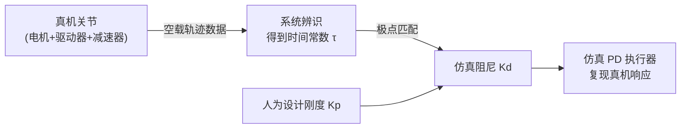

# 比例微分控制 PD 基础：仿真关节的虚拟驱动器

> **一句话**：给关节发一个目标角度，它需要知道"该施加多大力矩才能往那个方向走、而且不要来回振荡"——PD 控制器就是回答这个问题的算法：用当前位置误差算出一个拉力（P 项），用当前速度算出一个制动力（D 项），两者加在一起就是施加给关节的力矩。

**知识链接**：
- [电机驱动与控制：位置/速度/力矩模式](/硬件基础/H02_电机驱动与控制) — 真实关节的阻抗控制就是本文 PD 控制律的硬件实现
- [刚体动力学：牛顿-欧拉方程与惯性张量](/前置知识/006b_前置知识_刚体动力学_牛顿欧拉方程与惯性张量) — 惯量 I 从这里来，决定 Kp/Kd 的数量级
- [物理仿真数值积分：辛积分与能量稳定性](/前置知识/006c_前置知识_物理仿真数值积分_辛积分与能量稳定性) — 离散化 PD 时需要选择显式还是隐式积分
- [常微分方程 ODE 直觉与数值求解](/前置知识/001b_前置知识_常微分方程ODE直觉与数值求解) — 本文的二阶 ODE 是那篇讲的一阶 ODE 的自然延伸
- 下游：[隐式 PD 与极点匹配](/前置知识/017f_前置知识_隐式PD与极点匹配) — 仿真刚度/阻尼怎么从真机数据推算出来
- 下游：[一阶响应模型与命令-反馈系统辨识](/前置知识/017e_前置知识_一阶响应模型与命令反馈系统辨识) — 真机的"有效 PD 响应"是怎么用数据辨识的
- 下游：[机器人学基础串联](/系列/robot_foundations_deep_dive/) — 本文是执行器层的核心，在系列第 6 章展开

---

## 1. 从问题出发：关节为什么需要控制器

仿真里的关节不是魔法——你给它一个"目标角度 90°"，它不会瞬间跳过去。仿真器里的关节本质上是一个有**惯量**的物体，靠**力矩**推动旋转，遵守牛顿第二定律。

要让关节转到目标角度，必须回答三个问题：

1. **往哪走**：目标角度和当前角度的差（位置误差）决定方向。
2. **使多大劲**：误差越大，力矩应该越大；误差接近零时力矩也该接近零。
3. **怎么停下来**：只看位置误差会一直振荡——就像弹簧，过了目标还要被拉回来，永远转圈。需要一个"制动力"来抑制速度。

PD 控制器正是用最少的信息（当前位置和当前速度）回答这三个问题的标准算法。

---

## 2. P 项：比例控制——弹簧

比例（P）控制的想法最直观：**误差有多大，力矩就按比例多大**。

$$
\tau_P = K_p \cdot (q^* - q)
$$

**这个公式在做什么**：以当前位置误差 $(q^* - q)$ 为输入，乘上刚度系数 $K_p$，得到一个"往目标方向拉"的力矩。

::: details 📐 公式详解（点击展开）

| 子表达式 | 它是谁 | 它在干嘛 |
|---------|--------|---------|
| $q^*$ | **目标角度** | 你想让关节去的位置 |
| $q$ | **当前角度** | 关节实际在哪里 |
| $q^* - q$ | **位置误差** | 还差多少度才到目标 |
| $K_p$ | **刚度（弹簧系数）** | 决定"每差 1 度就施加多少力矩" |
| $\tau_P$ | **比例力矩** | 这一步 P 项的贡献 |

**用人话读**："像弹簧一样——离目标越远，被拉得越用力；到了目标，力归零。"

**为什么叫刚度**：$K_p$ 越大，弹簧越硬，关节越"急"。这和真实关节的阻抗控制（见 [H02](/硬件基础/H02_电机驱动与控制#3.4-混合模式-阻抗控制)）里刚度参数的物理意义完全一致。
:::

**P 控制的问题**：只有弹簧拉力，关节会超过目标、被弹回来、再超过……永远震荡，永远不能平稳停下。这不是数值问题——它是二阶系统（弹簧+惯量）在零阻尼下的物理必然。

---

## 3. D 项：微分控制——刹车

微分（D）控制的想法是：**速度有多大、方向如何，就加一个反向的制动力**。

$$
\tau_D = K_d \cdot (- \dot{q})
$$

或者更完整地（目标速度通常为零）：

$$
\tau_D = K_d \cdot (\dot{q}^* - \dot{q})
$$

**这个公式在做什么**：以当前速度 $\dot{q}$ 为输入，乘上阻尼系数 $K_d$，得到一个"和速度方向相反的制动力矩"。

::: details 📐 公式详解（点击展开）

| 子表达式 | 它是谁 | 它在干嘛 |
|---------|--------|---------|
| $\dot{q}$ | **当前角速度** | 关节现在以多快的速度在转 |
| $\dot{q}^* - \dot{q}$ | **速度误差** | 目标速度（通常 0）与实际速度之差 |
| $K_d$ | **阻尼系数** | 决定"每转快 1 rad/s 就施加多少反向力矩" |
| $\tau_D$ | **微分力矩** | 这一步 D 项的贡献 |

**用人话读**："像刹车踏板——动得越快，阻力越大；停下来就没有阻力。"

**为什么叫微分**：速度是位置对时间的导数（微分），所以这一项叫"微分项"。D 项不管你在哪儿，只管你跑多快——快就刹，慢就放。

**为什么 D 项能止住振荡**：P 项冲过目标后速度很大，D 项此时会施加一个很大的反向力矩，强迫关节减速。关节到目标之前就被减速到接近零，振荡被压下去了。
:::

---

## 4. PD 合并：二阶闭环系统

把 P 和 D 加在一起，得到 PD 控制律：

$$
\tau = K_p (q^* - q) + K_d (\dot{q}^* - \dot{q})
$$

代入牛顿第二定律（关节惯量为 $I$，$\tau = I\ddot{q}$），整理后得到关节的运动方程：

$$
I\ddot{q} + K_d \dot{q} + K_p (q - q^*) = 0
$$

**这个公式在做什么**：这是一个带阻尼的二阶线性系统——惯量、阻尼力、弹簧力三方平衡，描述关节从任意位置逼近目标的全过程。

::: details 📐 公式详解（点击展开）

| 子表达式 | 它是谁 | 它在干嘛 |
|---------|--------|---------|
| $I\ddot{q}$ | **惯性项** | 关节"不想改变运动状态"的惯性阻力 |
| $K_d \dot{q}$ | **阻尼项** | 速度越大，制动力越大 |
| $K_p(q - q^*)$ | **弹簧项** | 偏离目标越远，拉力越大 |

**用人话读**："关节是一个弹簧-阻尼器系统：弹簧把它拉向目标，阻尼阻止它乱冲，惯量决定它有多难被推动。"

**为什么需要三项**：去掉 $I$ 项（无质量）关节会瞬间跳位；去掉 $K_d$ 项（无阻尼）关节永远振荡；去掉 $K_p$ 项（无弹簧）关节对目标毫无感觉。三项缺一不可，各有角色。
:::

---

## 5. 刚度和阻尼究竟控制什么

用标准二阶系统的两个核心参数来理解：

$$
\omega_n = \sqrt{\frac{K_p}{I}}, \qquad \zeta = \frac{K_d}{2\sqrt{K_p \cdot I}}
$$

**自然频率 $\omega_n$（由 $K_p$ 决定）**：描述系统"想以多快的节拍振荡"。$K_p$ 越大，$\omega_n$ 越大，关节追目标越急、到位越快。

**阻尼比 $\zeta$（由 $K_d$ 决定）**：描述振荡被压制的程度。有三种典型状态：

| 状态 | 阻尼比 | 现象 | 原因 |
|------|--------|------|------|
| 欠阻尼 | $\zeta < 1$ | 振铃超调，来回震荡 | 阻尼不足以在第一次就停住 |
| 临界阻尼 | $\zeta = 1$ | 不超调、最快到位 | 阻尼刚好在零速时抵达目标 |
| 过阻尼 | $\zeta > 1$ | 不超调但很迟钝 | 阻尼太强，关节"爬行"进目标 |

> 左图：固定刚度（$\omega_n = 10$ rad/s），从上到下阻尼比依次为 0、0.2、0.5、1.0、2.0。$\zeta=0$ 永远震荡，$\zeta=1$ 无超调且最快到位，$\zeta=2$ 虽然不振铃但明显迟钝。右图：保持临界阻尼，把 $\omega_n$ 从 4 提高到 25（等价于把 $K_p$ 提高约 40 倍、$K_d$ 提高约 6 倍）——响应越来越快，到位时间从约 1.5s 压缩到 0.15s。

从图里读出的核心设计原则：
- **$K_p$ 决定"要多快"**——想让关节快，调大 $K_p$。
- **$K_d$ 决定"要不要振荡"**——$K_p$ 调大时，$K_d$ 必须同步增大，否则会从临界阻尼退回欠阻尼。
- **临界阻尼是工程默认目标**——不超调，又不迟钝，是"速度和稳定性之间的最优点"。

---

## 6. 仿真里的 PD 和真机有什么关系

这是最容易混淆的地方。

**真机上根本没有"Kp"和"Kd"这两个物理量**。真机的关节里有电机、驱动器固件（内置电流环/速度环）、减速器、连杆惯性。这一切合在一起产生了从"命令角度"到"实际角度"的有效响应，表现出来像一个有一定时间常数的滤波器——这就是用一阶辨识模型（见 [017e](/前置知识/017e_前置知识_一阶响应模型与命令反馈系统辨识)）能捕捉到的东西。

**仿真里没有电机**。仿真器的关节只接受力矩，然后按物理引擎积分。PD 控制器是"虚拟驱动器"：它替代了真机里那一整套电机+驱动器，给仿真关节按 $K_p(q^*-q)+K_d(\dot q^*-\dot q)$ 的公式算出力矩并施加。

于是问题变成了：**如何选 $K_p$ 和 $K_d$，让仿真关节的响应和真机一样慢、一样稳？**

- $K_p$（刚度）是人为选定的设计值——决定"仿真关节想要多硬"。通常选一个足够大、让关节不会显得松垮的值。
- $K_d$（阻尼）由真机辨识结果反推——通过极点匹配（见 [017f](/前置知识/017f_前置知识_隐式PD与极点匹配)），把真机的时间常数 $\tau$ 翻译成对应的 $K_d$，让仿真关节"慢得和真机一样"。

> 图里的要点：$K_d$ 不是随意选的——它被真机数据通过极点匹配约束住了；$K_p$ 是自由设计变量，但一旦选定，$K_d$ 就随之确定。

---

## 7. 边界情况：$K_p$ 太大会发生什么

$K_p$ 过大时，弹簧力在一个积分步长内就能把关节推出很远，积分器来不及"消化"这么大的力，数值就爆炸（指数级增长）。这是**显式 PD 的数值稳定性上限**：

$$
K_p \lesssim \frac{2I}{h^2}
$$

其中 $h$ 是仿真步长。步长越小（仿真运行越精细），允许的最大 $K_p$ 越大。

这也是为什么仿真器默认用**隐式 PD（implicit PD actuator）**而不是显式：隐式把阻尼项改用下一时刻的速度来算，让大刚度下依然稳定（详见 [017f](/前置知识/017f_前置知识_隐式PD与极点匹配#2-隐式驱动器-为什么仿真里-隐式-更好)）。

---

## 8. PD 和 PID 的区别

加上积分（I）项就是 PID：

$$
\tau_{PID} = K_p(q^*-q) + K_i\int(q^*-q)\,dt + K_d(\dot q^*-\dot q)
$$

I 项的作用：消除**稳态误差**。PD 在关节到目标附近时，弹簧力接近零，如果此时有常数外力（比如重力分量），关节会停在目标旁边的一个偏差点上。I 项积累这个偏差，慢慢把它顶回去。

**仿真里通常用 PD 不用 PID 的原因**：仿真里动力学方程已经包含了重力 $g(q)$，通常做了补偿（feedforward 力矩），所以不需要 I 项消除稳态误差。真机的驱动器固件内部往往自带积分项，外层 PD 不需要重复。

---

## 9. 总结

- PD 控制器是关节的"虚拟弹簧-阻尼器"：P 项（刚度 $K_p$）把关节拉向目标，D 项（阻尼 $K_d$）抑制振荡。
- 二阶闭环系统有两个关键参数：自然频率 $\omega_n = \sqrt{K_p/I}$（决定快慢）和阻尼比 $\zeta = K_d/(2\sqrt{K_p I})$（决定振不振）。
- 临界阻尼（$\zeta = 1$）是工程默认目标：最快到位且不超调。
- 仿真里 PD 是执行器模型，不是真机行为的拟合；$K_p$ 人为设计，$K_d$ 由真机辨识数据通过极点匹配反推。
- $K_p$ 过大时显式 PD 会数值爆炸，仿真器用隐式 PD 规避这个问题。

---

## 延伸阅读

- [电机驱动与控制](/硬件基础/H02_电机驱动与控制) — 真实机器人的阻抗控制接口：同一个公式在驱动器固件里的工程落地
- [隐式 PD 与极点匹配](/前置知识/017f_前置知识_隐式PD与极点匹配) — $K_d$ 怎么从真机时间常数算出来
- [一阶响应模型与命令-反馈系统辨识](/前置知识/017e_前置知识_一阶响应模型与命令反馈系统辨识) — 真机的有效 PD 响应是怎么用数据辨识的
- [机械臂动力学方程：M、C、g 与关节力矩](/前置知识/008d_前置知识_机械臂动力学方程M_C_g与关节力矩) — 真实机器人需要在 PD 之外额外补偿 Cq²、g(q) 等项
