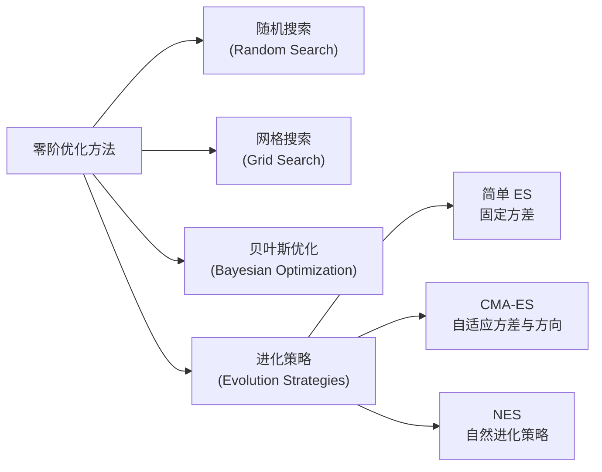
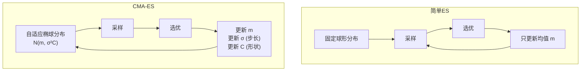
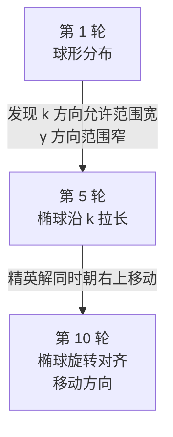

# CMA-ES：让零阶优化器自己学会搜索方向

> **一句话**：CMA-ES 是一种不需要梯度的优化器——它每一轮采样一群候选解、根据这群解的好坏自适应调整下一轮的采样分布，用"让好的方向采样更密集"代替"沿着梯度走"。

**知识链接**：
- [系统辨识与逆问题基础](/前置知识/018b_前置知识_系统辨识与逆问题基础)（CMA-ES 常用于参数辨识的外层搜索）
- [可微物理仿真](/前置知识/018a_前置知识_应变能密度与超弹性本构模型全景)（当仿真器可微时可以用梯度优化；当不可微时退而用 CMA-ES）
- [PhysTwin 精读](/论文综述/169_PhysTwin_从稀疏视频构建可交互软体数字孪生)（用 CMA-ES 搜索弹簧连接半径、碰撞参数等离散/不可微参数）
- [SimOpt 精读](/论文综述/130_SimOpt_闭环仿真参数自适应)（用 CMA-ES 校准仿真参数分布）

---

## 贯穿全文的例子

> **场景**：你要调一个仿真器的参数，让它模拟的绳子运动和真实视频一致。参数有两个：弹簧的刚度 $k$、阻尼系数 $\gamma$。你不知道损失函数关于 $(k, \gamma)$ 的梯度——每次改参数都要跑一遍仿真、算 Chamfer 距离，这个过程不可微。
>
> 你现在手上只有一个函数：`loss(k, gamma) -> float`，它告诉你"这组参数跑出来的仿真和视频差多少"，但不告诉你"朝哪个方向改能变好"。CMA-ES 要解决的就是这个问题：**怎么在看不见梯度的情况下，一步步逼近最优参数**。

这个场景是 PhysTwin 论文 Stage 1 零阶优化阶段做的事情。弹簧连接半径是离散的、碰撞参数穿过接触力不可微，所以梯度下降用不上——必须用零阶方法。

---

## 一、为什么需要零阶优化

梯度优化（如 SGD、Adam）的前提是：你能算出损失函数关于参数的梯度 $\nabla_\theta \mathcal{L}$。但很多实际问题里，这个梯度算不出来或者算出来没用：

| 梯度不可用的场景 | 为什么没法用梯度 |
|--------------|-------------|
| **仿真器不可微** | 碰撞、摩擦、断裂等不连续事件穿不过去；仿真软件本身可能是黑盒（没有反向传播实现） |
| **离散参数** | 网格分辨率、连接拓扑、枚举选项（如材料类型）没有梯度的概念 |
| **真实世界实验** | 机器人真机实验、化学实验、A/B 测试——每次评估成本高，无法算梯度 |
| **多模态 / 梯度消失** | 损失函数有很多局部极小值，梯度法容易卡住；或者梯度接近零、方向不可信 |

这些场景下，只能**用函数值引导搜索，不能用梯度**。这类方法统称**零阶优化**（zero-order optimization）或**黑盒优化**（black-box optimization）。

常见的零阶方法：



> **看什么**：网格/随机搜索在高维（参数 >10 维）时效率极低；贝叶斯优化在低维（<20 维）时很强但高维扩展性差；进化策略在中等维度（5–100 维）的黑盒优化中是最常用的选择。CMA-ES 是进化策略中最成熟、最常被引用的算法。

---

## 二、最简单的进化策略：固定高斯采样

在讲 CMA-ES 之前，先看最简单的进化策略——它不自适应，每一轮用固定分布采样：

**算法步骤**（简单 ES）：

1. 设定初始均值 $\mathbf{m}_0$ 和固定标准差 $\sigma$
2. 从 $\mathcal{N}(\mathbf{m}, \sigma^2 I)$ 采样 $\lambda$ 个候选解 $\{\mathbf{z}_1, \dots, \mathbf{z}_\lambda\}$
3. 评估每个候选解的损失 $f(\mathbf{z}_i)$
4. 选出最好的 $\mu$ 个（$\mu < \lambda$），用它们的加权均值更新 $\mathbf{m}$：

$$
\mathbf{m} \leftarrow \sum_{i=1}^{\mu} w_i \, \mathbf{z}_{(i)}
$$

**这个公式在做什么**：把评估结果最好的 $\mu$ 个候选解做加权平均，更新搜索中心。权重按排名递减——排名第一的候选解对下一轮搜索中心的影响最大。

::: details 📐 公式详解（点击展开）

| 符号 | 含义 | 说明 |
|-----|------|------|
| $\mathbf{z}_{(i)}$ | 按 $f$ 排序后第 $i$ 好的候选解 | 排名越靠前越好 |
| $w_i$ | 第 $i$ 名的权重 | 预设值，排名靠前权重更大 |
| $\mu$ | 选出的精英数量 | 通常 $\mu = \lfloor \lambda/2 \rfloor$ |
| $\mathbf{m}$ | 更新后的搜索中心 | 下一轮采样的均值 |

**数值代入**：5 个候选解中选出 $\mu=2$ 个最好的 $\mathbf{z}_{(1)}=(480, 0.08)$、$\mathbf{z}_{(2)}=(520, 0.12)$，权重 $w_1=0.7, w_2=0.3$，则 $\mathbf{m} = 0.7 \times (480, 0.08) + 0.3 \times (520, 0.12) = (492, 0.092)$。
:::

其中 $\mathbf{z}_{(1)}, \dots, \mathbf{z}_{(\mu)}$ 是按 $f$ 排序后最好的 $\mu$ 个，$w_i$ 是预设权重（通常让排名靠前的权重更大）。

5. 重复步骤 2–4。

> **用绳子例子走一遍**：你不知道最优的 $(k, \gamma)$ 是多少，先猜一个中间值 $\mathbf{m}_0 = (500, 0.1)$，标准差 $\sigma = 100$。每轮采样 20 组候选参数，跑 20 次仿真，选仿真结果最好的 5 组，用它们的均值更新 $\mathbf{m}$。下一轮继续在新均值附近采样。

这个方法能跑，但有两个严重问题：

| 问题 | 后果 |
|-----|------|
| **$\sigma$ 不会变** | 初始如果选太大，搜索永远在抖动；选太小，很快陷入局部最优 |
| **所有方向一视同仁** | 如果 $k$ 方向的最优解范围很窄而 $\gamma$ 方向很宽，用各向同性的球形高斯采样是浪费——大部分样本落在没用的 $k$ 值上 |

CMA-ES 的全部工作就是解决这两个问题。

---

## 三、CMA-ES 的核心想法

CMA-ES 全称 **Covariance Matrix Adaptation Evolution Strategy**，它的名字精确描述了它做的事：

- **Evolution Strategy**：用"采样 → 选优 → 更新分布"的循环代替梯度
- **Covariance Matrix**：采样分布不是球形的，而是一个完整的多元高斯 $\mathcal{N}(\mathbf{m}, \sigma^2 \mathbf{C})$，协方差矩阵 $\mathbf{C}$ 控制椭球的形状和朝向
- **Adaptation**：$\mathbf{m}$、$\sigma$、$\mathbf{C}$ 三个量每一轮都根据选出的精英解更新



> **看什么**：简单 ES 只调均值，搜索方向和尺度永远不变。CMA-ES 同时调均值、步长和形状——它在"学习搜索本身应该怎么做"。

---

## 四、三个自适应变量的物理直觉

把 CMA-ES 的采样分布想象成一个"在参数空间里飘浮的椭球形探测器"：

| 变量 | 控制什么 | 直觉 |
|-----|---------|------|
| **均值 $\mathbf{m}$** | 椭球的中心位置 | "我目前认为最优解大概在哪" |
| **步长 $\sigma$** | 椭球的整体大小 | "我对自己的猜测有多不确定"——大 $\sigma$ 表示还在大范围搜索，小 $\sigma$ 表示已经在局部精修 |
| **协方差 $\mathbf{C}$** | 椭球的形状与朝向 | "哪个方向的搜索更有价值"——沿着损失平坦的方向拉长椭球，沿着损失陡峭的方向压扁 |

> **用绳子例子**：第一轮发现"$k$ 从 400 到 600 都还行，但 $\gamma$ 必须在 0.08–0.12 之间"。下一轮 CMA-ES 的协方差矩阵就会自动把椭球沿 $k$ 方向拉长、沿 $\gamma$ 方向压扁——更多的采样落在有用的 $\gamma$ 变化上，而不是浪费在 $k$ 上。

---

## 五、算法主循环

CMA-ES 每一轮（generation）执行以下步骤：

### 5.1 采样

$$
\mathbf{z}_i = \mathbf{m} + \sigma \cdot \mathbf{y}_i, \qquad \mathbf{y}_i \sim \mathcal{N}(\mathbf{0}, \mathbf{C}), \qquad i = 1, \dots, \lambda
$$

**这个公式在做什么**：从当前的自适应分布里抽 $\lambda$ 个候选解。$\mathbf{m}$ 是中心，$\sigma\sqrt{\mathbf{C}}$ 决定搜索范围的形状和大小。

::: details 📐 公式详解（点击展开）

| 子表达式 | 它是谁 | 它在干嘛 |
|---------|--------|---------|
| $\mathbf{m}$ | 当前最佳估计均值（$d$ 维向量） | 搜索的中心点，上一轮选出的精英解的加权均值 |
| $\sigma$ | 全局步长（标量） | 控制整体搜索范围，初始通常设为参数范围的 1/3 |
| $\mathbf{C}$ | 协方差矩阵（$d \times d$ 正定对称矩阵） | 编码搜索方向的相对重要性和参数间的相关性 |
| $\mathbf{y}_i$ | 标准化的采样向量 | 从 $\mathcal{N}(\mathbf{0}, \mathbf{C})$ 采样；$\mathbf{C}$ 的作用是把各向同性高斯噪声变成沿主方向拉伸的椭球噪声 |
| $\mathbf{z}_i$ | 第 $i$ 个候选解 | 实际要去评估的参数组合 |

**用人话读**："在当前最优估计附近，用一个自适应形状的椭球分布撒一批候选点，椭球的方向和大小由历史经验决定。"
:::

### 5.2 评估与选择

评估每个候选解的目标函数值 $f(\mathbf{z}_i)$，按从小到大排序（假设是最小化问题），取最好的 $\mu$ 个，记为 $\mathbf{z}_{(1)}, \dots, \mathbf{z}_{(\mu)}$。

通常设 $\mu = \lfloor \lambda/2 \rfloor$，$\lambda$ 取 $4 + \lfloor 3\ln d \rfloor$（$d$ 是参数维度）。

### 5.3 更新均值

$$
\mathbf{m} \leftarrow \sum_{i=1}^{\mu} w_i \, \mathbf{z}_{(i)}
$$

**这个公式在做什么**：和简单 ES 相同——用精英解的加权均值更新搜索中心。区别在于权重设计和后续对 $\sigma$、$\mathbf{C}$ 的联动更新。

::: details 📐 公式详解（点击展开）

| 子表达式 | 它是谁 | 它在干嘛 |
|---------|--------|---------|
| $\mathbf{z}_{(i)}$ | 按 $f$ 排序后第 $i$ 好的候选解 | 精英解集合 |
| $w_i$ | 第 $i$ 名的权重 | 对数递减，让前几名贡献更大 |
| $\mathbf{m}$ | 搜索分布的均值 | 更新后的新中心 |

**用人话读**："把表现最好的一半候选解做加权平均，排名越靠前权重越大，更新搜索中心。"
:::

权重 $w_i$ 通常取 $w_i = \frac{\ln(\mu + 0.5) - \ln i}{\sum_{j=1}^{\mu} [\ln(\mu+0.5) - \ln j]}$，让排名第一的权重最大，排名靠后的权重递减（log-rank weighting）。

**为什么这样设计权重**：线性权重对噪声敏感，排名靠后的样本可能只是运气不好；对数权重让排名信息平滑传递，避免个别异常值主导更新。

### 5.4 更新步长 $\sigma$（累积步长适应，CSA）

这是 CMA-ES 最巧妙的部分之一。步长的更新依赖一个**演化路径**（evolution path）$\mathbf{p}_\sigma$：

$$
\mathbf{p}_\sigma \leftarrow (1 - c_\sigma)\mathbf{p}_\sigma + \sqrt{c_\sigma(2 - c_\sigma)\mu_{\text{eff}}} \cdot \mathbf{C}^{-1/2} \frac{\mathbf{m}^{\text{new}} - \mathbf{m}^{\text{old}}}{\sigma}
$$

**这个公式在做什么**：维护"均值移动的滑动平均"（演化路径 $\mathbf{p}_\sigma$），用指数加权累积历史的移动方向。$\mathbf{C}^{-1/2}$ 做了去相关变换，让路径在各方向上有可比的尺度。

::: details 📐 演化路径公式详解（点击展开）

| 子表达式 | 含义 | 说明 |
|---------|------|------|
| $(1 - c_\sigma)\mathbf{p}_\sigma$ | 旧路径的衰减 | $c_\sigma \approx 0.3$，保留约 70% 的历史信息 |
| $\mathbf{C}^{-1/2} \frac{\mathbf{m}^{\text{new}} - \mathbf{m}^{\text{old}}}{\sigma}$ | 去相关后的归一化移动向量 | 变换到标准坐标系，使各方向可比 |
| $\sqrt{c_\sigma(2 - c_\sigma)\mu_{\text{eff}}}$ | 归一化常数 | 保证随机选择下 $\mathbf{p}_\sigma$ 长度的期望等于 $\mathbb{E}\|\mathcal{N}(\mathbf{0}, \mathbf{I})\|$ |

**用人话读**："用指数加权移动平均记住最近几代搜索中心往哪走，$\mathbf{C}^{-1/2}$ 确保在椭球拉伸的方向上不会放大。"
:::

$$
\sigma \leftarrow \sigma \cdot \exp\left(\frac{c_\sigma}{d_\sigma}\left(\frac{\|\mathbf{p}_\sigma\|}{\mathbb{E}\|\mathcal{N}(\mathbf{0}, \mathbf{I})\|} - 1\right)\right)
$$

**这个公式在做什么**：比较演化路径的长度和随机游走的期望长度——路径比随机长（移动方向一致），增大 $\sigma$；比随机短（来回抖动），减小 $\sigma$。

::: details 📐 公式详解（点击展开）

| 子表达式 | 它是谁 | 它在干嘛 |
|---------|--------|---------|
| $\mathbf{p}_\sigma$ | 步长演化路径 | 累积最近几轮均值移动的方向，衰减系数 $c_\sigma \approx 0.3$ |
| $\mathbf{C}^{-1/2}$ | 协方差的逆平方根 | 把移动向量从椭球坐标系变换回标准正交坐标系（"去相关"） |
| $\mathbb{E}\|\mathcal{N}(\mathbf{0}, \mathbf{I})\|$ | $d$ 维标准高斯向量的期望长度 | 约为 $\sqrt{d}(1 - \frac{1}{4d} + \frac{1}{21d^2})$，这是随机游走的基准 |
| $\frac{\|\mathbf{p}_\sigma\|}{\mathbb{E}\|\cdots\|} - 1$ | 实际演化速度与随机游走的比值减一 | 大于 0 表示进展快于随机，小于 0 表示在原地打转 |
| $\exp(\cdots)$ | 步长的乘性更新因子 | 对数尺度调整，保证 $\sigma > 0$ 且变化平滑 |

**用人话读**："如果最近几轮我朝着同一个方向走得很稳，说明还在下坡路上，可以加大步子；如果方向来回抖，说明已经到谷底了，该缩小步子精修了。"

**为什么不直接看损失下降**：损失下降只告诉你"这一步好不好"，不告诉你"搜索的尺度对不对"。演化路径比较的是"移动的持续性"——持续朝一个方向走就说明还没到最优，步长可以更大。
:::

### 5.5 更新协方差 $\mathbf{C}$（秩-$\mu$ 更新 + 秩-1 累积）

协方差更新有两个来源：

1. **秩-$\mu$ 更新**：用精英解的协方差直接更新

$$
\mathbf{C} \leftarrow (1 - c_1 - c_\mu) \mathbf{C} + c_1 \mathbf{p}_c \mathbf{p}_c^\top + c_\mu \sum_{i=1}^{\mu} w_i \, \mathbf{y}_{(i)} \mathbf{y}_{(i)}^\top
$$

**这个公式在做什么**：协方差矩阵的更新由三部分组成——保留一部分旧的 $\mathbf{C}$（遗忘因子）、加一点演化路径的外积（长期趋势）、再加当前这一轮精英解的加权协方差（当前信息）。三项加起来让椭球的形状沿着有价值的方向拉伸。

::: details 📐 公式详解（点击展开）

| 项 | 含义 | 作用 |
|----|------|------|
| $(1 - c_1 - c_\mu) \mathbf{C}$ | 旧协方差矩阵的保留 | 遗忘因子，平滑更新 |
| $c_1 \mathbf{p}_c \mathbf{p}_c^\top$ | 演化路径的秩-1 更新 | 捕获长期移动趋势 |
| $c_\mu \sum w_i \mathbf{y}_{(i)} \mathbf{y}_{(i)}^\top$ | 精英解的秩-$\mu$ 更新 | 当前这一轮的协方差信息 |

**用人话读**："保留八成老形状，加一点历史轨迹的方向，再加一点这一轮最好的几个点分布的方向。"
:::

其中 $\mathbf{y}_{(i)} = \frac{\mathbf{z}_{(i)} - \mathbf{m}^{\text{old}}}{\sigma}$ 是归一化的精英解偏移。

2. **秩-1 累积**：维护另一个演化路径 $\mathbf{p}_c$（协方差演化路径），它累积的是原始移动方向（不做去相关）：

$$
\mathbf{p}_c \leftarrow (1 - c_c)\mathbf{p}_c + H_\sigma \sqrt{c_c(2 - c_c)\mu_{\text{eff}}} \cdot \frac{\mathbf{m}^{\text{new}} - \mathbf{m}^{\text{old}}}{\sigma}
$$

**这个公式在做什么**：维护协方差的演化路径——累积最近几轮搜索中心的移动方向，但不做去相关变换（保留原始坐标系信息），用于 $\mathbf{C}$ 更新中的秩-1 项。开关 $H_\sigma$ 在步长还在剧烈调整时暂停更新，避免错误的方向信息污染协方差。

::: details 📐 公式详解（点击展开）

| 子表达式 | 含义 | 说明 |
|---------|------|------|
| $(1 - c_c)\mathbf{p}_c$ | 旧路径的衰减 | 指数遗忘，$c_c$ 越大遗忘越快 |
| $\frac{\mathbf{m}^{\text{new}} - \mathbf{m}^{\text{old}}}{\sigma}$ | 归一化的搜索中心移动 | 不经过 $\mathbf{C}^{-1/2}$ 去相关 |
| $H_\sigma$ | 步长适应开关 | $\|\mathbf{p}_\sigma\|$ 过大时置 0 |

**用人话读**："记住最近几代搜索中心朝哪个方向走，但如果步长还在剧烈调整中，先暂停别记了。"
:::

其中 $H_\sigma$ 是一个开关，当 $\|\mathbf{p}_\sigma\|$ 过大时（说明步长还在大幅调整）置为 0，暂停协方差更新。

**为什么需要两个更新项**：

| 更新项 | 作用 | 学习速度 |
|-------|------|---------|
| 秩-$\mu$ 更新 | 利用当前这一轮的 $\mu$ 个精英解，快速调整方向 | 快 |
| 秩-1 累积 | 利用跨代的移动趋势，捕获长期相关性 | 慢但稳定 |

两者结合，让 CMA-ES 既能快速响应新信息，又不会被单轮噪声带偏。

---

## 六、为什么叫"协方差矩阵自适应"

协方差矩阵 $\mathbf{C}$ 编码了"哪些方向值得多采样"。它的特征值和特征向量描述椭球的形状：

$$
\mathbf{C} = \mathbf{B} \mathbf{D}^2 \mathbf{B}^\top
$$

**这个公式在做什么**：对协方差矩阵做特征分解——$\mathbf{B}$ 的列是椭球的主轴方向，$\mathbf{D}$ 对角线是各主轴的缩放比例。CMA-ES 通过调整 $\mathbf{C}$ 来旋转和拉伸搜索椭球。

::: details 📐 公式详解（点击展开）

| 符号 | 含义 | 说明 |
|-----|------|------|
| $\mathbf{B}$ | 特征向量矩阵 | 列向量是椭球的主轴方向 |
| $\mathbf{D}$ | 对角矩阵 | 对角线 $d_i$ 是各主轴的标准差 |
| $\mathbf{D}^2$ | $\mathbf{D}$ 的平方 | 对角线 $d_i^2$ 是各主轴的方差 |

**数值代入**（二维）：如果 $\mathbf{D} = \text{diag}(2, 0.5)$，椭球在第一主轴方向的标准差是 2、第二主轴方向是 0.5，即 CMA-ES 在第一主轴方向采样的范围是第二主轴的 4 倍。$\mathbf{B}$ 决定了这两个主轴的旋转角度。
:::

其中 $\mathbf{B}$ 是特征向量矩阵（椭球的主轴方向），$\mathbf{D}$ 是对角矩阵（每个主轴的缩放比例）。

当 CMA-ES 发现某个方向的精英解聚集得很窄，$\mathbf{C}$ 就会在那个方向缩小方差（把椭球压扁）；发现另一个方向的精英解分布很宽，就会在那个方向放大方差（把椭球拉长）。



> **看什么**：CMA-ES 不需要你告诉它"损失函数在 $(k, \gamma)$ 平面上是个狭长的山谷"——它从采样结果中自动学出这个事实，然后把椭球转到山谷方向、拉成山谷的形状。

---

## 七、与其他零阶方法对比

| 方法 | 优势 | 劣势 | 适用场景 |
|-----|------|------|---------|
| **网格搜索** | 简单，覆盖全局 | $d$ 维网格需要 $n^d$ 次评估，维度灾难 | 低维（<5）且范围已知 |
| **随机搜索** | 无需调参 | 收敛慢，不利用历史信息 | 作为 baseline |
| **贝叶斯优化** | 样本效率高（每轮 1 个评估），拟合损失函数全局形状 | 高维（>20）时高斯过程拟合失效；每轮需要解一个 acquisition 优化子问题 | 低维、单次评估成本极高（如真机实验） |
| **CMA-ES** | 中等维度（5–100）效率高；不需要初始梯度；对初值不敏感 | 每轮需要 $\lambda \approx 4+3\ln d$ 次评估（但可并行）；不如贝叶斯优化样本效率 | 中等维度黑盒优化、仿真参数辨识 |

**CMA-ES 的甜点区域**：10–50 维的连续参数空间、单次评估耗时几秒到几分钟、可以并行评估。

---

## 八、PhysTwin 中的 CMA-ES：为什么零阶阶段不能跳过

PhysTwin 论文的 Stage 1 优化分两层：

1. **零阶阶段（CMA-ES）**：优化全局刚度、碰撞恢复系数、碰撞摩擦系数、弹簧连接半径、最大邻居数
2. **一阶阶段（梯度下降）**：优化每根弹簧的独立刚度（上万维）

为什么不能直接跳到一阶？因为：

| 参数类型 | 为什么不可微 |
|---------|------------|
| **弹簧连接半径** | 离散选择（例如 0.01m / 0.02m / 0.03m），改变拓扑结构 |
| **最大邻居数** | 整数，决定每个控制点连多少根控制弹簧 |
| **碰撞参数** | 穿过碰撞力不可微（接触/分离是跳变） |

这些参数如果设错了，后续一阶优化再怎么精修每根弹簧的刚度都无济于事——就像楼房地基歪了，再精细装修也没用。

PhysTwin 的消融实验证明：只用零阶的 CD 是 0.007，只用一阶的 CD 是 0.008，两者结合是 0.005。零阶负责结构，一阶负责细节，二者缺一不可。

---

## 九、实现要点

### 9.1 参数初始化

| 参数 | 推荐初值 | 说明 |
|-----|---------|------|
| $\lambda$ | $4 + \lfloor 3\ln d \rfloor$ | 种群大小，$d$ 是参数维度 |
| $\mu$ | $\lfloor \lambda / 2 \rfloor$ | 精英解数量 |
| $\sigma$ | 参数范围的 1/3 | 初始步长 |
| $\mathbf{m}$ | 搜索空间中心或随机 | 初始均值 |
| $\mathbf{C}$ | $\mathbf{I}$ | 初始协方差为单位矩阵（球形） |
| $c_\sigma$ | $\frac{\mu_{\text{eff}} + 2}{d + \mu_{\text{eff}} + 5}$ | 步长演化路径学习率 |
| $c_c$ | $\frac{4 + \mu_{\text{eff}}/d}{d + 4 + 2\mu_{\text{eff}}/d}$ | 协方差演化路径学习率 |

其中 $\mu_{\text{eff}} = \frac{1}{\sum_{i=1}^{\mu} w_i^2}$ 是权重的有效数，通常约为 $\mu / 4$。

### 9.2 停止条件

| 条件 | 说明 |
|-----|------|
| **函数评估次数达到预算** | 例如 1000 轮 × $\lambda$ 次评估 |
| **步长 $\sigma$ 过小** | $\sigma < 10^{-10}$，说明已经收敛到一个点 |
| **协方差矩阵退化** | $\max(\text{eig}(\mathbf{C})) / \min(\text{eig}(\mathbf{C})) > 10^{14}$，椭球过于扁平 |
| **函数值不再下降** | 连续 50 轮最优值变化 < $10^{-8}$ |

### 9.3 实现库

- **Python**: `cma` 包（`pip install cma`），作者 Hansen 维护，接口简单：

```python
import cma
es = cma.CMAEvolutionStrategy(x0, sigma0)
while not es.stop():
    solutions = es.ask()
    es.tell(solutions, [fitness(x) for x in solutions])
```

- **C++**: `libcmaes`
- **MATLAB**: Hansen 官方提供的 `cmaes.m`

---

## 十、适用边界

### 10.1 什么时候该用 CMA-ES

✅ **适合**：

- 参数维度 5–100
- 目标函数不可微或梯度不可信
- 可以并行评估多个候选解
- 对初值鲁棒性要求高（CMA-ES 对初值不敏感）
- 函数有噪声，但噪声不是极端大

### 10.2 什么时候不该用

❌ **不适合**：

- **极高维（>100）**：协方差矩阵是 $d \times d$ 的，存储和更新成本 $O(d^2)$；有专门的高维变种（如 sep-CMA-ES、VD-CMA）但效果有限
- **单次评估成本极高且不可并行**：贝叶斯优化更样本效率
- **函数有梯度且可微**：直接用梯度法
- **离散组合优化**：CMA-ES 是连续空间方法，离散问题用遗传算法或组合优化专用方法

---

## 十一、扩展与变种

| 变种 | 改动 | 适用场景 |
|-----|------|---------|
| **sep-CMA-ES** | 限制 $\mathbf{C}$ 为对角矩阵（忽略参数间相关性） | 高维（>100）且参数相关性弱 |
| **VD-CMA** | 只更新 $\mathbf{C}$ 的主导特征向量 | 高维且只有少数方向重要 |
| **CMA-ES with active update** | 给排名靠后的样本负权重，让 $\mathbf{C}$ 远离它们 | 多模态函数 |
| **Restarts** | 多次重启，用不同 $\sigma$ 初始化 | 避免陷入局部最优 |

---

## 总结

CMA-ES 的核心思想是：**不用梯度，用采样历史自适应调整搜索分布**。它同时学习三件事：

1. **哪里**（均值 $\mathbf{m}$）
2. **多大范围**（步长 $\sigma$）
3. **哪个方向更重要**（协方差 $\mathbf{C}$）

在物理仿真参数辨识、机器人控制器调参、黑盒超参数优化中，CMA-ES 是中等维度黑盒优化的标准选择。它的强大之处不在于单次迭代的样本效率（贝叶斯优化更高），而在于**不需要你懂损失函数的形状，它自己会学**。

---

## 延伸阅读

- Hansen, N. (2016). *The CMA Evolution Strategy: A Tutorial*. arXiv:1604.00772 — CMA-ES 作者本人的教程，公式推导完整
- [PhysTwin 精读](/论文综述/169_PhysTwin_从稀疏视频构建可交互软体数字孪生) — 零阶+一阶分层优化的实际应用
- [SimOpt 精读](/论文综述/130_SimOpt_闭环仿真参数自适应) — 用 CMA-ES 校准仿真参数分布
- [系统辨识与逆问题基础](/前置知识/018b_前置知识_系统辨识与逆问题基础) — CMA-ES 解决的大类问题
- Beyer, H. G., & Schwefel, H. P. (2002). *Evolution strategies–A comprehensive introduction*. Natural Computing, 1(1), 3-52. — 进化策略的历史与理论背景"]
```
