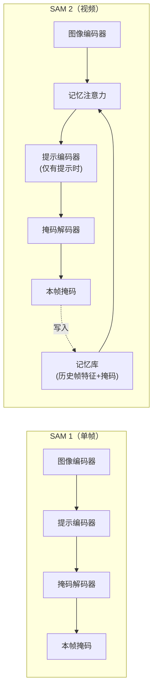
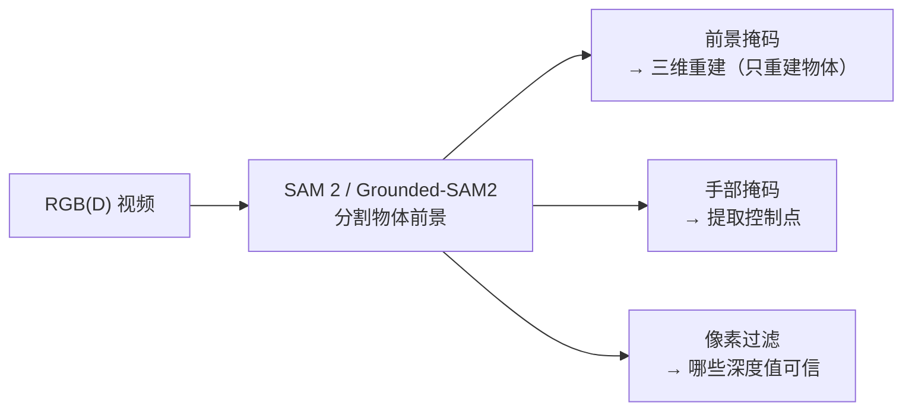

# SAM 2：一个模型分割任意视频中的任意物体

> **一句话**：SAM 2（Segment Anything Model 2）是 Meta 推出的提示驱动分割基础模型——给它一张图或一段视频，加上"分割这个"的提示（点、框、掩码、文字），它就能在视频所有帧中持续追踪并分割出对应物体。

**知识链接**：
- [DINOv2 视觉特征提取器](/前置知识/013b_前置知识_DINOv2视觉特征提取器)（SAM 2 的图像编码器借鉴了类似的自监督视觉 Transformer 架构）
- [PhysTwin 精读](/论文综述/169_PhysTwin_从稀疏视频构建可交互软体数字孪生)（用 Grounded-SAM2 做物体/手部分割的第一步）
- [[019b_前置知识_CoTracker点追踪]]（SAM 2 给出掩码 → CoTracker 在掩码内追踪点，两者常串联使用）

---

## 贯穿全文的例子

> **场景**：桌上有一根橙色绳子，三台相机同时拍了一段视频。你想把每一帧里的绳子从背景中分割出来，得到逐帧的二值掩码——后续的三维重建、物理仿真都需要这个掩码。传统做法是手动标注，但几百帧视频标一遍要花好几个小时。能不能只在第一帧点一下绳子，模型就自动在所有帧里跟着分？

SAM 2 做的就是这件事。你在第一帧给一个点击提示，它输出第一帧的掩码，然后自动把这个掩码"传播"到后续每一帧——即使物体被遮挡、形变、离开画面又回来。

---

## 一、从 SAM 到 SAM 2：为什么需要视频版

### 1.1 SAM 1 能做什么

SAM（Segment Anything Model, 2023）是第一个"分割一切"的基础模型：

- 输入一张图 + 提示（点/框/文字），输出对应的掩码
- 在 1100 万张图、11 亿个掩码上训练
- 零样本泛化到未见过的物体类别

但 SAM 1 的限制是**逐帧独立处理**——它不知道"上一帧的绳子"和"这一帧的绳子"是同一个物体。每帧独立分割会导致掩码在时间上不一致、边界抖动、遮挡后丢失身份。

### 1.2 SAM 2 解决了什么

SAM 2 在 SAM 1 基础上加了一个**记忆机制**，让模型能够"记住"它在之前帧看到的物体：

> **看什么**：SAM 2 的关键新增是中间的"记忆库 → 记忆注意力"回路。每一帧的分割结果被写入记忆库，后续帧在分割时会"查阅"记忆——"之前这个物体长什么样、在什么位置"。这让 SAM 2 能跨帧保持一致的物体身份。

---

## 二、SAM 2 的三个核心模块

### 2.1 图像编码器

输入一帧 RGB 图像，输出特征图（feature map）。SAM 2 使用 **Hiera**（一种层级化视觉 Transformer），比 SAM 1 的 ViT-H 编码器快 6 倍，同时保持相近的特征质量。

Hiera 的特点是用多尺度窗口注意力（multi-scale window attention）替代全局注意力，在早期层用小窗口处理高分辨率特征，后期层逐步合并成大窗口：

| 层级 | 分辨率 | 窗口大小 | 作用 |
|-----|--------|---------|------|
| Stage 1 | 1/4 | 8×8 | 局部纹理和边缘 |
| Stage 2 | 1/8 | 8×8 | 中等尺度结构 |
| Stage 3 | 1/16 | 16×16 | 语义信息 |
| Stage 4 | 1/32 | 全局 | 全局上下文 |

### 2.2 记忆机制

这是 SAM 2 的核心创新。记忆库存储两类信息：

**记忆库的内容**：

| 类型 | 存什么 | 哪些帧 |
|-----|-------|--------|
| **记忆编码** | 图像特征 + 掩码信息的融合编码 | 最近 $N$ 帧（默认 6） + 所有有用户提示的帧 |
| **目标指针** | 当前物体的高层语义特征 | 每帧更新一次 |

**记忆注意力**的工作方式：当前帧的图像特征作为 Query，记忆库中的历史特征作为 Key 和 Value，通过交叉注意力机制让当前帧"看到"历史帧中物体的样子和位置。

$$
\text{Attn}(Q, K, V) = \text{softmax}\left(\frac{QK^\top}{\sqrt{d}}\right)V
$$

**这个公式在做什么**：标准的缩放点积注意力——当前帧的特征（$Q$）与记忆库中历史帧的特征（$K$/$V$）做相似度匹配，让当前帧能"看到"历史帧中物体的样子和位置。

::: details 📐 公式详解（点击展开）

| 符号 | 含义 | 来源 |
|-----|------|------|
| $Q$ | Query，查询矩阵 | 当前帧的图像特征经线性投影 |
| $K$ | Key，键矩阵 | 记忆库中历史帧特征经线性投影 |
| $V$ | Value，值矩阵 | 记忆库中历史帧特征经线性投影 |
| $d$ | 特征维度 | 用于缩放，防止点积值过大导致 softmax 梯度消失 |
| $\text{softmax}$ | 归一化 | 把相似度转为概率权重 |

**用人话读**："当前帧对记忆库里的每一帧说'你跟我像不像'，像的给高权重、不像的给低权重，然后按权重把记忆库的信息加权汇总。"
:::

**为什么只存最近 $N$ 帧**：存所有帧会让注意力计算量线性增长。SAM 2 用一个固定大小的 FIFO 队列保持计算量恒定，同时永久保留有用户提示的帧（"锚点帧"）——这些帧的分割最可靠，是记忆的基石。

### 2.3 掩码解码器

和 SAM 1 类似，掩码解码器是一个轻量级 Transformer，输入融合后的特征（图像特征 + 记忆注意力输出 + 提示编码），输出：

- **掩码**：每个像素属于目标物体的概率
- **置信度分数**：模型对自己输出的信心
- **遮挡预测**：物体在当前帧是否被遮挡

遮挡预测是 SAM 2 新增的——当模型判断物体被遮挡时，它不输出掩码（避免错误分割），但仍然维护记忆，等物体重新出现时继续跟踪。

---

## 三、提示方式

SAM 2 支持多种提示方式，灵活度很高：

| 提示类型 | 说明 | 何时用 |
|---------|------|--------|
| **正点击** | 点击物体上的一个像素，意思是"分割包含这个点的物体" | 最常用，最省力 |
| **负点击** | 点击背景上的一个像素，意思是"不要分割这个区域" | 当正点击结果包含了不想要的部分时 |
| **边界框** | 画一个矩形框住目标物体 | 多个物体紧邻时，框更精确 |
| **掩码** | 直接提供一个粗糙的掩码作为起点 | 有其他模型（如 Grounding DINO）的初步输出时 |
| **文字**（通过 Grounded-SAM2） | 用自然语言描述目标（如 "rope"） | 不知道物体具体位置，只知道类别 |

**Grounded-SAM2 的工作方式**：PhysTwin 用的是 Grounded-SAM2，它把 Grounding DINO（一个开放词汇目标检测器——输入文字描述，输出物体的边界框）和 SAM 2 串起来：

> **看什么**：Grounding DINO 负责"找到它在哪"，SAM 2 负责"精确分割它的轮廓并在视频中持续跟踪"。两个模型各做擅长的事，串联后实现了"说一个名字就能分割整段视频"。

---

## 四、训练数据：SA-V 数据集

SAM 2 在 **SA-V**（Segment Anything Video）数据集上训练，这是当时最大的视频分割数据集：

| 对比 | SA-V | 之前最大 (YouTube-VOS) |
|-----|------|----------------------|
| 视频数 | 50,900 | 4,453 |
| 掩码数 | 642,000 | 197,000 |
| 标注方式 | 人机协作（标注员 + SAM 2 交替迭代） | 纯人工 |

**人机协作标注**的思路：先用 SAM 2 的早期版本自动分割 → 标注员修正错误 → 修正后的数据反馈训练更好的 SAM 2 → 新版本再自动分割 → 标注员修正更少的错误 → 循环。这个"数据飞轮"让标注成本降低了 8.4 倍。

---

## 五、性能与速度

### 5.1 视频分割基准

在多个视频物体分割基准上，SAM 2 的零样本表现超过或接近之前的全监督方法：

| 基准 | 之前最佳 | SAM 2（零样本） |
|-----|---------|----------------|
| DAVIS 2017 (J&F) | 86.5（监督训练） | **82.5**（零样本） |
| SA-V test (J&F) | — | **75.9** |
| MOSE (J) | 62.5（监督） | **63.8** |

### 5.2 推理速度

| 模型 | 编码器 | 帧率 (fps) |
|-----|--------|-----------|
| SAM 2-T | Hiera-T | ~44 fps |
| SAM 2-B+ | Hiera-B+ | ~35 fps |
| SAM 2-L | Hiera-L | ~24 fps |

这个速度支持实时交互——用户可以在视频播放过程中随时添加修正提示。

---

## 六、在 Real2Sim 管线中的角色

在 PhysTwin、OVOW、Splatting Physical Scenes 等 Real2Sim 论文中，SAM 2（或 Grounded-SAM2）扮演的角色是管线的**第一步**：

> **看什么**：分割结果直接影响后续所有步骤。如果把手也算进了物体，后续的 3D 高斯重建就会重建出手的形状；如果漏掉了绳子的末端，后续的物理仿真就会在一个不完整的物体上做参数辨识。所以 SAM 2 的分割质量是整条管线的上界。

---

## 七、适用边界

| 场景 | SAM 2 表现 |
|-----|-----------|
| ✅ 刚性/可形变物体跟踪分割 | 强 |
| ✅ 遮挡后重新出现 | 能处理（遮挡预测 + 记忆保持） |
| ✅ 多物体同时分割 | 支持（对每个物体维护独立记忆） |
| ⚠️ 极端运动模糊 | 可能丢失 |
| ⚠️ 外观剧烈变化（如液体分裂） | 可能混淆身份 |
| ❌ 透明/半透明物体 | 边缘不清晰时容易漏 |
| ❌ 像素级精度（<2px 误差） | 基础模型的分割粒度不够 |

---

## 延伸阅读

- Ravi et al. (2024). *SAM 2: Segment Anything in Images and Videos*. arXiv:2408.00714 — SAM 2 原论文
- Kirillov et al. (2023). *Segment Anything*. arXiv:2304.02643 — SAM 1 原论文
- Liu et al. (2023). *Grounding DINO: Marrying DINO with Grounded Pre-Training for Open-Set Object Detection*. arXiv:2303.05499 — Grounded-SAM2 中的检测器
- [PhysTwin 精读](/论文综述/169_PhysTwin_从稀疏视频构建可交互软体数字孪生) — SAM 2 在数字孪生管线中的实际使用
- [DINOv2 视觉特征提取器](/前置知识/013b_前置知识_DINOv2视觉特征提取器) — 相关的自监督视觉基础模型