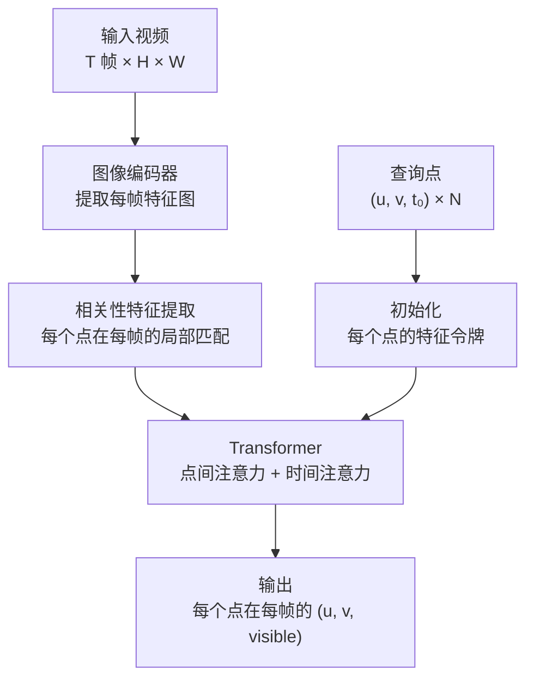
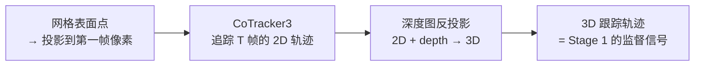

# CoTracker：在视频中追踪任意一组点的去向

> **一句话**：CoTracker 是一个基于 Transformer 的点追踪基础模型——给它一段视频和若干查询点（"你帮我盯着这几个位置"），它输出这些点在每一帧的像素坐标和可见性标记。

**知识链接**：
- [SAM 2 视频分割基础模型](/前置知识/019a_前置知识_SAM2视频分割基础模型)（SAM 2 给出掩码 → CoTracker 在掩码内追踪点，两者常串联使用）
- [SfM 与点云初始化](/前置知识/005_前置知识_SfM与点云初始化)（SfM 也做特征点匹配，但是帧间稀疏匹配；CoTracker 做的是稠密长程追踪）
- [PhysTwin 精读](/论文综述/169_PhysTwin_从稀疏视频构建可交互软体数字孪生)（用 CoTracker3 追踪物体表面和手部关键点，作为物理优化的监督信号）

---

## 贯穿全文的例子

> **场景**：一根绳子被手从桌上提起。你在第一帧选了绳子上的 50 个点（均匀撒在绳子表面），想知道这些点在后续 100 帧里分别去了哪里——它们的 2D 像素轨迹。
>
> 这些轨迹有两个用途：配合深度图反投影成 3D 点后，它们是物理仿真器的监督信号（"真实世界里这个点去了那个位置"）；也是评估仿真质量的度量（"仿真器预测的位置和真实轨迹差多远"）。

---

## 一、光流 vs 点追踪：为什么不直接用光流

### 1.1 光流

光流（optical flow）估计的是相邻两帧之间每个像素的位移。经典方法如 RAFT 输出一个稠密的位移场：

$$
\text{Flow}(t \to t+1): \mathbb{R}^{H \times W} \to \mathbb{R}^{H \times W \times 2}
$$

**这个公式在做什么**：光流模型的输入输出定义——输入一帧图像（$H \times W$），输出每个像素到下一帧的二维位移向量。

::: details 📐 公式详解（点击展开）

| 符号 | 含义 |
|-----|------|
| $H \times W$ | 图像的高和宽 |
| $\to \mathbb{R}^{H \times W \times 2}$ | 每个像素输出 $(dx, dy)$ 两个分量 |

**数值例子**：对于 $480 \times 640$ 的视频，光流输出 $480 \times 640 \times 2$ 的张量。如果位置 $(100, 200)$ 的输出是 $(3.5, -1.2)$，表示该像素在下一帧移动到了 $(103.5, 198.8)$。
:::

光流的问题是**帧间**的——它只告诉你"这一帧的这个像素，下一帧去了哪里"，不告诉你"这个物体表面的这个物理点，100 帧之后在哪里"。

如果你把帧间光流串联起来追踪一个点的长程轨迹，误差会逐帧累积——每帧光流有 1 像素误差，100 帧后偏移可达 10+ 像素。遮挡时光流直接失效，串联追踪就此中断。

### 1.2 点追踪

点追踪（point tracking / TAP）直接估计一个查询点从第 $t_0$ 帧到第 $t$ 帧的**长程对应**：

$$
\text{Track}(t_0 \to t): (u_{t_0}, v_{t_0}) \mapsto (u_t, v_t, \text{visible}_t)
$$

**这个公式在做什么**：点追踪的输入输出定义——给定查询点在第 $t_0$ 帧的像素坐标 $(u, v)$，输出该点在第 $t$ 帧的位置和可见性。

::: details 📐 公式详解（点击展开）

| 符号 | 含义 |
|-----|------|
| $(u_{t_0}, v_{t_0})$ | 查询点在起始帧的像素坐标 |
| $(u_t, v_t)$ | 查询点在第 $t$ 帧的预测像素坐标 |
| $\text{visible}_t$ | 布尔值或概率，标记该点在第 $t$ 帧是否可见 |

**与光流的关键区别**：光流是"相邻帧的稠密位移"，点追踪是"任意帧之间的稀疏对应"。点追踪直接建模长程轨迹，不依赖帧间串联。
:::

它的输出不仅是位置，还有可见性（visibility）——告诉你"这个点在第 $t$ 帧能不能被看到"。如果被遮挡了，它标记为不可见，但记住这个点的身份，等它重新出现时继续追踪。

| 对比 | 光流 | 点追踪 |
|-----|------|--------|
| 估计范围 | 相邻两帧 | 任意帧到任意帧 |
| 输出 | 稠密位移场（所有像素） | 指定查询点的轨迹 |
| 遮挡处理 | 无（遮挡处光流不可信） | 输出可见性标记 |
| 误差累积 | 串联多帧时严重 | 直接估计长程对应，无累积 |
| 点间一致性 | 每个像素独立估计 | 多个点联合推理 |

---

## 二、CoTracker 的核心设计

CoTracker 系列（v1 → v2 → v3）有几个版本，核心思想是用 Transformer 让多个追踪点**互相参照**。

### 2.1 为什么多个点要联合追踪

想象追踪绳子上的 50 个点。如果每个点独立追踪，当绳子某段被手遮挡时，被遮挡的点会丢失。但如果这 50 个点一起推理，模型可以利用可见点的运动推断被遮挡点的位置——"绳子的左边往上走了、右边没动，中间被遮挡的部分大概率也在往上"。

这就是 CoTracker 的核心想法：**点之间的运动是有相关性的，联合推理比独立推理更鲁棒**。

### 2.2 架构概览

> **看什么**：关键是中间的 Transformer 层——它同时做两件事：**时间注意力**让每个点看到自己在不同帧的特征变化（"这个点长什么样？之前在哪？"），**点间注意力**让不同点互相参照（"旁边的点往哪动了？"）。

### 2.3 相关性特征

对于每个查询点在每一帧，CoTracker 在该帧的特征图上提取一个局部窗口（如 8×8），计算查询点的特征与窗口内每个位置的**相关性**（内积）。这个相关性特征告诉模型"这个点最像的地方在哪"。

$$
\text{corr}_{n,t}(i,j) = \frac{\mathbf{f}_n^\top \mathbf{g}_t(i,j)}{\sqrt{d}}
$$

**这个公式在做什么**：计算第 $n$ 个查询点与第 $t$ 帧局部窗口中位置 $(i,j)$ 的特征相似度——内积越大说明越像，用 $\sqrt{d}$ 缩放避免维度过大时数值爆炸。

::: details 📐 公式详解（点击展开）

| 符号 | 含义 | 说明 |
|-----|------|------|
| $\mathbf{f}_n$ | 第 $n$ 个查询点的特征向量 | 在初始帧提取，维度 $d$ |
| $\mathbf{g}_t(i,j)$ | 第 $t$ 帧位置 $(i,j)$ 的特征向量 | 从图像编码器输出的特征图裁取 |
| $\sqrt{d}$ | 缩放因子 | 与 Transformer 的缩放点积注意力相同 |

**用人话读**："把这个查询点的'长相'跟候选位置的'长相'做内积——像的得分高，不像的得分低。在局部窗口内找到得分最高的位置，就是这个点在这一帧的预测位置。"
:::

### 2.4 迭代精修

CoTracker 不是一次性输出最终结果，而是**迭代精修**：

1. 初始估计：每个点的位置初始化为查询位置（假设物体不动）
2. 第 1 轮：Transformer 根据相关性特征和初始位置输出位置更新量
3. 第 2 轮：用更新后的位置重新提取相关性特征，再过一次 Transformer
4. 重复 4–6 轮

每轮精修都在缩小搜索范围——第一轮可能把搜索窗口从 32×32 缩到 16×16，最后一轮在 4×4 的窗口里微调亚像素位置。

---

## 三、CoTracker3 的改进

CoTracker3（2024）是最新版本，主要改进：

| 改进 | CoTracker 1/2 | CoTracker3 |
|-----|--------------|------------|
| 训练数据 | 合成数据（Kubric） | 合成 + 大规模真实视频伪标注 |
| 伪标注方法 | — | 用教师模型在真实视频上生成轨迹标注 |
| 推理模式 | 在线（逐帧或滑窗）| 在线 + 离线（全视频一次性） |
| 精度 | TAP-Vid 基准上 AJ=61.2 | AJ=65.1 |

**在线 vs 离线模式**：

- **在线模式**：视频流式输入，每来一帧就更新追踪结果。适合实时应用（如机器人遥操作）
- **离线模式**：把整段视频一次性输入，利用双向时间信息（未来帧也能帮助当前帧的追踪）。精度更高，适合离线处理（如 PhysTwin 的数据预处理）

---

## 四、点追踪的评估指标

| 指标 | 全称 | 说明 |
|-----|------|------|
| **AJ** | Average Jaccard | 综合衡量位置精度和可见性预测；计算方式是"在不同位置阈值下，正确追踪的点占比"的平均 |
| **δ_avg** | Position Accuracy | 位置误差在阈值内的点的比例（阈值通常取 1/2/4/8/16 像素，取平均） |
| **OA** | Occlusion Accuracy | 可见性预测的准确率（"模型说可见时是否真的可见"） |

---

## 五、在 PhysTwin 中的角色

PhysTwin 用 CoTracker3 做两件事：

### 5.1 追踪物体表面点

在配准完成的网格表面上采样若干点，投影到第一帧的像素坐标作为查询点，用 CoTracker3 追踪它们在所有帧的 2D 轨迹。再结合对应帧的深度图反投影成 3D：

### 5.2 追踪手部控制点

分割出的手部掩码内采样关键点 → CoTracker3 追踪 → 深度反投影 → 最远点采样（FPS）→ 控制点 3D 轨迹。

这些控制点轨迹驱动仿真中的控制弹簧——"手在这个时刻在那个位置"直接翻译成"控制弹簧的端点在那个位置"。

### 5.3 一个反直觉的发现

PhysTwin 论文报告了一个有趣的结果：**物理优化后的轨迹比 CoTracker3 原始输出更准、更平滑**。

原因：CoTracker3 的逐帧输出有高频抖动和偶发跳变（模型的不确定性），但物理仿真器受守恒律约束，不会突然跳变。物理约束相当于对轨迹做了时序正则化——强迫轨迹满足连续的运动方程，自然抹平了跟踪器的噪声。

---

## 六、适用边界

| 场景 | CoTracker3 表现 |
|-----|----------------|
| ✅ 刚性物体运动 | 强 |
| ✅ 可形变物体（绳子、布料） | 强（联合追踪利用变形的相关性） |
| ✅ 快速运动 | 迭代精修机制容忍较大位移 |
| ✅ 部分遮挡 | 可见性预测 + 点间信息互补 |
| ⚠️ 长时间完全遮挡（>30 帧） | 可能丢失身份 |
| ⚠️ 无纹理区域 | 相关性特征无法区分不同位置 |
| ❌ 透明/反光物体 | 特征不稳定 |
| ❌ 拓扑变化（分裂、合并） | 无法处理 |

---

## 七、与其他追踪方法对比

| 方法 | 类型 | 优势 | 劣势 |
|-----|------|------|------|
| **RAFT** | 光流 | 稠密、快速 | 帧间，累积误差 |
| **PIPs** | 单点追踪 | 简单 | 点间无信息交互 |
| **TAPIR** | 单点追踪 | TAP-Vid 基准强 | 逐点独立 |
| **CoTracker3** | 多点联合追踪 | 点间信息共享、鲁棒 | 需要指定查询点 |
| **BootsTAP** | 自监督追踪 | 不需要标注 | 精度略低 |

---

## 延伸阅读

- Karaev et al. (2024). *CoTracker3: Simpler and Better Point Tracking by Pseudo-Labelling Real Videos*. arXiv:2410.11831 — CoTracker3 原论文
- Karaev et al. (2023). *CoTracker: It is Better to Track Together*. arXiv:2307.07635 — CoTracker 初版
- Doersch et al. (2022). *TAP-Vid: A Benchmark for Tracking Any Point in a Video*. arXiv:2211.03726 — 点追踪评估基准
- [PhysTwin 精读](/论文综述/169_PhysTwin_从稀疏视频构建可交互软体数字孪生) — CoTracker3 在物理仿真管线中的具体用法
- [SAM 2 视频分割基础模型](/前置知识/019a_前置知识_SAM2视频分割基础模型) — 与 CoTracker 常串联使用的上游模型
- [SfM 与点云初始化](/前置知识/005_前置知识_SfM与点云初始化) — 另一种从图像获取 3D 对应的方法
