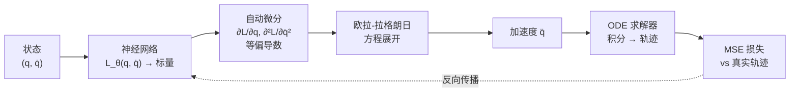

# 拉格朗日神经网络（LNN）：让神经网络自动遵守物理守恒律

> **一句话**：普通神经网络学动力学时会违反能量守恒，导致长期预测发散或阻尼到静止。拉格朗日神经网络（Lagrangian Neural Network, LNN）不直接学加速度，而是学一个标量函数——拉格朗日量 $\mathcal{L}(q,\dot{q})$——再通过欧拉-拉格朗日方程自动导出加速度，从而在结构上保证系统服从拉格朗日力学，长期预测不违反物理。

**知识链接**：
- [拉格朗日力学与欧拉-拉格朗日方程](/前置知识/008c_前置知识_拉格朗日力学与欧拉拉格朗日方程) — 本文的全部数学基础：广义坐标、动能势能、欧拉-拉格朗日方程的推导
- [常微分方程 ODE 直觉与数值求解](/前置知识/001b_前置知识_常微分方程ODE直觉与数值求解) — LNN 求出加速度后，用 ODE 求解器推进轨迹
- [物理仿真数值积分：辛积分与能量稳定性](/前置知识/006c_前置知识_物理仿真数值积分_辛积分与能量稳定性) — 辛积分器是另一条保能量路线，和 LNN 的结构性保证互补

---

## 贯穿全文的例子

一个无摩擦的单摆：质量 $m=1\,\text{kg}$ 的球挂在长度 $l=1\,\text{m}$ 的无质量杆上。广义坐标就是摆角 $q=\theta$，广义速度是角速度 $\dot{q}=\dot\theta$。系统只有重力、没有摩擦、没有外力驱动。

用牛顿法或拉格朗日方程都可以得到精确的运动方程 $\ddot\theta = -(g/l)\sin\theta$。现在假设我们**不知道这个方程**，只有一段轨迹数据（若干帧的 $\theta(t), \dot\theta(t)$），想用神经网络把这个动力学学出来。

---

## 一、问题：直接学加速度为什么会出错

最朴素的做法是训一个网络 $f_\theta(q,\dot{q}) \approx \ddot{q}$，输入状态，直接输出加速度，然后用 [ODE 求解器](/前置知识/001b_前置知识_常微分方程ODE直觉与数值求解)往前积分。这叫"黑箱 Neural ODE"。

这种网络没有任何物理结构约束。它对训练数据时间范围内的拟合可以很好，但一旦往外推（rollout 更多步），问题就出来了：

- **能量漂移**：网络在每一步产生的微小加速度误差会累积。真实单摆在同一高度来回摆，总能量恒定；网络可能让总能量慢慢升高（摆越来越高直到翻跟头）或慢慢降低（摆越来越小直到停下）。
- **对称性破坏**：真实单摆的运动是时间可逆的（倒放录像看不出区别），但网络学到的加速度函数没有这个性质。

根本原因：网络的函数空间太大了。$f_\theta$ 可以拟合的函数里，只有极少数满足能量守恒。让网络自己从有限数据中学到守恒这件事，等于要求它在一个极高维空间里恰好落到一个零测集上——这是不现实的。

**正确的思路**：不要让网络学"加速度是多少"，而是让网络学一个受限的中间量，使得从这个中间量导出的加速度**自动满足守恒律**。这个中间量就是拉格朗日量。

---

## 二、核心思路：学拉格朗日量，导出加速度

### 2.1 回顾欧拉-拉格朗日方程

[拉格朗日力学](/前置知识/008c_前置知识_拉格朗日力学与欧拉拉格朗日方程)告诉我们：如果知道系统的拉格朗日量 $\mathcal{L}(q,\dot{q}) = T - V$（动能减势能），运动方程由欧拉-拉格朗日方程给出：

$$
\frac{d}{dt}\frac{\partial \mathcal{L}}{\partial \dot{q}} - \frac{\partial \mathcal{L}}{\partial q} = 0
$$

**这个公式在做什么**：从一个标量能量函数推导出系统的运动方程——不需要画受力图、不需要逐个分析力，只要知道动能和势能怎么依赖坐标和速度，运动规律就自动确定了。

::: details 📐 公式详解（点击展开）

| 子表达式 | 它是谁 | 它在干嘛 |
|---------|--------|---------|
| $\mathcal{L}(q,\dot{q})$ | 拉格朗日量（标量函数） | 编码了系统的全部力学信息：动能怎么依赖速度、势能怎么依赖位置 |
| $\frac{\partial \mathcal{L}}{\partial \dot{q}}$ | 广义动量 | 拉格朗日量对速度的偏导，是"系统运动惯性"的度量 |
| $\frac{d}{dt}\frac{\partial \mathcal{L}}{\partial \dot{q}}$ | 广义动量的时间变化率 | 动量怎么随时间演化 |
| $\frac{\partial \mathcal{L}}{\partial q}$ | 广义力 | 拉格朗日量对位置的偏导，描述系统因位置变化产生的"驱动" |

**用人话读**："动量随时间的变化率等于广义力"——这就是拉格朗日版的牛顿第二定律 $F=ma$，只不过坐标可以是任意的广义坐标。

**为什么用能量而不是直接用力**：力是矢量、和坐标系选择有关；拉格朗日量是标量，换坐标系形式不变。对复杂系统（多关节机器人、耦合振子），标量方法省去了大量的力分析。
:::

把欧拉-拉格朗日方程展开，可以显式解出加速度 $\ddot{q}$：

$$
\ddot{q} = \left(\frac{\partial^2 \mathcal{L}}{\partial \dot{q}^2}\right)^{-1}\left(\frac{\partial \mathcal{L}}{\partial q} - \frac{\partial^2 \mathcal{L}}{\partial \dot{q}\,\partial q}\,\dot{q}\right)
$$

**这个公式在做什么**：把欧拉-拉格朗日方程改写成"加速度 = ..."的形式，使它可以直接喂给 ODE 求解器做时间积分。

::: details 📐 公式详解（点击展开）

| 子表达式 | 它是谁 | 它在干嘛 |
|---------|--------|---------|
| $\frac{\partial^2 \mathcal{L}}{\partial \dot{q}^2}$ | 广义质量矩阵（Hessian） | 拉格朗日量对速度的二阶偏导，相当于"有效惯性"。对标准动力系统它是正定的 |
| $\left(\cdot\right)^{-1}$ | 矩阵求逆 | 从"力"除以"质量"得到"加速度"，和 $a = F/m$ 同构 |
| $\frac{\partial \mathcal{L}}{\partial q}$ | 位置相关的力 | 势能梯度（加上坐标相关的动能项） |
| $\frac{\partial^2 \mathcal{L}}{\partial \dot{q}\,\partial q}\,\dot{q}$ | 科氏/离心类修正 | 动能对位置的变化率引起的"虚拟力"（在旋转坐标系中变成离心力和科氏力） |

**用人话读**："加速度等于'力'除以'质量'，但这里的'力'和'质量'都是从拉格朗日量的偏导自动算出来的。"

**为什么需要二阶导**：欧拉-拉格朗日方程本身包含 $\frac{d}{dt}\frac{\partial \mathcal{L}}{\partial \dot{q}}$，对时间求导后自然出现 $\mathcal{L}$ 对 $\dot{q}$ 的二阶导。
:::

### 2.2 LNN 的核心设计

LNN（Cranmer et al., 2020，"Lagrangian Neural Networks"）的设计非常直接：

1. **用一个神经网络 $\mathcal{L}_\theta(q,\dot{q})$ 参数化拉格朗日量**：输入是广义坐标和广义速度，输出是一个标量。
2. **用自动微分（autograd）计算欧拉-拉格朗日方程需要的偏导数**：$\partial \mathcal{L}/\partial q$、$\partial \mathcal{L}/\partial \dot{q}$、$\partial^2 \mathcal{L}/\partial \dot{q}^2$、$\partial^2 \mathcal{L}/\partial \dot{q}\,\partial q$ 全部由 PyTorch/JAX 的自动微分直接算出。
3. **代入展开的欧拉-拉格朗日方程得到 $\ddot{q}$**。
4. **用 ODE 求解器沿时间积分，得到轨迹预测**。
5. **训练损失是预测轨迹和真实轨迹的均方误差**。

> **看什么**：网络的输出不是加速度，是一个标量。加速度是从这个标量经过自动微分和欧拉-拉格朗日方程"推导出来"的。这个中间层就是结构先验——它强制网络输出的加速度必须来自某个合法的拉格朗日量，而合法的拉格朗日量天然满足能量守恒。

### 2.3 为什么结构先验保证了守恒

关键在一个经典定理：**诺特定理（Noether's Theorem）**。如果拉格朗日量不显式依赖时间（$\partial \mathcal{L}/\partial t = 0$），那么系统有一个守恒量——能量函数（哈密顿量）：

$$
H = \dot{q}\frac{\partial \mathcal{L}}{\partial \dot{q}} - \mathcal{L}
$$

**这个公式在做什么**：从拉格朗日量构造一个守恒量——能量。只要拉格朗日量不显式依赖时间，$H$ 就在运动过程中保持不变。

::: details 📐 公式详解（点击展开）

| 子表达式 | 它是谁 | 它在干嘛 |
|---------|--------|---------|
| $\dot{q}\frac{\partial \mathcal{L}}{\partial \dot{q}}$ | 速度 × 广义动量 | 对标准动能 $T = \frac{1}{2}m\dot{q}^2$，这一项等于 $2T$——动能的两倍 |
| $\mathcal{L}$ | 拉格朗日量 $T-V$ | 动能减势能 |
| $H = 2T - (T-V) = T+V$ | 总能量 | 在标准情况下就是动能加势能 |

**用人话读**："把动能的两倍减去拉格朗日量，得到的就是总能量，这个量在运动过程中永远不变。"

**为什么 LNN 自动满足**：LNN 的网络 $\mathcal{L}_\theta(q,\dot{q})$ 不接受 $t$ 作为输入，所以 $\partial \mathcal{L}_\theta/\partial t = 0$ 在结构上成立，$H$ 的守恒是数学定理的直接推论，不需要额外训练。
:::

在经典力学中 $H$ 就是总能量 $T+V$。LNN 的拉格朗日量网络不以 $t$ 为输入，所以 $\partial \mathcal{L}_\theta/\partial t = 0$ 自动成立，$H$ 自动守恒——**不需要额外的损失项或正则化**。

这就是 LNN 和黑箱 Neural ODE 的根本差异：黑箱方法要从数据中学到守恒，LNN 从结构上保证守恒。

---

## 三、单摆的例子：LNN vs 黑箱

回到我们的单摆。真实的拉格朗日量是 $\mathcal{L} = \frac{1}{2}ml^2\dot\theta^2 - mgl(1-\cos\theta)$。

**黑箱 Neural ODE**：训练网络直接拟合 $\ddot\theta \approx f_\theta(\theta,\dot\theta)$。在训练数据范围内（比如前 5 秒），预测不错；但 rollout 到 50 秒后，总能量开始漂移——摆幅逐渐增大或逐渐减小，因为每一步的微小误差在积分中累积。

**LNN**：训练网络拟合 $\mathcal{L}_\theta(\theta,\dot\theta)$。网络学到的可能不是精确的 $\frac{1}{2}ml^2\dot\theta^2 - mgl(1-\cos\theta)$，而是某个等价函数（拉格朗日量可以加任意常数、加任意 $q$ 的全时间导数而不改变运动方程）。但因为运动方程来自欧拉-拉格朗日结构，总能量在 rollout 过程中保持恒定——50 秒、500 秒、5000 秒后摆幅都不变。

| 方法 | 训练范围精度 | 长期 rollout | 能量守恒 |
|------|------------|-------------|---------|
| 黑箱 Neural ODE | 好 | 发散 | 不保证 |
| LNN | 好 | 稳定 | 结构性保证 |

---

## 四、多自由度系统与耗散扩展

### 4.1 向量化：多个广义坐标

单摆只有一个自由度 $q \in \mathbb{R}$。对于多自由度系统（比如双摆 $q \in \mathbb{R}^2$，或软体机器人 $q \in \mathbb{R}^d$），公式完全一样，只是标量变成向量/矩阵：

- $\frac{\partial^2 \mathcal{L}}{\partial \dot{q}^2}$ 变成 $d \times d$ 的 Hessian 矩阵
- 矩阵求逆变成线性方程组求解
- ODE 的状态维度从 2 变成 $2d$

自动微分对向量输入同样适用，只是计算代价更高——Hessian 的计算量是 $O(d^2)$ 次前向/反向传播。对于低维系统（$d \leq 10$）这不是问题；对于高维系统，Hessian-vector product 技术可以避免显式构造整个 Hessian。

### 4.2 耗散扩展：Rayleigh 耗散函数

真实系统几乎都有摩擦和阻尼。标准拉格朗日力学描述的是保守系统，不含耗散。如果直接用标准 LNN 学一个有摩擦的系统，网络会被迫用保守力去拟合耗散行为——拟合不上。

解决方法是引入 Rayleigh 耗散函数 $\mathcal{D}(\dot{q})$（一个关于速度的非负标量函数），修改运动方程为：

$$
\frac{d}{dt}\frac{\partial \mathcal{L}}{\partial \dot{q}} - \frac{\partial \mathcal{L}}{\partial q} = -\frac{\partial \mathcal{D}}{\partial \dot{q}}
$$

**这个公式在做什么**：在标准欧拉-拉格朗日方程的右侧加上一个"刹车力"。耗散函数 $\mathcal{D}$ 对速度的梯度恰好给出一个与速度方向相反的力，把系统的能量慢慢耗散掉。

::: details 📐 公式详解（点击展开）

| 子表达式 | 它是谁 | 它在干嘛 |
|---------|--------|---------|
| $\mathcal{D}(\dot{q})$ | Rayleigh 耗散函数（标量，非负） | 编码系统耗散能量的速率，$\mathcal{D} \geq 0$ 保证能量只减不增 |
| $-\frac{\partial \mathcal{D}}{\partial \dot{q}}$ | 耗散力 | 对速度的梯度取负号，力的方向与速度相反——越快耗散越大，相当于"粘滞阻力" |
| 等号左侧 | 标准欧拉-拉格朗日项 | 保守部分不变，和之前完全一样 |

**用人话读**："保守力学照常推导，额外加一个和速度方向相反的刹车力，刹车力的大小由另一个网络决定。"

**为什么用单独的函数而不是直接在加速度里加阻尼项**：分开建模保证了保守部分依然精确守恒，耗散部分独立可控。系统的总能量损失率恰好等于 $2\mathcal{D}$（Rayleigh 耗散定理），物理上可解释。
:::

在实际实现中，用两个神经网络：一个学 $\mathcal{L}_\theta(q,\dot{q})$，一个学 $\mathcal{D}_\phi(\dot{q})$。两者联合训练，保守力和耗散力各司其职。

---

## 五、LNN vs HNN：两条物理先验路线

在 LNN 之前，Greydanus et al.（2019）提出了哈密顿神经网络（Hamiltonian Neural Network, HNN），思路相似但用的是哈密顿力学而非拉格朗日力学：

| 维度 | LNN | HNN |
|------|-----|-----|
| 学什么 | 拉格朗日量 $\mathcal{L}(q,\dot{q})$ | 哈密顿量 $H(q,p)$ |
| 输入坐标 | 广义坐标 + 广义速度 $(q,\dot{q})$ | 广义坐标 + 广义动量 $(q,p)$ |
| 导出方程 | 欧拉-拉格朗日方程（二阶 ODE） | 哈密顿正则方程（一阶 ODE） |
| 需要的导数阶数 | 二阶偏导（Hessian） | 一阶偏导（梯度） |
| 坐标选择 | 任意广义坐标 | 必须是正则坐标 $(q,p)$ |
| 约束处理 | 容易（拉格朗日乘子） | 困难（需要先消除约束） |

关键区别：**HNN 要求输入是正则坐标 $(q,p)$**，其中 $p$ 是广义动量，不是速度。对简单系统 $p = m\dot{q}$，两者可以互换；但对复杂系统（如带约束的机器人），广义动量和速度的关系不是简单的线性映射，从观测数据中直接获取 $p$ 很困难。**LNN 用 $(q,\dot{q})$ 作为输入，速度比动量更容易从传感器直接测量或从位置差分估计**，因此在实际应用中更方便。

计算代价上 HNN 更低（只需一阶偏导），但 LNN 的坐标选择灵活性在机器人和物理仿真场景中更有优势。

---

## 六、应用场景

### 6.1 物理系统建模与长期预测

LNN 最直接的用途是学习一个可以长期 rollout 的动力学模型。机器人学中，如果系统的精确动力学方程未知（比如一个软体机器人，材料参数不确定），可以从示教轨迹学习 LNN，然后用学到的模型做基于模型的控制（Model Predictive Control）。守恒律的结构性保证使得 MPC 中的多步预测不会发散。

### 6.2 渲染与仿真耦合

在计算机视觉中，LNN 可以和可微渲染器结合：从视频观测中学习拉格朗日量，然后用学到的动力学做物理预测。后续文章 [LaGSplat](/论文综述/173_LaGSplat_潜在拉格朗日高斯溅射交互仿真) 就是这条路线的代表——用 LNN 在潜在空间中学习场景动力学，再通过高斯溅射渲染器把物理状态映射成图像。

### 6.3 力的传递

当 LNN 和可微渲染器耦合后，可以通过雅可比矩阵把外力从渲染空间"拉回"到广义坐标空间。如果知道某个三维点 $\mu_i$ 受到外力 $f$，而 $\mu_i$ 是广义坐标 $q$ 的函数（通过解码器 $\mu_i = g(q)$），则广义力为：

$$
\tau = J_i^T f, \quad J_i = \frac{\partial \mu_i}{\partial q}
$$

**这个公式在做什么**：把作用在三维空间中某个点上的力"翻译"成广义坐标空间中的等效力——这就是虚功原理的计算形式。

::: details 📐 公式详解（点击展开）

| 子表达式 | 它是谁 | 它在干嘛 |
|---------|--------|---------|
| $f$ | 外力（三维矢量） | 在渲染空间/物理空间中施加的力 |
| $J_i = \frac{\partial \mu_i}{\partial q}$ | 解码器雅可比 | 描述广义坐标的微小变化如何影响三维点的位置 |
| $J_i^T f$ | 广义力（虚功原理） | 把三维力投影到广义坐标空间，得到在每个自由度上的等效力矩/力 |
| $\tau$ | 广义力向量 | 可以直接代入带外力的欧拉-拉格朗日方程的右侧 |

**用人话读**："用户在屏幕上推了一个点，雅可比矩阵告诉我们这个推力在每个广义坐标方向上产生了多大的等效力矩，然后拉格朗日方程用这些力矩推进运动。"

**为什么是转置不是逆**：雅可比转置把力从输出空间映射到输入空间（虚功原理），雅可比逆把速度从输出空间映射到输入空间（逆运动学）。这里要传递的是力，所以用转置。
:::

---

## 七、局限与注意事项

1. **Hessian 计算开销**：对 $d$ 维广义坐标，需要 $d \times d$ 的 Hessian，计算量随维度二次增长。这限制了 LNN 在高维系统上的直接应用——一般适用于 $d \leq 10$ 的系统。
2. **Hessian 正定性**：物理上，广义质量矩阵 $\frac{\partial^2 \mathcal{L}}{\partial \dot{q}^2}$ 必须正定（否则加速度无定义）。普通 MLP 不保证输出的 Hessian 正定，需要特殊的网络架构（如 input-convex neural network，ICNN）或后处理（如 $H \to H + \epsilon I$）。
3. **不适合非完整约束**：轮式机器人的"不能侧滑"是速度层面的约束，拉格朗日力学处理它需要拉格朗日乘子，LNN 目前没有标准的处理方式。
4. **训练数据需求**：LNN 需要 $(q, \dot{q})$ 的配对数据。如果只有位置序列，需要先用有限差分或其他方法估计速度，估计误差会传播到训练中。

---

## 延伸阅读

- [拉格朗日力学与欧拉-拉格朗日方程](/前置知识/008c_前置知识_拉格朗日力学与欧拉拉格朗日方程) — 完整的数学基础
- [物理仿真数值积分](/前置知识/006c_前置知识_物理仿真数值积分_辛积分与能量稳定性) — 辛积分器也保能量，但从数值方法角度而非网络结构
- [LaGSplat 精读](/论文综述/173_LaGSplat_潜在拉格朗日高斯溅射交互仿真) — LNN 和高斯溅射结合的具体应用
