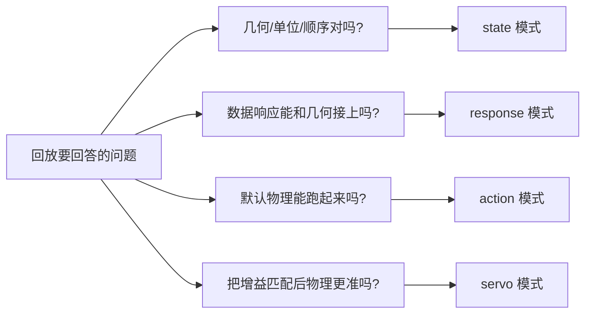
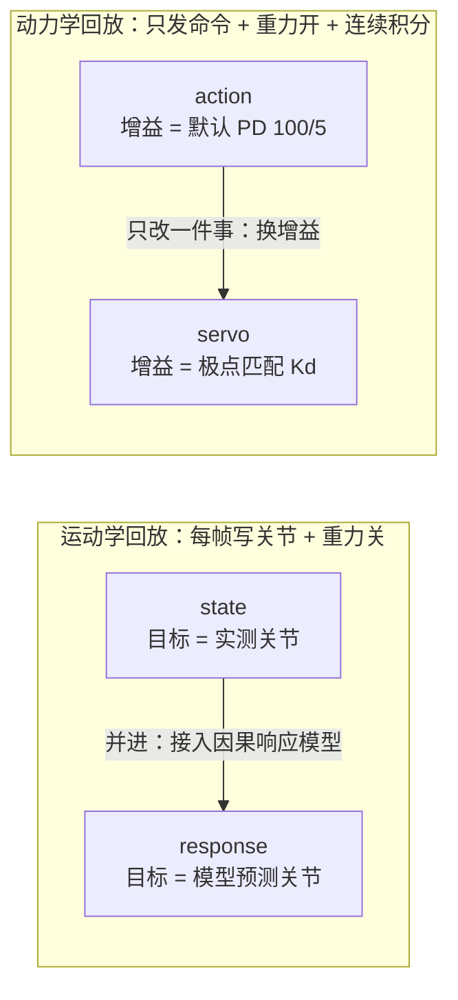

# Isaac Lab real2sim 回放的四种驱动模式：state / action / response / servo

> **一句话**：把一条真机轨迹放进 Isaac Lab 回放，关节可以有四种被驱动的方式——**直接写实测关节（state）、只发命令用默认 PD 跑真物理（action）、写模型预测的关节（response）、只发命令用匹配好的 PD 跑真物理（servo）**。它们不是四个功能，而是一组控制变量实验：每换一种模式，就只改动"目标从哪来"或"用哪套 PD"其中一个因素，好让误差的下降能归因到具体原因上。

**知识链接**：
- [Leader-Follower 遥操作与机器人示教数据格式](/前置知识/017b_前置知识_Leader_Follower遥操作与机器人示教数据格式) — 回放用的 state / action 两种通道从哪来
- [一阶响应模型与命令-反馈系统辨识](/前置知识/017e_前置知识_一阶响应模型与命令反馈系统辨识) — response 和 servo 用的因果响应模型
- [隐式 PD 与极点匹配](/前置知识/017f_前置知识_隐式PD与极点匹配) — servo 把辨识出的响应换算成阻尼的公式
- [Real2Sim 评估的证据边界](/前置知识/017g_前置知识_Real2Sim评估的证据边界) — 每种模式"能证明什么、不能证明什么"
- [Isaac Lab 仿真对齐与参数调优](/工程实践/IsaacLab仿真对齐与参数调优) — 关节 PD 增益的系统辨识背景
- [机器人系统辨识深度解析](/系列/system_identification_deep_dive/index) — 辨识与写回仿真的完整流水线

---

## 1. 为什么一个回放脚本要拆成四种模式

回放的目的是判断"仿真里的机器人和真机有多像"。但影响误差的因素不止一个：几何对不对、单位对不对、响应快慢对不对、重力开不开、控制器增益对不对。如果只跑一种回放得到一个误差数字，根本无法知道误差来自哪里。

所以正确的做法是**一次只放开一个因素**，观察误差怎么变。四种模式就是四个"开关组合"：

图里要看的重点：**每个模式只回答一个问题**。想要"一次跑出一个综合结论"是不可能的；分清问题、逐个隔离，才是这套设计的意义。

---

## 2. 两个开关决定一切

四种模式之间的差别，可以压缩成两个正交维度：

- **目标从哪来**：`state` 用实测关节；`response`/`servo` 用因果模型预测；`action` 用 leader 命令。
- **是否积分动力学**：`state`/`response` 每帧重置关节、关重力（运动学回放）；`action`/`servo` 只发命令、开重力、连续积分（动力学回放）。

再加上第三个维度——**用哪套 PD 增益**：`action` 用仿真自带的默认值，`servo` 用极点匹配得到的目标阻尼。

图里要看的重点：**左右两组各有一条"改进路径"**。左组在运动学里从"抄答案"走到"用模型预测"；右组在动力学里从"默认增益"走到"匹配增益"。`state → response` 隔离的是"动力学"，`action → servo` 隔离的是"增益"。

---

## 3. state 模式：把答案抄进去

**机制**：每一帧把真机 follower 的实测关节角直接写入仿真、速度清零，再用同一个位置作为目标推进一个控制步，最后读取仿真里真实的关节状态作为输出。重力关闭。

它为什么要"写进去再读出来"而不是直接把输入当输出？因为这样才能让视口真正更新——早期只写数据、不推进渲染时出现过"数值在变、画面冻结"的情况。读取仿真实际状态，也能暴露求解器对超限角度的修正。

**能证明什么**：几何、运动学、单位、左右顺序、末端语义（link6）与场景加载是自洽的。这条轨迹跑完 936 帧，末端位置误差约 0.98 mm（右）/ 1.15 mm（左）——说明"把真机姿态摆进仿真"这一步是准的。

**不能证明什么**：它把答案当输入，所以这个误差本质上是"抄答案的准确度"，**不涉及任何动力学、接触或控制器**。文档里直接把它描述为几何预演。

---

## 4. action 模式：真物理，但增益是错的

**机制**：只在初始化时使用首帧真机 state；之后**只喂 leader 命令**，让仿真用自带的默认隐式 PD 在重力下连续积分。每步先把目标截断到官方限位，再推进。

这条路上有两个"真"：真的开重力、真的连续积分（不再是每帧重置）。也有一个"假"：**PD 增益是仿真默认值，不是辨识出来的**——臂 100 N·m/rad 刚度、5 N·m·s/rad 阻尼，夹爪 1000/10。这套数跟真机的实际响应没有关系。

**能证明什么**：配置能完整执行整段 leader 命令，输出有限、不爆炸，限位截断行为可见。这一条 935 步跑下来，末端误差 25.0 mm（右）/ 40.5 mm（左），并有 170 个目标值被截断。

**不能证明什么**：误差主要来自"增益不对"，而不是"仿真动力学已拟合"。所以这个数字**不能**用来做空载控制参数标定，也**不能**当作任务成功的证据。

---

## 5. response 模式：运动学代理

**机制**：用从空载数据辨识出的因果一阶模型，从初始反馈和后续命令一路预测出每一步的关节，然后像 `state` 那样把**预测的关节**写进仿真（重力仍关闭），再和实测的下一帧比较。

它把问题从"抄答案"换成了"用模型算答案再抄进去"。这样能验证的是一件事：**辨识出的响应模型和机器人的几何/关节接口能正确接上**——如果关节顺序、单位、维度映射有一处错，这里立刻会崩。两条独立空载短轨迹在 response 模式下完成 577 / 705 步，末端误差 3.6 / 3.5 mm，和离线预测一致。

**能证明什么**：数据响应与仿真几何之间的连接正确，预测可在真实仿真循环里复现。

**不能证明什么**：它仍然**没有跑自由动力学**（关重力、每帧重置）。误差小只说明"模型算得准 + 几何对得上"，和"仿真的物理动力学是否接近真机"是两回事。

---

## 6. servo 模式：真物理 + 正确增益

**机制**：和 `action` 一样，**只发命令、开重力、连续积分**；唯一的改动是把执行器的阻尼从默认值换成**极点匹配**的结果——用辨识出的响应时间常数 $\alpha$ 反推每个关节该有的 $K_d$（刚度取设计值 1000）。命令仍需经过饱和、增益、偏置和整数延迟处理，但**不再额外叠加一阶滤波**，因为"慢"已经由阻尼承担，叠两次会让关节比真机还慢。

这是四种模式里唯一同时满足"真物理"和"增益可信"的。同一批数据上，默认 PD 的误差是 35.4 mm（835330，右臂）/ 30.8 mm（835331，左臂），换成匹配增益后降到 **6.0 / 5.2 mm**。

**能证明什么**：在**空载**数据上，响应匹配确实让物理回放更接近真机；这个改善在没参与调参的独立短轨迹上依然成立。

**不能证明什么**：极点匹配建立在"忽略质量"的近似上，真实的惯量、重力、限位仍然在起作用；而且空载数据里没有接触和负载，所以结果**不外推**到抓取任务，也不等于辨识出了真实电机参数。

---

## 7. PD 为什么是 action 和 servo 的分界线

把四种模式排成一条链，PD 的位置就很清楚了：

| 模式 | 目标来源 | 重力/积分 | 用哪套 PD | 主要验证对象 |
| --- | --- | --- | --- | --- |
| state | 实测关节 | 关 / 每帧重置 | 不涉及（直接写状态） | 几何、单位、顺序 |
| response | 模型预测关节 | 关 / 每帧重置 | 不涉及 | 数据响应与几何的接口 |
| action | leader 命令 | 开 / 连续积分 | **默认 100/5（未辨识）** | 命令链路能跑完整段 |
| servo | leader 命令 | 开 / 连续积分 | **极点匹配的 Kd** | 匹配增益后的物理回放 |

`action` 和 `servo` 之间**只差一个 PD**。所以 `servo` 不是"第五种回放"，而是"把 action 模式里那套错的增益换成对的"。反过来，如果直接拿 `action` 的误差去判断控制参数好不好，等于在用一个未知的错误增益当基准——这正是为什么标定必须用 `servo` 的结果，而不能用 `action` 的。

---

## 8. 四条结果放在一起看

| 模式 | 完成量 | 末端误差（右/左） | 这个数字的含义 |
| --- | --- | --- | --- |
| state | 936 帧 | 0.98 / 1.15 mm | 几何回放准确度 |
| response | 577 / 705 步 | 3.61 / 3.52 mm | 响应模型 + 几何接口一致 |
| action | 935 步 | 25.0 / 40.5 mm | 默认增益下的物理回放误差 |
| servo | 577 / 705 步 | 6.0 / 5.2 mm | 匹配增益后的物理回放误差 |

单独看任意一行都可能被误读：state 的亚毫米很漂亮但毫无动力学含义；action 的大误差不代表物理不行，只代表增益没调。**把四行放在一起，才能读出"哪一步解决了哪个问题"。**

---

## 9. 一个常见的误用

最常见的一类错误是：拿 `state` 模式的漂亮误差去宣称"仿真和真机高度一致"，或者拿 `action` 模式的大误差去宣称"仿真器不好用"。两者都错在**没有区分这个数字是在哪组假设下得到的**。

判断一个回放数字能不能用，先问三个问题：目标是不是真机实测（抄答案了吗）？重力/积分开了吗（跑动力学了吗）？增益是辨识的还是默认的？三个问题答完，这个数字的适用范围就确定了。

---

## 10. 总结

- 四种模式是**控制变量实验**：state（抄答案）、response（模型预测但仍是运动学）、action（真物理但默认增益）、servo（真物理 + 匹配增益）。
- 两个正交维度——**目标来源**与**是否积分动力学**——加上**用哪套 PD**，决定了每种模式能证明什么。
- `state → response` 隔离动力学，`action → servo` 隔离增益；`servo` 本质是"把 action 的 PD 换成对的"。
- 标定必须用 `servo` 的结果；`state` 的亚毫米不能当动力学证据，`action` 的大误差也不能当仿真器差评。
- 无论哪种模式，都不涉及接触与负载，结论都有明确边界。

**一句话**：这四种模式是同一段回放的四个"假设版本"——离开具体是哪一版，任何误差数字都没有意义。

---

## 延伸阅读

- [隐式 PD 与极点匹配](/前置知识/017f_前置知识_隐式PD与极点匹配) — servo 里那套 Kd 怎么算出来
- [一阶响应模型与命令-反馈系统辨识](/前置知识/017e_前置知识_一阶响应模型与命令反馈系统辨识) — response / servo 的模型来源
- [Real2Sim 评估的证据边界](/前置知识/017g_前置知识_Real2Sim评估的证据边界) — 如何为每种模式的结论划边界
- [Isaac Lab 仿真对齐与参数调优](/工程实践/IsaacLab仿真对齐与参数调优) — 关节 PD 增益辨识的工程细节
