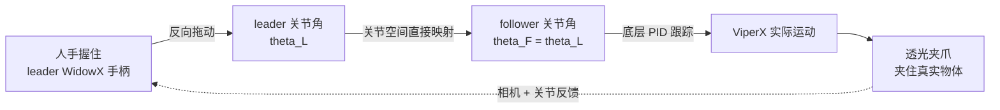

# 第一章：ALOHA 低成本遥操作硬件

本章讲清楚一件事：一个总价不到 2 万美元的双臂系统，凭什么能遥操作出足以训练精细策略的高质量演示。答案不在于某个昂贵的零件，而在于五个互相约束的设计原则串起来的一整套取舍。

---

**知识链接**

- [行为克隆与 RL 微调范式](/前置知识/000d_前置知识_行为克隆与RL微调范式) — 本章采集的数据最终服务于模仿学习
- [正运动学与 DH 参数](/前置知识/003a_前置知识_正运动学与DH参数) — 理解关节空间与任务空间的差别
- [机器人奇异性速度椭球与可操作度](/前置知识/008b_前置知识_机器人奇异性速度椭球与可操作度) — 为什么关节空间映射能绕开 IK 失效

---

## 一 精细操作为什么需要专用硬件

先看 Open Cup 这个任务的全过程。杯子初始直立在桌上：右爪先轻推杯沿把它放倒，再把它拨进张开的左爪；左爪合拢、把杯子抬离桌面；随后右手指从下方伸过去撬开盖子。每一步都对精度极度敏感——差几毫米，要么推不倒杯子，要么拨不进爪，要么撬盖时打滑。

这类任务对硬件提出了相互矛盾的要求。**要精度**，通常意味着高刚度机械臂、高分辨率编码器和精准标定；**要精细接触**，意味着力控和本体重量的可控；**要能用真实物体**，意味着工作空间和夹爪形态要适配乱七八糟的日常物品。传统上满足这些要求的系统（如达芬奇手术机器人、ABB YuMi）价格是 ALOHA 的五到十倍。

ALOHA 的立场是：把这些要求交给**学习**去补足，硬件只需要"够好 + 够便宜 + 够好修"。由此得到五条设计原则：

| 原则 | 含义 | 具体落点 |
|------|------|---------|
| 低成本 | 总价在多数实验室可承受范围 | 两台 ViperX 6-DoF 加杂件 < $20k |
| 通用 | 能操作真实世界的各种细物 | 定制透光手指 + 抓握胶带 |
| 易用 | 遥操作直观、可靠 | 关节空间映射、手柄剪刀机构 |
| 可维修 | 出故障能自己修 | Dynamixel 舵机可单独更换、模块化臂 |
| 易搭建 | 非专家 2 小时内装好 | 只用现成件 + 少量 3D 打印件 |

## 二 机械臂选型

系统使用同厂商生产的两个尺寸的 6 自由度机械臂：跟随端（follower）是较大的 ViperX，负责真正干活；操作端（leader）是较小的 WidowX，由人手反向拖动。ViperX 工作载荷 750g、跨度 1.5m、重复精度 5-8mm，整臂约 $5600；WidowX 约 $3300。两者关节一一对应、近似等比例，这一点是后面关节空间映射能用起来的前提。

原厂夹爪对精细操作不够通用——太宽、挡视线、抓不住薄膜。ALOHA 换成自制的 3D 打印"透光"手指，并在指尖贴抓握胶带。透光设计让操作者和相机都能看清夹爪内侧正在发生什么，这对撬盖子、捏薄片这类需要看清接触的任务至关重要。

> 读图重点：整条回路里**没有逆运动学**。人手拖动 leader，关节角直接抄给 follower，follower 的底层 PID 再把这个目标角"追"出来。回路末端的相机和关节反馈回到人手，构成操作者自己的闭环。

## 三 关节空间映射而不是任务空间

遥操作天然有两条路线。**任务空间映射**是主流做法：捕获人手（VR 手柄或相机）的末端位姿，解逆运动学（IK）算出让机器人末端到达那个位姿的关节角。**关节空间映射**是 ALOHA 的选择：直接把人手拖动 leader 得到的关节角，按关节一一对应抄给 follower。

这个选择背后有三个具体的工程理由。

**第一，精细操作常发生在奇异位形附近。** ViperX 是 6 自由度、无冗余，靠近奇异点时 IK 的解会对目标位姿极度敏感，甚至无解——现成的 IK 求解器在这种场景下频繁失败。关节空间映射完全不经过 IK，只要在关节限位内就能高带宽、低延迟地控制，绕开了这个雷区。奇异性和可操作度的原理见 [机器人奇异性速度椭球与可操作度](/前置知识/008b_前置知识_机器人奇异性速度椭球与可操作度)。

**第二，leader 本身的重量反而帮了忙。** 人手要拖动一个有惯性的物理机构，这会自然限制操作速度、并吸收手上的微小抖动。作者观察到，用关节空间映射在精细任务上的表现，比握 VR 手柄更好——因为操作者获得了力反馈式的天然阻尼。

**第三，力的大小被隐式编码了。** 记录时用的是 leader 的关节位置，而不是 follower 的。这是关键细节：follower 由底层 PID 跟踪 leader 目标角，leader 与 follower 之间的角度差决定了施加的力矩大小。把人手输入的 leader 角作为动作标签，等于把"人当时使了多大劲"也一起记了下来；若记录 follower 角，则会丢掉这个信息。

## 四 把遥操作体验磨顺手

关节空间映射解决了"能不能用"，还有"好不好用"的问题。

**手柄剪刀机构。** 原厂 leader 的每个轴都由舵机提供阻尼，长时间操作很累。ALOHA 设计了 3D 打印的"手柄 + 剪刀"机构，它把夹爪的开关从原来的二元开合变成连续控制，同时降低了反向拖动所需的力量。连续夹爪控制让演示的动作更细腻，也更容易被策略学习。

**橡皮筋重力补偿。** leader 机构本身有重量，操作者需要一直用力对抗重力。ALOHA 加了一套橡皮筋配重，部分抵消 leader 侧的重力，把长时间（>30 分钟）连续演示变得可行。这对需要采集数十条轨迹的任务很现实——疲劳会直接污染演示质量。

## 五 感知与场景配置

整个系统装在一个 20×20mm 铝型材搭建的笼子里，交叉钢丝绳加固，保证相机和机械臂的相对位置稳定。感知由四台罗技 C922x 网络摄像头组成，每台输出 480×640 的 RGB 图像：

- **两台腕部相机**分别装在 follower 的两条腕上，提供夹爪附近的近距离特写——这是判断接触状态的关键视角。
- **一台前置相机**和**一台顶置相机**提供全局视野。

遥操作与数据记录都以 50Hz 进行，也就是说每条轨迹一秒记录 50 个动作点。这个频率为后面"动作分块"提供了足够的密度，同时也正是复合误差容易被放大的频率。

## 六 这套硬件能干什么

ALOHA 的遥操作能力覆盖三类任务：

- **精细任务**：穿扎带、从钱包里夹出信用卡、开关自封袋。
- **接触丰富任务**：把 288 针内存条插进主板、翻书页、组装 NIST 板 #2 的链条。
- **动态任务**：用真球拍颠乒乓球、在不让球掉落的前提下平衡球、在空中甩塑料袋。

作者强调，像穿扎带、插内存、颠乒乓球这些技能，在预算高出 5-10 倍的其他遥操作平台上都难以完成。这为"低成本 + 学习"这条路线提供了最直接的证据：便宜的硬件不是靠更强的传感器赢，而是靠把人的精细操作完整、忠实、可重复地记录下来，再让策略去复现。

## 本章小结

- ALOHA 用同厂商两个尺寸的 6-DoF 臂做 leader-follower，靠关节空间映射绕开 IK，并让 leader 重量充当天然阻尼。
- 记录 leader 关节角而非 follower 关节角，是因为角度差隐含了操作力信息。
- 透光 3D 打印手指、手柄剪刀机构和橡皮筋配重，是把"能用"打磨成"好用"的三个关键件。
- 四路 480×640 相机 + 50Hz 记录，构成后续策略的输入与动作密度基础。

下一章进入算法的第一块核心：动作分块与时间集成，看它如何把复合误差从源头压制下去。
