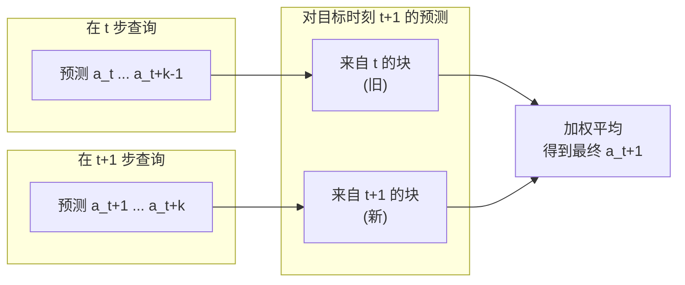

# 第二章：动作分块与时间集成

前情提要：第一章确立了 ALOHA 采集数据的方式——50Hz 记录 leader 关节角，四路相机提供观测。本章解决算法侧的第一个核心问题：即便有高质量演示，逐帧预测单步动作的策略仍会因复合误差而崩掉。ACT 的答案是动作分块加时间集成。

---

**知识链接**

- [行为克隆与 RL 微调范式](/前置知识/000d_前置知识_行为克隆与RL微调范式) — 复合误差问题的完整背景
- [Diffusion Policy 前置知识](/前置知识/000c_前置知识_Diffusion_Policy) — 同样面对多模态动作的另一种解法
- [Chunked RL 分块离线 RL 微调 VLA](/论文综述/078_ChunkedRL_分块离线RL微调VLA) — 动作分块在 RL 侧的后续应用

---

## 一 复合误差与非马尔可夫行为

行为克隆的经典失败模式是**复合误差**。策略在时刻 $t$ 预测了一个略有偏差的动作，环境因此走到一个训练数据里没出现过的状态；策略在这个陌生状态上又预测出更大偏差的动作，误差像复利一样滚大。任务越精细、控制频率越高，这个滚雪球越快。

第二类麻烦是演示的**非马尔可夫性**。人类演示里经常出现停顿——比如 Open Cup 里人先把手悬在杯子上方"找一下感觉"再下手。这段停顿和"当前状态"没有确定关系，它依赖"现在是演示的第几秒"。一个只看当前状态、只看一步的马尔可夫策略无法解释这种依赖时刻的行为，于是它可能学到"看到这个状态就永远停住"，让机器人卡死。

## 二 动作分块：把视野缩短 k 倍

动作分块（action chunking）借自神经科学：人执行动作时不是逐个肌肉命令去发，而是把一串动作打包成一个"块"整体执行。在 ACT 里，它被翻译成一句很具体的改动：

$$
\pi_\theta(a_{t:t+k} \mid s_t) \quad \text{替代} \quad \pi_\theta(a_t \mid s_t)
$$

**这个公式在做什么**：策略不再只预测"下一步做什么"，而是一次预测未来 $k$ 步的动作序列，然后把这些动作整段执行掉，再重新观察、重新预测。

::: details 📐 公式详解（点击展开）

| 子表达式 | 它是谁 | 它在干嘛 |
|---------|--------|---------|
| $s_t$ | **当前观测** | 四路图像 + 两条臂的关节角 |
| $a_{t:t+k}$ | **动作块** | 从当前时刻起的 $k$ 步目标关节角序列，形状是 $k \times 14$ |
| $\pi_\theta$ | **策略网络** | 参数为 $\theta$ 的 ACT 解码器 |
| $k$ | **分块长度** | 一次预测覆盖的步数，直接决定视野被缩短多少倍 |

**用人话读**："看一眼画面，一次性把接下来 $k$ 步的动作都想好，然后照着执行。"

**为什么这样能压住复合误差**：任务的有效视野（需要多少个连续决策才能做完）被缩减成原来的 $1/k$。原来要连续正确决策 700 次，现在只要 700/k 次"块级决策"，每一步内部小误差不再逐帧累积重新决策，滚雪球的机会少了 $k$ 倍。分块同时还让"停顿"这类时间相关行为落在一个块内部，被一并模仿，缓解了非马尔可夫问题。
:::

## 三 朴素分块的抖动问题

分块不是没有代价。最直接的实现是"每 $k$ 步观察一次、生成 $k$ 个动作、依次执行"，但这会带来一个缺陷：每 $k$ 步才突然纳入一次新观测，机器人的运动会在新旧动作之间"跳变"，动作不平滑，精细任务尤其受不了。

ACT 的修法是**提高查询频率**：不再每 $k$ 步才查询，而是每一步都查询策略，生成新的 $k$ 步动作块。这样相邻两次查询产生的块会重叠，在任意一个时刻 $t$，会有来自多个不同块的、针对 $t$ 的多个预测。

> 读图重点：对同一个目标时刻，缓冲区里堆着"最早预测它的块"到"最新预测它的块"共若干个候选。时间集成要做的就是把它们加权合成一个动作。

## 四 时间集成：对同一时刻的多个预测加权

时间集成（temporal ensembling）对同一个目标时刻 $t$ 的所有预测做指数加权平均。记这些预测按"预测发生的先后"编号：$A_t[0]$ 是最早（最旧）的那次预测，$A_t[i]$ 表示更晚做出的预测，最大到 $i = k-1$。最终的动作为：

$$
a_t = \frac{\sum_{i} w_i\, A_t[i]}{\sum_i w_i}, \qquad w_i = \exp(-m\, i)
$$

**这个公式在做什么**：把针对同一时刻的每一份预测按"它有多新鲜"分配权重——越旧的预测权重越大（越接近共识），越新的权重越小——然后归一化加权平均，得到平滑且稳定的动作。

::: details 📐 公式详解（点击展开）

| 子表达式 | 它是谁 | 它在干嘛 |
|---------|--------|---------|
| $A_t[i]$ | **第 i 份候选预测** | 针对目标时刻 $t$ 的第 $i$ 个（按预测时间从旧到新编号）预测动作 |
| $w_i = \exp(-m i)$ | **新鲜度权重** | 随 $i$ 指数衰减；$i=0$ 最旧却权重最大（$\exp 0 = 1$） |
| $\sum_i w_i$ | **归一化** | 保证加权平均的权重和为 1，不放大动作幅值 |
| $m$ | **纳入速度旋钮** | 越小曲线越平，新预测保留越多权重，新观测生效越快 |

**用人话读**："对同一个未来时刻，把历史上多次做过的预测乘上'越旧越重'的指数权重，加权平均出最终动作。"

**为什么是"越旧越重"**：越早做出的预测通常来自更"沉得住气"的输入分布，抖动更少；而每一步都纳入新观测会让动作灵敏但噪。用指数衰减把新旧信息按可控比例混合，就得到一个既平滑又能响应新观测的动作。$m$ 小 → 分布平 → 新预测权重不小 → 响应快；$m$ 大 → 只有最旧的说了算 → 响应慢但更稳。

**为什么"对同一时刻聚合"而不是"聚合相邻时刻"**：常见平滑是拿当前动作和前后相邻时刻的动作平均，这会把"未来时刻"的信息也掺进来，引入系统性偏差。聚合同一目标时刻则不同——所有候选说的都是"$t$ 时刻该做什么"，平均它们不引入时间偏差。
:::

下图把 $\exp(-m i)$ 的形状画出来。横轴是预测的新旧编号（$i=0$ 最旧），纵轴是归一化后的权重：

> 读图重点：三条曲线都是单调衰减，说明旧预测权重更高；比较不同 $m$：$m=0.01$ 的曲线最平，新预测仍分到可观权重，动作对扰动敏感；$m=0.1$ 衰减最快，几乎只听最旧那份预测。

想亲手拖动 $k$ 和 $m$、看权重分配与加权平均怎么变，可以打开本系列概览页或第三章的互动架构图（"分块与时间集成"标签页）。

## 五 训练与推理的完整状态转移

时间集成在推理时是一段有状态的过程，必须把状态转移说清楚才能读懂代码。

**推理时的缓冲结构。** 维护一个 FIFO 缓冲区 $\mathcal{B}[0:T]$，其中 $\mathcal{B}[t]$ 存放"针对目标时刻 $t$ 的所有预测"。每个时间步的循环是：

1. **读旧状态**：当前时刻 $t$，缓冲区里已经累积了对 $t$ 的若干候选预测。
2. **算新预测**：在当前观测 $s_t$ 上查询策略，得到新块 $\hat{a}_{t:t+k-1}$。
3. **写缓冲**：把新块的第 $j$ 个动作写进 $\mathcal{B}[t+j]$，$j = 0,\dots,k-1$。
4. **读目标时刻的候选**：取出 $\mathcal{B}[t]$，即所有针对 $t$ 的候选。
5. **集成更新**：按 $w_i = \exp(-mi)$ 加权平均，得到最终动作 $a_t$ 并下发给底层 PID。

用一个数值例子把第 5 步走一遍。设 $k=5$、$m=0.1$，缓冲 $\mathcal{B}[t]$ 里有三份候选（旧、中、新），对应关节某维目标角为 $10^\circ, 12^\circ, 8^\circ$。权重 $w = [1, e^{-0.1}, e^{-0.2}] \approx [1, 0.905, 0.819]$，归一化后约 $[0.367, 0.332, 0.301]$，最终动作 $\approx 0.367 \times 10 + 0.332 \times 12 + 0.301 \times 8 \approx 10.0^\circ$。三份预测分歧越大，集成后的动作就越靠向权重最高的旧预测，起到"分歧时求稳"的效果。

**训练时的算法**（论文 Algorithm 1）：从演示数据采样观测 $s_t$ 和长度为 $k$ 的动作块 $a_{t:t+k}$，编码器推断风格变量 $z$，解码器在 $z$ 和 $s_t$ 条件下预测动作块，用重建损失 + KL 正则更新。训练完全不受时间集成影响——集成只发生在推理，**不增加任何训练成本**，代价仅是推理时多一点计算。

## 六 为什么两个部件缺一不可

论文的消融实验给出两条独立结论：把动作分块单独加进别的基线方法（BeT、VINN 等），能明显提升它们；而只做分块、不做时间集成，动作平滑度下降、成功率也下降。这说明二者分工不同——分块压复合误差，集成压抖动。下一章进入网络架构，看 Transformer 和 CVAE 怎样把多模态演示真正吃进去。

## 本章小结

- 动作分块把策略从 $\pi(a_t\mid s_t)$ 改成 $\pi(a_{t:t+k}\mid s_t)$，把有效视野缩短 $k$ 倍，并顺带缓解演示的非马尔可夫停顿。
- 每步都查询会产生重叠的块，对同一目标时刻形成多份预测。
- 时间集成用 $w_i = \exp(-mi)$ 对这些预测加权平均，$m$ 控制新观测纳入速度；聚合的是同一时刻而非相邻时刻，避免时间偏差。
- 集成只在推理发生，零训练成本；分块与集成解决的是两个不同的误差来源。
