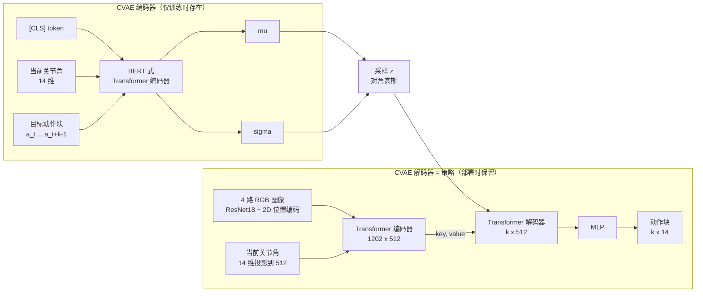

# 第三章：ACT 网络架构与 CVAE 建模

前情提要：第二章用动作分块 + 时间集成解决了复合误差和抖动。但演示数据还有一个麻烦没处理——同一次抓取，人可以做出一百种都正确的轨迹。本章看 ACT 如何用 CVAE 把这些多模态的演示装进一个 Transformer 编解码器。

---

**知识链接**

- [条件变分自编码器 CVAE](/前置知识/015f_前置知识_条件变分自编码器CVAE) — ACT 的生成式建模基石
- [Vision Transformer 图像分块与位置编码](/前置知识/003g_前置知识_Vision_Transformer图像分块与位置编码) — 图像如何变成 token 序列
- [Cross Attention 与交替注意力机制](/前置知识/001e_前置知识_Cross_Attention与交替注意力机制) — 解码器如何从编码器取信息
- [标量条件编码 位置编码与时间步嵌入](/前置知识/001s_前置知识_标量条件编码_位置编码与时间步嵌入) — 2D 正弦位置编码

---

## 一 为什么需要生成模型

Open Cup 任务里，每次演示把杯子放倒的角度、拨进左爪的力度、撬盖时手指的落点都略有不同。如果让一个回归网络直接输出"标准动作块"，它会倾向于输出这些不同做法的平均。可平均动作在物理上往往是不成立的——朝若干个不同方向的力取平均，结果可能是零，杯子纹丝不动。

更微妙的是，人还会在"精度不重要"的环节更随意。比如把杯子抬离桌面这段，手腕姿态怎么摆都行，演示的方差很大；而撬盖手指必须精确到位，方差很小。策略必须学会"在哪里该严格、在哪里可以放松"，而不是一刀切地模仿均值和方差。

ACT 的解法是把策略训练成一个**条件变分自编码器**，用一个潜变量 $z$ 显式承载"这一次演示用哪种方式做"的随机性。

## 二 CVAE 的两个部件与条件选择

ACT 的 CVAE 有两个部件：**编码器** $q_\phi(z \mid a_{t:t+k}, \bar{o}_t)$ 和**解码器**（即策略）$\pi_\theta(\hat{a}_{t:t+k} \mid o_t, z)$。两者对"观测"的处理有一个关键差异：

- 解码器用的是完整观测 $o_t$：四路 RGB 图像 + 两条臂的关节角。
- 编码器只用 $\bar{o}_t$：**去掉图像**，只留当前关节角，加动作序列。

为什么编码器要去掉图像？因为现实训练里，编码器只在训练时存在，它的唯一任务是"教会解码器怎么用 $z$"。让它同时处理四路高分辨率图像，会显著拖慢训练，而它推断"这次是哪种做法"其实主要依赖动作序列本身，图像并非必需。这是一个纯粹的工程取舍——去掉图像对最终性能影响很小，但训练快得多。

> 读图重点：编码器（上）吃的是"关节角 + 动作块"，产出 $z$ 的分布；解码器（下）吃的是"图像 + 关节角 + $z$"，产出动作块。测试时上整块被丢弃，$z$ 直接设为先验均值。

## 三 训练目标

ACT 最大化演示动作块在给定观测下的对数似然。由于真实后验不可解，实际优化 ELBO，它由重建项和 KL 正则项组成：

$$
\mathcal{L} = \underbrace{\mathbb{E}_{z \sim q_\phi}\big\| \hat{a}_{t:t+k} - a_{t:t+k} \big\|_1}_{\mathcal{L}_{\text{reconst}}} \;+\; \underbrace{\beta\, D_{\mathrm{KL}}\big(q_\phi(z \mid a_{t:t+k}, \bar{o}_t)\,\|\,\mathcal{N}(0, I)\big)}_{\mathcal{L}_{\text{reg}}}
$$

**这个公式在做什么**：第一项逼解码器在 $z$ 和观测条件下把真实动作块重建出来（这里用 L1 而非对数似然写法，见下文）；第二项把编码器吐出的 $z$ 分布往标准高斯拉，保持潜空间光滑，让测试时 $z = 0$ 也能正常解码。

::: details 📐 公式详解（点击展开）

| 子表达式 | 它是谁 | 它在干嘛 |
|---------|--------|---------|
| $\hat{a}_{t:t+k}$ | **策略输出的动作块** | 解码器预测的 $k$ 步目标关节角 |
| $\|\hat{a} - a\|_1$ | **重建误差** | 预测块和演示块的 L1 距离，越小说明越像 |
| $q_\phi(z \mid a_{t:t+k}, \bar{o}_t)$ | **事后推断器** | 训练时偷看答案动作块，推断"这次演示的 $z$" |
| $D_{\mathrm{KL}}(\cdot \| \mathcal{N})$ | **正则项** | 把推断出的 $z$ 分布拉向标准高斯 |
| $\beta$ | **权重旋钮** | $\beta$ 越大，$z$ 承载的信息越少、越"规矩" |

**用人话读**："让解码器用 $z$ 和观测把真实动作重建出来，同时让 $z$ 别偏离标准高斯太远。"

**为什么用 L1 而不是 L2 或对数似然**：论文发现 L1 损失对动作序列的建模更精确——L2 对大偏差更敏感、容易把"离群但正确"的演示拉向均值，而 L1 更稳健。这与生成模型的经典写法不同，是一个经验性但很有效的选择。$z$ 的完整变分推导见 [条件变分自编码器 CVAE](/前置知识/015f_前置知识_条件变分自编码器CVAE)。
:::

论文还报告了两个反直觉的细节：用 delta 关节位置（相对增量）作为动作，性能反而下降；因此 ACT 直接预测**绝对**目标关节位置。另一个是 $\beta$ 通常取 10 而不是标准 VAE 的 1——更高的 $\beta$ 让 $z$ 携带更少信息，作者发现这对精细任务更好。$\beta$ 太大时 $z$ 几乎为零向量，模型退化成确定性回归；太小则潜空间不光滑，测试时取 $z=0$ 解码不稳。

## 四 解码器的张量流水线

解码器是一个标准的图像 → Transformer 编码器 → Transformer 解码器结构。把一个 480×640 的图像喂进来，经过的处理步骤必须逐维看清，否则很容易在复现时对不上形状：

| 步骤 | 操作 | 形状变化 |
|------|------|---------|
| 1 | ResNet18 提特征 | $480\times640\times3 \to 15\times20\times512$ |
| 2 | 空间维展平成序列 | $15\times20\times512 \to 300\times512$ |
| 3 | 加 2D 正弦位置编码 | $300\times512$（保持） |
| 4 | 四路图像拼接 | $4\times300 = 1200$ 个 token，$1200\times512$ |
| 5 | 追加关节角与 $z$ | 各投影到 512，共 $1202\times512$ |

第 4 步的四路图像都来自同一套 ResNet18 权重（共享骨干），所以不同视角的 token 落在同一特征空间里，编码器才能把它们"对得上"地进行信息综合。第 5 步的关节角和 $z$ 各是一个向量，用线性层投影到 512 维后当作额外的两个 token 拼进序列，长度因此从 1200 变成 1202。

**Transformer 编码器**在这个 1202 长序列上做自注意力，把四个视角、关节角、风格变量综合成一个上下文。**Transformer 解码器**的输入不是序列，而是一组固定的位置嵌入——长度为 $k$、维度 512 的可学习向量，它的 key 和 value 全部来自编码器的输出（交叉注意力）。解码器输出 $k\times512$，再经一个 MLP 下投影成 $k\times14$，就是两条 7-DoF 臂未来 $k$ 步的目标关节角。

这个设计里，解码器输入是"固定的位置嵌入"值得留意：它意味着解码器每一步的输出位置由这组嵌入锚定，而不是像语言模型那样把已生成 token 喂回去自回归。ACT 是**一次并行**吐出整个动作块，这正是它能满足推理时间约 0.01 秒的原因。自回归生成动作的对照路线见 [动作 Token 化与自回归策略](/前置知识/000l_前置知识_动作Token化与自回归策略)。

### 互动架构图

把上面六个部件串起来看，再亲手调一调分块与集成的参数：

<ACTArchitecturePlayground />

## 五 训练与推理的配置

模型约 8000 万参数，对每个任务**从零开始训练**，不做跨任务预训练——这是 2023 年 ACT 的定位：一个任务一个模型。训练细节：

- 单张 11GB 的 RTX 2080 Ti，训练约 5 小时。
- 推理时加载验证集损失最低的 checkpoint。
- 推理单步约 0.01 秒，配合时间集成也能实时。

推理流程与第二章的状态机一致：加载策略后，逐步查询得到动作块、写入缓冲、对同一时刻做加权平均、下发给 PID。测试时解码器的 $z$ 固定为先验均值（对角高斯取 0），使同一个观测对应确定动作，便于复现和调试。若需要多样性，可以从先验采样 $z$，得到同一观测下不同的合理动作块。

## 六 多模态到底被存在哪

一个容易被忽略的问题是：既然测试只用 $z=0$，那训练时那种"一个观测多条动作"的多模态信息去哪了？

答案是它被"编译"进了网络参数。训练时解码器被反复要求"看到不同的 $z$，做出不同的动作"，于是它学会了让输出随 $z$ 平滑变化；同时编码器学会把"哪种做法"编码进 $z$。到了测试，虽然没有编码器，但解码器在 $z=0$ 附近的行为是聚合的、稳定的——它输出的是"在潜空间原点的那种典型做法"。这解释了为什么 ACT 能在测试时既确定（$z=0$）又不崩（训练见过 $z$ 的邻域）。

## 本章小结

- ACT 把策略训练成 CVAE：编码器推断风格变量 $z$，解码器在 $z$ 和观测下生成动作块。
- 编码器只用关节角和动作序列（去掉图像）换取训练速度；解码器用完整观测。
- 训练目标 = L1 重建项 + $\beta$ 加权的 KL 正则；ACT 用绝对关节位置、L1 损失、偏大的 $\beta$。
- 解码器把四路图像经 ResNet18 + 2D 位置编码变成 1202 个 token，用 Transformer 编码器综合，再用解码器并行吐出 $k\times14$ 动作块。
- 多模态被编译进参数，测试时用 $z=0$ 得到确定的典型行为。

下一章用实验和消融验证：每个设计到底贡献了多少，以及复现时最容易踩的坑。
