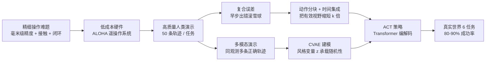

# ACT / ALOHA 深度解析：低成本双臂精细操作与动作分块策略

> 一个不到 2 万美元的双臂遥操作台，加一个把"动作序列"而非"单步动作"当作预测目标的 Transformer 策略，如何在真实世界里完成插电池、开调料杯、穿魔术贴这些连高端平台都头疼的精细任务？

## 系列定位

这个系列逐层拆解 ALOHA（A Low-cost Open-source Hardware System for Bimanual Teleoperation）与 ACT（Action Chunking with Transformers），即 Tony Zhao 等人 2023 年的工作 *Learning Fine-Grained Bimanual Manipulation with Low-Cost Hardware*（arXiv:2304.13705）。这篇论文是"动作分块 + 明确的多模态建模"这一范式的奠基之作，后来大量双臂操作与 VLA 系统（包括 [RoboTwin 2.0](/系列/robotwin2_deep_dive/) 里作为基线对比的 ACT）都以它为原型。

论文正文里几处关键取舍没有展开：为什么精细操作必须用 leader 关节位置而不是 follower 的？时间集成的指数权重究竟在做什么？CVAE 的编码器为什么测试时被丢掉？本系列把这些问题补齐。

## 核心矛盾

精细操作（threading cable ties、slotting a battery、opening a condiment cup）有三个特征：需要毫米级精度、需要接触力的协调、需要闭环视觉反馈。传统方案靠昂贵机器人 + 高精度传感器堆出来，成本难以接受。用学习绕过建模是一条低成本路径，但它带来两个新麻烦：

**复合误差（compounding errors）**：模仿学习的策略一旦早步出错，就会走到训练分布之外的陌生状态，之后的误差像滚雪球一样累积。

**人类演示的多模态与非平稳性**：同一观测下，人可以走出多条都正确的轨迹；而且演示中会出现"停顿"这类依赖时刻而非状态的行为。

ACT 的两个核心部件——动作分块 + 时间集成、CVAE 建模——分别对付这两个麻烦。

> 读图重点：左边是"硬件 + 数据"的输入来源，右上、右中两条支路各自解决一个误差来源，最后汇聚到 ACT 网络并落到真机结果。

## 互动架构总览

下面这个组件把 ACT 的六个部件画成一条流水线，并配了一个可亲手调参的"动作分块与时间集成"演示。点节点看"是什么 / 关键点 / 优势"，切标签页可以拖动 k 和 m，直接看权重分配和加权平均怎么变。

<ACTArchitecturePlayground />

## 章节目录

| 章节 | 标题 | 解决的问题 |
|------|------|------------|
| 01 | [ALOHA 低成本遥操作硬件](./01_ALOHA低成本遥操作硬件) | 为什么关节空间映射 + 3D 打印件能撑起精细遥操作 |
| 02 | [动作分块与时间集成](./02_动作分块与时间集成) | 怎样把复合误差从源头压下去，又让动作不抖 |
| 03 | [ACT 网络架构与 CVAE 建模](./03_ACT网络架构与CVAE建模) | Transformer 编解码器如何组织图像、关节、风格变量 |
| 04 | [实验、消融与复现要点](./04_实验消融与复现要点) | 每个设计选择贡献了多少，工程复现要注意什么 |

## 阅读前提

- 基本的线性代数、概率与神经网络训练常识。
- [行为克隆与 RL 微调范式](/前置知识/000d_前置知识_行为克隆与RL微调范式)——模仿学习的基本设定与复合误差问题。
- [条件变分自编码器 CVAE](/前置知识/015f_前置知识_条件变分自编码器CVAE)——理解 ACT 的生成式建模方式。
- [Vision Transformer 图像分块与位置编码](/前置知识/003g_前置知识_Vision_Transformer图像分块与位置编码)——Transformer 处理图像的方式。

## 贯穿例子

全文使用论文中的真实任务 **Open Cup（打开调料杯）**：右手指先轻推杯沿把它放倒，再拨进张开的左爪，左爪合拢抬起杯子，右手指从下方撬开盖子。这个任务同时包含空间精度、双臂协调、闭环视觉和接触，是理解 ACT 每个设计选择的最好载体。

## 延伸阅读

- [机器人模仿学习综述](/论文综述/S02_机器人模仿学习综述)——ACT 在模仿学习谱系中的位置。
- [Diffusion Policy 前置知识](/前置知识/000c_前置知识_Diffusion_Policy)——另一条用生成模型建模多模态动作的路线，可与 CVAE 对照。
- [Chunked RL 分块离线 RL 微调 VLA](/论文综述/078_ChunkedRL_分块离线RL微调VLA)——动作分块思想在强化学习侧的后继发展。
