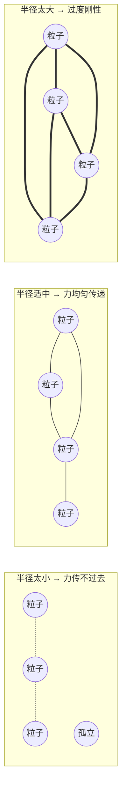

# 弹簧连接图构建：KDTree 邻域搜索与拓扑参数权衡

> **输入**：4,074 个粒子（三层去重后）。
> **输出**：弹簧连接表（~13,400 对索引），每根弹簧记录两端点 ID 和静止长度。

**知识链接**：
- [质点弹簧模型](/前置知识/006e_前置知识_质点弹簧模型与绳索仿真基础) — 弹簧力公式需要静止长度和连接关系

---

## 贯穿全文的例子

> 4,074 个粒子散布在毛绒熊体积中。现在要决定哪些粒子之间用弹簧连起来——连太少物体会"散架"（面团变面粉），连太多计算量爆炸且物体变得过度刚性（橡皮泥变钢板）。你需要找一个"刚好合适"的连接半径，让弹簧网络既能传递力、又不过度约束。

---

## 一、弹簧图的数学定义

弹簧系统是一个无向图 $G = (V, E)$：
- **节点** $V$：4,074 个粒子
- **边** $E$：弹簧连接，每条边 $(i, j)$ 附带静止长度 $l_{ij}^0 = \lVert \mathbf{x}_i - \mathbf{x}_j \rVert$

静止长度取初始粒子间距离——假设物体一开始是无应力状态（弹簧既不拉伸也不压缩）。

---

## 二、KDTree 半径搜索

`step2b_springs.py` 用 scipy 的 `cKDTree.query_pairs(radius)` 找所有距离小于 radius 的粒子对。`step3_export.py` 则用 Open3D 的 `search_hybrid_vector_3d(point, radius, max_nb)` 逐点搜索，加入了最大邻居数限制。

两种方式的区别：

| | cKDTree.query_pairs | O3D search_hybrid_vector_3d |
|-|--------------------|-----------------------------|
| 输入 | 全局半径 | 每个点的半径 + 最大邻居数 |
| 输出 | 所有满足条件的对 | 每个点的 top-K 邻居 |
| 度数控制 | 无（大半径时度数爆炸） | 有（max_nb 硬上限） |
| 去重 | 自动（对称） | 需手动避免重复添加 |

**Bear 项目最终使用的是 Open3D 路径**（`step3_export.py`），参数：`radius=0.012`（12mm），`max_nb=10`。

---

## 三、半径扫描：如何选择 12mm

`step2b_springs.py` 对 12 个候选半径做了扫描：

| 半径 (mm) | 弹簧数 | 平均度 | 孤立点 |
|----------|--------|--------|--------|
| 10 | 7,200 | 3.5 | 142 |
| **12** | **13,400** | **6.6** | **9** |
| 14 | 21,800 | 10.7 | 2 |
| 16 | 32,400 | 15.9 | 0 |
| 20 | 65,000 | 31.9 | 0 |
| 32 | 215,000 | 105.5 | 0 |

**选择逻辑**：目标约 12,000 根弹簧（同量级软体物体的经验设定），12mm 最接近这个目标。

**为什么不选更小的半径（如 10mm）**：10mm 时 142 个点完全孤立——没有任何弹簧连接。孤立点会自由飘走（只受重力、无弹力约束），导致仿真崩溃。

**为什么不选更大的半径（如 20mm）**：弹簧数从 1.3 万暴增到 6.5 万，每时间步的弹簧力计算量增加 5 倍。更关键的是，过密的连接让物体变得过度刚性——每个粒子被 30+ 个邻居拉扯，几乎无法变形。

---

## 四、最大邻居数的作用

Open3D 的 `search_hybrid_vector_3d` 有 `max_nb` 参数：每个点最多连 `max_nb` 个邻居。这解决了**局部密度不均**的问题：

- 内部点附近密度高 → 半径内可能有 20+ 个邻居 → cap 到 10
- 表面点附近密度低 → 半径内只有 3–5 个邻居 → 全部保留

$$
\deg(i) = \min\left(|\{j : \lVert\mathbf{x}_i - \mathbf{x}_j\rVert < r\}|, \; \text{max\_nb}\right)
$$

**这个设计在做什么**：max_nb 起到"度数均衡器"的作用——在高密度区域限制连接数，在低密度区域不施加额外限制。让弹簧力的传递不因密度差异而失衡。

---

## 五、孤立点的处理

扫描结果中 12mm 还有 9 个孤立点。这些点要么是采样时落在物体边角的离群点，要么是去重后周围邻居都被移除了。

当前实现没有特殊处理孤立点——它们在仿真中只受重力和碰撞力，会缓慢下落。对于 9/4074 = 0.2% 的比例，影响可以忽略。但如果孤立点比例超过 5%，需要增大半径或补采样。

---

## 六、静止长度的计算

每根弹簧的静止长度是初始粒子间的欧几里得距离：

$$
l_{ij}^0 = \lVert \mathbf{x}_i^{(0)} - \mathbf{x}_j^{(0)} \rVert
$$

**为什么不用其他值**：静止长度定义了"弹簧无应力时的长度"。如果设太短，物体一开始就处于拉伸状态（自发膨胀）；如果设太长，一开始就处于压缩状态（自发收缩）。用初始距离意味着"物体在第一帧的形状就是自然状态"。

**Bear 数据**：静止长度分布在 3–12mm 之间，中位数约 7mm。

---

## 七、弹簧图的物理含义

弹簧图不是"连最近邻就完了"——它决定了力的传播路径。可以把弹簧图想象成"物体的骨骼"：



---

## 八、工程经验

| 参数 | 经验范围 | Bear 选择 | 依据 |
|------|---------|----------|------|
| radius | 物体尺度的 5–10% | 12mm（~6.5% of 184mm） | 弹簧数 ≈ 3N |
| max_nb | 8–15 | 10 | 度数均衡 |
| 目标弹簧数 | 2–4 × 粒子数 | 13,400 ≈ 3.3 × 4,074 | 计算量 vs 连接性 |

**thumb rule**：弹簧数 ≈ 3 × 粒子数是一个合理的起点。低于 2× 容易有大量孤立点；高于 5× 仿真变慢且物体过度刚性。

---

## 输出检查清单

```bash
python3 -c "
import numpy as np
springs = np.load('artifacts/14_springs.npy')
print(f'n_springs: {len(springs)}')
print(f'shape: {springs.shape}')  # 预期 (N, 2)
print(f'index range: {springs.min()} ~ {springs.max()}')  # 预期 0 ~ 4073
"
# 预期：n_springs ≈ 13400, shape=(13400, 2)
```