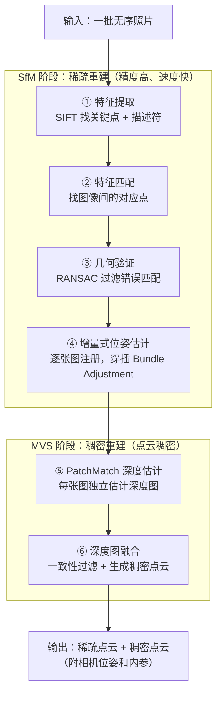

# 全景图：COLMAP 在解决什么问题

你用手机绕着一个物体拍了 60 张照片，想用 NeRF 或 3D Gaussian Splatting 重建它。第一步——几乎所有教程都会告诉你——是先跑 COLMAP。COLMAP 输出相机位姿和稀疏点云，NeRF/3DGS 才能用。

但 COLMAP 到底在做什么？为什么单凭照片就能算出每张照片的拍摄位置？这一章给出整体答案，后续章节再逐步深入每个环节。

## 核心问题：从 2D 图像恢复 3D 结构

照片是三维世界的一次透视投影——深度信息在这个过程中丢失了。一个像素点背后，沿着相机射线延伸的所有三维点，都会投影到同一个位置。所以单张图像无法告诉你任何点的深度。

但**多张从不同位置拍摄的图像包含互补信息**。同一个三维点在两张图里的位置不同，这种"视差"编码了深度——就像人的两只眼睛让你感知立体空间一样。COLMAP 要做的，就是从大量照片的视差中，同时恢复出每张照片的拍摄位置（相机位姿）和场景的三维结构（点云）。

这个问题在计算机视觉里叫做 **Structure from Motion（SfM，运动恢复结构）**——"运动"指相机的位移，"结构"指场景的三维点。

## 整体流程：两个阶段，六个步骤

COLMAP 的完整流程分为两大阶段，SfM 负责稀疏重建，MVS 负责稠密重建：

> 注意流程中没有任何"你需要告诉 COLMAP 相机顺序"的步骤——它处理的是**无序图像集合**，自己推断哪些图片能匹配、哪些图片从相邻位置拍摄。

## SfM 阶段：稀疏但精确

SfM 的输出是稀疏点云（通常几千到几十万个点）和每张图精确的相机位姿。"稀疏"不是缺点，而是 SfM 工作方式的自然结果：它只能在能被可靠检测和匹配的特征点处重建三维点。

**特征提取（第①步）**：在每张图像里找"指纹"——那些在旋转、缩放、光照变化下仍然稳定的局部区域。SIFT（尺度不变特征变换）是 COLMAP 默认使用的方法，它给每个关键点生成一个 128 维的描述符，作为该点的视觉指纹。

**特征匹配（第②步）**：比对不同图像之间的描述符，找出视觉上相似的点对（候选对应点）。朴素做法是两两比对所有图像，但图像多时代价是 $O(n^2)$，COLMAP 支持词袋（Bag of Words）加速，先找相似图像对再匹配。

**几何验证（第③步）**：匹配出来的点对有大量错误（描述符相似但实际是不同物体上的点）。COLMAP 用 RANSAC 估计两视图之间的几何关系（本质矩阵或基础矩阵），把与几何关系不一致的匹配过滤掉，只保留"内点"。

**增量式位姿估计（第④步）**：这是 SfM 的核心。选两张有足够匹配、基线合适的图像作为起点，用三角测量建立初始稀疏点云，然后逐张加入新图像：
- 新图像通过 PnP（透视 n 点）+ RANSAC 估计位姿（它在已知三维点的投影约束下求解相机的 6 自由度位置）
- 新图像带来的匹配帮助三角化更多三维点
- 每隔若干步做一次全局 Bundle Adjustment，把所有相机位姿和三维点一起优化，消除误差积累

最终 SfM 给出精确的相机位姿（旋转 + 平移）、相机内参（焦距、主点、畸变系数），以及稀疏点云。这三样东西是 NeRF 和 3DGS 需要的全部输入。

## MVS 阶段：稠密但更慢

如果只需要喂给 NeRF/3DGS，SfM 的结果就够了。MVS 是为了得到稠密重建——给后续的表面重建、测量或可视化用。

**PatchMatch 深度估计（第⑤步）**：利用 SfM 给出的相机位姿，对每张图独立估计深度图——图中每个像素对应的深度值。PatchMatch 的核心思路是：如果深度估计正确，把这个点投影到相邻图中的对应区域，两块图像区域应该看起来一样（光度一致性）。通过随机传播 + 迭代优化，找到使光度一致性最好的深度和法向量。

**深度图融合（第⑥步）**：多张图的深度图各自独立估计，存在噪声和不一致。融合时只保留在多张图中深度一致的点，过滤掉估计不稳定的区域，生成最终的稠密点云（可以进一步用泊松表面重建得到网格）。

## COLMAP 的输出：三个文件

SfM 完成后，结果存储在 `sparse/0/` 目录下：

| 文件 | 内容 |
|------|------|
| `cameras.bin` | 每个相机模型的内参（焦距、主点、畸变系数） |
| `images.bin` | 每张图像的外参（旋转四元数 + 平移向量）及对应的特征点 |
| `points3D.bin` | 每个三维点的世界坐标及被哪些图像观测到 |

这三个文件就是 NeRF/3DGS 所需的全部"前处理结果"。Instant-NGP、Gaussian Splatting 等框架都有脚本直接读取这个格式，或转换为 `transforms.json`。

## 为什么 COLMAP 能工作：两个关键观察

读完流程之后，有两个更深的问题值得回答——不然流程只是步骤的罗列。

**为什么特征匹配能找到对应点**：SIFT 关键点不是随便选的像素点，它们是图像尺度空间中的极值点（类似"角点"或"斑点"），在不同拍摄角度、不同缩放倍率、不同光照下，对同一物体的同一位置，SIFT 大概率都能检测到同一个关键点，且生成相似的描述符。这就是"尺度不变"的含义。

**为什么能同时恢复位姿和三维点（而不是需要知道其中之一）**：这是 SfM 最精妙的地方。它不需要知道任何先验三维结构——起点只是两张图的特征匹配。从匹配关系可以估计两相机的相对旋转和平移方向（本质矩阵分解），从旋转和平移方向可以三角测量出三维点，有了三维点可以用 PnP 注册更多图像，注册更多图像后有了更多匹配可以三角化更多三维点……这是一个自举（bootstrapping）过程，从两张图出发，滚雪球式地扩展到整个场景。

## 本系列的阅读路线

接下来每一章聚焦流程中的一个环节，从"它在解决什么问题"出发，把设计原理讲透。如果你的目标是：

- **看懂 COLMAP 的参数和输出**：重点读第 01、09、10 章
- **理解 SfM 的完整原理**：读第 01-06 章
- **理解稠密重建 MVS**：读第 07-08 章
- **对接 NeRF/3DGS**：直接跳到第 10 章，用到哪个概念再回来查

**知识链接**：
- [相机模型与针孔投影](/前置知识/014a_前置知识_相机模型与针孔投影) — 投影矩阵是什么、内外参含义
- [对极几何：两视图如何约束三维空间](/前置知识/014b_前置知识_对极几何两视图几何基础) — 本质矩阵、三角测量
- [RANSAC：在噪声匹配中找几何一致的子集](/前置知识/014d_前置知识_RANSAC鲁棒估计) — 几何验证的鲁棒估计方法
- [Bundle Adjustment：同时优化所有相机位姿和三维点](/前置知识/014e_前置知识_BundleAdjustment捆绑调整) — SfM 精度的最终保证

下一章：[SIFT 特征：找到图像里稳定的"指纹"](./02_SIFT特征提取与描述)
