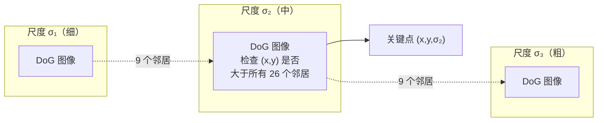
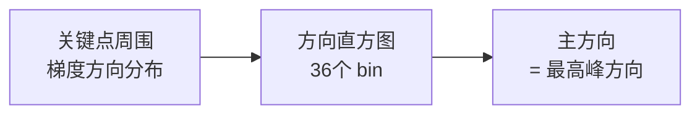
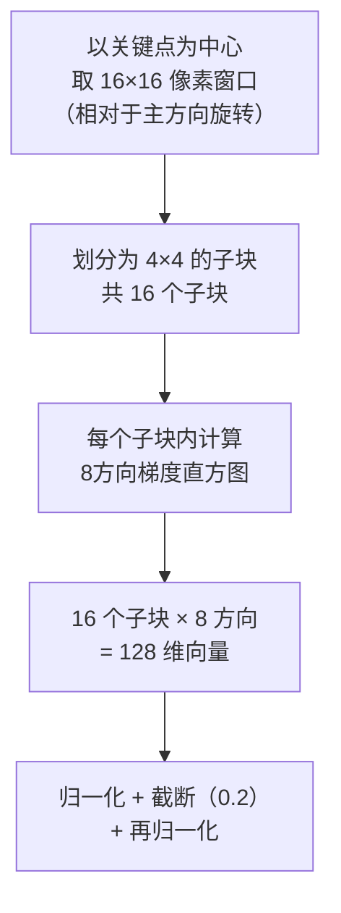

# SIFT 特征：找到图像里稳定的"指纹"

特征匹配的前提是：同一个三维点在不同图像里都能被"认出来"。但相机从不同角度、不同距离、不同光照条件下拍摄，同一个点的像素外观可以差异巨大。

普通的像素块比较根本不够用——近处拍的建筑门把手和远处拍的同一个门把手，像素完全不同。SIFT（Scale-Invariant Feature Transform，尺度不变特征变换）的目标就是找到那些**在旋转、缩放、光照变化下都能被稳定检测并描述**的局部区域。它是 COLMAP 默认使用的特征，也是三维重建领域二十余年来的基石算法。

SIFT 分两个阶段：先**检测关键点**（在哪里提特征），再**描述关键点**（这个特征的视觉指纹是什么）。

## 阶段一：检测关键点

### 为什么需要"尺度不变"

同一个物体的角点，近拍时可能跨越 5 个像素，远拍时只有 1 个像素。如果固定一个检测窗口大小，近拍和远拍根本检测不到同一个点。

解决方案：**在多个尺度下同时看图像**，让每个关键点找到它"最合适"的那个尺度——那个尺度下，这个结构刚好是局部极值。

### 高斯尺度空间：从细节到整体

高斯模糊天然地代表"在某个尺度下看图像"。用标准差为 $\sigma$ 的高斯核模糊图像，等价于把所有细节小于 $\sigma$ 的结构都抹掉，只保留更大尺度的结构。$\sigma$ 越大，图像越模糊，保留的结构越粗。

SIFT 构建一个**高斯金字塔**：把图像用若干个逐渐增大的 $\sigma$ 分别模糊，得到一组从清晰到模糊的图像，称为一个**组（octave）**。每组结束时，把图像下采样一半，开始下一组——这样总共能覆盖从像素级到整图级别的所有尺度。

### DoG：用减法检测"斑点"

直接在高斯模糊图像上找特征点不够稳定。SIFT 用的是**差分高斯（Difference of Gaussians，DoG）**：把相邻两个 $\sigma$ 的模糊图像相减。

$$
D(x, y, \sigma) = L(x, y, k\sigma) - L(x, y, \sigma)
$$

其中 $L(x,y,\sigma)$ 是用 $\sigma$ 模糊后的图像，$k$ 是相邻尺度的比例因子。

**这个公式在做什么**：两个不同程度模糊的图像相减，消除了两者共有的低频背景，留下了"在这个尺度范围内存在的结构"。DoG 是高斯拉普拉斯（LoG）的高效近似——LoG 是经典的斑点检测器，响应在斑点（blob）的中心最强。

::: details 📐 为什么 DoG 近似 LoG（可跳过）

高斯函数对尺度 $\sigma$ 的导数满足：

$$
\frac{\partial G}{\partial \sigma} = \sigma \nabla^2 G
$$

用有限差分近似这个导数：

$$
\sigma \nabla^2 G \approx \frac{G(x,y,k\sigma) - G(x,y,\sigma)}{k\sigma - \sigma}
$$

所以 $D = G(x,y,k\sigma) - G(x,y,\sigma) \approx (k-1)\sigma^2 \nabla^2 G$，与 LoG 成正比。LoG 在斑点边缘为零、中心最强，正好适合检测"局部圆形结构"——这类结构在不同拍摄角度下最稳定。
:::

下图展示了不同 $\sigma$ 下的高斯核形状，以及相邻两个 $\sigma$ 相减后的 DoG 响应——DoG 在中心位置（结构中心）有明显的极值：

> 上图：三个不同 $\sigma$ 的高斯核，$\sigma$ 越大越平坦，代表更粗的尺度。下图：相邻 $\sigma$ 相减的 DoG 响应，中心极大值正是关键点检测的目标。

### 关键点：三维极值点

有了 DoG 图像，SIFT 在**空间 × 尺度**三个维度上找极值点：一个像素 $(x, y, \sigma)$ 的 DoG 值，要大于（或小于）它在同尺度的 8 个邻居 + 上下相邻尺度各 9 个邻居，共 26 个邻居。满足条件的点就是候选关键点。

> 关键点必须在空间和尺度两个维度都是极值——这保证了它能以相同的尺度从不同拍摄距离的图像中被检测到。

**精确定位（亚像素）**：极值点在离散网格上找到后，用二阶泰勒展开对 DoG 函数做插值，把关键点精确到亚像素和亚尺度级别，同时过滤掉低对比度的弱响应（$|D| < 0.03$）和边缘上不稳定的响应（用 Hessian 矩阵的主曲率比检测）。

## 阶段二：描述关键点

找到关键点后，还需要一个"指纹"——描述这个关键点周围的视觉外观，让它能被另一张图中的同一个点认出来。

### 主方向：让描述符旋转不变

在计算描述符之前，SIFT 先给每个关键点确定一个**主方向**，后续所有计算都相对于这个方向进行——这样旋转图像后，描述符不变。

做法：在关键点所在尺度的高斯模糊图像上，计算以关键点为中心、一定半径内所有像素的梯度方向，用高斯加权累积成方向直方图（36个方向bin，每 10°一个）。直方图最高峰对应的方向就是主方向。

### 128 维描述符：梯度方向直方图的拼接

SIFT 描述符的设计目标是：描述关键点周围的梯度分布，对光照线性变化鲁棒，对小量几何扭曲鲁棒。

具体做法如下：

每一步的设计考虑：

**为什么是 4×4 子块而不是单个直方图**：单个整体直方图丢失了空间位置信息——左上角和右下角的梯度不加区分地混在一起。分成 16 个子块，保留了局部空间结构，使描述符对相邻像素的微小位移不敏感，但对整体结构保持区分力。

**为什么是 8 个方向**：8 个方向（每 45°）的量化足以区分不同的局部结构（水平、垂直、斜向等），又不至于太细导致对噪声敏感。

**归一化 + 截断的目的**：先做 L2 归一化消除整体亮度变化；再把超过 0.2 的分量截断（限制单个强梯度方向的过大影响）；最后重新归一化。这使描述符对**非线性光照变化**（如局部高光）也有一定鲁棒性。

最终每个关键点得到一个 128 维的浮点向量——这就是 SIFT 描述符。

### 描述符匹配：最近邻 + 比率测试

在匹配时，对图像 A 中的每个描述符，在图像 B 中找最近邻（L2 距离最小）和次近邻。如果最近邻距离 / 次近邻距离 $< 0.8$（Lowe's ratio test），则接受这个匹配；否则认为匹配不可靠，丢弃。

**为什么需要比率测试**：如果最近邻的距离比次近邻小得多（比率低），说明这个匹配有明显的唯一性，不太可能是偶然的相似。如果两者距离接近，说明存在多个看起来差不多的候选，这个匹配不可靠。

比率测试是 SIFT 匹配中过滤错误匹配最有效的手段，能把匹配中的错误率从超过 50% 降到 10% 以下。

## GPU 加速：COLMAP 的实际使用

SIFT 的尺度空间计算和描述符提取在高分辨率图上非常耗时。COLMAP 内置了基于 CUDA 的 GPU 加速实现（`SiftExtractionOptions` 中 `use_gpu = true`），能把特征提取速度提升 10-50 倍。

如果没有 GPU，COLMAP 也支持纯 CPU 运行，只是慢得多。对于大规模重建（数百张图）建议一定要用 GPU。

## COLMAP 的特征提取参数

COLMAP 的 `feature_extractor` 阶段主要参数：

| 参数 | 默认值 | 含义 |
|------|--------|------|
| `SiftExtraction.max_num_features` | 8192 | 每张图最多保留的特征点数 |
| `SiftExtraction.peak_threshold` | 0.02/3 | DoG 极值点的最低响应阈值，越低找越多关键点 |
| `SiftExtraction.edge_threshold` | 10 | 边缘响应过滤阈值，越低越严格过滤边缘点 |
| `SiftExtraction.max_image_size` | 3200 | 处理前的最大图像边长（超出则缩放） |

**实战建议**：室内纹理稀少的场景（白墙、光滑地板）可以把 `peak_threshold` 降低到 0.004，让 COLMAP 找更多关键点；纹理丰富的户外场景用默认值即可，关键点数量不是越多越好，太多会显著拖慢后续匹配阶段。

## 小结

SIFT 通过两个设计解决了跨视角匹配的核心难题：

- **DoG 尺度空间极值检测**：关键点在尺度 + 空间的三维响应图里找极值，天然保证了在不同拍摄距离下能检测到同一个点，并对应同一个 $\sigma$。
- **基于主方向的梯度方向直方图描述符**：先对齐旋转方向，再用 128 维梯度分布统计描述局部外观，对亮度线性变化和小量几何变形都鲁棒。

这两点合在一起，让 SIFT 成为几十年来特征匹配的默认选择。后续 SuperPoint 等深度学习方法在某些场景下超越了 SIFT，但 COLMAP 仍以 SIFT 为默认，因为它完全无需训练数据，在各类场景下表现稳定。

**知识链接**：
- → [特征匹配策略：在海量图像对中找对应点](./03_特征匹配策略) — SIFT 描述符如何被用于图像间匹配
- [相机模型与针孔投影](/前置知识/014a_前置知识_相机模型与针孔投影) — 理解关键点的像素坐标如何参与后续几何计算

上一章：[全景图：COLMAP 在解决什么问题](./01_全景图_COLMAP在解决什么问题) | 下一章：[特征匹配策略：在海量图像对中找对应点](./03_特征匹配策略)
