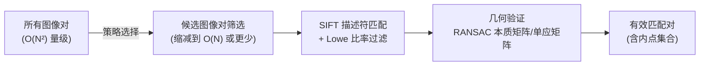
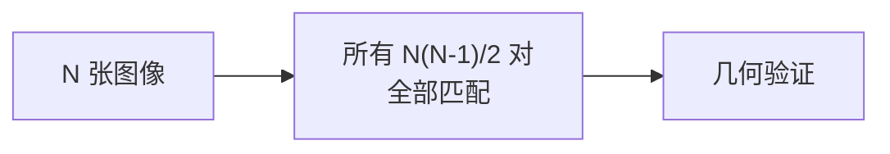
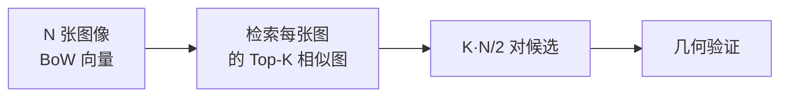
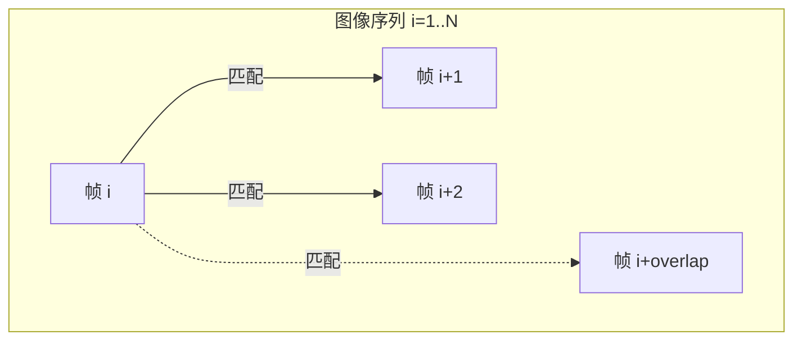

# 特征匹配策略：在海量图像对中找对应点

第 02 章给每张图提取了 SIFT 特征——每张图几千到几万个 128 维的描述符向量。现在要把不同图像里描述同一个三维点的描述符配对起来。

问题的规模是这样的：100 张图、每张 5000 个特征点，朴素地两两比对所有图像对，就是 $C_{100}^2 = 4950$ 对图像，每对还要做 5000×5000 次描述符距离比较——这是 1.2 亿次 128 维向量距离计算。1000 张图时，这个数字变成 1200 亿次，根本跑不完。

COLMAP 提供了四种匹配策略，核心问题都是一样的：**哪些图像对值得做完整的 SIFT 比对？**

## 两种工作：候选筛选 vs 精确匹配

不管用哪种策略，特征匹配都分两步走：



**候选筛选**决定哪些对图像进入后续流程，是策略的核心差异所在。**描述符匹配和几何验证**对每一对候选图像执行，成本固定，由候选对数量线性缩放。

## 几何验证：用 RANSAC 过滤错误匹配

几何验证是匹配流程里最重要但最容易被忽视的一步，值得先讲清楚——后面每种策略都会产生候选对进入这里。

SIFT + Lowe 比率过滤之后，图像对里仍然有 10–30% 的错误匹配。几何验证用 RANSAC 拟合两视图之间的几何关系，自动找到与几何关系一致的"内点"匹配，剔除其余的外点。

COLMAP 同时尝试两种几何关系：

| 几何模型 | 自由度 | 适用场景 |
|----------|--------|----------|
| **基础矩阵 F**（Fundamental Matrix） | 7 | 一般相对运动，有视差 |
| **单应矩阵 H**（Homography） | 8 | 平面场景或相机纯旋转 |

COLMAP 默认在同一对图像上同时估计 F 和 H，比较哪个内点数更多，选取更优的模型。对于纯平面场景（一幅海报的多张照片），H 内点数会远多于 F；有明显视差的真实场景反之。

内点匹配数量是这对图像"是否有效"的判断依据，默认至少要有 15 个内点才会保留这对图像关系用于后续重建。

> 几何验证的具体原理参见 [RANSAC：在充满噪声的匹配中找几何一致的子集](/前置知识/014d_前置知识_RANSAC鲁棒估计) 和 [对极几何：两视图几何基础](/前置知识/014b_前置知识_对极几何两视图几何基础)。

## 策略一：穷举匹配（Exhaustive Matching）

对所有图像对都做完整的 SIFT 比对和几何验证。



**用途**：图像数量少（通常 ≤ 100 张），或场景结构复杂、词袋检索容易漏掉真正重叠的图像对（如反复出现的相似结构、对称建筑）。

**代价**：$O(N^2)$，100 张图约 5000 对，还能接受；500 张图就是 125,000 对，耗时会很长。

**COLMAP 命令**：`colmap exhaustive_matcher`

关键参数 `ExhaustiveMatching.block_size`（默认 50）：把图像分成若干块，每次只在块内做穷举，避免一次性把所有图的描述符都加载进内存。大于这个数的图像集会分块处理，块间也会做交叉匹配。

## 策略二：词袋检索匹配（Vocabulary Tree Matching）

用 BoW 把每张图量化成词频向量，检索最相似的 Top-K 张图，只对这 K 张候选图做 SIFT 比对。



**用途**：图像数量多（数百到数千张），场景覆盖范围广，不同位置拍摄的图像之间没有重叠。这是大规模重建的标准选择。

**代价**：$O(N \cdot K)$，通常 $K$ 取 5–20，代价接近线性。

**BoW 检索的局限**：只能找"词汇组成相似"的图像，对纹理稀少的场景（雪地、白墙走廊）检索效果差，可能漏掉真正有重叠的图像对。

**COLMAP 命令**：`colmap vocab_tree_matcher`（需要提供预训练词汇树文件）

主要参数：

| 参数 | 默认值 | 含义 |
|------|--------|------|
| `VocabTreeMatching.vocab_tree_path` | — | 词汇树路径，必填 |
| `VocabTreeMatching.num_nearest_neighbors` | 5 | 每张图检索最相似的前 K 张 |
| `VocabTreeMatching.num_checks` | 256 | 量化时的精度控制，越大越准但越慢 |

**词汇树下载**：COLMAP 官方提供了 `vocab_tree_flickr100K_words32K.bin`（32K 词，适合中小规模）和 `vocab_tree_flickr100K_words256K.bin`（256K 词，更准确，文件更大），从 [COLMAP 官网](https://colmap.github.io/faq.html) 下载。

词袋模型的原理详见 [词袋模型：从海量图像中快速找相似场景](/前置知识/014c_前置知识_词袋模型与图像检索)。

## 策略三：序列匹配（Sequential Matching）

假设图像按拍摄顺序排列（视频帧或有序照片），只对相邻的若干帧做匹配。



**用途**：无人机航拍、机器人 SLAM、绕物体拍摄的视频序列。文件名排序即为拍摄顺序（COLMAP 按文件名字母序排列图像）。

**代价**：$O(N \cdot \text{overlap})$，接近线性。

**局限**：不能处理场景回环（走了一圈又回到起点）——回环的两端时间上相距很远，序列匹配看不到它们的重叠。COLMAP 提供了一个可选的 `loop_detection` 参数，在序列匹配基础上加入词袋检索来处理回环，但需要额外的词汇树文件。

**COLMAP 命令**：`colmap sequential_matcher`

主要参数：

| 参数 | 默认值 | 含义 |
|------|--------|------|
| `SequentialMatching.overlap` | 10 | 每帧向后匹配多少帧 |
| `SequentialMatching.loop_detection` | false | 是否启用回环检测 |
| `SequentialMatching.vocab_tree_path` | — | 回环检测需要的词汇树路径 |

## 策略四：自定义图像对（Custom Matching）

用户提供一个文本文件，显式列出哪些图像对需要匹配。适合有外部信息（GPS 坐标、拓扑图）的场景，或已经通过其他方法确定了图像重叠关系。

```
image_001.jpg image_002.jpg
image_001.jpg image_050.jpg
image_020.jpg image_021.jpg
```

**COLMAP 命令**：`colmap matches_importer`

## 如何选择策略

| 场景 | 推荐策略 |
|------|----------|
| ≤ 100 张图，任意顺序 | 穷举匹配 |
| 数百张图，无人机/绕物拍摄 | 词袋匹配（32K 词汇树） |
| 视频帧，拍摄顺序已知 | 序列匹配（overlap=15–30） |
| 视频帧 + 场景有回环 | 序列匹配 + 回环检测 |
| 有 GPS 或拓扑先验 | 自定义图像对 |

**实际建议**：词袋匹配是最通用的选择，只要场景有足够纹理。遇到匹配稀少导致重建断开时，可以先用词袋匹配，再对断开区域补做穷举匹配（COLMAP 支持分阶段运行，新的匹配结果会追加到数据库）。

## 匹配完成后的数据库

所有匹配和几何验证结果都存储在 COLMAP 的 SQLite 数据库（`database.db`）里，内容包括：

- `keypoints` 表：每张图的 SIFT 关键点坐标和尺度
- `descriptors` 表：每张图的 SIFT 描述符（128 维浮点）
- `matches` 表：原始描述符匹配（几何验证前）
- `two_view_geometries` 表：几何验证后的内点匹配 + F/H 矩阵

后续的增量式 SfM 完全从 `two_view_geometries` 读取，只使用几何验证通过的内点。

## 小结

特征匹配是一个成本控制问题：穷举匹配精确但昂贵，词袋、序列、自定义匹配都是用先验知识削减候选对数量。无论哪种策略，**几何验证（RANSAC + 基础矩阵/单应矩阵）**都是必须的——它把描述符相似度判断提升到几何一致性判断，去掉了绝大多数视觉相似但物理位置不对应的错误匹配，给后续位姿估计提供干净的输入。

**知识链接**：
- ← [SIFT 特征](/系列/colmap_deep_dive/02_SIFT特征提取与描述) — 匹配的原始输入
- ← [词袋模型](/前置知识/014c_前置知识_词袋模型与图像检索) — 词袋检索的工作原理
- ← [RANSAC 鲁棒估计](/前置知识/014d_前置知识_RANSAC鲁棒估计) — 几何验证的核心算法
- → [对极几何与位姿估计](/系列/colmap_deep_dive/04_对极几何与位姿估计) — 从匹配关系恢复相机相对位姿

上一章：[SIFT 特征：找到图像里稳定的"指纹"](./02_SIFT特征提取与描述) | 下一章：[对极几何与位姿估计](./04_对极几何与位姿估计)
