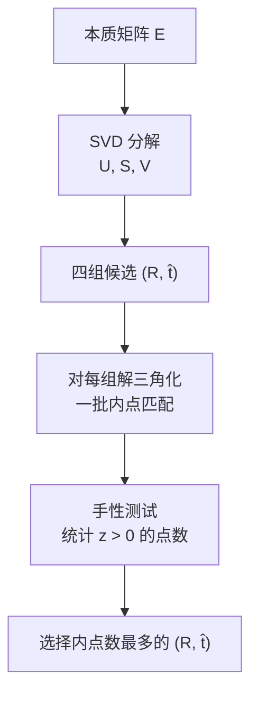
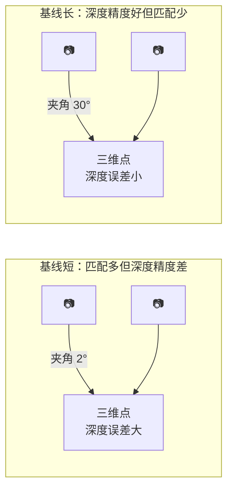
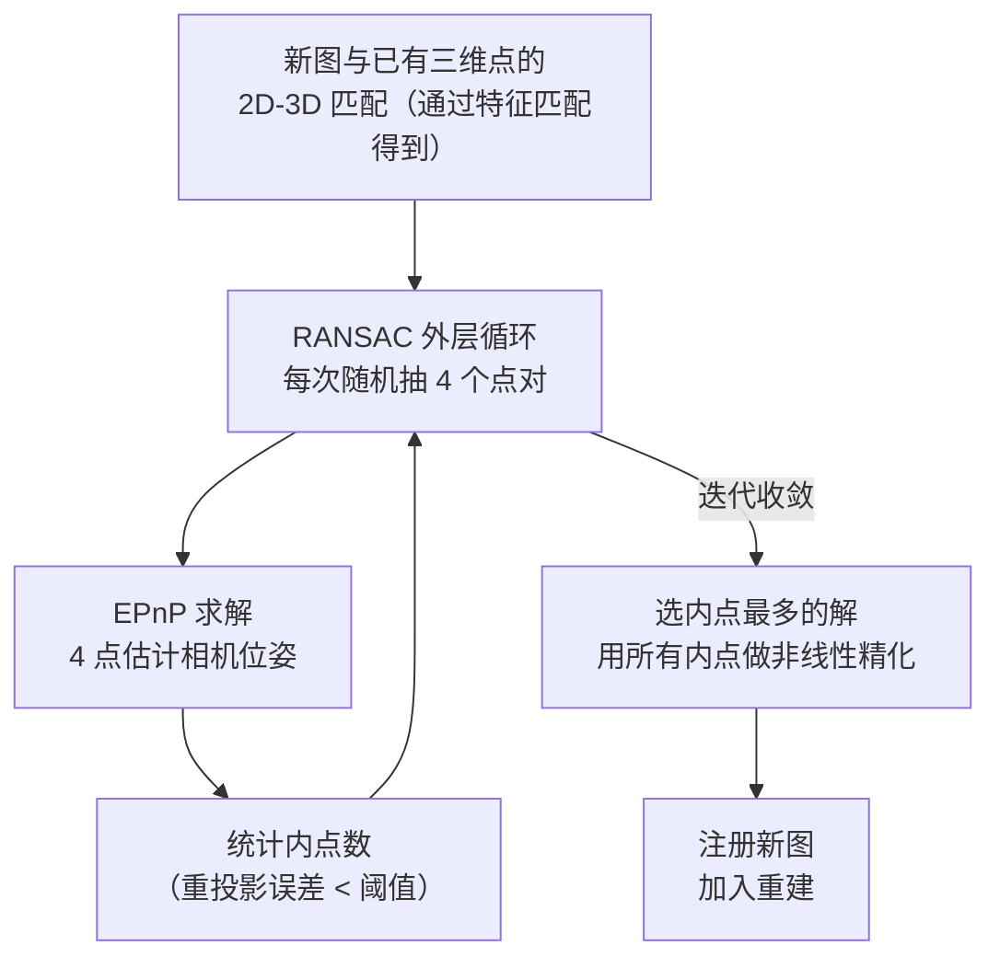

# 对极几何与位姿估计：从匹配点对恢复相机位置

第 03 章结束时，COLMAP 的数据库里有了一批几何验证通过的图像对，每对附带一组内点匹配和对应的基础矩阵（或单应矩阵）。现在的问题是：**如何从这些匹配关系推断出每张图的拍摄位置？**

这一章分两部分：第一部分讲如何从两张图的匹配关系恢复相对位姿（两视图问题），第二部分讲有了初始点云之后如何把新图一张张注册进来（多视图扩展）。

## 两视图：从匹配点对到相对位姿

### 从基础矩阵到本质矩阵

几何验证已经给每对图像估计出基础矩阵 $F$，它编码了两视图之间的对极约束：

$$
\mathbf{p}'^T F \mathbf{p} = 0
$$

$F$ 是用像素坐标建立的，与相机内参有关。**本质矩阵 $E$** 是归一化图像坐标（去掉内参影响）下的对应关系：

$$
E = K'^T F K
$$

其中 $K, K'$ 是两相机的内参矩阵。$E$ 只编码两相机的旋转 $R$ 和平移方向 $\hat{t}$，与场景无关。

**为什么先估 $F$ 再转 $E$**：$F$ 的估计不需要知道内参（适合内参未知或初始化不精确的情况），COLMAP 在几何验证阶段统一用 $F$。当后续有精确内参时，转换为 $E$ 再分解，得到更稳定的旋转和平移。

### 分解 $E$：四组候选解

对 $E$ 做 SVD 分解可以得到四组候选的旋转和平移方向 $(R_1, +\hat{t})$、$(R_1, -\hat{t})$、$(R_2, +\hat{t})$、$(R_2, -\hat{t})$。四组解里只有一组让所有三维点都在两台相机前方——这叫**手性测试（cheirality test）**：取一批内点匹配，用每组解三角化，统计重建出的三维点有多少在两个相机的正前方（$z > 0$），选通过手性测试最多的那组。

> 注意这里恢复的是平移**方向** $\hat{t}$（单位向量），不是平移量。平移的尺度由三角化后的三维点深度隐含确定，但整个场景的绝对尺度是欠定的——这也是为什么 COLMAP 的输出需要外部标定（如 GPS 或已知长度的标尺）才能得到真实尺度。

### 三角化：从两视图匹配到三维点

有了两相机的相对位姿，就能对每对内点匹配做三角化——求那条"两条射线的交点"。

两条射线在存在噪声时一般不精确相交，用线性方法（DLT）求最小二乘解：

$$
\begin{bmatrix} p_x P_3^T - P_1^T \\ p_y P_3^T - P_2^T \\ p'_x P'^T_3 - P'^T_1 \\ p'_y P'^T_3 - P'^T_2 \end{bmatrix} \mathbf{X} = 0
$$

其中 $P, P'$ 是两台相机的投影矩阵，$P_i^T$ 是第 $i$ 行。对系数矩阵做 SVD，最小奇异值对应的右奇异向量即为 $\mathbf{X}$。

三角化结果要过滤：

- **重投影误差**：$\mathbf{X}$ 投影回两张图的像素误差超过阈值（默认 4 像素）则丢弃
- **深度**：$\mathbf{X}$ 在任一相机后方（$z \le 0$）则丢弃
- **基线角度**：两条射线夹角太小（$< 1°$）则三角化精度差，丢弃

### 基线和三角化精度的权衡

基线越长，三角化精度越高（射线交叉角越大，深度误差越小）；但基线太长，两张图重叠区域少，匹配点数量少。COLMAP 在选取初始图像对时，同时考虑匹配数量（要多）和基线角度（要大），取两者综合最优的一对。

## 多视图扩展：PnP 注册新图像

有了初始两视图的稀疏点云，增量式 SfM 用 **PnP（Perspective-n-Point）** 把新图像一张张注册进来。

### PnP：从 2D-3D 对应估计相机位姿

PnP 的输入是：已知位置的三维点 $\{\mathbf{X}_j\}$ 和它们在新图像中的像素坐标 $\{\mathbf{x}_j\}$。问题是求这张新图的相机旋转 $R$ 和平移 $\mathbf{t}$，使所有点的投影误差最小。

**为什么 PnP 可以单独求解新图位姿**：三维点位置已知（来自前面的三角化），只需估计 6 个自由度的相机位姿，比从零开始估计本质矩阵要约束更强，精度更高。

COLMAP 使用 EPnP + RANSAC：

**EPnP 为什么需要 4 个点**：3 个点（P3P）有多解（4 个），加上第 4 个点可以唯一确定位姿。COLMAP 默认使用 EPnP，它能利用更多点得到更稳定的初始解，再用非线性优化精化。

### 三角化更多三维点

注册完新图后，它带来了新的匹配关系：新图与已有图像之间的特征匹配可以三角化出更多三维点（这些点之前没有被三角化，因为它们只在已注册图像中出现）。这些新点又帮助后续的新图注册，形成滚雪球式扩展。

### 局部 Bundle Adjustment

PnP 给出的初始位姿有误差，三角化后又有误差积累。每注册若干张新图，COLMAP 做一次**局部 BA**：只优化最近注册的相机和它们观测到的三维点，修正误差而不动之前已经稳定的部分。

每隔更长时间做一次**全局 BA**：所有相机和点一起优化，彻底消除漂移。全局 BA 的代价高，但是 SfM 精度的根本保证。

BA 的原理详见 [Bundle Adjustment：同时优化所有相机位姿和三维点](/前置知识/014e_前置知识_BundleAdjustment捆绑调整)。

## COLMAP 的图像注册顺序

COLMAP 不是简单地按文件名顺序注册图像，而是用一个启发式评分来决定下一张注册哪张图：

$$
\text{score}(i) = (\text{与已注册图匹配的内点数})^{0.6} \times (\text{可三角化的已有三维点数})
$$

选评分最高的图优先注册——它的意思是：和已有重建重叠最多、能提供最多几何约束的图。这个顺序让重建从核心稳定区域向外扩展，而不是从薄弱区域开始积累误差。

## 失败场景和处理方式

**初始化失败**：找不到满足"内点数多 + 基线够"的图像对。常见原因是图像纹理稀少或两两重叠不足。解法：确保拍摄时有足够重叠（建议 60–80%），或对纹理稀少场景降低 SIFT 检测阈值（`peak_threshold`）。

**注册失败（某张图孤立）**：新图与已有三维点的 2D-3D 内点数太少（`< min_num_inliers`，默认 30）。常见原因是拍摄角度变化太大或光照剧变。解法：补拍过渡图，或降低 `Mapper.min_num_inliers`（但会增加位姿误差的风险）。

**漂移**：长走廊、对称建筑等场景，误差沿序列积累，回环处错位明显。必须通过回环检测（词袋匹配 + 几何验证找到回环处的图像对）并在全局 BA 时一并约束。

## COLMAP 相关参数

`colmap mapper` 阶段的关键参数：

| 参数 | 默认值 | 含义 |
|------|--------|------|
| `Mapper.min_num_inliers` | 30 | 注册新图至少需要的 2D-3D 内点数 |
| `Mapper.init_min_num_inliers` | 100 | 初始图像对至少需要的特征匹配内点数 |
| `Mapper.init_min_tri_angle` | 16° | 初始图像对要求的最小三角化角 |
| `Mapper.ba_local_num_images` | 6 | 局部 BA 覆盖的最近注册图像数 |
| `Mapper.ba_global_images_freq` | 500 | 每注册多少张图做一次全局 BA |

## 小结

两视图的位姿估计从本质矩阵分解出四组候选旋转和平移，通过手性测试选出正确解。三角化把 2D 匹配转化成 3D 点，但精度依赖于基线角度。多视图扩展用 PnP 把新图注册进来，每步穿插局部 BA 控制误差，定期全局 BA 消除积累漂移。

这个过程本质上是**几何约束的渐进加强**：从两张图的相对位姿出发，每增加一张图就多一批约束加入 BA，整个重建在迭代中收敛到全局最优。

**知识链接**：
- ← [特征匹配策略](/系列/colmap_deep_dive/03_特征匹配策略) — 匹配内点是位姿估计的输入
- ← [对极几何：两视图几何基础](/前置知识/014b_前置知识_对极几何两视图几何基础) — 本质矩阵推导与三角化原理
- ← [RANSAC 鲁棒估计](/前置知识/014d_前置知识_RANSAC鲁棒估计) — PnP + RANSAC 的工作方式
- → [增量式 SfM：全流程走通](/系列/colmap_deep_dive/05_增量式SfM) — 把两视图和 PnP 组合成完整 SfM 流程

上一章：[特征匹配策略](./03_特征匹配策略) | 下一章：[增量式 SfM：全流程走通](./05_增量式SfM)
