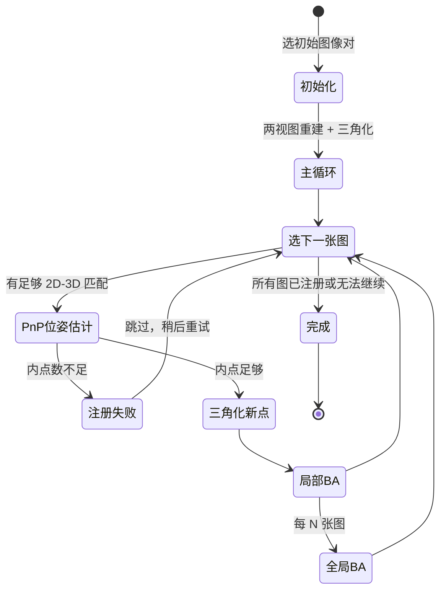
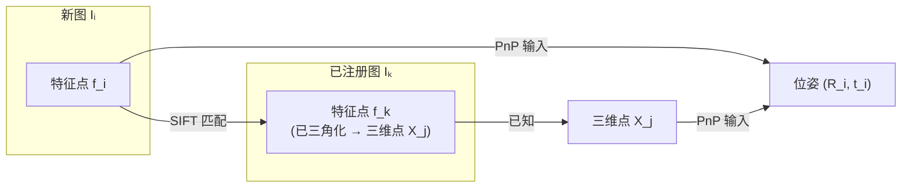
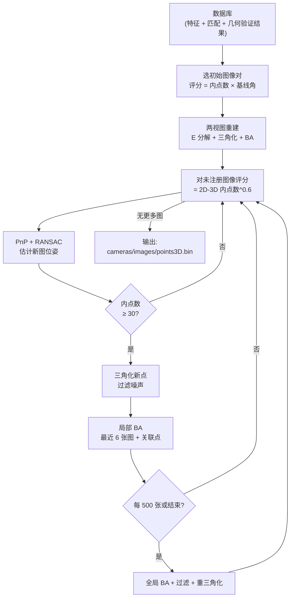

# 增量式 SfM：从两张图到完整场景的自举过程

前四章分别讲了 SIFT 特征、特征匹配、对极几何与 PnP。这一章把它们组合起来，讲 COLMAP 的 `mapper` 阶段是如何把这些积木拼成一个完整的三维重建流程的。

增量式 SfM 有一个反直觉的地方：它不需要知道任何初始的三维结构，也不需要提前知道相机位置。整个场景的三维点云和相机位姿，是从零开始、从两张图出发，**自举（bootstrapping）**出来的。

## 整体状态机

把 COLMAP mapper 看作一个状态机，理解它在任意时刻的状态，就能理解每一步在做什么。

**状态**：
- 一个**已注册图像集合** $\mathcal{I}$（初始为空）
- 一个**已重建三维点云** $\mathcal{P}$（初始为空）
- 每个已注册图像的**相机位姿** $\{(R_i, t_i)\}$
- 每个三维点被哪些图像观测到的**可见性图**

**一次迭代做什么**：选一张新图，估计它的位姿，三角化新点，做局部 BA，修正误差。

## 第一步：选初始图像对

初始图像对是整个重建的地基。选错了，整个重建会漂移或无法收敛。

COLMAP 对每对有效匹配的图像评分，综合两个维度：

1. **匹配内点数量**：内点越多，三角化的点越多，初始点云越稠密，后续注册越稳定。但内点太多往往意味着相机位置太近、基线太短。
2. **三角化角**：用初步估计的相机方向（仅根据内点几何关系）计算对应三维点方向的夹角，要求大于 `init_min_tri_angle`（默认 16°）。基线角越大，三角化深度越精确，但通常内点数更少。

两个维度本质上相反，COLMAP 通过阈值过滤（内点数 ≥ `init_min_num_inliers`，三角化角 ≥ 阈值）取合格对，再从中选内点最多的一对。

**初始化容易失败的场景**：
- 纯旋转：相机绕光轴旋转，基线为零，三角化完全不定
- 平面场景：所有三维点共面，本质矩阵退化（此时单应矩阵更合适，但单应矩阵的位姿分解也有多解问题）
- 图像过少且重叠不足：找不到同时满足两个阈值的图像对

## 第二步：初始两视图重建

选好初始图像对 $(I_1, I_2)$ 后：

1. 把第一张图 $I_1$ 的位姿设为世界坐标系原点：$R_1 = I_{3\times3}$，$t_1 = 0$
2. 从本质矩阵分解 $R_2, \hat{t}_2$，用手性测试确定正确解（见第 04 章）
3. 对所有内点匹配做三角化，得到初始点云 $\mathcal{P}$
4. 对 $(I_1, I_2)$ 和 $\mathcal{P}$ 做一次全局 BA，消除初始误差

此后世界坐标系就固定了——所有新图的位姿都相对于这个坐标系。注意平移尺度也在此时固定：$|t_2|$ 的长度隐含了场景尺度，整个重建的尺度由它决定。

## 第三步：选下一张要注册的图像

不是按文件顺序，而是按评分选"最有价值"的下一张图：

$$
\text{score}(I_i) = (\text{与已有三维点的 2D-3D 内点数})^{0.6}
$$

指数 0.6 让评分随内点数次线性增长，避免极端情况（某张图有几千个 2D-3D 内点但其他指标差）主导选择。

**如果没有图能满足最低内点数阈值（默认 30）**：映射器会尝试以更低阈值重试，或停止当前的重建分量，尝试用剩余图像开始新的分量（COLMAP 支持多个不相连分量）。

## 第四步：PnP 注册新图

PnP 的输入是：已有三维点 $\mathbf{X}_j$ 和它们在新图中的像素坐标 $\mathbf{x}_j$（通过特征匹配确定），估计新图的 $(R_i, t_i)$。

**2D-3D 匹配的来源**：新图 $I_i$ 已经在匹配阶段和已注册图 $I_k$ 建立了特征匹配。已注册图 $I_k$ 的特征点有些已经三角化成三维点，所以 $I_i$ 上的特征点可以通过 $I_k$ 追溯到对应的三维点——这就是 2D-3D 对应。

EPnP + RANSAC 的流程见第 04 章。注册成功的判据：内点数 ≥ `min_num_inliers`（默认 30）。

## 第五步：三角化更多三维点

新图注册后，它和所有已注册图的匹配关系都可以用来三角化新点。哪些匹配点还没有对应三维点？这些点对（新图特征点 + 某已注册图特征点）现在都有了已知位姿，可以三角化。

三角化的过滤条件：
- 重投影误差 $< 4$ 像素（在两张图中）
- 深度 $> 0$（点在相机前方）
- 三角化角 $> 0.5°$（基线够大）

过滤后的点加入 $\mathcal{P}$，可见性图更新。

## 第六步：局部 Bundle Adjustment

每注册一张新图后，做局部 BA：

- 固定"老"相机（已注册较久的图），只优化最新注册的若干张图（由 `ba_local_num_images` 控制，默认 6）
- 同时优化这些图观测到的所有三维点
- 用 Ceres Solver 求解稀疏非线性最小二乘（Huber 核 + Schur 消元）

**为什么不每次都做全局 BA**：全局 BA 的复杂度随场景规模增长很快，每步都做会让大场景重建慢到不可接受。局部 BA 代价低，足以消除新图引入的局部误差。

## 第七步：全局 Bundle Adjustment

每注册 `ba_global_images_freq`（默认 500）张图，或者重建结束时，做一次全局 BA：所有相机 + 所有三维点一起优化。

全局 BA 不仅消除漂移，还处理**回环**：如果场景有回环（同一个地点从不同时间被再次拍到），回环处的匹配约束在局部 BA 中无法被利用，只有在全局 BA 里才能把两端拉在一起。

## 过滤与清理

全局 BA 之后，COLMAP 还做一轮清理：

- **三维点过滤**：删除重投影误差过大（默认 $> 4$ 像素）或三角化角过小的点
- **重新三角化**：用优化后的位姿重新三角化那些之前因为位姿不准而被过滤的匹配，找回被误删的点
- **位姿细化**：对重投影误差高于阈值的图像重新做 PnP，修正因 BA 尚未收敛时注册的图像

清理 + 重三角化通常要循环 2–3 次才收敛。

## 完整流程图

## 重建质量的关键指标

重建完成后，COLMAP 会在命令行输出若干质量指标：

| 指标 | 含义 | 健康值 |
|------|------|--------|
| `mean_reproj_error` | 平均重投影误差 | $< 1.0$ 像素 |
| `mean_num_observations` | 每个三维点平均被多少张图看到 | $> 3$ |
| `mean_num_3d_points` | 每张图平均有多少可见三维点 | $> 500$ |
| `num_reg_images` / `num_images` | 注册成功率 | $> 90\%$ |

重投影误差 $> 2$ 像素说明有系统性问题（通常是内参不准确或镜头畸变模型选择错误）。注册率低说明匹配策略不适合当前场景。

## 多分量问题

如果场景有多个不相连的部分（比如室内室外没有重叠图像），COLMAP 会生成多个重建分量，分别存放在 `sparse/0/`、`sparse/1/` 等目录下。每个分量有自己独立的坐标系和尺度，不能直接合并。

## 小结

增量式 SfM 是一个闭环迭代系统：初始两视图建立坐标系，PnP 把新图注册进来，三角化扩充点云，BA 修正误差，修正后的位姿又让下一张图注册得更准。整个系统的稳健性来自 RANSAC（抵抗错误匹配）和多次 BA（消除积累误差），规模扩展性来自稀疏 Jacobian 的 Schur 消元。

接下来 Bundle Adjustment 章节（第 06 章）会更深入地讲 COLMAP 的 BA 实现细节——优化策略、Ceres 配置、大规模场景的处理技巧。

**知识链接**：
- ← [对极几何与位姿估计](/系列/colmap_deep_dive/04_对极几何与位姿估计) — E 分解、三角化、PnP
- ← [Bundle Adjustment 前置知识](/前置知识/014e_前置知识_BundleAdjustment捆绑调整) — Schur 消元与 Ceres Solver
- → [Bundle Adjustment 在 COLMAP 中的实现](/系列/colmap_deep_dive/06_BundleAdjustment) — 局部 BA、全局 BA 的参数与调优

上一章：[对极几何与位姿估计](./04_对极几何与位姿估计) | 下一章：[Bundle Adjustment 在 COLMAP 中的实现](./06_BundleAdjustment)
