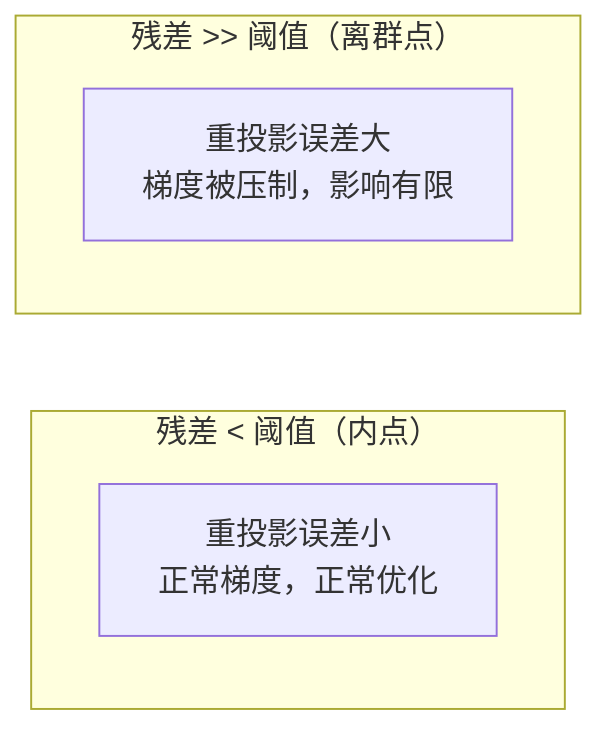
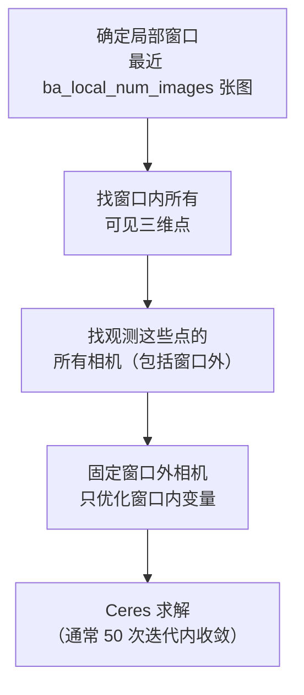

# Bundle Adjustment 在 COLMAP 中的实现

Bundle Adjustment（BA）是 SfM 精度的最终保证。第 05 章描述了 BA 在增量式 SfM 里的两个角色——局部 BA 控制近期误差、全局 BA 消除漂移。这一章深入 COLMAP 的 BA 实现：Ceres Solver 的配置选择、稀疏结构的利用方式、鲁棒核的作用，以及大规模场景的调优策略。

BA 的数学原理（重投影误差、Schur 消元）已在 [Bundle Adjustment 前置知识](/前置知识/014e_前置知识_BundleAdjustment捆绑调整) 中详细推导，这里聚焦 COLMAP 的工程选择。

## 优化问题的结构

COLMAP 的 BA 问题写成：

$$
\min_{\{R_i, \mathbf{t}_i, K_i\}, \{\mathbf{X}_j\}} \sum_{(i,j) \in \mathcal{O}} \rho\!\left(\| \mathbf{x}_{ij} - \pi(R_i, \mathbf{t}_i, K_i, \mathbf{X}_j) \|^2\right)
$$

其中 $\pi(\cdot)$ 是投影函数（含畸变模型），$\mathcal{O}$ 是所有"图像 $i$ 观测到三维点 $j$"的记录，$\rho(\cdot)$ 是鲁棒核。

**待优化变量的编码**：旋转 $R_i$ 用四元数表示（4 维，单位球约束，Ceres 自动处理流形上的更新），平移 $\mathbf{t}_i$ 是 3 维向量，每台相机内参按相机模型不同为 3–6 个参数，每个三维点 3 维坐标。COLMAP 默认把所有图像共享同一个相机模型的内参固定为一组（即拍摄时同一台相机的所有图像共享内参），也可以配置为每张图独立内参（如混用多台不同相机）。

## Ceres Solver：COLMAP 的优化引擎

COLMAP 使用 Google Ceres Solver，一个高性能的非线性最小二乘库。Ceres 的主要优势在于：自动微分（无需手推雅可比）、稀疏 QR/Cholesky 求解、内置 Schur 消元（`ITERATIVE_SCHUR` 或 `DENSE_SCHUR`）、支持流形（四元数旋转、相似变换）。

COLMAP 对 Ceres 的核心配置：

```cpp
ceres::Solver::Options options;
options.linear_solver_type = ceres::ITERATIVE_SCHUR;   // 利用稀疏结构
options.preconditioner_type = ceres::SCHUR_JACOBI;     // Jacobi 预条件
options.max_num_iterations = 100;
options.function_tolerance = 1e-6;
options.gradient_tolerance = 1e-10;
```

**为什么用 `ITERATIVE_SCHUR`**：直接对整个 Hessian 矩阵做 Cholesky 分解在大场景下内存爆炸（矩阵稠密化后可能达到 GB 级）。`ITERATIVE_SCHUR` 用共轭梯度迭代法求解 Schur 补系统，不显式构造大矩阵，内存占用接近问题本身的稀疏存储，适合数千张图的大规模场景。

小规模场景（几十张图）或内参也要优化时，COLMAP 会自动切换到 `DENSE_SCHUR`——它显式构造并求解 Schur 补，精度更高但内存和时间代价更大。

## 鲁棒核：压制离群点

BA 的观测数据里仍然有一定比例的错误匹配（即使经过了几何验证）。如果用普通最小二乘，一个很大的重投影误差会产生极大的梯度，把整个优化拉偏。

**Cauchy 核**（COLMAP 的默认选择）：

$$
\rho(r^2) = s^2 \log\!\left(1 + \frac{r^2}{s^2}\right)
$$

其中 $s$ 是尺度参数（COLMAP 默认 $s = \sqrt{1.0}$ 像素）。当残差 $r \ll s$ 时，$\rho \approx r^2$（近似最小二乘）；当 $r \gg s$ 时，$\rho$ 增长非常缓慢，离群观测的影响被大幅压制。



**实际效果**：鲁棒核让 BA 能在错误匹配占 5–15% 的情况下收敛到正确解。但如果离群比例太高（> 30%），核也无法拯救，需要回头检查匹配质量或降低 RANSAC 的内点阈值。

## 局部 BA vs 全局 BA 的实现差异

### 局部 BA

每注册 1 张新图后触发，只优化最近注册的若干张图和它们直接观测到的三维点：



关键细节：窗口外的相机虽然固定不优化，但它们对三维点的观测约束**仍然参与**残差计算——这防止了窗口内的三维点向错误方向漂移（被窗口外的固定观测拉住）。

### 全局 BA

所有相机和三维点都放开优化，但有两个额外处理：

**Gauge 固定（坐标系规范化）**：BA 不约束绝对坐标系，整体平移、旋转、缩放都是零梯度方向（gauge freedom），会导致优化病态。COLMAP 通过固定第一张图的位姿和三维点的质心来消除这 7 个自由度。

**三维点过滤**：全局 BA 前先删掉重投影误差大于阈值的三维点（`filter_max_reproj_error`，默认 4 像素），避免离群点拖慢收敛；BA 后再次过滤，然后用新位姿重新三角化那些刚才被过滤掉的匹配点，通常能找回一部分误删的好点。这个"BA → 过滤 → 重三角化"循环重复 2–3 次直到收敛。

## 内参优化：是否同时优化相机内参

COLMAP 的 BA 可以配置是否在重投影误差中同时优化相机内参（焦距、主点、畸变系数）。

**优化内参的时机**：
- 相机内参未知或不精确（消费级相机、手机）：从 `SIMPLE_RADIAL` 模型开始，让 BA 同时精化焦距和畸变
- 有精确标定内参（工业相机，ChArUco 标定）：固定内参，只优化位姿和三维点，避免内参和位姿之间的相互污染

**过拟合风险**：同时优化内参和位姿在图像数量少（< 20 张）或拍摄角度变化很小时容易过拟合——内参和位姿共同解释同一个投影，会产生病态解。COLMAP 的默认设置是优化内参，但对于已知内参的场景建议设 `refine_focal_length = false` 等。

## 相机模型的选择对 BA 的影响

COLMAP 支持多种相机模型，复杂度依次递增：

| 模型 | 参数数 | 适用场景 |
|------|--------|----------|
| `SIMPLE_PINHOLE` | 2 (f, cx, cy) | 无畸变，仅用于测试 |
| `PINHOLE` | 4 (fx, fy, cx, cy) | 无畸变，已标定 |
| `SIMPLE_RADIAL` | 3 (f, cx, cy, k1) | 普通消费级相机默认选择 |
| `RADIAL` | 4 (f, cx, cy, k1, k2) | 鱼眼较弱时 |
| `OPENCV` | 8 (fx, fy, cx, cy, k1, k2, p1, p2) | 有切向畸变时 |
| `FULL_OPENCV` | 12 | 强畸变广角镜头 |

**选择原则**：模型越复杂，自由度越多，BA 越容易过拟合。**从 `SIMPLE_RADIAL` 开始**，只有在平均重投影误差 > 1.5 像素且明显是畸变引起时才升级模型。

## 大规模场景的调优

场景超过几百张图时，全局 BA 耗时显著。主要调优方向：

**减少全局 BA 频率**：把 `ba_global_images_freq` 从默认 500 提高到 1000–2000，减少全局 BA 次数，代价是漂移积累略多。

**只优化位姿，固定三维点**：全局 BA 里把三维点设为固定，只优化相机位姿。三维点的精度依赖位姿，但位姿对三维点误差的敏感程度比反过来低很多。这大幅减少了变量数量。

**缩减全局 BA 的图像范围**：对于线性序列场景（长走廊、城市街道），只对最近 N 张图做"准全局" BA，而不是全部。COLMAP 本身没有直接提供这个选项，但可以通过分段重建再合并来近似。

**增加迭代次数容忍**：把 `ba_global_max_num_iterations` 从默认 50 提高到 100，让优化收敛更彻底，换来更高精度但更长时间。

## 收敛指标与诊断

BA 完成后，COLMAP 输出：

```
Bundle adjustment report:
  Residuals : 1234567
  Parameters: 89012
  Iterations: 34
  Time      : 23.45 [s]
  Initial cost: 0.453 [px]
  Final cost  : 0.187 [px]
  Termination : Convergence
```

`Initial cost` 和 `Final cost` 是重投影误差的均方根（RMSE）。**健康指标**：`Final cost < 0.5` 像素说明重建质量好；`> 1.5` 像素通常意味着内参不准确或有大量错误匹配混入。

`Termination: Convergence` 表示梯度范数降到容忍阈值以下；`No convergence` 表示达到最大迭代次数，可能需要调大迭代次数或检查数据质量。

## 小结

COLMAP 的 BA 实现围绕三个工程选择展开：用 Ceres 的 `ITERATIVE_SCHUR` 把大规模稀疏问题缩放到数千张图；用 Cauchy 鲁棒核压制残余的错误匹配；用局部/全局两级 BA 平衡速度和精度。这些选择让 COLMAP 在消费级硬件上处理百张到千张图的重建任务成为日常可行的操作。

SfM 阶段到这里结束，输出是精确的相机位姿和稀疏点云。下一章开始讲 MVS：如何从这些位姿出发，给每张图估计稠密的深度图。

**知识链接**：
- ← [Bundle Adjustment 前置知识](/前置知识/014e_前置知识_BundleAdjustment捆绑调整) — 重投影误差推导与 Schur 消元数学
- ← [增量式 SfM](/系列/colmap_deep_dive/05_增量式SfM) — 局部/全局 BA 在 SfM 流程中的触发时机
- → [PatchMatch 深度估计](/系列/colmap_deep_dive/07_PatchMatch深度估计) — MVS 阶段的第一步

上一章：[增量式 SfM](./05_增量式SfM) | 下一章：[PatchMatch 深度估计](./07_PatchMatch深度估计)
